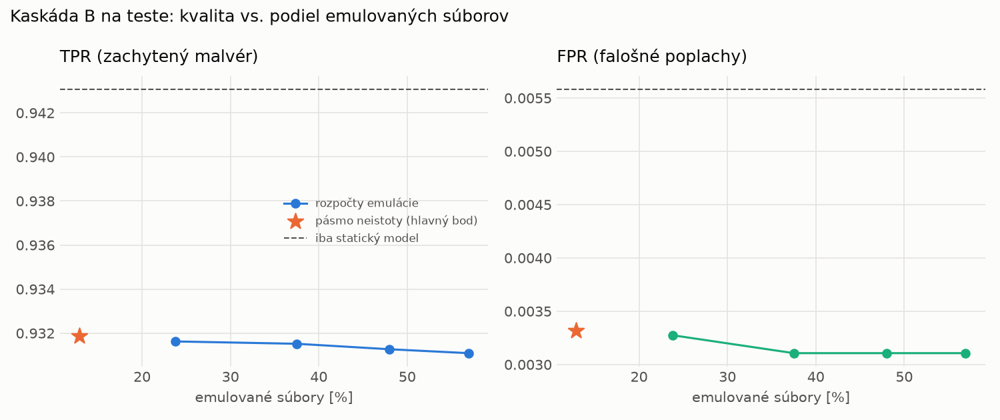

# Kaskáda B `b_heavy` – beh `20261103-232659`

> Generované `src/cascade/evaluate_b.py` (2026-11-03T23:26:59+01:00). Seedy: [0, 1, 2]; hodnoty = priemer ± sm. odchýlka.
> Všetky prahy a pásmo neistoty sú z validácie; test sa na nič nenastavuje. Postup: `docs/09_plan_v2.md`.

| rola | beh |
|---|---|
| static | `runs_v2/lofo/backdoor/students_static/mlp_kd/20261103-232226` |
| dynamic | `runs_v2/lofo/backdoor/students_dynamic/mlp_kd/20261103-232431` |
| hybrid | `runs_v2/lofo/backdoor/hybrid/two_branch/20261103-220724` |

Druhý stupeň: **dynamic**. Pásmo neistoty statického modelu: FPR ≤ 0.1% nad `hi`,
najviac 1% malvéru validácie pod `lo` (seed 0: lo = 0.5265, hi = 0.9991, seed 1: lo = 0.5957, hi = 0.9987, seed 2: lo = 0.6238, hi = 0.9986).

## Test
| prístup | accuracy | balanced_accuracy | precision | recall_tpr | fpr | f1 | mcc |
|---|---|---|---|---|---|---|---|
| kaskáda B | 0.9616 ± 0.0046 | 0.9643 ± 0.0043 | 0.9970 ± 0.0001 | 0.9319 ± 0.0085 | 0.0033 ± 0.0001 | 0.9633 ± 0.0046 | 0.9254 ± 0.0086 |
| statický | 0.9666 ± 0.0018 | 0.9687 ± 0.0016 | 0.9950 ± 0.0002 | 0.9431 ± 0.0032 | 0.0056 ± 0.0003 | 0.9684 ± 0.0017 | 0.9345 ± 0.0034 |
| dynamický | 0.6921 ± 0.0107 | 0.7149 ± 0.0099 | 0.9743 ± 0.0022 | 0.4436 ± 0.0193 | 0.0138 ± 0.0006 | 0.6095 ± 0.0188 | 0.4967 ± 0.0160 |
| hybrid (každá vzorka) | 0.9769 ± 0.0037 | 0.9782 ± 0.0034 | 0.9949 ± 0.0009 | 0.9624 ± 0.0076 | 0.0059 ± 0.0011 | 0.9783 ± 0.0036 | 0.9543 ± 0.0072 |

- **emulované súbory: 12.90%** (ostatné rozhodne iba statický model); na hybrid ide 8.71% súborov
- chyby pri istom rozhodnutí statického modelu (seed 0): 424
- validácia: emulované 4.01%, na hybrid 1.89%

## Validácia
| prístup | accuracy | balanced_accuracy | precision | recall_tpr | fpr | f1 | mcc |
|---|---|---|---|---|---|---|---|
| kaskáda B | 0.9906 ± 0.0003 | 0.9913 ± 0.0003 | 0.9966 ± 0.0003 | 0.9880 ± 0.0004 | 0.0053 ± 0.0004 | 0.9923 ± 0.0003 | 0.9802 ± 0.0007 |
| statický | 0.9890 ± 0.0002 | 0.9892 ± 0.0002 | 0.9939 ± 0.0001 | 0.9881 ± 0.0005 | 0.0097 ± 0.0002 | 0.9910 ± 0.0002 | 0.9768 ± 0.0005 |
| dynamický | 0.9547 ± 0.0021 | 0.9613 ± 0.0017 | 0.9935 ± 0.0001 | 0.9324 ± 0.0036 | 0.0097 ± 0.0002 | 0.9620 ± 0.0019 | 0.9091 ± 0.0040 |
| hybrid (každá vzorka) | 0.9939 ± 0.0003 | 0.9933 ± 0.0003 | 0.9943 ± 0.0005 | 0.9958 ± 0.0007 | 0.0091 ± 0.0009 | 0.9950 ± 0.0003 | 0.9871 ± 0.0007 |

## Januárové vzorky vynechanej rodiny (iba malvér → TPR)
| prístup | TPR |
|---|---|
| kaskáda B | 0.9200 ± 0.0089 |
| statický | 0.9396 ± 0.0114 |
| dynamický | 0.5846 ± 0.0123 |
| hybrid (každá vzorka) | 0.9224 ± 0.0174 |

Podiel emulovaných: 35.12%

## Krivka rozpočtu emulácie (test, priemer cez seedy)
| budget_val | emulation_rate | hybrid_rate | recall_tpr | fpr | f1 |
|---|---|---|---|---|---|
| 0.1000 | 0.2380 | 0.1250 | 0.9316 | 0.0033 | 0.9632 |
| 0.2000 | 0.3751 | 0.1729 | 0.9315 | 0.0031 | 0.9632 |
| 0.3000 | 0.4801 | 0.2137 | 0.9313 | 0.0031 | 0.9631 |
| 0.4000 | 0.5694 | 0.2655 | 0.9311 | 0.0031 | 0.9630 |

## Výpočtové nároky
Emulácia (Speakeasy) sa nedá zmerať (dataset neobsahuje PE súbory). **Predpoklad** 60 s na súbor
(limit z `speakeasy-config.json`): kaskáda B ≈ 7.7 s na súbor v priemere, dynamický/hybridný model
a kaskáda A 60 s (emulujú každý súbor).

_Chýba benchmark niektorého komponentu (v zero-day behoch sa nemeria)._

