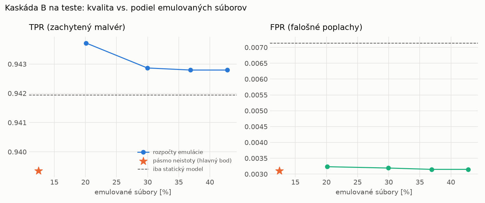

# Kaskáda B `b_nokd` – beh `20261103-232703`

> Generované `src/cascade/evaluate_b.py` (2026-11-03T23:27:03+01:00). Seedy: [0, 1, 2]; hodnoty = priemer ± sm. odchýlka.
> Všetky prahy a pásmo neistoty sú z validácie; test sa na nič nenastavuje. Postup: `docs/09_plan_v2.md`.

| rola | beh |
|---|---|
| static | `runs_v2/lofo/backdoor/students_static/mlp_nokd/20261103-232309` |
| dynamic | `runs_v2/lofo/backdoor/students_dynamic/mlp_nokd/20261103-232505` |
| hybrid | `runs_v2/lofo/backdoor/hybrid/lightgbm/20261103-220506` |

Druhý stupeň: **dynamic**. Pásmo neistoty statického modelu: FPR ≤ 0.1% nad `hi`,
najviac 1% malvéru validácie pod `lo` (seed 0: lo = 0.5534, hi = 0.9948, seed 1: lo = 0.6336, hi = 0.9703, seed 2: lo = 0.5391, hi = 0.9449).

## Test
| prístup | accuracy | balanced_accuracy | precision | recall_tpr | fpr | f1 | mcc |
|---|---|---|---|---|---|---|---|
| kaskáda B | 0.9657 ± 0.0019 | 0.9681 ± 0.0018 | 0.9972 ± 0.0005 | 0.9394 ± 0.0031 | 0.0031 ± 0.0006 | 0.9674 ± 0.0018 | 0.9331 ± 0.0036 |
| statický | 0.9653 ± 0.0025 | 0.9674 ± 0.0023 | 0.9936 ± 0.0004 | 0.9419 ± 0.0043 | 0.0071 ± 0.0004 | 0.9671 ± 0.0024 | 0.9319 ± 0.0047 |
| dynamický | 0.7064 ± 0.0045 | 0.7280 ± 0.0040 | 0.9733 ± 0.0038 | 0.4714 ± 0.0106 | 0.0154 ± 0.0026 | 0.6351 ± 0.0088 | 0.5164 ± 0.0047 |
| hybrid (každá vzorka) | 0.9893 ± 0.0014 | 0.9897 ± 0.0013 | 0.9959 ± 0.0006 | 0.9842 ± 0.0032 | 0.0047 ± 0.0008 | 0.9900 ± 0.0013 | 0.9785 ± 0.0028 |

- **emulované súbory: 12.46%** (ostatné rozhodne iba statický model); na hybrid ide 8.75% súborov
- chyby pri istom rozhodnutí statického modelu (seed 0): 492
- validácia: emulované 6.00%, na hybrid 2.19%

## Validácia
| prístup | accuracy | balanced_accuracy | precision | recall_tpr | fpr | f1 | mcc |
|---|---|---|---|---|---|---|---|
| kaskáda B | 0.9906 ± 0.0010 | 0.9915 ± 0.0009 | 0.9970 ± 0.0003 | 0.9876 ± 0.0013 | 0.0046 ± 0.0005 | 0.9923 ± 0.0008 | 0.9803 ± 0.0021 |
| statický | 0.9889 ± 0.0007 | 0.9892 ± 0.0005 | 0.9940 ± 0.0004 | 0.9879 ± 0.0014 | 0.0094 ± 0.0007 | 0.9909 ± 0.0006 | 0.9767 ± 0.0014 |
| dynamický | 0.9532 ± 0.0025 | 0.9600 ± 0.0021 | 0.9934 ± 0.0000 | 0.9299 ± 0.0041 | 0.0098 ± 0.0000 | 0.9606 ± 0.0022 | 0.9061 ± 0.0048 |
| hybrid (každá vzorka) | 0.9948 ± 0.0001 | 0.9940 ± 0.0001 | 0.9939 ± 0.0001 | 0.9977 ± 0.0000 | 0.0097 ± 0.0002 | 0.9958 ± 0.0001 | 0.9891 ± 0.0002 |

## Januárové vzorky vynechanej rodiny (iba malvér → TPR)
| prístup | TPR |
|---|---|
| kaskáda B | 0.9298 ± 0.0056 |
| statický | 0.9300 ± 0.0056 |
| dynamický | 0.5870 ± 0.0051 |
| hybrid (každá vzorka) | 0.9916 ± 0.0049 |

Podiel emulovaných: 23.27%

## Krivka rozpočtu emulácie (test, priemer cez seedy)
| budget_val | emulation_rate | hybrid_rate | recall_tpr | fpr | f1 |
|---|---|---|---|---|---|
| 0.1000 | 0.2012 | 0.1202 | 0.9437 | 0.0032 | 0.9697 |
| 0.2000 | 0.2995 | 0.1626 | 0.9429 | 0.0032 | 0.9692 |
| 0.3000 | 0.3690 | 0.1869 | 0.9428 | 0.0031 | 0.9692 |
| 0.4000 | 0.4279 | 0.2018 | 0.9428 | 0.0031 | 0.9692 |

## Výpočtové nároky
Emulácia (Speakeasy) sa nedá zmerať (dataset neobsahuje PE súbory). **Predpoklad** 60 s na súbor
(limit z `speakeasy-config.json`): kaskáda B ≈ 7.5 s na súbor v priemere, dynamický/hybridný model
a kaskáda A 60 s (emulujú každý súbor).

_Chýba benchmark niektorého komponentu (v zero-day behoch sa nemeria)._

