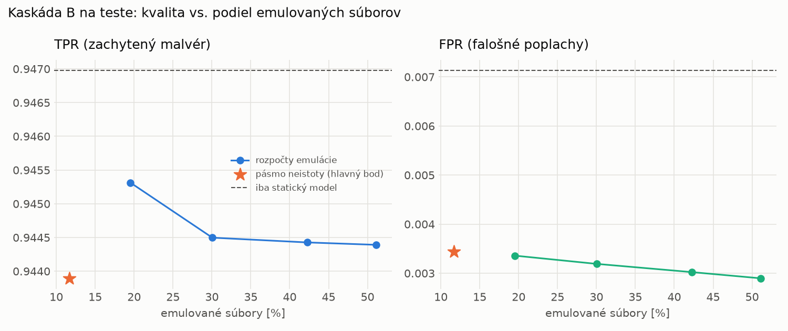

# Kaskáda B `b_twobranch` – beh `20261103-232705`

> Generované `src/cascade/evaluate_b.py` (2026-11-03T23:27:05+01:00). Seedy: [0, 1, 2]; hodnoty = priemer ± sm. odchýlka.
> Všetky prahy a pásmo neistoty sú z validácie; test sa na nič nenastavuje. Postup: `docs/09_plan_v2.md`.

| rola | beh |
|---|---|
| static | `runs_v2/lofo/backdoor/students_static/mlp_kd_twobranch/20261103-232405` |
| dynamic | `runs_v2/lofo/backdoor/students_dynamic/mlp_kd_twobranch/20261103-232603` |
| hybrid | `runs_v2/lofo/backdoor/hybrid/lightgbm/20261103-220506` |

Druhý stupeň: **dynamic**. Pásmo neistoty statického modelu: FPR ≤ 0.1% nad `hi`,
najviac 1% malvéru validácie pod `lo` (seed 0: lo = 0.5475, hi = 0.9977, seed 1: lo = 0.5390, hi = 0.9949, seed 2: lo = 0.5599, hi = 0.9960).

## Test
| prístup | accuracy | balanced_accuracy | precision | recall_tpr | fpr | f1 | mcc |
|---|---|---|---|---|---|---|---|
| kaskáda B | 0.9680 ± 0.0096 | 0.9702 ± 0.0088 | 0.9969 ± 0.0001 | 0.9439 ± 0.0177 | 0.0034 ± 0.0001 | 0.9696 ± 0.0093 | 0.9376 ± 0.0182 |
| statický | 0.9680 ± 0.0115 | 0.9699 ± 0.0105 | 0.9937 ± 0.0012 | 0.9470 ± 0.0223 | 0.0071 ± 0.0015 | 0.9697 ± 0.0111 | 0.9372 ± 0.0219 |
| dynamický | 0.7015 ± 0.0024 | 0.7236 ± 0.0023 | 0.9763 ± 0.0019 | 0.4605 ± 0.0037 | 0.0132 ± 0.0010 | 0.6258 ± 0.0038 | 0.5108 ± 0.0041 |
| hybrid (každá vzorka) | 0.9893 ± 0.0014 | 0.9897 ± 0.0013 | 0.9959 ± 0.0006 | 0.9842 ± 0.0032 | 0.0047 ± 0.0008 | 0.9900 ± 0.0013 | 0.9785 ± 0.0028 |

- **emulované súbory: 11.71%** (ostatné rozhodne iba statický model); na hybrid ide 8.29% súborov
- chyby pri istom rozhodnutí statického modelu (seed 0): 273
- validácia: emulované 5.04%, na hybrid 2.15%

## Validácia
| prístup | accuracy | balanced_accuracy | precision | recall_tpr | fpr | f1 | mcc |
|---|---|---|---|---|---|---|---|
| kaskáda B | 0.9899 ± 0.0018 | 0.9908 ± 0.0015 | 0.9966 ± 0.0003 | 0.9869 ± 0.0028 | 0.0053 ± 0.0004 | 0.9917 ± 0.0015 | 0.9789 ± 0.0038 |
| statický | 0.9891 ± 0.0031 | 0.9893 ± 0.0025 | 0.9939 ± 0.0003 | 0.9882 ± 0.0051 | 0.0096 ± 0.0005 | 0.9911 ± 0.0025 | 0.9771 ± 0.0064 |
| dynamický | 0.9539 ± 0.0018 | 0.9606 ± 0.0015 | 0.9935 ± 0.0002 | 0.9310 ± 0.0028 | 0.0097 ± 0.0002 | 0.9612 ± 0.0016 | 0.9075 ± 0.0035 |
| hybrid (každá vzorka) | 0.9948 ± 0.0001 | 0.9940 ± 0.0001 | 0.9939 ± 0.0001 | 0.9977 ± 0.0000 | 0.0097 ± 0.0002 | 0.9958 ± 0.0001 | 0.9891 ± 0.0002 |

## Januárové vzorky vynechanej rodiny (iba malvér → TPR)
| prístup | TPR |
|---|---|
| kaskáda B | 0.9355 ± 0.0134 |
| statický | 0.9333 ± 0.0165 |
| dynamický | 0.5829 ± 0.0004 |
| hybrid (každá vzorka) | 0.9916 ± 0.0049 |

Podiel emulovaných: 19.62%

## Krivka rozpočtu emulácie (test, priemer cez seedy)
| budget_val | emulation_rate | hybrid_rate | recall_tpr | fpr | f1 |
|---|---|---|---|---|---|
| 0.1000 | 0.1952 | 0.1148 | 0.9453 | 0.0034 | 0.9704 |
| 0.2000 | 0.3005 | 0.1640 | 0.9445 | 0.0032 | 0.9700 |
| 0.3000 | 0.4229 | 0.2080 | 0.9444 | 0.0030 | 0.9701 |
| 0.4000 | 0.5113 | 0.2466 | 0.9444 | 0.0029 | 0.9701 |

## Výpočtové nároky
Emulácia (Speakeasy) sa nedá zmerať (dataset neobsahuje PE súbory). **Predpoklad** 60 s na súbor
(limit z `speakeasy-config.json`): kaskáda B ≈ 7.0 s na súbor v priemere, dynamický/hybridný model
a kaskáda A 60 s (emulujú každý súbor).

_Chýba benchmark niektorého komponentu (v zero-day behoch sa nemeria)._

