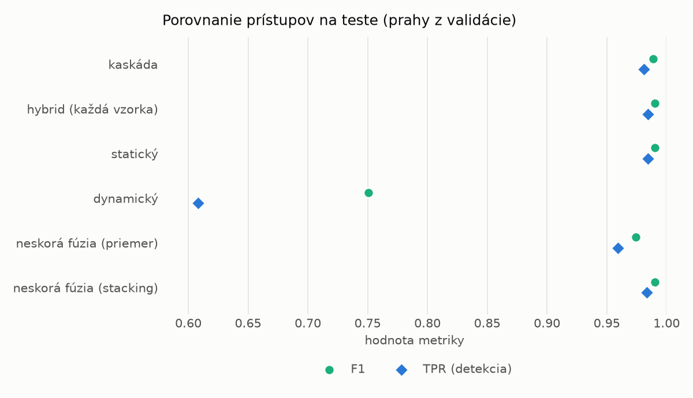
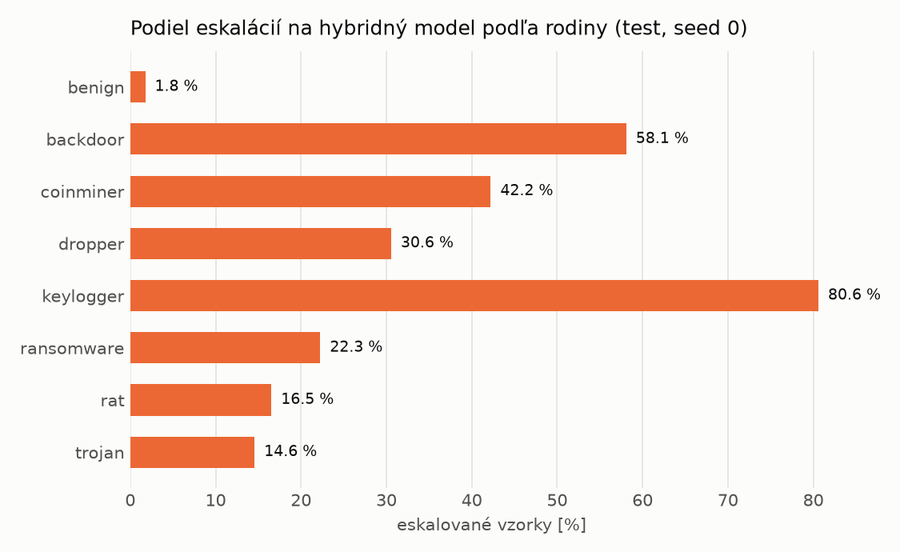

# Kaskáda `baselines` – beh `20261103-232651`

> Generované `src/cascade/evaluate.py` (2026-11-03T23:26:51+01:00). Seedy: [0, 1, 2]; hodnoty = priemer ± sm. odchýlka.
> Všetky prahy sú určené na validácii (FPR ≤ 1 %); test sa na nič nenastavuje.

| rola | beh |
|---|---|
| static | `runs_v2/lofo/backdoor/static/lightgbm/20261103-211252` |
| dynamic | `runs_v2/lofo/backdoor/dynamic/lightgbm/20261103-212927` |
| hybrid | `runs_v2/lofo/backdoor/hybrid/lightgbm/20261103-220506` |

## Test
| prístup | accuracy | balanced_accuracy | precision | recall_tpr | fpr | f1 | mcc |
|---|---|---|---|---|---|---|---|
| kaskáda | 0.9879 ± 0.0003 | 0.9886 ± 0.0003 | 0.9965 ± 0.0005 | 0.9811 ± 0.0011 | 0.0040 ± 0.0006 | 0.9888 ± 0.0003 | 0.9759 ± 0.0006 |
| hybrid (každá vzorka) | 0.9893 ± 0.0014 | 0.9897 ± 0.0013 | 0.9959 ± 0.0006 | 0.9842 ± 0.0032 | 0.0047 ± 0.0008 | 0.9900 ± 0.0013 | 0.9785 ± 0.0028 |
| statický | 0.9893 ± 0.0001 | 0.9898 ± 0.0001 | 0.9957 ± 0.0002 | 0.9846 ± 0.0003 | 0.0050 ± 0.0002 | 0.9901 ± 0.0001 | 0.9786 ± 0.0001 |
| dynamický | 0.7810 ± 0.0014 | 0.7968 ± 0.0013 | 0.9802 ± 0.0009 | 0.6083 ± 0.0028 | 0.0146 ± 0.0007 | 0.7507 ± 0.0020 | 0.6260 ± 0.0021 |
| neskorá fúzia (priemer) | 0.9726 ± 0.0008 | 0.9738 ± 0.0007 | 0.9896 ± 0.0010 | 0.9594 ± 0.0022 | 0.0119 ± 0.0012 | 0.9743 ± 0.0008 | 0.9454 ± 0.0015 |
| neskorá fúzia (stacking) | 0.9893 ± 0.0011 | 0.9898 ± 0.0010 | 0.9968 ± 0.0003 | 0.9833 ± 0.0024 | 0.0037 ± 0.0004 | 0.9900 ± 0.0011 | 0.9785 ± 0.0022 |

## Validácia
| prístup | accuracy | balanced_accuracy | precision | recall_tpr | fpr | f1 | mcc |
|---|---|---|---|---|---|---|---|
| kaskáda | 0.9955 ± 0.0002 | 0.9948 ± 0.0003 | 0.9950 ± 0.0004 | 0.9976 ± 0.0001 | 0.0079 ± 0.0006 | 0.9963 ± 0.0001 | 0.9904 ± 0.0004 |
| hybrid (každá vzorka) | 0.9948 ± 0.0001 | 0.9940 ± 0.0001 | 0.9939 ± 0.0001 | 0.9977 ± 0.0000 | 0.0097 ± 0.0002 | 0.9958 ± 0.0001 | 0.9891 ± 0.0002 |
| statický | 0.9956 ± 0.0002 | 0.9947 ± 0.0002 | 0.9944 ± 0.0003 | 0.9985 ± 0.0000 | 0.0090 ± 0.0004 | 0.9964 ± 0.0001 | 0.9907 ± 0.0003 |
| dynamický | 0.9649 ± 0.0019 | 0.9696 ± 0.0015 | 0.9936 ± 0.0001 | 0.9489 ± 0.0033 | 0.0097 ± 0.0002 | 0.9707 ± 0.0017 | 0.9284 ± 0.0037 |
| neskorá fúzia (priemer) | 0.9940 ± 0.0001 | 0.9934 ± 0.0001 | 0.9940 ± 0.0001 | 0.9963 ± 0.0001 | 0.0096 ± 0.0002 | 0.9951 ± 0.0001 | 0.9874 ± 0.0002 |
| neskorá fúzia (stacking) | 0.9956 ± 0.0002 | 0.9948 ± 0.0002 | 0.9946 ± 0.0003 | 0.9982 ± 0.0000 | 0.0086 ± 0.0004 | 0.9964 ± 0.0001 | 0.9907 ± 0.0003 |

## Správanie kaskády (test, seed 0)
- podiel eskalácií na hybrid: **21.54%** (3735 vzoriek)
- chyby pri zhode študentov (kaskáda ich nemôže opraviť): **126**
  (0.926% zo zhôd; FP 6, FN 120)
- úspešnosť na eskalovaných vzorkách: hybrid 0.9793842034805891, statický 0.984471218206158,
  dynamický 0.015528781793842034  → prínos hybridu pri nezhode

## Výpočtové nároky (odhad z benchmarkov komponentov)
_Chýba benchmark niektorého komponentu (`python -m src.evaluation.benchmark`)._

