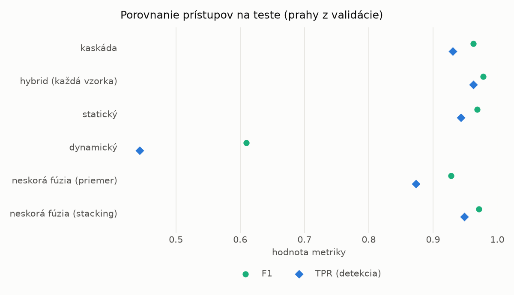
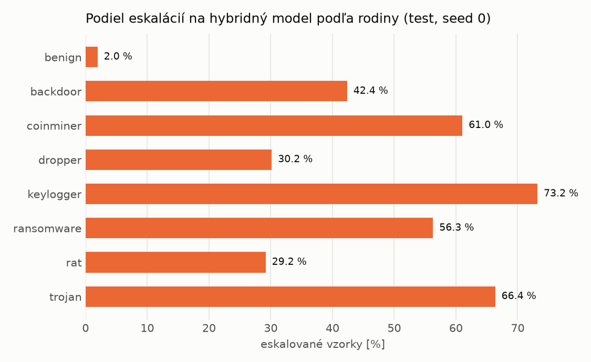

# Kaskáda `heavy` – beh `20261103-232649`

> Generované `src/cascade/evaluate.py` (2026-11-03T23:26:49+01:00). Seedy: [0, 1, 2]; hodnoty = priemer ± sm. odchýlka.
> Všetky prahy sú určené na validácii (FPR ≤ 1 %); test sa na nič nenastavuje.

| rola | beh |
|---|---|
| static | `runs_v2/lofo/backdoor/students_static/mlp_kd/20261103-232226` |
| dynamic | `runs_v2/lofo/backdoor/students_dynamic/mlp_kd/20261103-232431` |
| hybrid | `runs_v2/lofo/backdoor/hybrid/two_branch/20261103-220724` |

## Test
| prístup | accuracy | balanced_accuracy | precision | recall_tpr | fpr | f1 | mcc |
|---|---|---|---|---|---|---|---|
| kaskáda | 0.9610 ± 0.0028 | 0.9638 ± 0.0026 | 0.9974 ± 0.0001 | 0.9306 ± 0.0052 | 0.0029 ± 0.0001 | 0.9628 ± 0.0028 | 0.9244 ± 0.0052 |
| hybrid (každá vzorka) | 0.9769 ± 0.0037 | 0.9782 ± 0.0034 | 0.9949 ± 0.0009 | 0.9624 ± 0.0076 | 0.0059 ± 0.0011 | 0.9783 ± 0.0036 | 0.9543 ± 0.0072 |
| statický | 0.9666 ± 0.0018 | 0.9687 ± 0.0016 | 0.9950 ± 0.0002 | 0.9431 ± 0.0032 | 0.0056 ± 0.0003 | 0.9684 ± 0.0017 | 0.9345 ± 0.0034 |
| dynamický | 0.6921 ± 0.0107 | 0.7149 ± 0.0099 | 0.9743 ± 0.0022 | 0.4436 ± 0.0193 | 0.0138 ± 0.0006 | 0.6095 ± 0.0188 | 0.4967 ± 0.0160 |
| neskorá fúzia (priemer) | 0.9286 ± 0.0492 | 0.9337 ± 0.0451 | 0.9942 ± 0.0035 | 0.8735 ± 0.0932 | 0.0062 ± 0.0043 | 0.9281 ± 0.0533 | 0.8680 ± 0.0841 |
| neskorá fúzia (stacking) | 0.9699 ± 0.0035 | 0.9718 ± 0.0032 | 0.9954 ± 0.0004 | 0.9489 ± 0.0067 | 0.0052 ± 0.0005 | 0.9716 ± 0.0034 | 0.9409 ± 0.0067 |

## Validácia
| prístup | accuracy | balanced_accuracy | precision | recall_tpr | fpr | f1 | mcc |
|---|---|---|---|---|---|---|---|
| kaskáda | 0.9905 ± 0.0002 | 0.9911 ± 0.0002 | 0.9960 ± 0.0004 | 0.9885 ± 0.0001 | 0.0063 ± 0.0006 | 0.9922 ± 0.0001 | 0.9801 ± 0.0003 |
| hybrid (každá vzorka) | 0.9939 ± 0.0003 | 0.9933 ± 0.0003 | 0.9943 ± 0.0005 | 0.9958 ± 0.0007 | 0.0091 ± 0.0009 | 0.9950 ± 0.0003 | 0.9871 ± 0.0007 |
| statický | 0.9890 ± 0.0002 | 0.9892 ± 0.0002 | 0.9939 ± 0.0001 | 0.9881 ± 0.0005 | 0.0097 ± 0.0002 | 0.9910 ± 0.0002 | 0.9768 ± 0.0005 |
| dynamický | 0.9547 ± 0.0021 | 0.9613 ± 0.0017 | 0.9935 ± 0.0001 | 0.9324 ± 0.0036 | 0.0097 ± 0.0002 | 0.9620 ± 0.0019 | 0.9091 ± 0.0040 |
| neskorá fúzia (priemer) | 0.9916 ± 0.0007 | 0.9914 ± 0.0007 | 0.9941 ± 0.0004 | 0.9922 ± 0.0008 | 0.0093 ± 0.0006 | 0.9932 ± 0.0006 | 0.9823 ± 0.0015 |
| neskorá fúzia (stacking) | 0.9919 ± 0.0003 | 0.9916 ± 0.0002 | 0.9938 ± 0.0000 | 0.9930 ± 0.0004 | 0.0098 ± 0.0000 | 0.9934 ± 0.0002 | 0.9830 ± 0.0006 |

## Správanie kaskády (test, seed 0)
- podiel eskalácií na hybrid: **29.61%** (5134 vzoriek)
- chyby pri zhode študentov (kaskáda ich nemôže opraviť): **492**
  (4.031% zo zhôd; FP 3, FN 489)
- úspešnosť na eskalovaných vzorkách: hybrid 0.9727308141799766, statický 0.9850019477989872,
  dynamický 0.014998052201012855  → prínos hybridu pri nezhode

## Výpočtové nároky (odhad z benchmarkov komponentov)
_Chýba benchmark niektorého komponentu (`python -m src.evaluation.benchmark`)._

