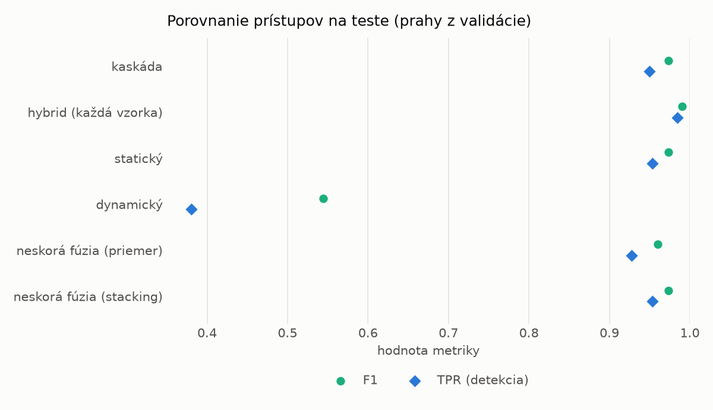
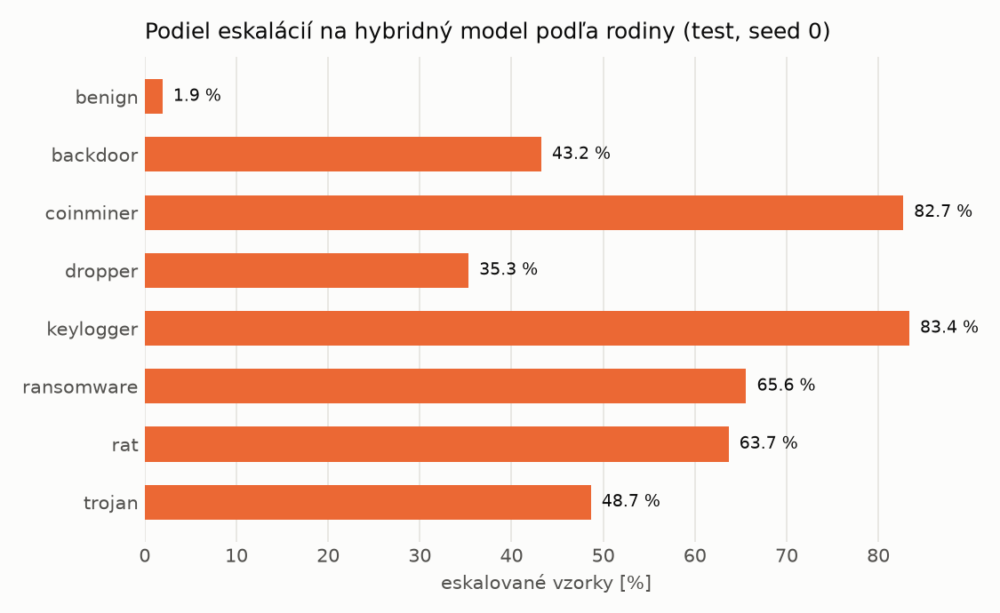

# Kaskáda `modal` – beh `20261103-232647`

> Generované `src/cascade/evaluate.py` (2026-11-03T23:26:47+01:00). Seedy: [0, 1, 2]; hodnoty = priemer ± sm. odchýlka.
> Všetky prahy sú určené na validácii (FPR ≤ 1 %); test sa na nič nenastavuje.

| rola | beh |
|---|---|
| static | `runs_v2/lofo/backdoor/students_static/mlp_kd_modal/20261103-232325` |
| dynamic | `runs_v2/lofo/backdoor/students_dynamic/mlp_kd_modal/20261103-232528` |
| hybrid | `runs_v2/lofo/backdoor/hybrid/lightgbm/20261103-220506` |

## Test
| prístup | accuracy | balanced_accuracy | precision | recall_tpr | fpr | f1 | mcc |
|---|---|---|---|---|---|---|---|
| kaskáda | 0.9717 ± 0.0033 | 0.9738 ± 0.0031 | 0.9980 ± 0.0006 | 0.9498 ± 0.0066 | 0.0023 ± 0.0007 | 0.9733 ± 0.0033 | 0.9447 ± 0.0063 |
| hybrid (každá vzorka) | 0.9893 ± 0.0014 | 0.9897 ± 0.0013 | 0.9959 ± 0.0006 | 0.9842 ± 0.0032 | 0.0047 ± 0.0008 | 0.9900 ± 0.0013 | 0.9785 ± 0.0028 |
| statický | 0.9717 ± 0.0037 | 0.9734 ± 0.0034 | 0.9945 ± 0.0006 | 0.9531 ± 0.0073 | 0.0063 ± 0.0008 | 0.9733 ± 0.0036 | 0.9442 ± 0.0070 |
| dynamický | 0.6580 ± 0.0345 | 0.6835 ± 0.0319 | 0.9713 ± 0.0046 | 0.3801 ± 0.0636 | 0.0131 ± 0.0005 | 0.5445 ± 0.0651 | 0.4471 ± 0.0509 |
| neskorá fúzia (priemer) | 0.9584 ± 0.0116 | 0.9613 ± 0.0106 | 0.9955 ± 0.0018 | 0.9276 ± 0.0229 | 0.0050 ± 0.0021 | 0.9602 ± 0.0117 | 0.9195 ± 0.0212 |
| neskorá fúzia (stacking) | 0.9722 ± 0.0033 | 0.9739 ± 0.0030 | 0.9951 ± 0.0008 | 0.9534 ± 0.0069 | 0.0055 ± 0.0010 | 0.9738 ± 0.0032 | 0.9452 ± 0.0062 |

## Validácia
| prístup | accuracy | balanced_accuracy | precision | recall_tpr | fpr | f1 | mcc |
|---|---|---|---|---|---|---|---|
| kaskáda | 0.9926 ± 0.0011 | 0.9931 ± 0.0006 | 0.9969 ± 0.0009 | 0.9911 ± 0.0026 | 0.0049 ± 0.0015 | 0.9940 ± 0.0009 | 0.9845 ± 0.0022 |
| hybrid (každá vzorka) | 0.9948 ± 0.0001 | 0.9940 ± 0.0001 | 0.9939 ± 0.0001 | 0.9977 ± 0.0000 | 0.0097 ± 0.0002 | 0.9958 ± 0.0001 | 0.9891 ± 0.0002 |
| statický | 0.9904 ± 0.0015 | 0.9904 ± 0.0011 | 0.9940 ± 0.0002 | 0.9903 ± 0.0027 | 0.0094 ± 0.0004 | 0.9922 ± 0.0012 | 0.9798 ± 0.0031 |
| dynamický | 0.9517 ± 0.0009 | 0.9588 ± 0.0007 | 0.9934 ± 0.0000 | 0.9275 ± 0.0015 | 0.0098 ± 0.0000 | 0.9593 ± 0.0008 | 0.9033 ± 0.0017 |
| neskorá fúzia (priemer) | 0.9930 ± 0.0002 | 0.9925 ± 0.0001 | 0.9941 ± 0.0000 | 0.9945 ± 0.0003 | 0.0094 ± 0.0000 | 0.9943 ± 0.0001 | 0.9852 ± 0.0004 |
| neskorá fúzia (stacking) | 0.9926 ± 0.0013 | 0.9922 ± 0.0010 | 0.9939 ± 0.0001 | 0.9941 ± 0.0022 | 0.0097 ± 0.0002 | 0.9940 ± 0.0010 | 0.9844 ± 0.0027 |

## Správanie kaskády (test, seed 0)
- podiel eskalácií na hybrid: **35.04%** (6075 vzoriek)
- chyby pri zhode študentov (kaskáda ich nemôže opraviť): **363**
  (3.223% zo zhôd; FP 2, FN 361)
- úspešnosť na eskalovaných vzorkách: hybrid 0.9893004115226337, statický 0.98880658436214,
  dynamický 0.011193415637860082  → prínos hybridu pri nezhode

## Výpočtové nároky (odhad z benchmarkov komponentov)
_Chýba benchmark niektorého komponentu (`python -m src.evaluation.benchmark`)._

