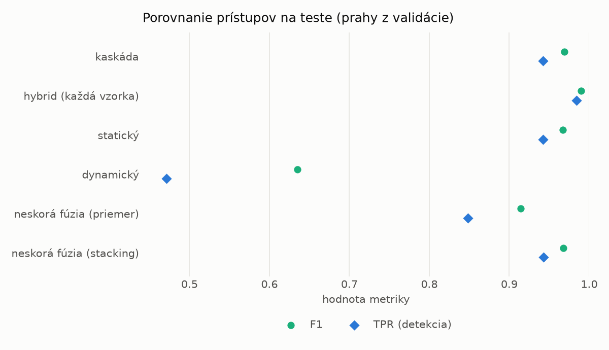
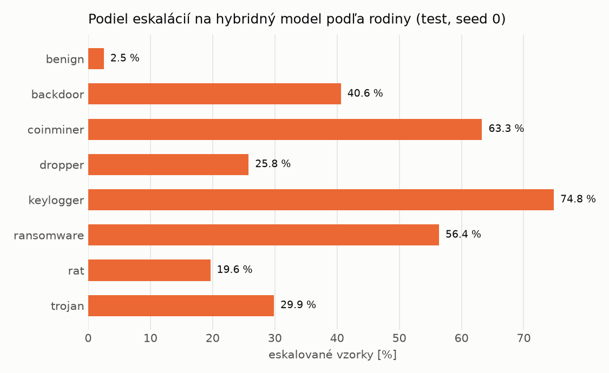

# Kaskáda `nokd` – beh `20261103-232644`

> Generované `src/cascade/evaluate.py` (2026-11-03T23:26:45+01:00). Seedy: [0, 1, 2]; hodnoty = priemer ± sm. odchýlka.
> Všetky prahy sú určené na validácii (FPR ≤ 1 %); test sa na nič nenastavuje.

| rola | beh |
|---|---|
| static | `runs_v2/lofo/backdoor/students_static/mlp_nokd/20261103-232309` |
| dynamic | `runs_v2/lofo/backdoor/students_dynamic/mlp_nokd/20261103-232505` |
| hybrid | `runs_v2/lofo/backdoor/hybrid/lightgbm/20261103-220506` |

## Test
| prístup | accuracy | balanced_accuracy | precision | recall_tpr | fpr | f1 | mcc |
|---|---|---|---|---|---|---|---|
| kaskáda | 0.9675 ± 0.0027 | 0.9698 ± 0.0025 | 0.9978 ± 0.0004 | 0.9421 ± 0.0049 | 0.0024 ± 0.0004 | 0.9691 ± 0.0027 | 0.9366 ± 0.0051 |
| hybrid (každá vzorka) | 0.9893 ± 0.0014 | 0.9897 ± 0.0013 | 0.9959 ± 0.0006 | 0.9842 ± 0.0032 | 0.0047 ± 0.0008 | 0.9900 ± 0.0013 | 0.9785 ± 0.0028 |
| statický | 0.9653 ± 0.0025 | 0.9674 ± 0.0023 | 0.9936 ± 0.0004 | 0.9419 ± 0.0043 | 0.0071 ± 0.0004 | 0.9671 ± 0.0024 | 0.9319 ± 0.0047 |
| dynamický | 0.7064 ± 0.0045 | 0.7280 ± 0.0040 | 0.9733 ± 0.0038 | 0.4714 ± 0.0106 | 0.0154 ± 0.0026 | 0.6351 ± 0.0088 | 0.5164 ± 0.0047 |
| neskorá fúzia (priemer) | 0.9151 ± 0.0355 | 0.9212 ± 0.0328 | 0.9942 ± 0.0008 | 0.8483 ± 0.0652 | 0.0058 ± 0.0004 | 0.9146 ± 0.0376 | 0.8431 ± 0.0623 |
| neskorá fúzia (stacking) | 0.9659 ± 0.0033 | 0.9680 ± 0.0029 | 0.9937 ± 0.0019 | 0.9431 ± 0.0078 | 0.0071 ± 0.0023 | 0.9677 ± 0.0033 | 0.9331 ± 0.0060 |

## Validácia
| prístup | accuracy | balanced_accuracy | precision | recall_tpr | fpr | f1 | mcc |
|---|---|---|---|---|---|---|---|
| kaskáda | 0.9916 ± 0.0003 | 0.9922 ± 0.0003 | 0.9967 ± 0.0002 | 0.9896 ± 0.0004 | 0.0052 ± 0.0002 | 0.9931 ± 0.0003 | 0.9824 ± 0.0007 |
| hybrid (každá vzorka) | 0.9948 ± 0.0001 | 0.9940 ± 0.0001 | 0.9939 ± 0.0001 | 0.9977 ± 0.0000 | 0.0097 ± 0.0002 | 0.9958 ± 0.0001 | 0.9891 ± 0.0002 |
| statický | 0.9889 ± 0.0007 | 0.9892 ± 0.0005 | 0.9940 ± 0.0004 | 0.9879 ± 0.0014 | 0.0094 ± 0.0007 | 0.9909 ± 0.0006 | 0.9767 ± 0.0014 |
| dynamický | 0.9532 ± 0.0025 | 0.9600 ± 0.0021 | 0.9934 ± 0.0000 | 0.9299 ± 0.0041 | 0.0098 ± 0.0000 | 0.9606 ± 0.0022 | 0.9061 ± 0.0048 |
| neskorá fúzia (priemer) | 0.9916 ± 0.0009 | 0.9914 ± 0.0007 | 0.9940 ± 0.0003 | 0.9924 ± 0.0018 | 0.0096 ± 0.0005 | 0.9932 ± 0.0008 | 0.9823 ± 0.0020 |
| neskorá fúzia (stacking) | 0.9924 ± 0.0011 | 0.9921 ± 0.0010 | 0.9941 ± 0.0003 | 0.9936 ± 0.0017 | 0.0094 ± 0.0004 | 0.9938 ± 0.0009 | 0.9840 ± 0.0024 |

## Správanie kaskády (test, seed 0)
- podiel eskalácií na hybrid: **26.96%** (4675 vzoriek)
- chyby pri zhode študentov (kaskáda ich nemôže opraviť): **439**
  (3.467% zo zhôd; FP 0, FN 439)
- úspešnosť na eskalovaných vzorkách: hybrid 0.984812834224599, statický 0.9756149732620321,
  dynamický 0.024385026737967913  → prínos hybridu pri nezhode

## Výpočtové nároky (odhad z benchmarkov komponentov)
_Chýba benchmark niektorého komponentu (`python -m src.evaluation.benchmark`)._

