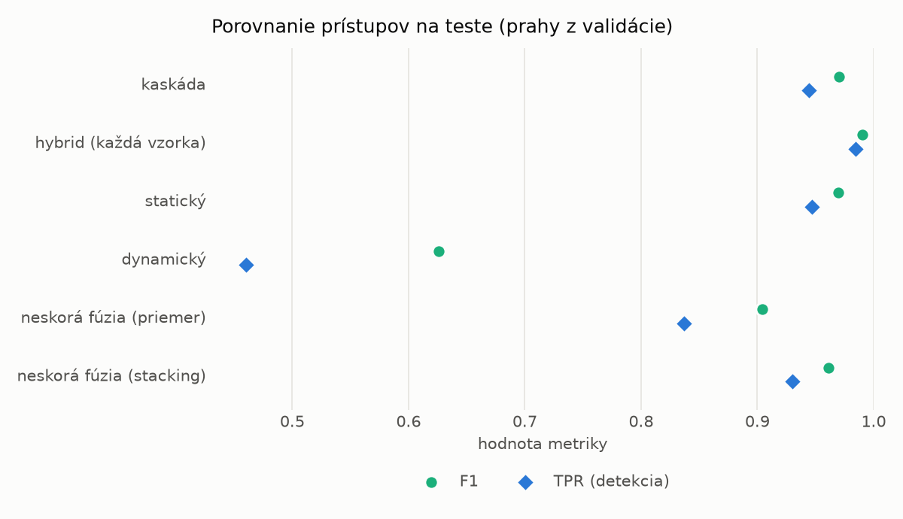
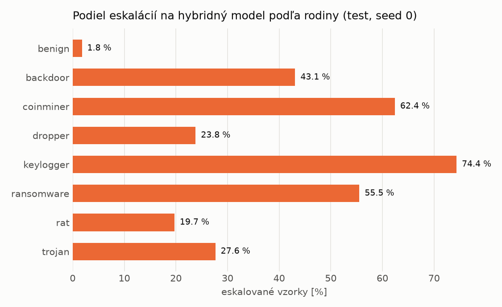

# Kaskáda `twobranch` – beh `20261103-232653`

> Generované `src/cascade/evaluate.py` (2026-11-03T23:26:53+01:00). Seedy: [0, 1, 2]; hodnoty = priemer ± sm. odchýlka.
> Všetky prahy sú určené na validácii (FPR ≤ 1 %); test sa na nič nenastavuje.

| rola | beh |
|---|---|
| static | `runs_v2/lofo/backdoor/students_static/mlp_kd_twobranch/20261103-232405` |
| dynamic | `runs_v2/lofo/backdoor/students_dynamic/mlp_kd_twobranch/20261103-232603` |
| hybrid | `runs_v2/lofo/backdoor/hybrid/lightgbm/20261103-220506` |

## Test
| prístup | accuracy | balanced_accuracy | precision | recall_tpr | fpr | f1 | mcc |
|---|---|---|---|---|---|---|---|
| kaskáda | 0.9689 ± 0.0108 | 0.9711 ± 0.0100 | 0.9981 ± 0.0003 | 0.9444 ± 0.0200 | 0.0022 ± 0.0003 | 0.9704 ± 0.0105 | 0.9393 ± 0.0206 |
| hybrid (každá vzorka) | 0.9893 ± 0.0014 | 0.9897 ± 0.0013 | 0.9959 ± 0.0006 | 0.9842 ± 0.0032 | 0.0047 ± 0.0008 | 0.9900 ± 0.0013 | 0.9785 ± 0.0028 |
| statický | 0.9680 ± 0.0115 | 0.9699 ± 0.0105 | 0.9937 ± 0.0012 | 0.9470 ± 0.0223 | 0.0071 ± 0.0015 | 0.9697 ± 0.0111 | 0.9372 ± 0.0219 |
| dynamický | 0.7015 ± 0.0024 | 0.7236 ± 0.0023 | 0.9763 ± 0.0019 | 0.4605 ± 0.0037 | 0.0132 ± 0.0010 | 0.6258 ± 0.0038 | 0.5108 ± 0.0041 |
| neskorá fúzia (priemer) | 0.9085 ± 0.0710 | 0.9150 ± 0.0652 | 0.9932 ± 0.0027 | 0.8371 ± 0.1333 | 0.0070 ± 0.0035 | 0.9044 ± 0.0815 | 0.8349 ± 0.1166 |
| neskorá fúzia (stacking) | 0.9593 ± 0.0131 | 0.9620 ± 0.0120 | 0.9942 ± 0.0014 | 0.9303 ± 0.0256 | 0.0064 ± 0.0017 | 0.9611 ± 0.0131 | 0.9210 ± 0.0241 |

## Validácia
| prístup | accuracy | balanced_accuracy | precision | recall_tpr | fpr | f1 | mcc |
|---|---|---|---|---|---|---|---|
| kaskáda | 0.9916 ± 0.0027 | 0.9921 ± 0.0021 | 0.9965 ± 0.0001 | 0.9897 ± 0.0045 | 0.0055 ± 0.0002 | 0.9931 ± 0.0022 | 0.9823 ± 0.0055 |
| hybrid (každá vzorka) | 0.9948 ± 0.0001 | 0.9940 ± 0.0001 | 0.9939 ± 0.0001 | 0.9977 ± 0.0000 | 0.0097 ± 0.0002 | 0.9958 ± 0.0001 | 0.9891 ± 0.0002 |
| statický | 0.9891 ± 0.0031 | 0.9893 ± 0.0025 | 0.9939 ± 0.0003 | 0.9882 ± 0.0051 | 0.0096 ± 0.0005 | 0.9911 ± 0.0025 | 0.9771 ± 0.0064 |
| dynamický | 0.9539 ± 0.0018 | 0.9606 ± 0.0015 | 0.9935 ± 0.0002 | 0.9310 ± 0.0028 | 0.0097 ± 0.0002 | 0.9612 ± 0.0016 | 0.9075 ± 0.0035 |
| neskorá fúzia (priemer) | 0.9900 ± 0.0030 | 0.9901 ± 0.0024 | 0.9940 ± 0.0002 | 0.9897 ± 0.0050 | 0.0094 ± 0.0004 | 0.9919 ± 0.0025 | 0.9790 ± 0.0063 |
| neskorá fúzia (stacking) | 0.9900 ± 0.0029 | 0.9902 ± 0.0023 | 0.9942 ± 0.0004 | 0.9895 ± 0.0048 | 0.0091 ± 0.0006 | 0.9919 ± 0.0024 | 0.9790 ± 0.0060 |

## Správanie kaskády (test, seed 0)
- podiel eskalácií na hybrid: **26.52%** (4599 vzoriek)
- chyby pri zhode študentov (kaskáda ich nemôže opraviť): **598**
  (4.694% zo zhôd; FP 0, FN 598)
- úspešnosť na eskalovaných vzorkách: hybrid 0.9876060013046314, statický 0.9849967384213959,
  dynamický 0.015003261578604044  → prínos hybridu pri nezhode

## Výpočtové nároky (odhad z benchmarkov komponentov)
_Chýba benchmark niektorého komponentu (`python -m src.evaluation.benchmark`)._

