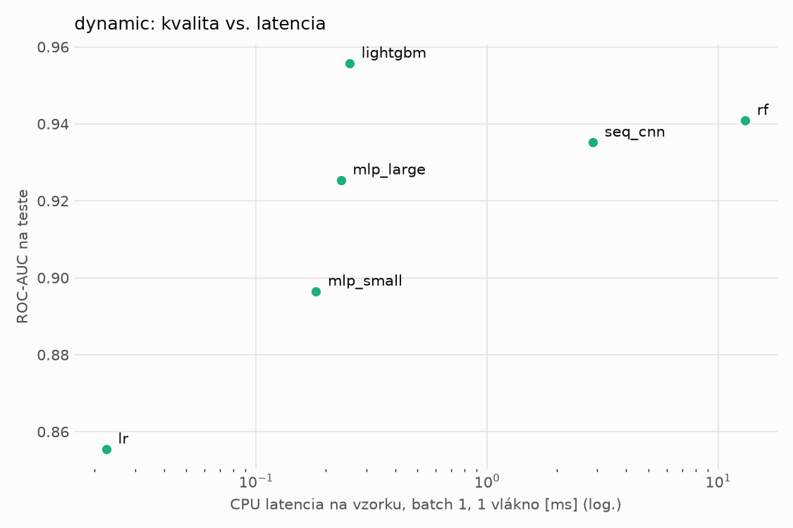
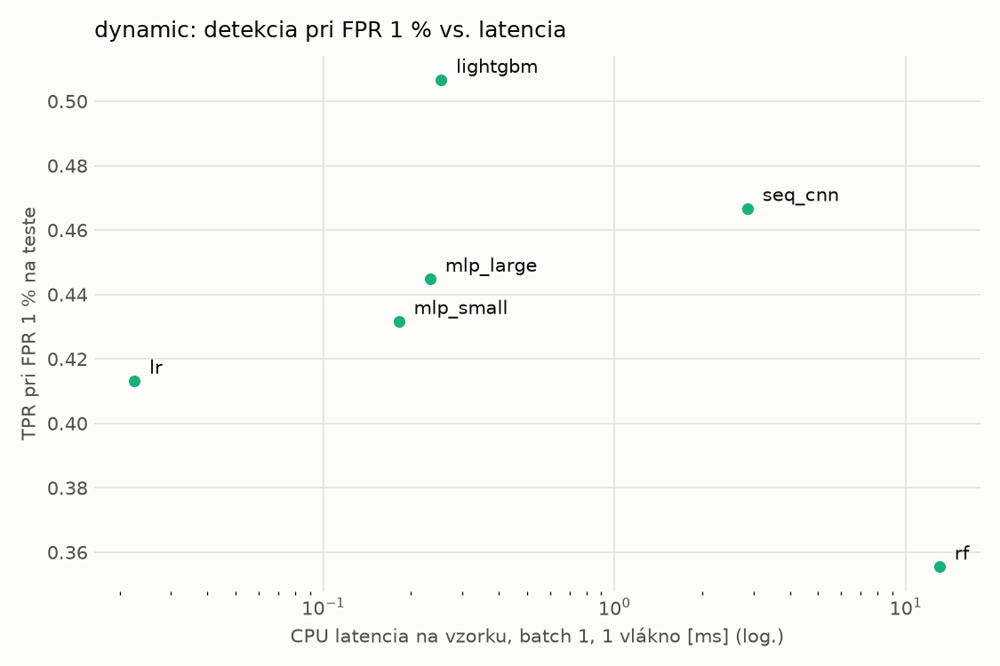
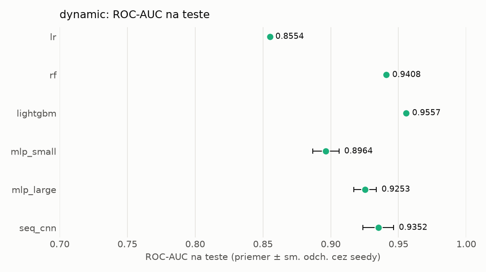
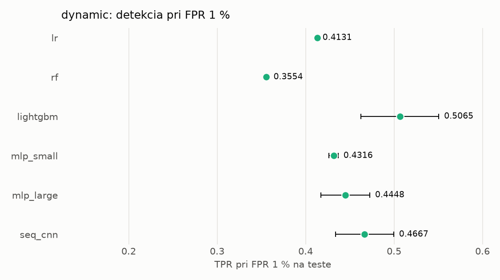

# Porovnanie modelov – dynamic

> Generované `src/evaluation/compare.py` (2026-11-03T21:57:42+01:00); použitý je posledný beh každého modelu.
> Metriky sú priemer cez seedy. \* = pri prahu určenom na validácii (FPR ≤ 1 %).
> CPU ms/vz. = medián latencie jednej vzorky na 1 vlákne vrátane transformácie vstupu (meranie hneď po tréningu,
> orientačné). Oficiálne merania spotreby sú v časti „Spotreba zdrojov pri inferencii“.

## Detekčná kvalita a orientačné časy
| model | ROC-AUC val | ROC-AUC test | TPR@FPR 1 % test | TPR@FPR 0,1 % test | F1 test* | FPR test* | gap train−val | CPU ms/vz. | CPU vz./s | GPU ms/vz. | parametre | MB | tréning s | ladenie min |
|---|---|---|---|---|---|---|---|---|---|---|---|---|---|---|
| [lr](../../dynamic/lr/20261103-212729/README.md) | 0.9935 | 0.8554 ± 0.0000 | 0.4131 | 0.1771 | 0.6042 | 0.0560 | 0.0006 | 0.023 | 335 395 | – | 2 001 | 0.06 | 3.9 | 0.0 |
| [rf](../../dynamic/rf/20261103-212748/README.md) | 0.9970 | 0.9408 ± 0.0008 | 0.3554 | 0.0000 | 0.5837 | 0.0183 | 0.0009 | 13.083 | 89 027 | – | 987 510 | 79.41 | 29.5 | 0.0 |
| [lightgbm](../../dynamic/lightgbm/20261103-212927/README.md) | 0.9970 | 0.9557 ± 0.0006 | 0.5065 | 0.1784 | 0.7507 | 0.0146 | 0.0009 | 0.254 | 55 147 | – | 703 034 | 39.96 | 26.8 | 0.0 |
| [mlp_small](../../dynamic/mlp_small/20261103-213112/README.md) | 0.9960 | 0.8964 ± 0.0097 | 0.4316 | 0.1592 | 0.6419 | 0.0136 | 0.0007 | 0.182 | 117 351 | 0.412 | 546 049 | 2.24 | 4.5 | 0.0 |
| [mlp_large](../../dynamic/mlp_large/20261103-213134/README.md) | 0.9959 | 0.9253 ± 0.0083 | 0.4448 | 0.2111 | 0.6558 | 0.0148 | 0.0005 | 0.233 | 101 044 | 0.530 | 1 190 657 | 4.83 | 15.5 | 0.0 |
| [seq_cnn](../../dynamic/seq_cnn/20261103-213229/README.md) | 0.9968 | 0.9352 ± 0.0113 | 0.4667 | 0.2178 | 0.6903 | 0.0130 | 0.0005 | 2.867 | 1 139 | 0.777 | 208 129 | 0.84 | 456.3 | 0.0 |

## Nízka prevalencia malvéru (test, prah z validácie)
| model | TPR | FPR | precision @ 1 % | falošné na 1 skutočný poplach @ 1 % | precision @ 0.1 % | falošné na 1 skutočný poplach @ 0.1 % |
|---|---|---|---|---|---|---|
| lr | 0.4533 | 0.0560 | 0.076 | 12.24 | 0.008 | 123.50 |
| rf | 0.4186 | 0.0183 | 0.188 | 4.33 | 0.022 | 43.68 |
| lightgbm | 0.6083 | 0.0146 | 0.297 | 2.37 | 0.040 | 23.93 |
| mlp_small | 0.4783 | 0.0136 | 0.261 | 2.82 | 0.034 | 28.50 |
| mlp_large | 0.4943 | 0.0148 | 0.252 | 2.97 | 0.032 | 29.95 |
| seq_cnn | 0.5336 | 0.0130 | 0.294 | 2.41 | 0.040 | 24.29 |

Prepočet: TPR a FPR nezávisia od podielu malvéru, preto sa dajú preniesť na nízku prevalenciu (v reálnej prevádzke je malvéru ~1 % alebo menej; v teste 54 %). „Falošné na 1 skutočný poplach“ = koľko neškodných súborov je označených na každý zachytený malvér.

## Spotreba zdrojov pri inferencii (benchmark, testovacia množina)
_Benchmark zatiaľ nebol spustený (`python -m src.evaluation.benchmark --approach dynamic`)._

## Grafy

