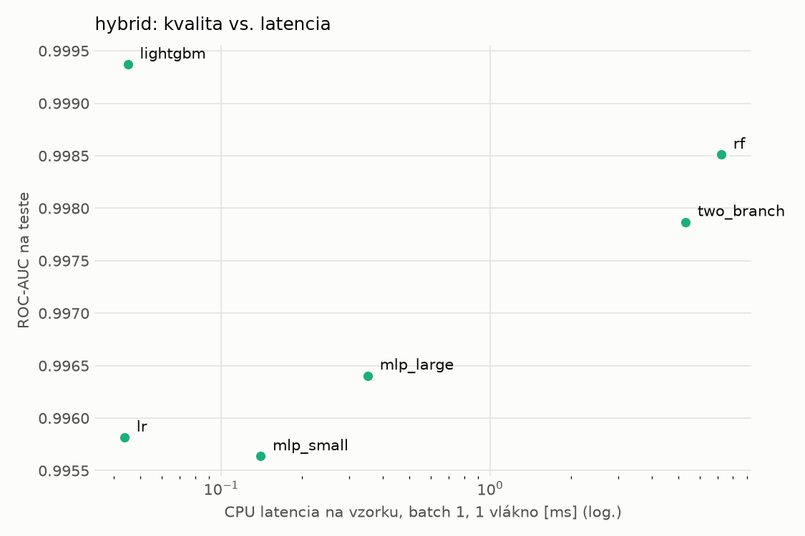
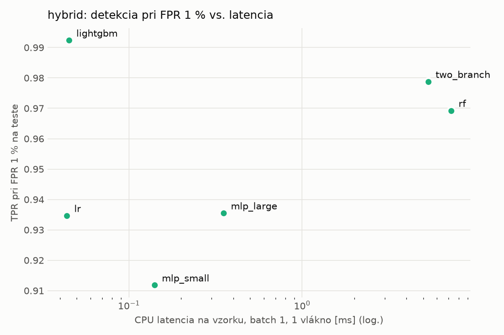
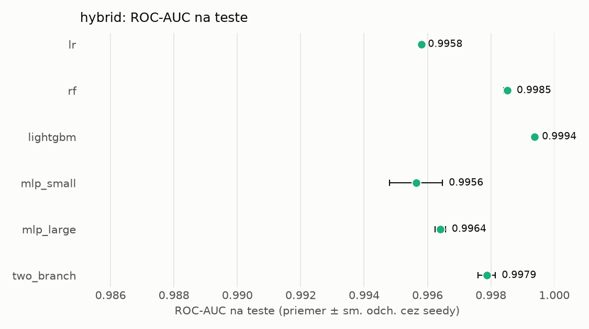
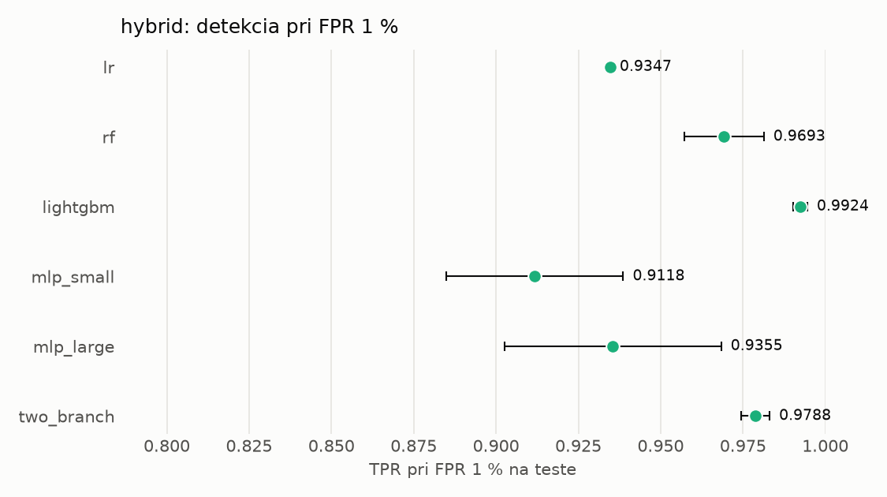

# Porovnanie modelov – hybrid

> Generované `src/evaluation/compare.py` (2026-11-03T22:29:06+01:00); použitý je posledný beh každého modelu.
> Metriky sú priemer cez seedy. \* = pri prahu určenom na validácii (FPR ≤ 1 %).
> CPU ms/vz. = medián latencie jednej vzorky na 1 vlákne vrátane transformácie vstupu (meranie hneď po tréningu,
> orientačné). Oficiálne merania spotreby sú v časti „Spotreba zdrojov pri inferencii“.

## Detekčná kvalita a orientačné časy
| model | ROC-AUC val | ROC-AUC test | TPR@FPR 1 % test | TPR@FPR 0,1 % test | F1 test* | FPR test* | gap train−val | CPU ms/vz. | CPU vz./s | GPU ms/vz. | parametre | MB | tréning s | ladenie min |
|---|---|---|---|---|---|---|---|---|---|---|---|---|---|---|
| [lr](../../hybrid/lr/20261103-215845/README.md) | 0.9990 | 0.9958 ± 0.0000 | 0.9347 | 0.6652 | 0.9485 | 0.0047 | 0.0006 | 0.044 | 155 039 | – | 4 316 | 0.13 | 4.4 | 0.0 |
| [rf](../../hybrid/rf/20261103-215918/README.md) | 0.9998 | 0.9985 ± 0.0001 | 0.9693 | 0.8147 | 0.9622 | 0.0081 | 0.0002 | 7.237 | 89 633 | – | 268 400 | 21.80 | 113.1 | 0.0 |
| [lightgbm](../../hybrid/lightgbm/20261103-220506/README.md) | 0.9999 | 0.9994 ± 0.0000 | 0.9924 | 0.9461 | 0.9900 | 0.0047 | 0.0001 | 0.045 | 296 237 | – | 32 613 | 1.81 | 17.6 | 0.0 |
| [mlp_small](../../hybrid/mlp_small/20261103-220603/README.md) | 0.9995 | 0.9956 ± 0.0008 | 0.9118 | 0.7216 | 0.9276 | 0.0072 | 0.0004 | 0.140 | 46 812 | 0.414 | 138 753 | 0.67 | 8.0 | 0.0 |
| [mlp_large](../../hybrid/mlp_large/20261103-220646/README.md) | 0.9997 | 0.9964 ± 0.0002 | 0.9355 | 0.7502 | 0.9493 | 0.0067 | 0.0002 | 0.351 | 37 861 | 0.537 | 2 384 257 | 9.66 | 6.2 | 0.0 |
| [two_branch](../../hybrid/two_branch/20261103-220724/README.md) | 0.9996 | 0.9979 ± 0.0003 | 0.9788 | 0.8540 | 0.9783 | 0.0059 | 0.0003 | 5.334 | 635 | 1.236 | 1 754 690 | 7.09 | 349.9 | 0.0 |

## Nízka prevalencia malvéru (test, prah z validácie)
| model | TPR | FPR | precision @ 1 % | falošné na 1 skutočný poplach @ 1 % | precision @ 0.1 % | falošné na 1 skutočný poplach @ 0.1 % |
|---|---|---|---|---|---|---|
| lr | 0.9055 | 0.0047 | 0.662 | 0.51 | 0.163 | 5.14 |
| rf | 0.9337 | 0.0081 | 0.539 | 0.85 | 0.104 | 8.62 |
| lightgbm | 0.9842 | 0.0047 | 0.677 | 0.48 | 0.172 | 4.82 |
| mlp_small | 0.8703 | 0.0072 | 0.549 | 0.82 | 0.108 | 8.29 |
| mlp_large | 0.9088 | 0.0067 | 0.579 | 0.73 | 0.120 | 7.34 |
| two_branch | 0.9624 | 0.0059 | 0.623 | 0.60 | 0.141 | 6.10 |

Prepočet: TPR a FPR nezávisia od podielu malvéru, preto sa dajú preniesť na nízku prevalenciu (v reálnej prevádzke je malvéru ~1 % alebo menej; v teste 54 %). „Falošné na 1 skutočný poplach“ = koľko neškodných súborov je označených na každý zachytený malvér.

## Spotreba zdrojov pri inferencii (benchmark, testovacia množina)
_Benchmark zatiaľ nebol spustený (`python -m src.evaluation.benchmark --approach hybrid`)._

## Grafy

