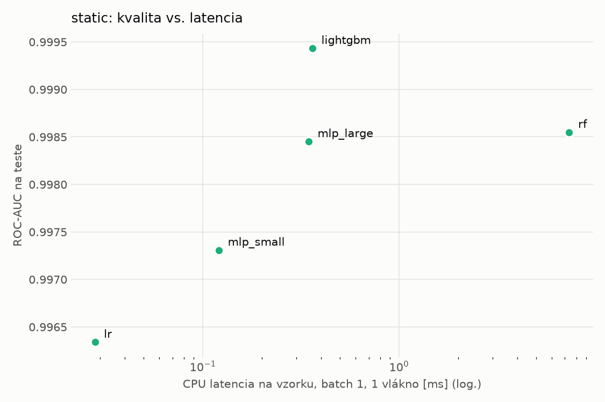
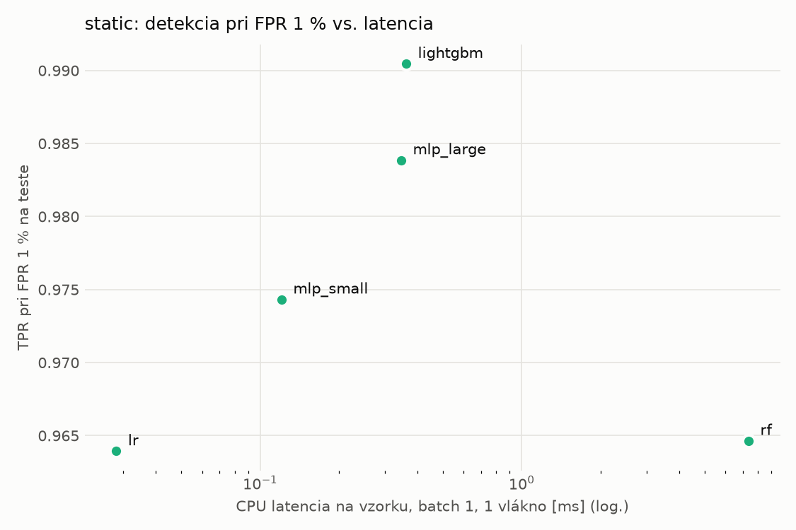
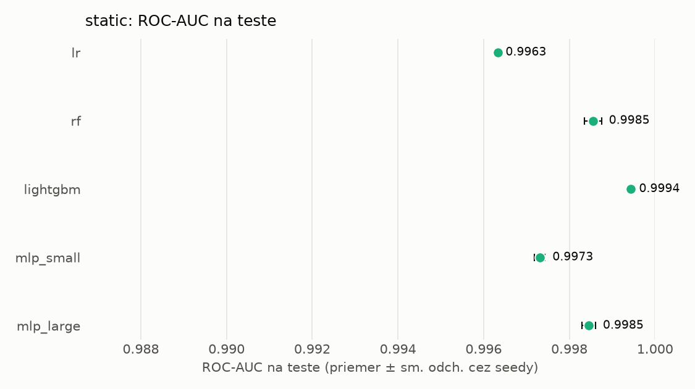
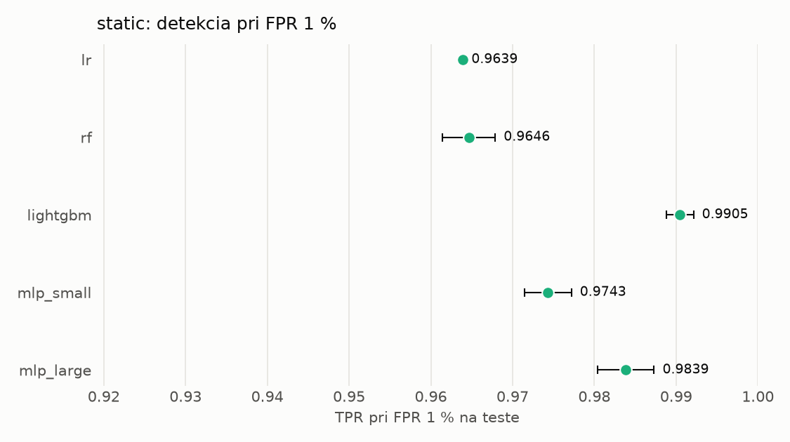

# Porovnanie modelov – static

> Generované `src/evaluation/compare.py` (2026-11-03T21:27:26+01:00); použitý je posledný beh každého modelu.
> Metriky sú priemer cez seedy. \* = pri prahu určenom na validácii (FPR ≤ 1 %).
> CPU ms/vz. = medián latencie jednej vzorky na 1 vlákne vrátane transformácie vstupu (meranie hneď po tréningu,
> orientačné). Oficiálne merania spotreby sú v časti „Spotreba zdrojov pri inferencii“.

## Detekčná kvalita a orientačné časy
| model | ROC-AUC val | ROC-AUC test | TPR@FPR 1 % test | TPR@FPR 0,1 % test | F1 test* | FPR test* | gap train−val | CPU ms/vz. | CPU vz./s | GPU ms/vz. | parametre | MB | tréning s | ladenie min |
|---|---|---|---|---|---|---|---|---|---|---|---|---|---|---|
| [lr](../../static/lr/20261103-211132/README.md) | 0.9987 | 0.9963 ± 0.0000 | 0.9639 | 0.1021 | 0.9632 | 0.0078 | 0.0006 | 0.028 | 289 986 | – | 2 316 | 0.07 | 1.8 | 0.0 |
| [rf](../../static/rf/20261103-211145/README.md) | 0.9998 | 0.9985 ± 0.0002 | 0.9646 | 0.8665 | 0.9737 | 0.0065 | 0.0002 | 7.363 | 139 743 | – | 368 800 | 29.83 | 19.9 | 0.0 |
| [lightgbm](../../static/lightgbm/20261103-211252/README.md) | 0.9999 | 0.9994 ± 0.0000 | 0.9905 | 0.9630 | 0.9901 | 0.0050 | 0.0001 | 0.362 | 36 722 | – | 591 589 | 34.72 | 267.2 | 0.0 |
| [mlp_small](../../static/mlp_small/20261103-212634/README.md) | 0.9996 | 0.9973 ± 0.0001 | 0.9743 | 0.7561 | 0.9803 | 0.0069 | 0.0003 | 0.121 | 109 629 | 0.383 | 74 753 | 0.36 | 5.1 | 0.0 |
| [mlp_large](../../static/mlp_large/20261103-212659/README.md) | 0.9998 | 0.9985 ± 0.0002 | 0.9839 | 0.8628 | 0.9835 | 0.0067 | 0.0001 | 0.346 | 76 945 | 0.609 | 1 362 369 | 5.53 | 5.4 | 0.0 |

## Nízka prevalencia malvéru (test, prah z validácie)
| model | TPR | FPR | precision @ 1 % | falošné na 1 skutočný poplach @ 1 % | precision @ 0.1 % | falošné na 1 skutočný poplach @ 0.1 % |
|---|---|---|---|---|---|---|
| lr | 0.9352 | 0.0078 | 0.547 | 0.83 | 0.107 | 8.34 |
| rf | 0.9540 | 0.0065 | 0.598 | 0.67 | 0.129 | 6.77 |
| lightgbm | 0.9846 | 0.0050 | 0.664 | 0.51 | 0.164 | 5.11 |
| mlp_small | 0.9669 | 0.0069 | 0.585 | 0.71 | 0.123 | 7.16 |
| mlp_large | 0.9730 | 0.0067 | 0.596 | 0.68 | 0.127 | 6.85 |

Prepočet: TPR a FPR nezávisia od podielu malvéru, preto sa dajú preniesť na nízku prevalenciu (v reálnej prevádzke je malvéru ~1 % alebo menej; v teste 54 %). „Falošné na 1 skutočný poplach“ = koľko neškodných súborov je označených na každý zachytený malvér.

## Spotreba zdrojov pri inferencii (benchmark, testovacia množina)
_Benchmark zatiaľ nebol spustený (`python -m src.evaluation.benchmark --approach static`)._

## Grafy

