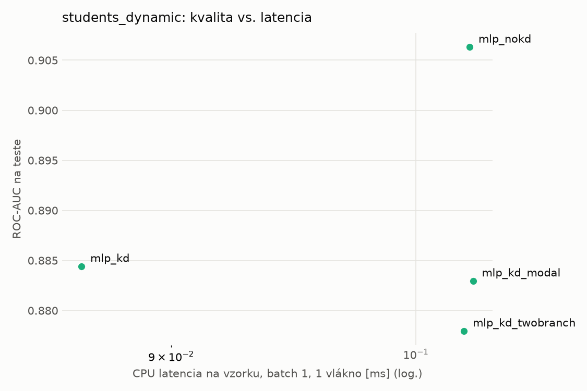
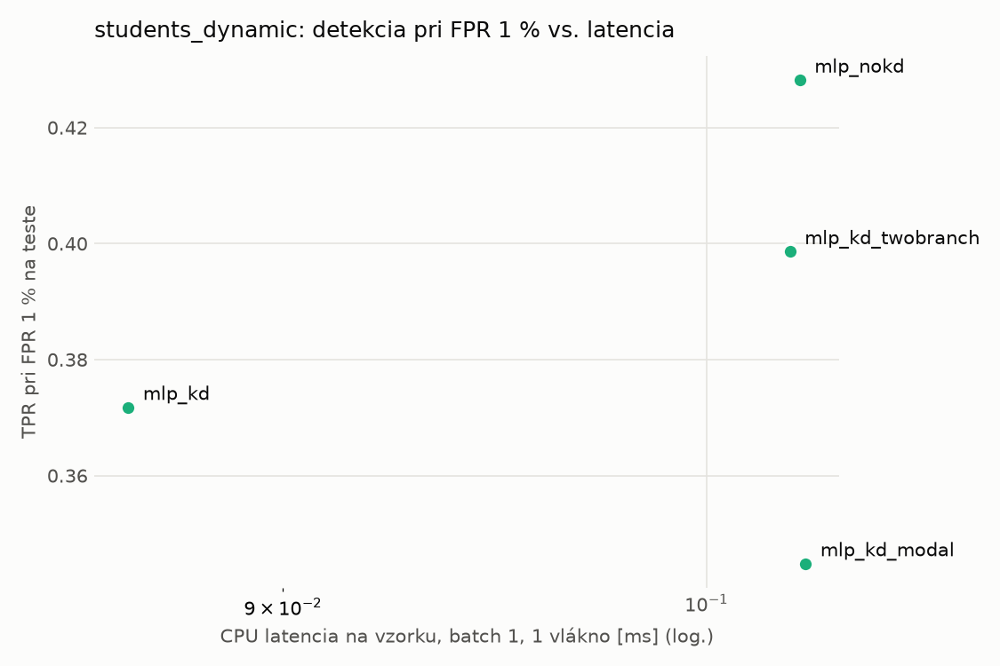
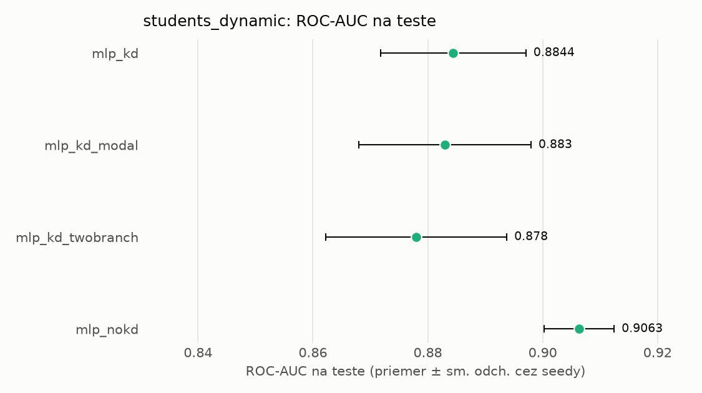
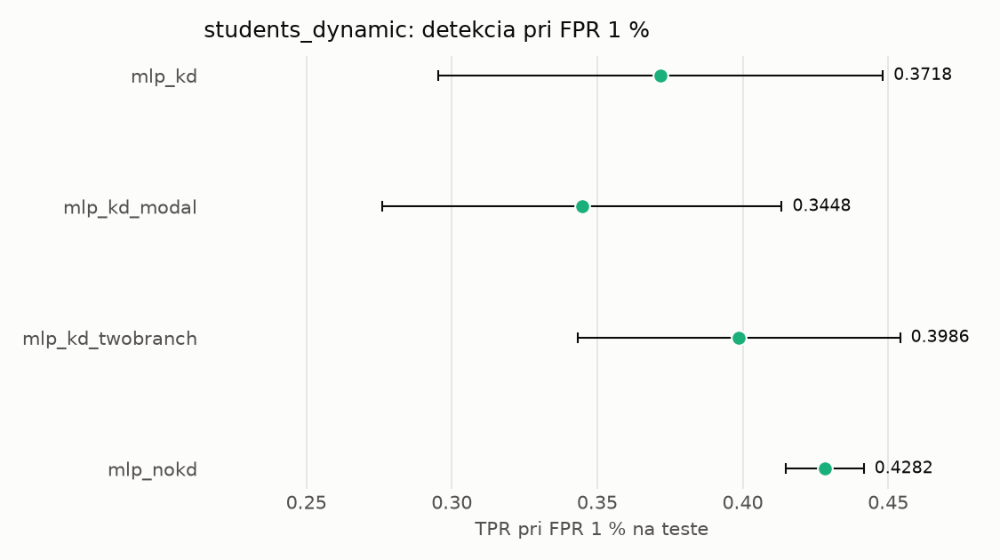

# Porovnanie modelov – students_dynamic

> Generované `src/evaluation/compare.py` (2026-11-03T23:26:39+01:00); použitý je posledný beh každého modelu.
> Metriky sú priemer cez seedy. \* = pri prahu určenom na validácii (FPR ≤ 1 %).
> CPU ms/vz. = medián latencie jednej vzorky na 1 vlákne vrátane transformácie vstupu (meranie hneď po tréningu,
> orientačné). Oficiálne merania spotreby sú v časti „Spotreba zdrojov pri inferencii“.

## Detekčná kvalita a orientačné časy
| model | ROC-AUC val | ROC-AUC test | TPR@FPR 1 % test | TPR@FPR 0,1 % test | F1 test* | FPR test* | gap train−val | CPU ms/vz. | CPU vz./s | GPU ms/vz. | parametre | MB | tréning s | ladenie min |
|---|---|---|---|---|---|---|---|---|---|---|---|---|---|---|
| [mlp_kd](../../students_dynamic/mlp_kd/20261103-232431/README.md) | 0.9958 | 0.8844 ± 0.0127 | 0.3718 | 0.2058 | 0.6095 | 0.0138 | 0.0004 | 0.087 | 96 279 | 0.455 | 64 129 | 0.31 | 8.6 | 0.0 |
| [mlp_kd_modal](../../students_dynamic/mlp_kd_modal/20261103-232528/README.md) | 0.9958 | 0.8830 ± 0.0150 | 0.3448 | 0.1924 | 0.5445 | 0.0131 | 0.0005 | 0.102 | 138 346 | 0.334 | 64 129 | 0.31 | 9.1 | 0.0 |
| [mlp_kd_twobranch](../../students_dynamic/mlp_kd_twobranch/20261103-232603/README.md) | 0.9958 | 0.8780 ± 0.0158 | 0.3986 | 0.2254 | 0.6258 | 0.0132 | 0.0005 | 0.102 | 141 299 | 0.322 | 64 129 | 0.31 | 9.3 | 0.0 |
| [mlp_nokd](../../students_dynamic/mlp_nokd/20261103-232505/README.md) | 0.9957 | 0.9063 ± 0.0061 | 0.4282 | 0.2383 | 0.6351 | 0.0154 | 0.0004 | 0.102 | 97 367 | 0.458 | 64 129 | 0.31 | 5.0 | 0.0 |

## Nízka prevalencia malvéru (test, prah z validácie)
| model | TPR | FPR | precision @ 1 % | falošné na 1 skutočný poplach @ 1 % | precision @ 0.1 % | falošné na 1 skutočný poplach @ 0.1 % |
|---|---|---|---|---|---|---|
| mlp_kd | 0.4436 | 0.0138 | 0.245 | 3.08 | 0.031 | 31.10 |
| mlp_kd_modal | 0.3801 | 0.0131 | 0.227 | 3.40 | 0.028 | 34.31 |
| mlp_kd_twobranch | 0.4605 | 0.0132 | 0.260 | 2.84 | 0.034 | 28.69 |
| mlp_nokd | 0.4714 | 0.0154 | 0.237 | 3.23 | 0.030 | 32.56 |

Prepočet: TPR a FPR nezávisia od podielu malvéru, preto sa dajú preniesť na nízku prevalenciu (v reálnej prevádzke je malvéru ~1 % alebo menej; v teste 54 %). „Falošné na 1 skutočný poplach“ = koľko neškodných súborov je označených na každý zachytený malvér.

## Spotreba zdrojov pri inferencii (benchmark, testovacia množina)
_Benchmark zatiaľ nebol spustený (`python -m src.evaluation.benchmark --approach students_dynamic`)._

## Grafy

