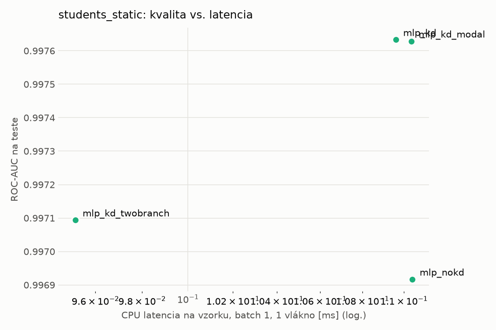
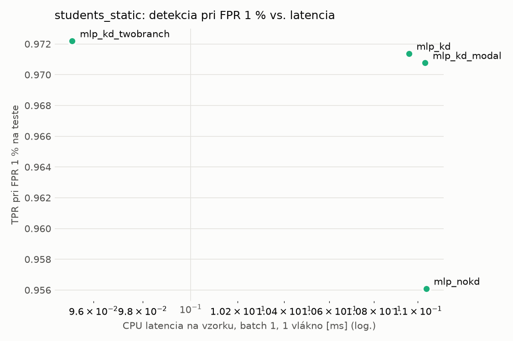
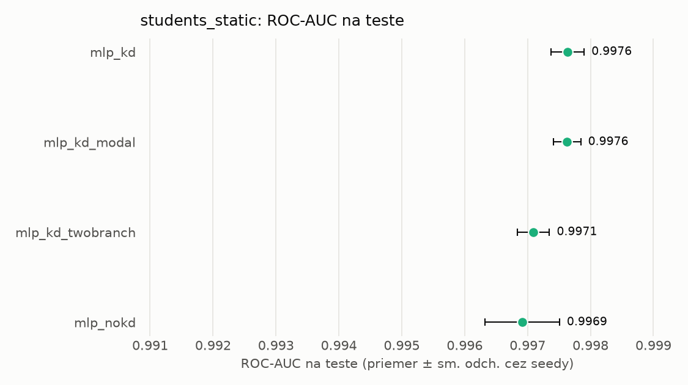
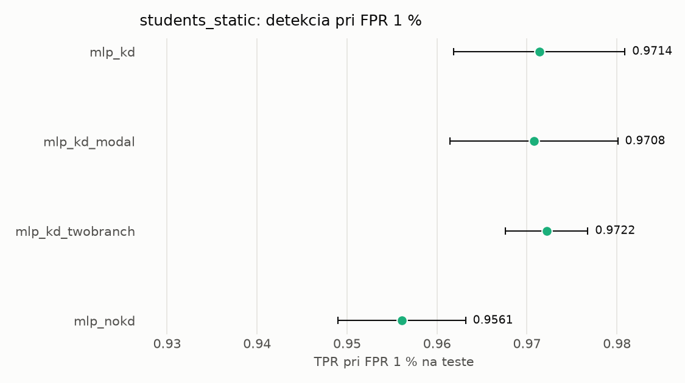

# Porovnanie modelov – students_static

> Generované `src/evaluation/compare.py` (2026-11-03T23:24:28+01:00); použitý je posledný beh každého modelu.
> Metriky sú priemer cez seedy. \* = pri prahu určenom na validácii (FPR ≤ 1 %).
> CPU ms/vz. = medián latencie jednej vzorky na 1 vlákne vrátane transformácie vstupu (meranie hneď po tréningu,
> orientačné). Oficiálne merania spotreby sú v časti „Spotreba zdrojov pri inferencii“.

## Detekčná kvalita a orientačné časy
| model | ROC-AUC val | ROC-AUC test | TPR@FPR 1 % test | TPR@FPR 0,1 % test | F1 test* | FPR test* | gap train−val | CPU ms/vz. | CPU vz./s | GPU ms/vz. | parametre | MB | tréning s | ladenie min |
|---|---|---|---|---|---|---|---|---|---|---|---|---|---|---|
| [mlp_kd](../../students_static/mlp_kd/20261103-232226/README.md) | 0.9992 | 0.9976 ± 0.0003 | 0.9714 | 0.6517 | 0.9684 | 0.0056 | 0.0006 | 0.110 | 109 841 | 0.447 | 74 209 | 0.36 | 11.1 | 0.0 |
| [mlp_kd_modal](../../students_static/mlp_kd_modal/20261103-232325/README.md) | 0.9992 | 0.9976 ± 0.0002 | 0.9708 | 0.6539 | 0.9733 | 0.0063 | 0.0006 | 0.110 | 109 043 | 0.294 | 74 209 | 0.36 | 10.3 | 0.0 |
| [mlp_kd_twobranch](../../students_static/mlp_kd_twobranch/20261103-232405/README.md) | 0.9990 | 0.9971 ± 0.0003 | 0.9722 | 0.3507 | 0.9697 | 0.0071 | 0.0007 | 0.095 | 109 945 | 0.282 | 74 209 | 0.36 | 4.7 | 0.0 |
| [mlp_nokd](../../students_static/mlp_nokd/20261103-232309/README.md) | 0.9988 | 0.9969 ± 0.0006 | 0.9561 | 0.4749 | 0.9671 | 0.0071 | 0.0009 | 0.110 | 110 273 | 0.269 | 74 209 | 0.36 | 2.3 | 0.0 |

## Nízka prevalencia malvéru (test, prah z validácie)
| model | TPR | FPR | precision @ 1 % | falošné na 1 skutočný poplach @ 1 % | precision @ 0.1 % | falošné na 1 skutočný poplach @ 0.1 % |
|---|---|---|---|---|---|---|
| mlp_kd | 0.9431 | 0.0056 | 0.630 | 0.59 | 0.145 | 5.91 |
| mlp_kd_modal | 0.9531 | 0.0063 | 0.605 | 0.65 | 0.132 | 6.60 |
| mlp_kd_twobranch | 0.9470 | 0.0071 | 0.573 | 0.75 | 0.117 | 7.53 |
| mlp_nokd | 0.9419 | 0.0071 | 0.571 | 0.75 | 0.117 | 7.57 |

Prepočet: TPR a FPR nezávisia od podielu malvéru, preto sa dajú preniesť na nízku prevalenciu (v reálnej prevádzke je malvéru ~1 % alebo menej; v teste 54 %). „Falošné na 1 skutočný poplach“ = koľko neškodných súborov je označených na každý zachytený malvér.

## Spotreba zdrojov pri inferencii (benchmark, testovacia množina)
_Benchmark zatiaľ nebol spustený (`python -m src.evaluation.benchmark --approach students_static`)._

## Grafy

