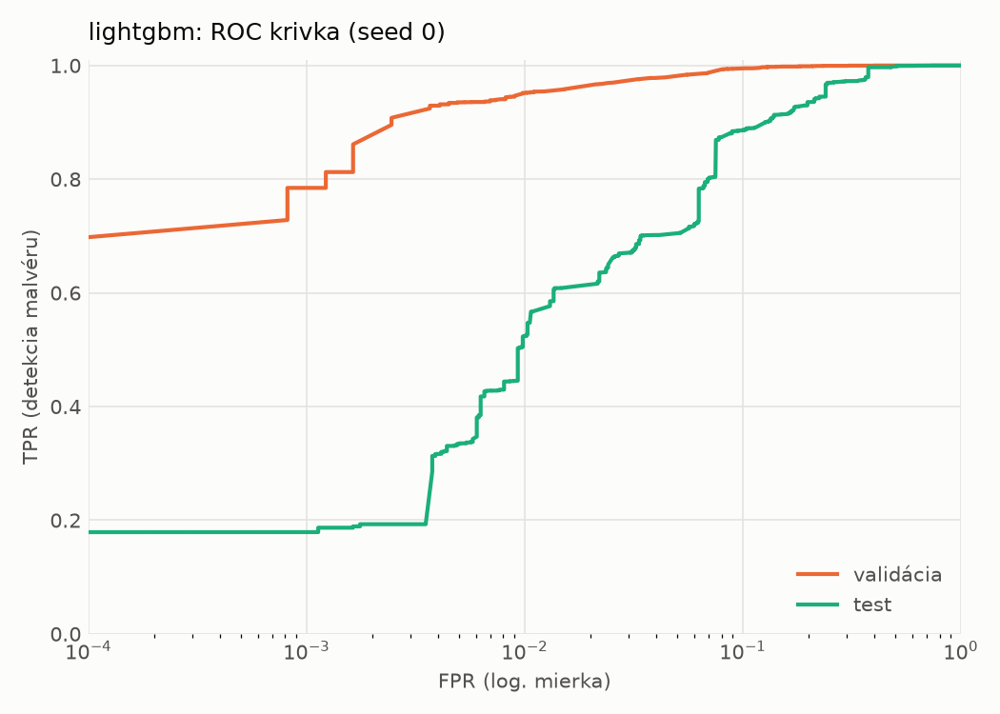
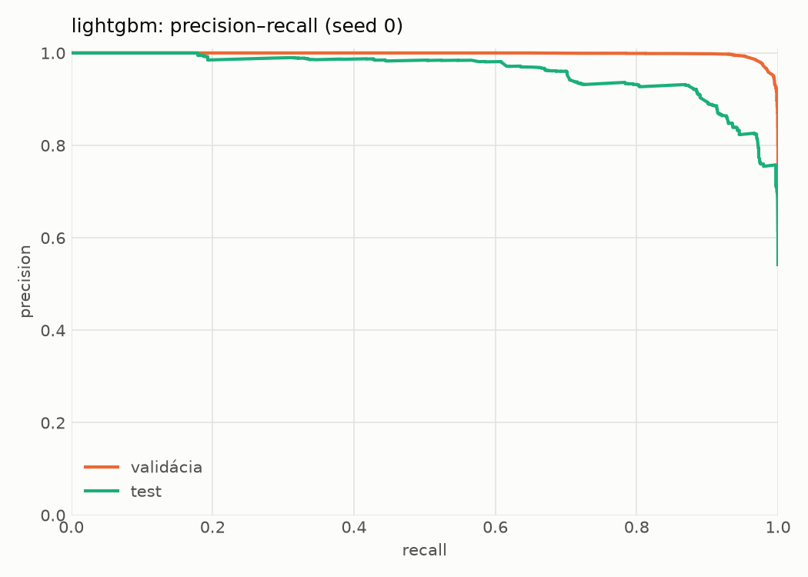
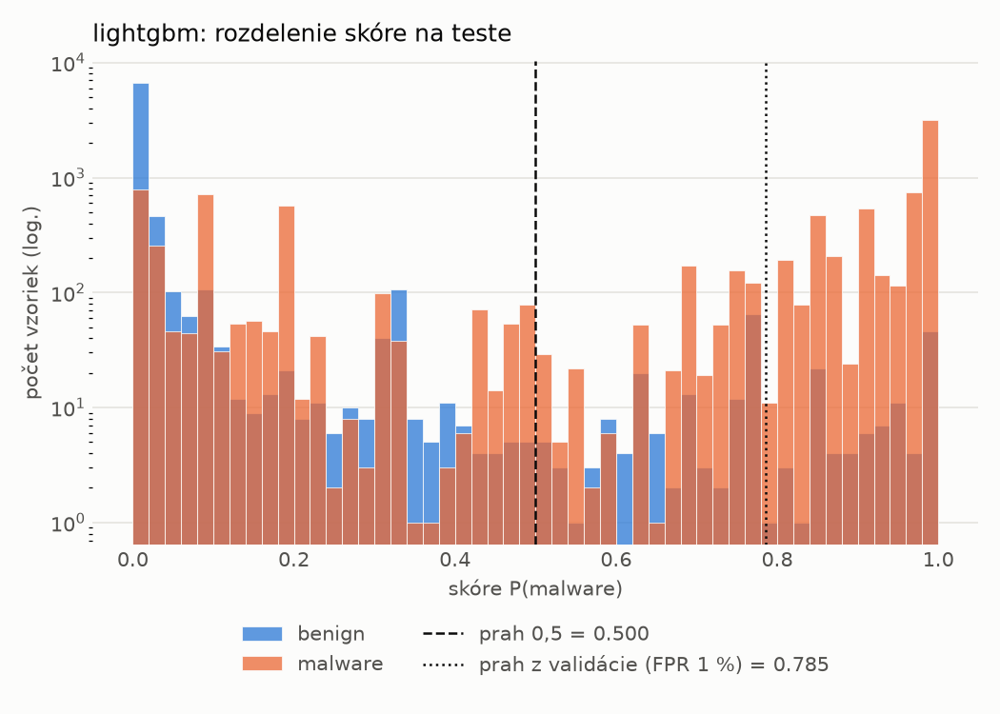
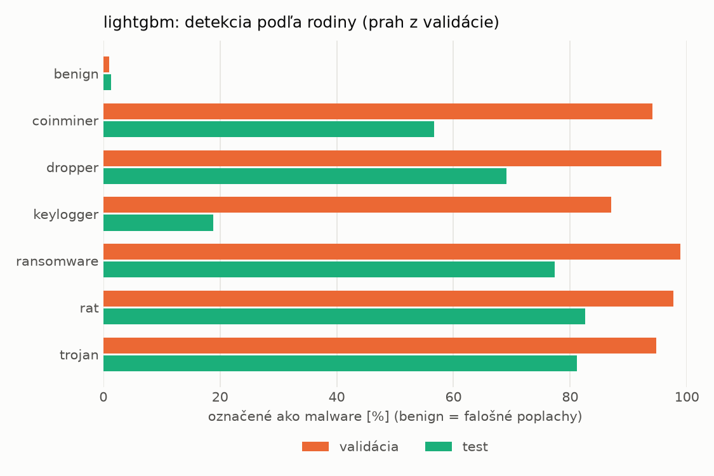
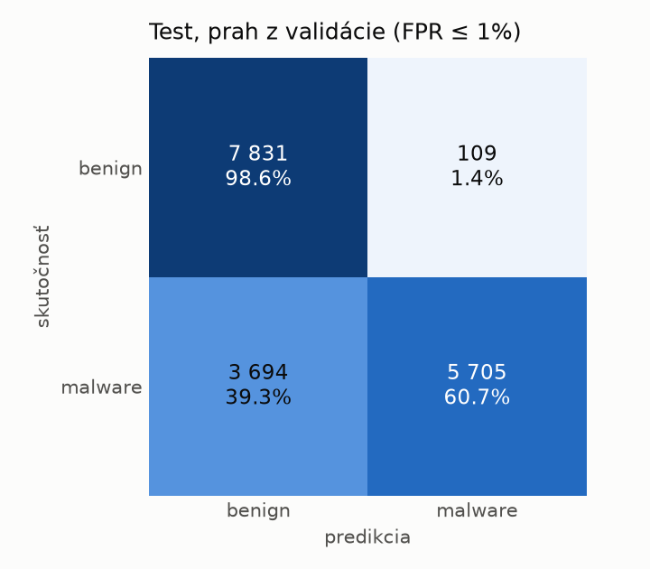
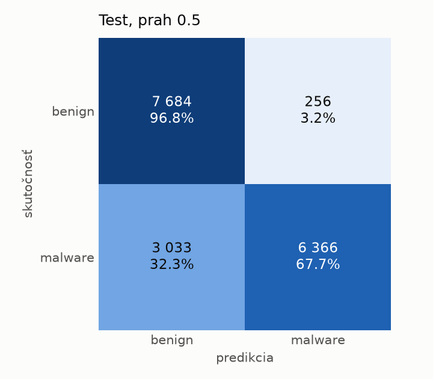
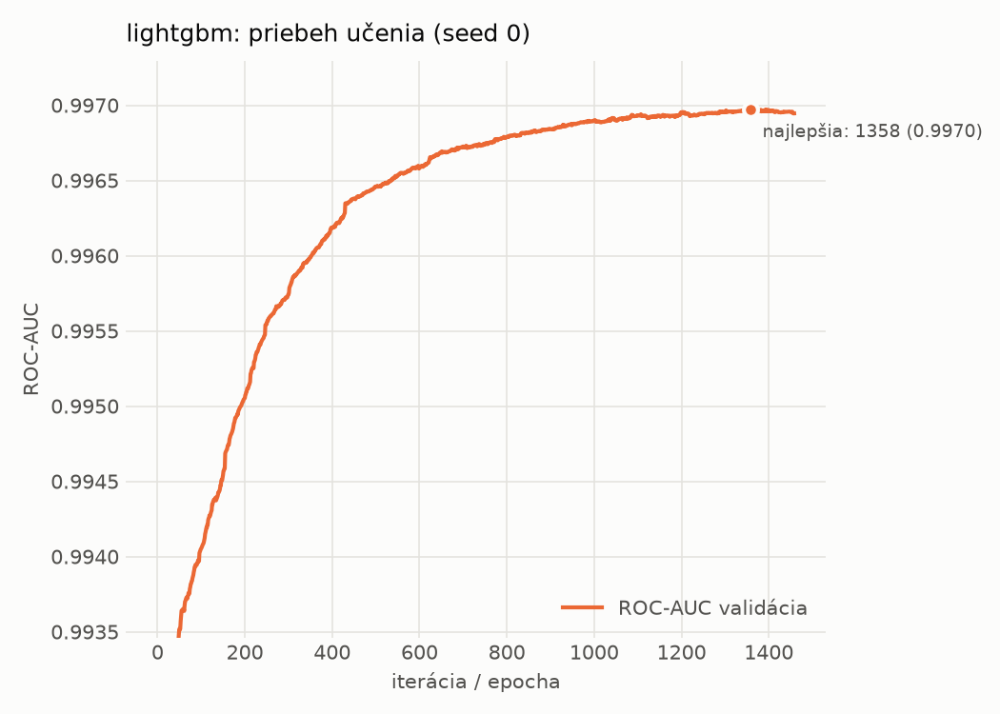

# dynamic/lightgbm – beh `20261103-212927`

> Automaticky generované (`src/training/run_tabular.py`). Konfigurácia: `config.yaml`, protokol: `protocol.yaml`.

- **Model:** `lightgbm` – LightGBM, gradient boosting stromov s early stopping na validácii (pôvodné hodnoty príznakov)
- **Ladenie:** bez ladenia – hyperparametre prevzaté z `runs_final/dynamic/lightgbm/20261102-003953`
- **Finálne modely:** seedy [0, 1, 2]; hodnoty sú priemer ± smerodajná odchýlka cez seedy
- **Najlepšie hyperparametre:** `{"num_boost_round": 5000, "early_stopping_rounds": 100, "learning_rate": 0.012600391102852807, "num_leaves": 261, "min_child_samples": 12, "feature_fraction": 0.7323605840883831, "bagging_fraction": 0.7241803281580393, "lambda_l1": 9.843384499248837e-06, "lambda_l2": 0.7301583949167907}`

## Detekčná kvalita (bez prahu)
| metrika | train (podvzorka) | validácia | test |
|---|---|---|---|
| ROC-AUC | 0.9979 ± 0.0000 | 0.9970 ± 0.0000 | 0.9557 ± 0.0006 |
| PR-AUC | 0.9985 ± 0.0000 | 0.9980 ± 0.0000 | 0.9602 ± 0.0006 |
| TPR pri FPR 1 % | 0.9522 ± 0.0019 | 0.9489 ± 0.0033 | 0.5065 ± 0.0440 |
| TPR pri FPR 0,1 % | 0.8504 ± 0.0049 | 0.7927 ± 0.0190 | 0.1784 ± 0.0009 |
| log loss | 0.0585 ± 0.0002 | 0.0683 ± 0.0001 | 0.5645 ± 0.0052 |
| Brier skóre | 0.0184 ± 0.0000 | 0.0202 ± 0.0000 | 0.1517 ± 0.0009 |

Rozdiel ROC-AUC train − validácia: **0.0009** (veľký rozdiel = preučenie).

## Pri prahu z validácie (FPR ≤ 1% na validácii)
| metrika | train (podvzorka) | validácia | test |
|---|---|---|---|
| accuracy | 0.9637 ± 0.0027 | 0.9649 ± 0.0019 | 0.7810 ± 0.0014 |
| balanced accuracy | 0.9693 ± 0.0019 | 0.9696 ± 0.0015 | 0.7968 ± 0.0013 |
| precision | 0.9965 ± 0.0011 | 0.9936 ± 0.0001 | 0.9802 ± 0.0009 |
| recall (TPR) | 0.9438 ± 0.0054 | 0.9489 ± 0.0033 | 0.6083 ± 0.0028 |
| FPR | 0.0052 ± 0.0017 | 0.0097 ± 0.0002 | 0.0146 ± 0.0007 |
| F1 | 0.9694 ± 0.0024 | 0.9707 ± 0.0017 | 0.7507 ± 0.0020 |
| MCC | 0.9268 ± 0.0049 | 0.9284 ± 0.0037 | 0.6260 ± 0.0021 |

## Pri pevnom prahu 0.5
| metrika | train (podvzorka) | validácia | test |
|---|---|---|---|
| accuracy | 0.9716 ± 0.0001 | 0.9719 ± 0.0001 | 0.8118 ± 0.0035 |
| balanced accuracy | 0.9731 ± 0.0000 | 0.9726 ± 0.0001 | 0.8240 ± 0.0032 |
| precision | 0.9866 ± 0.0000 | 0.9845 ± 0.0001 | 0.9615 ± 0.0006 |
| recall (TPR) | 0.9666 ± 0.0001 | 0.9695 ± 0.0001 | 0.6801 ± 0.0062 |
| FPR | 0.0205 ± 0.0000 | 0.0243 ± 0.0002 | 0.0322 ± 0.0003 |
| F1 | 0.9765 ± 0.0000 | 0.9769 ± 0.0001 | 0.7967 ± 0.0045 |
| MCC | 0.9410 ± 0.0001 | 0.9412 ± 0.0002 | 0.6639 ± 0.0056 |

## Výpočtové nároky (seed 0, testovacia množina)
| meranie | hodnota |
|---|---|
| tréning finálneho modelu | 26.8 s (priemer cez seedy) |
| ladenie spolu | 0 s |
| počet parametrov / uzlov | 703 034 |
| veľkosť modelu na disku | 39.96 MB |
| CPU latencia modelu (batch 1, 1 vlákno) | 0.254 ms (p95 0.323) |
| CPU priepustnosť (24 vlákien) | 55 147 vzoriek/s |

## Grafy
| | |
|---|---|
|  |  |
|  |  |
|  |  |
|  |  |

## Súbory
`metrics.json` (všetky metriky po seedoch vrátane rodín), `timing.json`, `hpo_trials.csv`,
`predictions/<časť>_seed<N>.parquet` (sha256, family, label, score), `model/seed_<N>/`, `log.txt`.
