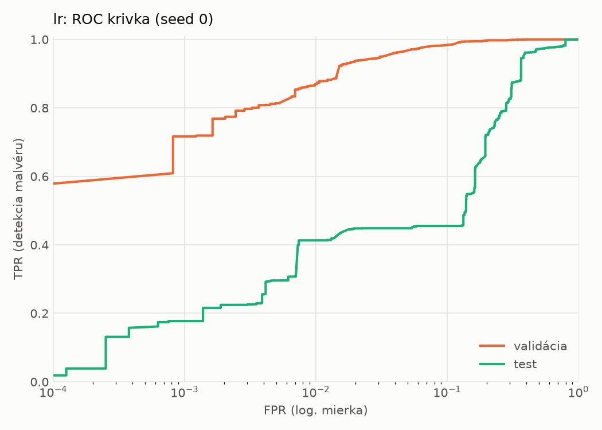
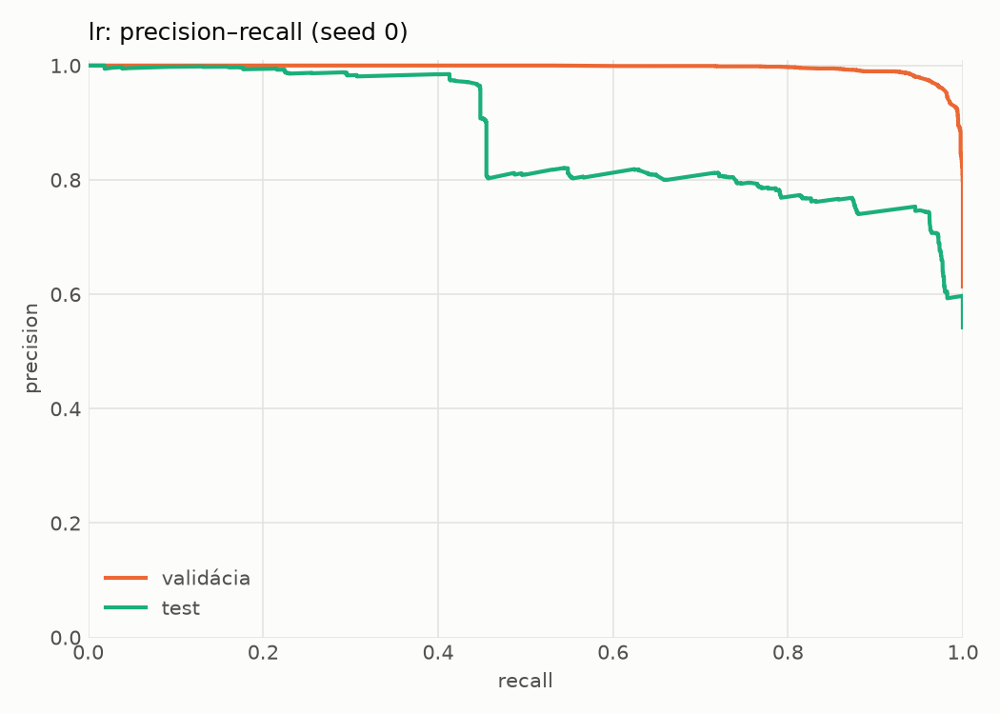
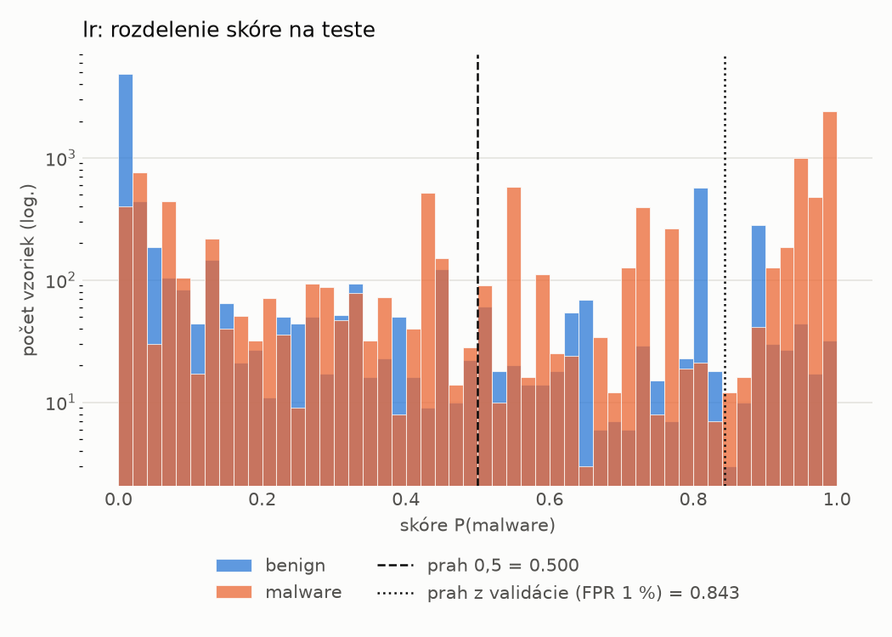
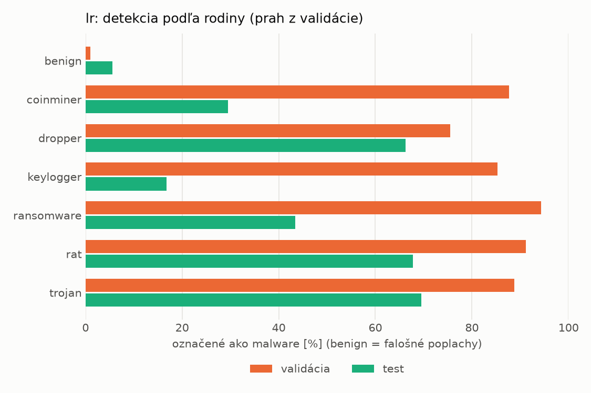
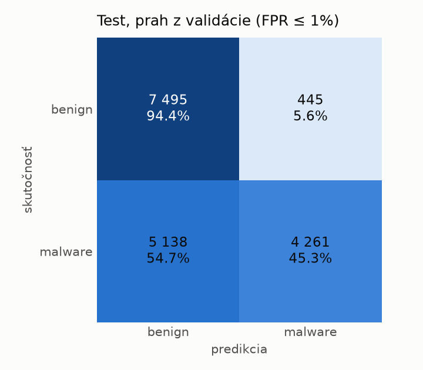
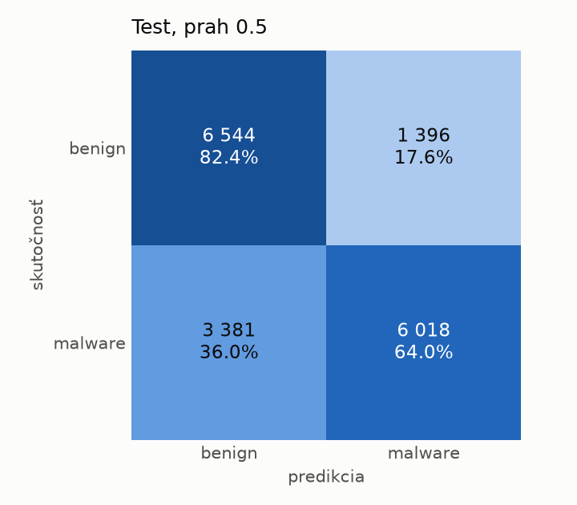

# dynamic/lr – beh `20261103-212729`

> Automaticky generované (`src/training/run_tabular.py`). Konfigurácia: `config.yaml`, protokol: `protocol.yaml`.

- **Model:** `logreg` – logistická regresia s L2 regularizáciou (vstup signed log1p + štandardizácia)
- **Ladenie:** bez ladenia – hyperparametre prevzaté z `runs_final/dynamic/lr/20261102-002602`
- **Finálne modely:** seedy [0, 1, 2]; hodnoty sú priemer ± smerodajná odchýlka cez seedy
- **Najlepšie hyperparametre:** `{"max_iter": 2000, "C": 0.04224422279858655}`

## Detekčná kvalita (bez prahu)
| metrika | train (podvzorka) | validácia | test |
|---|---|---|---|
| ROC-AUC | 0.9941 ± 0.0000 | 0.9935 ± 0.0000 | 0.8554 ± 0.0000 |
| PR-AUC | 0.9962 ± 0.0000 | 0.9958 ± 0.0000 | 0.8761 ± 0.0000 |
| TPR pri FPR 1 % | 0.8750 ± 0.0000 | 0.8687 ± 0.0000 | 0.4131 ± 0.0000 |
| TPR pri FPR 0,1 % | 0.7938 ± 0.0000 | 0.7166 ± 0.0000 | 0.1771 ± 0.0000 |
| log loss | 0.0993 ± 0.0000 | 0.1028 ± 0.0000 | 0.7564 ± 0.0000 |
| Brier skóre | 0.0297 ± 0.0000 | 0.0299 ± 0.0000 | 0.2080 ± 0.0000 |

Rozdiel ROC-AUC train − validácia: **0.0006** (veľký rozdiel = preučenie).

## Pri prahu z validácie (FPR ≤ 1% na validácii)
| metrika | train (podvzorka) | validácia | test |
|---|---|---|---|
| accuracy | 0.9127 ± 0.0000 | 0.9157 ± 0.0000 | 0.6780 ± 0.0000 |
| balanced accuracy | 0.9279 ± 0.0000 | 0.9295 ± 0.0000 | 0.6987 ± 0.0000 |
| precision | 0.9977 ± 0.0000 | 0.9929 ± 0.0000 | 0.9054 ± 0.0000 |
| recall (TPR) | 0.8590 ± 0.0000 | 0.8687 ± 0.0000 | 0.4533 ± 0.0000 |
| FPR | 0.0031 ± 0.0000 | 0.0098 ± 0.0000 | 0.0560 ± 0.0000 |
| F1 | 0.9232 ± 0.0000 | 0.9267 ± 0.0000 | 0.6042 ± 0.0000 |
| MCC | 0.8358 ± 0.0000 | 0.8387 ± 0.0000 | 0.4451 ± 0.0000 |

## Pri pevnom prahu 0.5
| metrika | train (podvzorka) | validácia | test |
|---|---|---|---|
| accuracy | 0.9582 ± 0.0000 | 0.9601 ± 0.0000 | 0.7245 ± 0.0000 |
| balanced accuracy | 0.9582 ± 0.0000 | 0.9599 ± 0.0000 | 0.7322 ± 0.0000 |
| precision | 0.9729 ± 0.0000 | 0.9736 ± 0.0000 | 0.8117 ± 0.0000 |
| recall (TPR) | 0.9582 ± 0.0000 | 0.9611 ± 0.0000 | 0.6403 ± 0.0000 |
| FPR | 0.0418 ± 0.0000 | 0.0414 ± 0.0000 | 0.1758 ± 0.0000 |
| F1 | 0.9655 ± 0.0000 | 0.9673 ± 0.0000 | 0.7159 ± 0.0000 |
| MCC | 0.9127 ± 0.0000 | 0.9164 ± 0.0000 | 0.4677 ± 0.0000 |

## Výpočtové nároky (seed 0, testovacia množina)
| meranie | hodnota |
|---|---|
| tréning finálneho modelu | 3.9 s (priemer cez seedy) |
| ladenie spolu | 0 s |
| počet parametrov / uzlov | 2 001 |
| veľkosť modelu na disku | 0.06 MB |
| transformácia vstupu – latencia (1 vlákno) | 0.017 ms |
| transformácia vstupu – priepustnosť | 55 678 vzoriek/s |
| CPU latencia modelu (batch 1, 1 vlákno) | 0.005 ms (p95 0.006) |
| CPU priepustnosť (24 vlákien) | 335 395 vzoriek/s |

## Grafy
| | |
|---|---|
|  |  |
|  |  |
|  |  |
|  |  |

## Súbory
`metrics.json` (všetky metriky po seedoch vrátane rodín), `timing.json`, `hpo_trials.csv`,
`predictions/<časť>_seed<N>.parquet` (sha256, family, label, score), `model/seed_<N>/`, `log.txt`.
