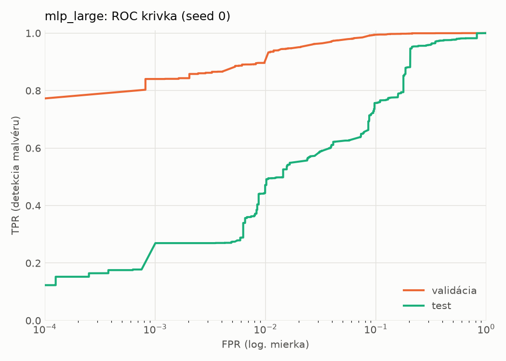
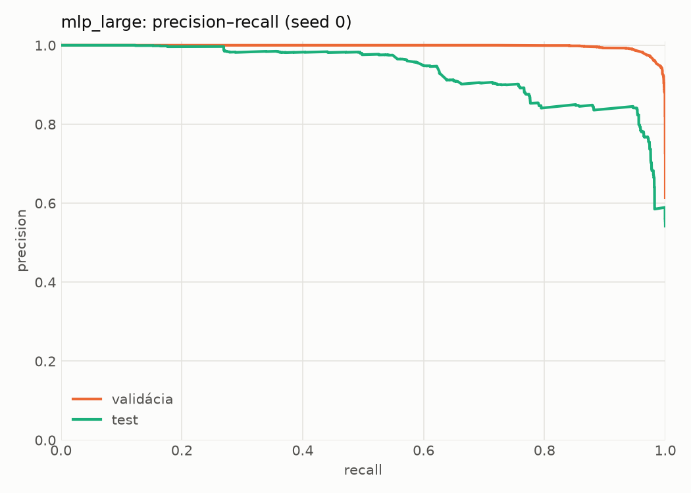
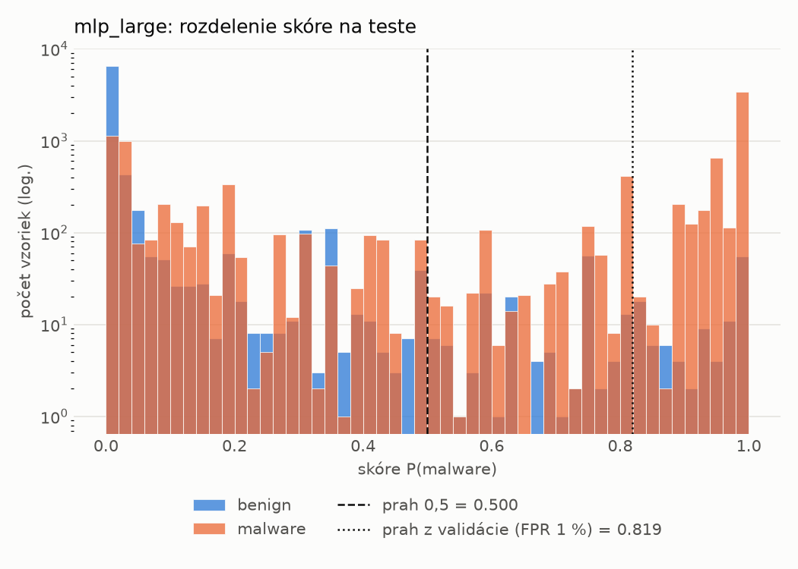
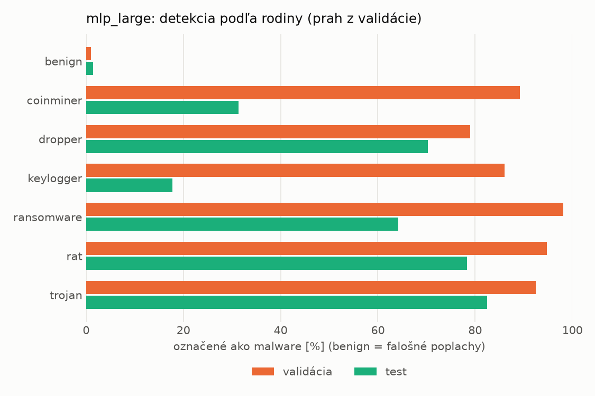
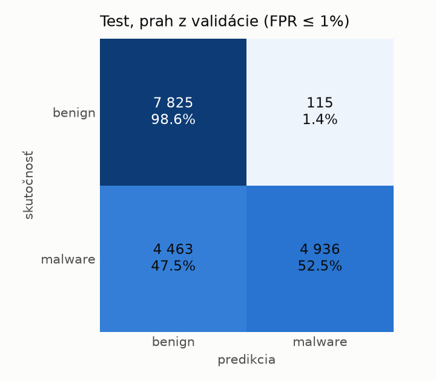
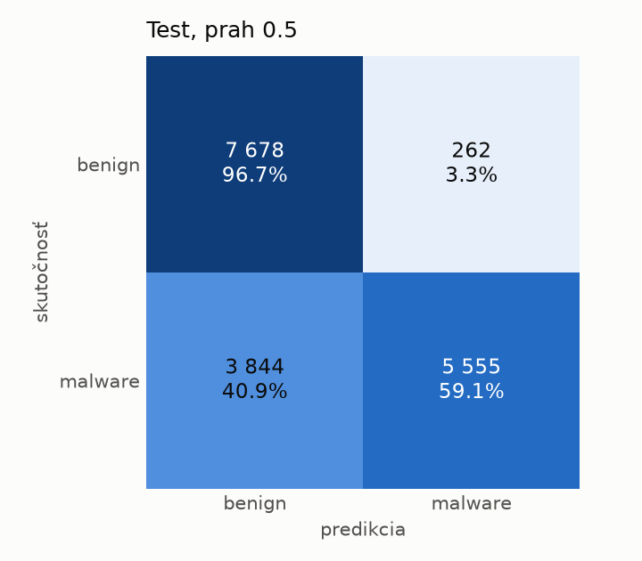
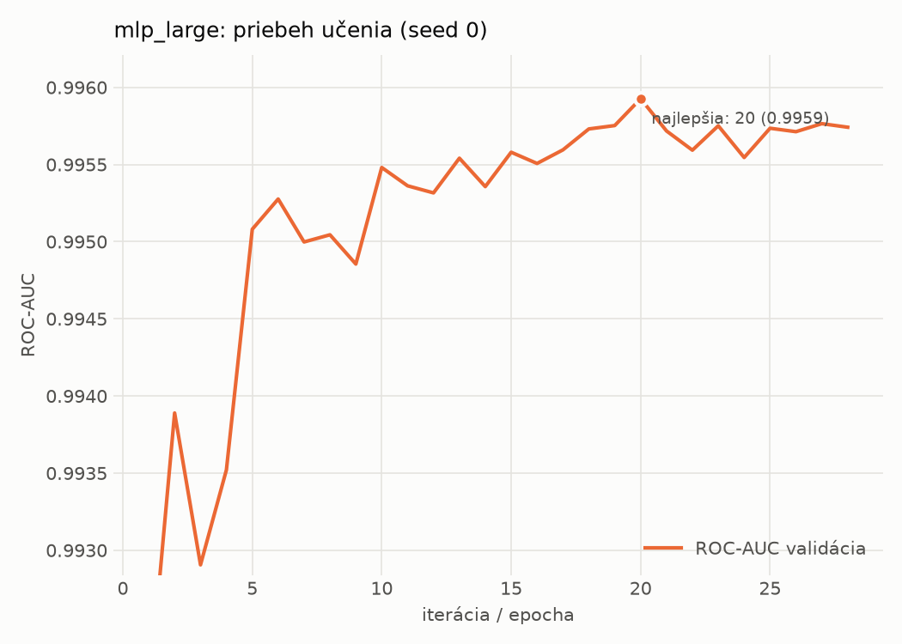

# dynamic/mlp_large – beh `20261103-213134`

> Automaticky generované (`src/training/run_tabular.py`). Konfigurácia: `config.yaml`, protokol: `protocol.yaml`.

- **Model:** `mlp` – veľká neurónová sieť (3–5 skrytých vrstiev, 512–2048 neurónov), kandidát na učiteľa
- **Ladenie:** bez ladenia – hyperparametre prevzaté z `runs_final/dynamic/mlp_large/20261102-005920`
- **Finálne modely:** seedy [0, 1, 2]; hodnoty sú priemer ± smerodajná odchýlka cez seedy
- **Najlepšie hyperparametre:** `{"max_epochs": 100, "patience": 8, "hidden_layers": 3, "hidden_width": 512, "width_decay": 0.5, "dropout": 0.3735687797102123, "lr": 0.00020669709962675654, "weight_decay": 1.4747439017290252e-05, "batch_size": 256}`

## Detekčná kvalita (bez prahu)
| metrika | train (podvzorka) | validácia | test |
|---|---|---|---|
| ROC-AUC | 0.9964 ± 0.0002 | 0.9959 ± 0.0000 | 0.9253 ± 0.0083 |
| PR-AUC | 0.9976 ± 0.0001 | 0.9974 ± 0.0000 | 0.9390 ± 0.0056 |
| TPR pri FPR 1 % | 0.9265 ± 0.0015 | 0.9206 ± 0.0188 | 0.4448 ± 0.0277 |
| TPR pri FPR 0,1 % | 0.8597 ± 0.0020 | 0.7806 ± 0.0523 | 0.2111 ± 0.0337 |
| log loss | 0.0755 ± 0.0018 | 0.0828 ± 0.0005 | 0.7896 ± 0.0699 |
| Brier skóre | 0.0239 ± 0.0006 | 0.0242 ± 0.0001 | 0.1847 ± 0.0122 |

Rozdiel ROC-AUC train − validácia: **0.0005** (veľký rozdiel = preučenie).

## Pri prahu z validácie (FPR ≤ 1% na validácii)
| metrika | train (podvzorka) | validácia | test |
|---|---|---|---|
| accuracy | 0.9429 ± 0.0100 | 0.9475 ± 0.0115 | 0.7191 ± 0.0155 |
| balanced accuracy | 0.9518 ± 0.0082 | 0.9554 ± 0.0094 | 0.7398 ± 0.0143 |
| precision | 0.9946 ± 0.0005 | 0.9933 ± 0.0001 | 0.9752 ± 0.0019 |
| recall (TPR) | 0.9113 ± 0.0163 | 0.9206 ± 0.0188 | 0.4943 ± 0.0283 |
| FPR | 0.0077 ± 0.0007 | 0.0098 ± 0.0000 | 0.0148 ± 0.0003 |
| F1 | 0.9511 ± 0.0090 | 0.9555 ± 0.0102 | 0.6558 ± 0.0253 |
| MCC | 0.8877 ± 0.0182 | 0.8956 ± 0.0212 | 0.5352 ± 0.0228 |

## Pri pevnom prahu 0.5
| metrika | train (podvzorka) | validácia | test |
|---|---|---|---|
| accuracy | 0.9634 ± 0.0018 | 0.9654 ± 0.0017 | 0.7853 ± 0.0194 |
| balanced accuracy | 0.9651 ± 0.0011 | 0.9669 ± 0.0008 | 0.7993 ± 0.0178 |
| precision | 0.9824 ± 0.0026 | 0.9830 ± 0.0022 | 0.9565 ± 0.0023 |
| recall (TPR) | 0.9571 ± 0.0052 | 0.9602 ± 0.0051 | 0.6327 ± 0.0367 |
| FPR | 0.0269 ± 0.0042 | 0.0263 ± 0.0037 | 0.0340 ± 0.0022 |
| F1 | 0.9696 ± 0.0016 | 0.9715 ± 0.0015 | 0.7612 ± 0.0272 |
| MCC | 0.9241 ± 0.0034 | 0.9280 ± 0.0032 | 0.6221 ± 0.0290 |

## Výpočtové nároky (seed 0, testovacia množina)
| meranie | hodnota |
|---|---|
| tréning finálneho modelu | 15.5 s (priemer cez seedy) |
| ladenie spolu | 0 s |
| počet parametrov / uzlov | 1 190 657 |
| veľkosť modelu na disku | 4.83 MB |
| transformácia vstupu – latencia (1 vlákno) | 0.034 ms |
| transformácia vstupu – priepustnosť | 48 105 vzoriek/s |
| CPU latencia modelu (batch 1, 1 vlákno) | 0.199 ms (p95 0.254) |
| CPU priepustnosť (24 vlákien) | 101 044 vzoriek/s |
| GPU latencia (batch 1) | 0.530 ms (p95 0.575) |
| GPU priepustnosť | 109 501 vzoriek/s |
| GPU špičková pamäť | 1210 MB |

## Grafy
| | |
|---|---|
|  |  |
|  |  |
|  |  |
|  |  |

## Súbory
`metrics.json` (všetky metriky po seedoch vrátane rodín), `timing.json`, `hpo_trials.csv`,
`predictions/<časť>_seed<N>.parquet` (sha256, family, label, score), `model/seed_<N>/`, `log.txt`.
