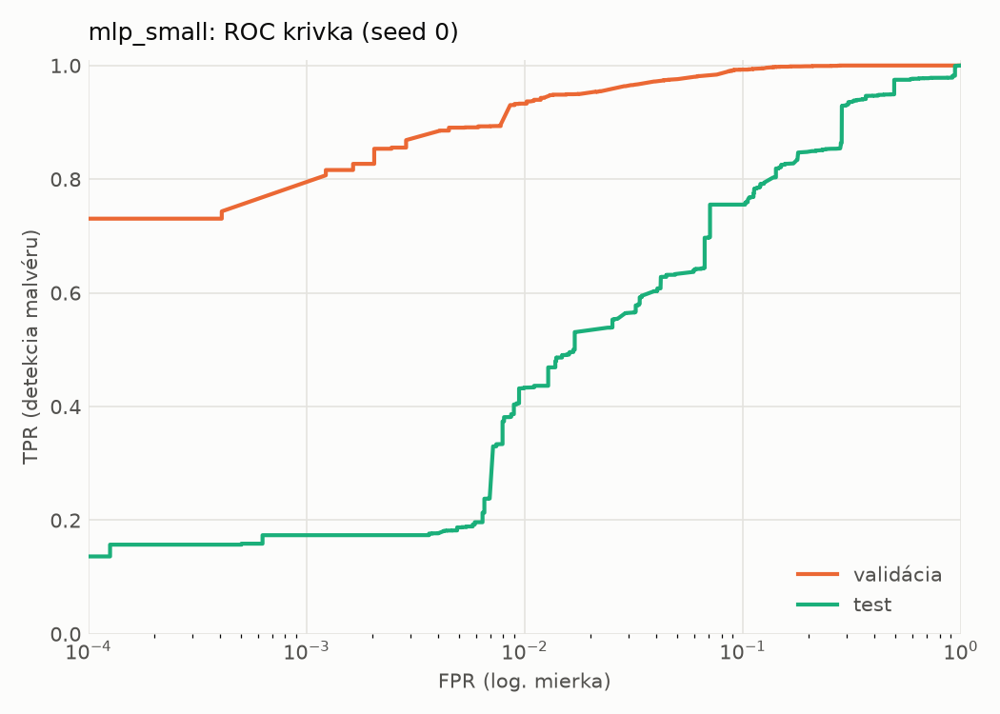
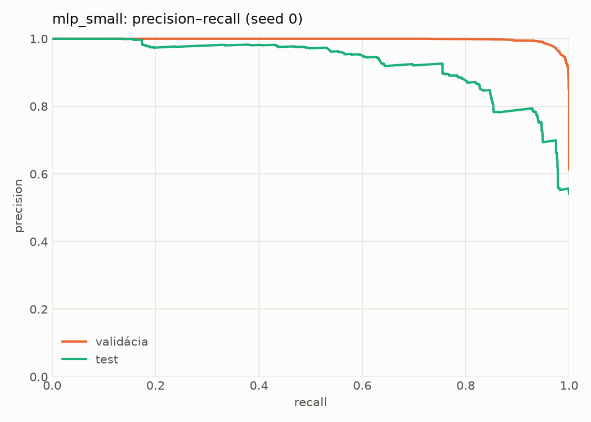
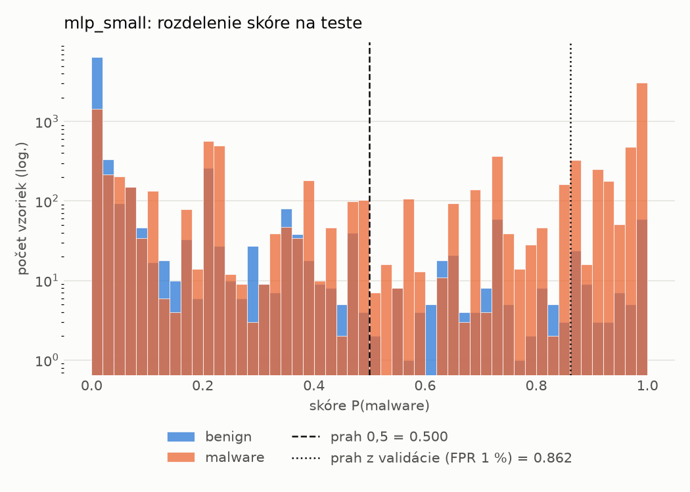
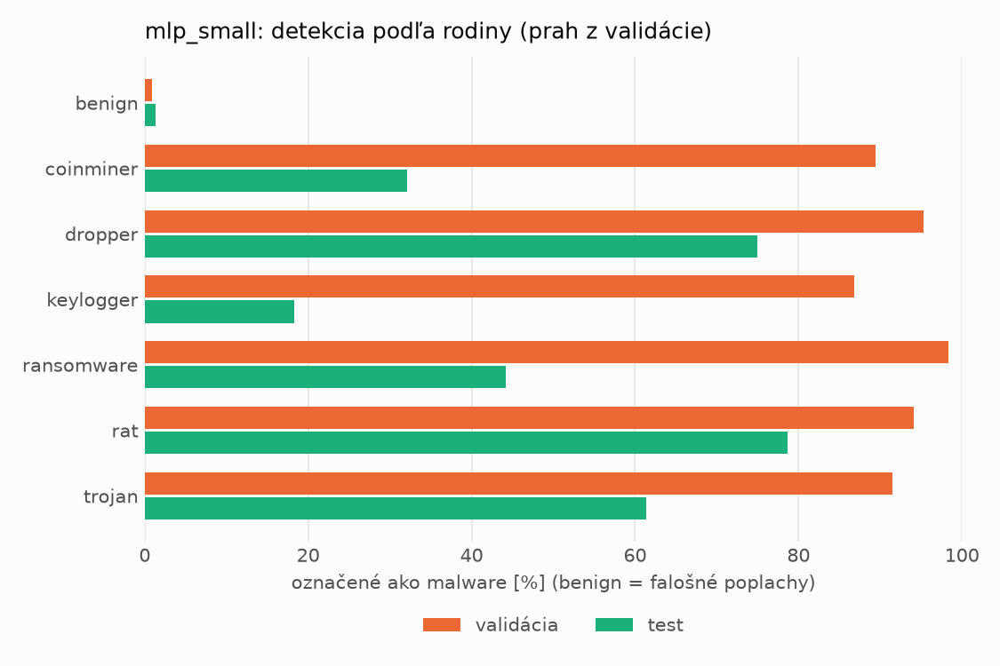
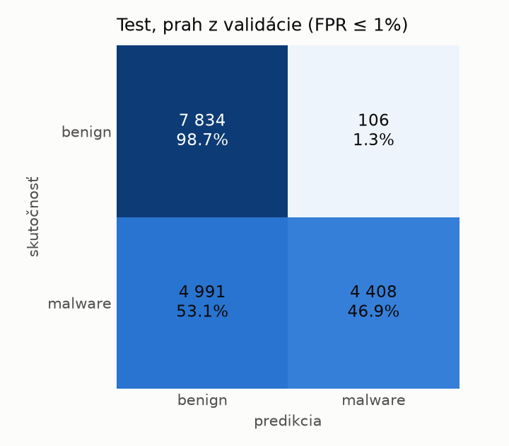
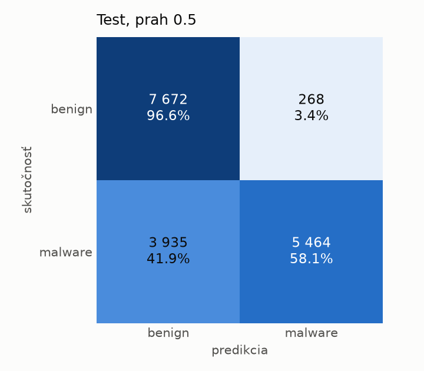
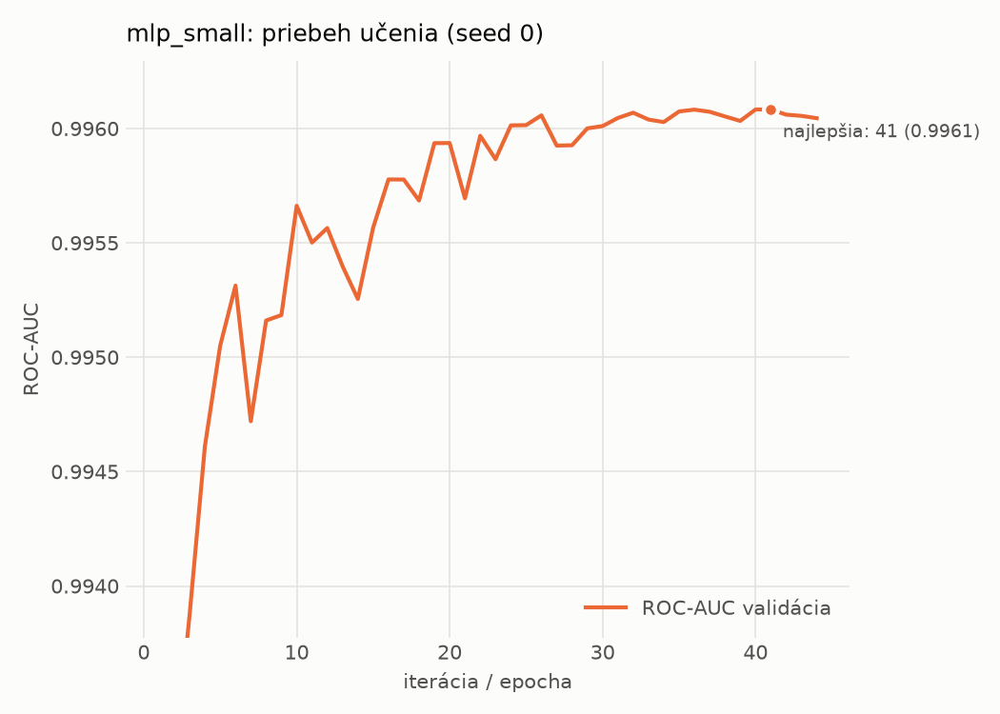

# dynamic/mlp_small – beh `20261103-213112`

> Automaticky generované (`src/training/run_tabular.py`). Konfigurácia: `config.yaml`, protokol: `protocol.yaml`.

- **Model:** `mlp` – malá neurónová sieť (1–2 skryté vrstvy), kandidát na ľahkého študenta
- **Ladenie:** bez ladenia – hyperparametre prevzaté z `runs_final/dynamic/mlp_small/20261102-005611`
- **Finálne modely:** seedy [0, 1, 2]; hodnoty sú priemer ± smerodajná odchýlka cez seedy
- **Najlepšie hyperparametre:** `{"width_decay": 0.5, "max_epochs": 100, "patience": 8, "hidden_layers": 2, "hidden_width": 256, "dropout": 0.194338644844741, "lr": 0.0002516607127550297, "weight_decay": 0.0020651425578959264, "batch_size": 1024}`

## Detekčná kvalita (bez prahu)
| metrika | train (podvzorka) | validácia | test |
|---|---|---|---|
| ROC-AUC | 0.9967 ± 0.0001 | 0.9960 ± 0.0001 | 0.8964 ± 0.0097 |
| PR-AUC | 0.9978 ± 0.0001 | 0.9974 ± 0.0000 | 0.9203 ± 0.0065 |
| TPR pri FPR 1 % | 0.9314 ± 0.0016 | 0.9332 ± 0.0019 | 0.4316 ± 0.0051 |
| TPR pri FPR 0,1 % | 0.8568 ± 0.0027 | 0.8020 ± 0.0547 | 0.1592 ± 0.0216 |
| log loss | 0.0727 ± 0.0007 | 0.0808 ± 0.0008 | 0.8794 ± 0.0164 |
| Brier skóre | 0.0229 ± 0.0002 | 0.0238 ± 0.0002 | 0.1900 ± 0.0052 |

Rozdiel ROC-AUC train − validácia: **0.0007** (veľký rozdiel = preučenie).

## Pri prahu z validácie (FPR ≤ 1% na validácii)
| metrika | train (podvzorka) | validácia | test |
|---|---|---|---|
| accuracy | 0.9502 ± 0.0006 | 0.9553 ± 0.0012 | 0.7109 ± 0.0093 |
| balanced accuracy | 0.9580 ± 0.0005 | 0.9618 ± 0.0010 | 0.7323 ± 0.0085 |
| precision | 0.9955 ± 0.0007 | 0.9935 ± 0.0002 | 0.9765 ± 0.0004 |
| recall (TPR) | 0.9227 ± 0.0011 | 0.9332 ± 0.0019 | 0.4783 ± 0.0177 |
| FPR | 0.0066 ± 0.0010 | 0.0097 ± 0.0002 | 0.0136 ± 0.0007 |
| F1 | 0.9577 ± 0.0005 | 0.9624 ± 0.0010 | 0.6419 ± 0.0157 |
| MCC | 0.9013 ± 0.0011 | 0.9100 ± 0.0022 | 0.5242 ± 0.0129 |

## Pri pevnom prahu 0.5
| metrika | train (podvzorka) | validácia | test |
|---|---|---|---|
| accuracy | 0.9660 ± 0.0006 | 0.9667 ± 0.0006 | 0.7504 ± 0.0063 |
| balanced accuracy | 0.9665 ± 0.0006 | 0.9670 ± 0.0003 | 0.7661 ± 0.0067 |
| precision | 0.9797 ± 0.0004 | 0.9798 ± 0.0005 | 0.9368 ± 0.0220 |
| recall (TPR) | 0.9643 ± 0.0009 | 0.9656 ± 0.0015 | 0.5789 ± 0.0124 |
| FPR | 0.0313 ± 0.0007 | 0.0317 ± 0.0009 | 0.0467 ± 0.0182 |
| F1 | 0.9719 ± 0.0005 | 0.9726 ± 0.0005 | 0.7154 ± 0.0073 |
| MCC | 0.9290 ± 0.0013 | 0.9302 ± 0.0012 | 0.5620 ± 0.0173 |

## Výpočtové nároky (seed 0, testovacia množina)
| meranie | hodnota |
|---|---|
| tréning finálneho modelu | 4.5 s (priemer cez seedy) |
| ladenie spolu | 0 s |
| počet parametrov / uzlov | 546 049 |
| veľkosť modelu na disku | 2.24 MB |
| transformácia vstupu – latencia (1 vlákno) | 0.034 ms |
| transformácia vstupu – priepustnosť | 53 018 vzoriek/s |
| CPU latencia modelu (batch 1, 1 vlákno) | 0.148 ms (p95 0.161) |
| CPU priepustnosť (24 vlákien) | 117 351 vzoriek/s |
| GPU latencia (batch 1) | 0.412 ms (p95 0.711) |
| GPU priepustnosť | 132 063 vzoriek/s |
| GPU špičková pamäť | 683 MB |

## Grafy
| | |
|---|---|
|  |  |
|  |  |
|  |  |
|  |  |

## Súbory
`metrics.json` (všetky metriky po seedoch vrátane rodín), `timing.json`, `hpo_trials.csv`,
`predictions/<časť>_seed<N>.parquet` (sha256, family, label, score), `model/seed_<N>/`, `log.txt`.
