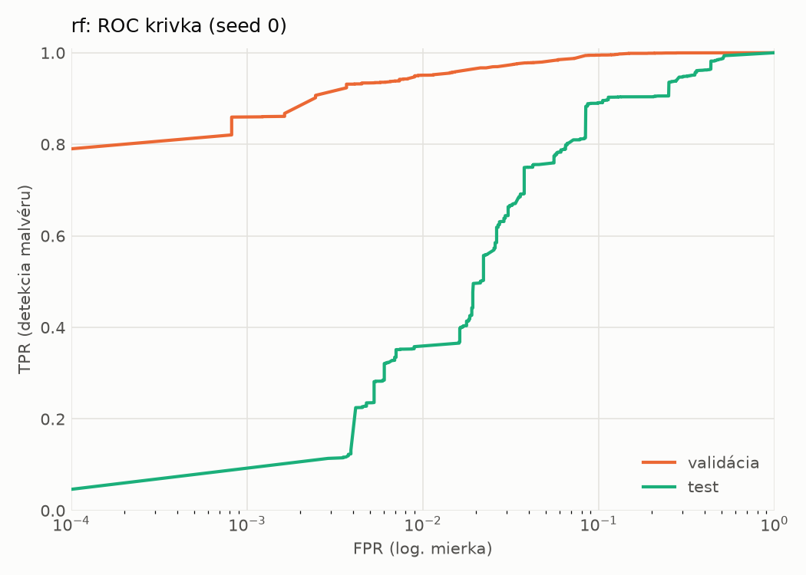
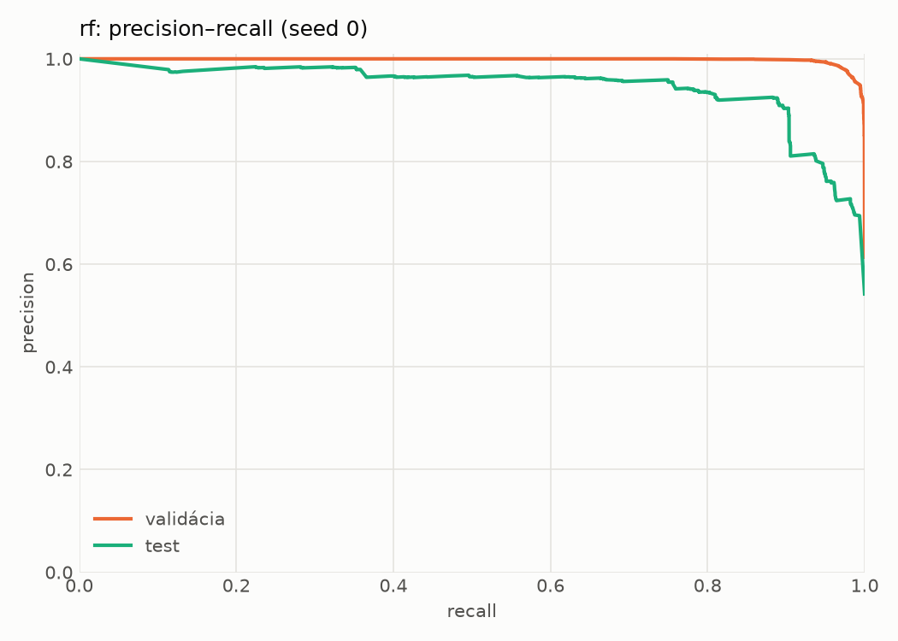
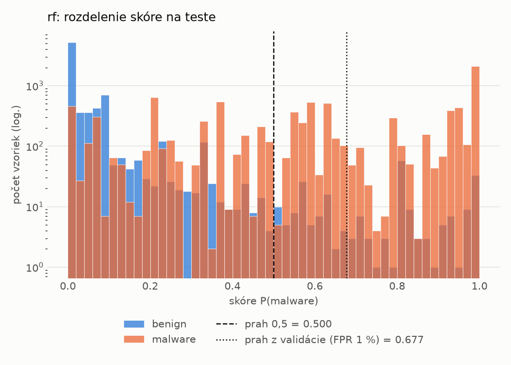
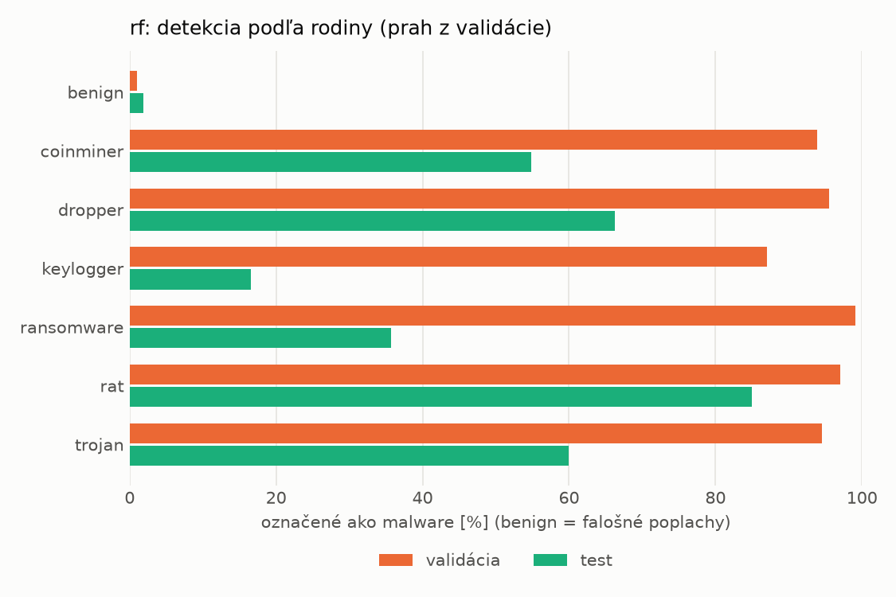
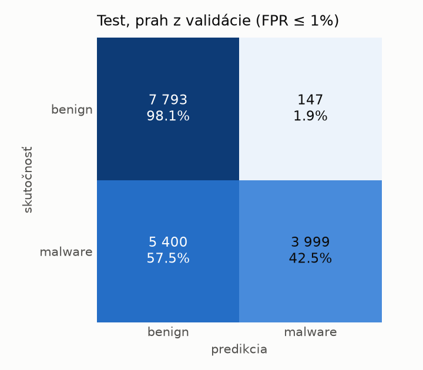
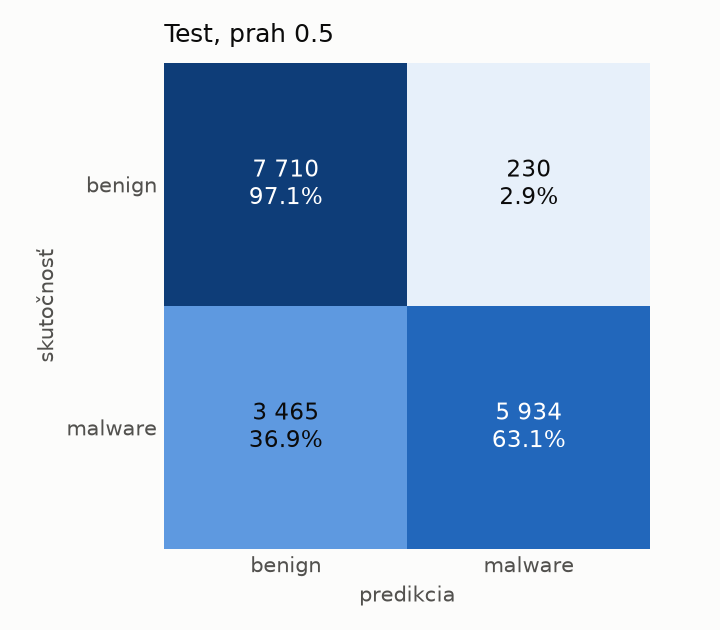

# dynamic/rf – beh `20261103-212748`

> Automaticky generované (`src/training/run_tabular.py`). Konfigurácia: `config.yaml`, protokol: `protocol.yaml`.

- **Model:** `random_forest` – Random Forest (pôvodné hodnoty príznakov)
- **Ladenie:** bez ladenia – hyperparametre prevzaté z `runs_final/dynamic/rf/20261102-003041`
- **Finálne modely:** seedy [0, 1, 2]; hodnoty sú priemer ± smerodajná odchýlka cez seedy
- **Najlepšie hyperparametre:** `{"n_estimators": 450, "max_depth": null, "min_samples_leaf": 1, "max_features": 0.05}`

## Detekčná kvalita (bez prahu)
| metrika | train (podvzorka) | validácia | test |
|---|---|---|---|
| ROC-AUC | 0.9979 ± 0.0000 | 0.9970 ± 0.0000 | 0.9408 ± 0.0008 |
| PR-AUC | 0.9986 ± 0.0000 | 0.9980 ± 0.0000 | 0.9447 ± 0.0004 |
| TPR pri FPR 1 % | 0.9540 ± 0.0007 | 0.9508 ± 0.0003 | 0.3554 ± 0.0023 |
| TPR pri FPR 0,1 % | 0.8608 ± 0.0004 | 0.8490 ± 0.0195 | 0.0000 ± 0.0000 |
| log loss | 0.0588 ± 0.0000 | 0.0683 ± 0.0002 | 0.5758 ± 0.0050 |
| Brier skóre | 0.0185 ± 0.0000 | 0.0204 ± 0.0000 | 0.1547 ± 0.0013 |

Rozdiel ROC-AUC train − validácia: **0.0009** (veľký rozdiel = preučenie).

## Pri prahu z validácie (FPR ≤ 1% na validácii)
| metrika | train (podvzorka) | validácia | test |
|---|---|---|---|
| accuracy | 0.9649 ± 0.0004 | 0.9661 ± 0.0001 | 0.6765 ± 0.0070 |
| balanced accuracy | 0.9699 ± 0.0003 | 0.9706 ± 0.0000 | 0.7001 ± 0.0064 |
| precision | 0.9952 ± 0.0001 | 0.9936 ± 0.0002 | 0.9644 ± 0.0002 |
| recall (TPR) | 0.9470 ± 0.0008 | 0.9508 ± 0.0003 | 0.4186 ± 0.0134 |
| FPR | 0.0071 ± 0.0001 | 0.0097 ± 0.0002 | 0.0183 ± 0.0006 |
| F1 | 0.9705 ± 0.0004 | 0.9718 ± 0.0001 | 0.5837 ± 0.0131 |
| MCC | 0.9289 ± 0.0008 | 0.9308 ± 0.0002 | 0.4702 ± 0.0099 |

## Pri pevnom prahu 0.5
| metrika | train (podvzorka) | validácia | test |
|---|---|---|---|
| accuracy | 0.9721 ± 0.0001 | 0.9715 ± 0.0001 | 0.7938 ± 0.0085 |
| balanced accuracy | 0.9735 ± 0.0000 | 0.9721 ± 0.0001 | 0.8075 ± 0.0078 |
| precision | 0.9868 ± 0.0000 | 0.9839 ± 0.0001 | 0.9637 ± 0.0009 |
| recall (TPR) | 0.9673 ± 0.0001 | 0.9694 ± 0.0001 | 0.6438 ± 0.0156 |
| FPR | 0.0203 ± 0.0000 | 0.0253 ± 0.0002 | 0.0287 ± 0.0003 |
| F1 | 0.9769 ± 0.0000 | 0.9766 ± 0.0001 | 0.7718 ± 0.0115 |
| MCC | 0.9420 ± 0.0001 | 0.9403 ± 0.0002 | 0.6376 ± 0.0130 |

## Výpočtové nároky (seed 0, testovacia množina)
| meranie | hodnota |
|---|---|
| tréning finálneho modelu | 29.5 s (priemer cez seedy) |
| ladenie spolu | 0 s |
| počet parametrov / uzlov | 987 510 |
| veľkosť modelu na disku | 79.41 MB |
| CPU latencia modelu (batch 1, 1 vlákno) | 13.083 ms (p95 14.157) |
| CPU priepustnosť (24 vlákien) | 89 027 vzoriek/s |

## Grafy
| | |
|---|---|
|  |  |
|  |  |
|  |  |
|  |  |

## Súbory
`metrics.json` (všetky metriky po seedoch vrátane rodín), `timing.json`, `hpo_trials.csv`,
`predictions/<časť>_seed<N>.parquet` (sha256, family, label, score), `model/seed_<N>/`, `log.txt`.
