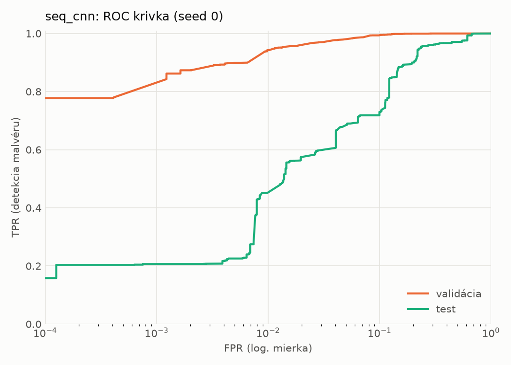
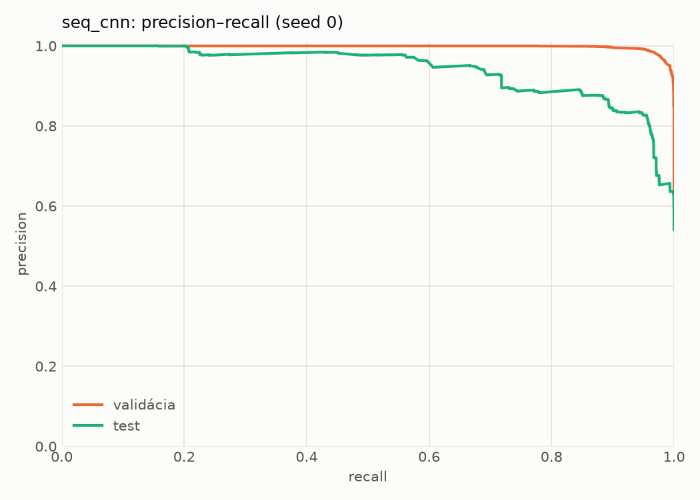
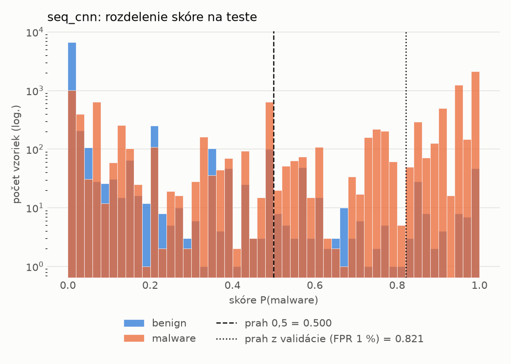
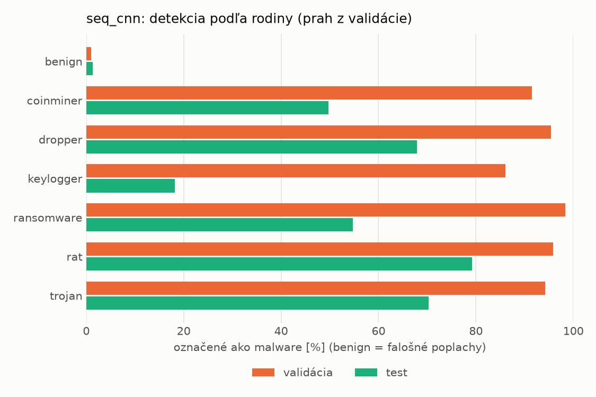
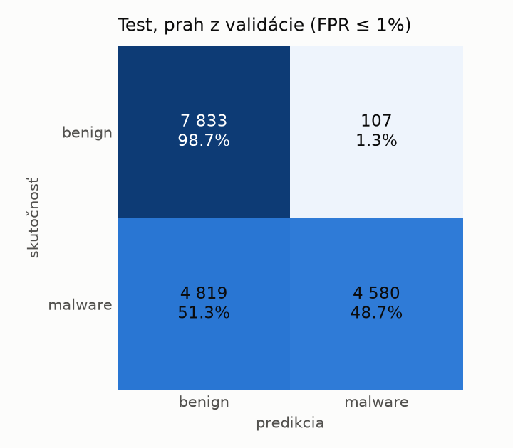
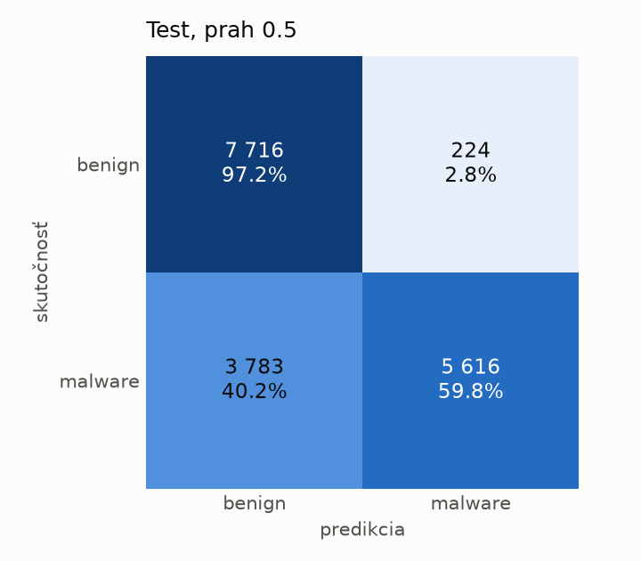
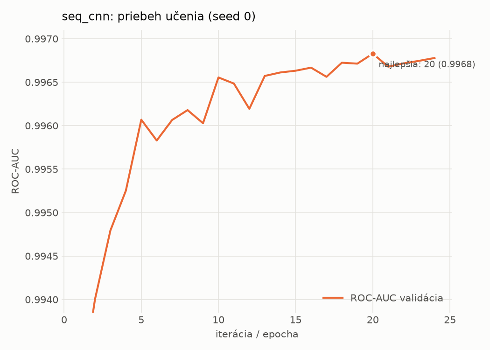

# dynamic_seq/seq_cnn – beh `20261103-213229`

> Automaticky generované (`src/training/run_tabular.py`). Konfigurácia: `config.yaml`, protokol: `protocol.yaml`.

- **Model:** `seq_cnn` – embedding API + paralelné 1D konvolúcie + maximum cez postupnosť
- **Ladenie:** bez ladenia – hyperparametre prevzaté z `runs_final/dynamic/seq_cnn/20261102-010741`
- **Finálne modely:** seedy [0, 1, 2]; hodnoty sú priemer ± smerodajná odchýlka cez seedy
- **Najlepšie hyperparametre:** `{"max_epochs": 30, "patience": 4, "emb_dim": 64, "channels": 128, "kernels": "2-4-8", "hidden": 64, "dropout": 0.19665662644598886, "lr": 0.0005755683530429188, "weight_decay": 0.0005400591881097476, "batch_size": 128}`

## Detekčná kvalita (bez prahu)
| metrika | train (podvzorka) | validácia | test |
|---|---|---|---|
| ROC-AUC | 0.9973 ± 0.0001 | 0.9968 ± 0.0001 | 0.9352 ± 0.0113 |
| PR-AUC | 0.9981 ± 0.0000 | 0.9979 ± 0.0001 | 0.9460 ± 0.0098 |
| TPR pri FPR 1 % | 0.9331 ± 0.0012 | 0.9428 ± 0.0027 | 0.4667 ± 0.0329 |
| TPR pri FPR 0,1 % | 0.8633 ± 0.0037 | 0.7865 ± 0.0244 | 0.2178 ± 0.0195 |
| log loss | 0.0668 ± 0.0014 | 0.0739 ± 0.0008 | 0.6961 ± 0.0551 |
| Brier skóre | 0.0210 ± 0.0003 | 0.0215 ± 0.0002 | 0.1606 ± 0.0144 |

Rozdiel ROC-AUC train − validácia: **0.0005** (veľký rozdiel = preučenie).

## Pri prahu z validácie (FPR ≤ 1% na validácii)
| metrika | train (podvzorka) | validácia | test |
|---|---|---|---|
| accuracy | 0.9557 ± 0.0024 | 0.9611 ± 0.0016 | 0.7412 ± 0.0220 |
| balanced accuracy | 0.9621 ± 0.0017 | 0.9665 ± 0.0013 | 0.7603 ± 0.0203 |
| precision | 0.9938 ± 0.0009 | 0.9936 ± 0.0001 | 0.9798 ± 0.0033 |
| recall (TPR) | 0.9333 ± 0.0048 | 0.9428 ± 0.0027 | 0.5336 ± 0.0403 |
| FPR | 0.0092 ± 0.0014 | 0.0097 ± 0.0002 | 0.0130 ± 0.0018 |
| F1 | 0.9626 ± 0.0021 | 0.9675 ± 0.0014 | 0.6903 ± 0.0348 |
| MCC | 0.9112 ± 0.0044 | 0.9212 ± 0.0030 | 0.5687 ± 0.0322 |

## Pri pevnom prahu 0.5
| metrika | train (podvzorka) | validácia | test |
|---|---|---|---|
| accuracy | 0.9686 ± 0.0004 | 0.9700 ± 0.0006 | 0.7850 ± 0.0307 |
| balanced accuracy | 0.9695 ± 0.0001 | 0.9706 ± 0.0008 | 0.7990 ± 0.0293 |
| precision | 0.9829 ± 0.0011 | 0.9829 ± 0.0018 | 0.9560 ± 0.0219 |
| recall (TPR) | 0.9653 ± 0.0017 | 0.9679 ± 0.0017 | 0.6322 ± 0.0477 |
| FPR | 0.0263 ± 0.0017 | 0.0268 ± 0.0029 | 0.0341 ± 0.0167 |
| F1 | 0.9741 ± 0.0003 | 0.9754 ± 0.0005 | 0.7606 ± 0.0390 |
| MCC | 0.9346 ± 0.0006 | 0.9372 ± 0.0012 | 0.6215 ± 0.0535 |

## Výpočtové nároky (seed 0, testovacia množina)
| meranie | hodnota |
|---|---|
| tréning finálneho modelu | 456.3 s (priemer cez seedy) |
| ladenie spolu | 0 s |
| počet parametrov / uzlov | 208 129 |
| veľkosť modelu na disku | 0.84 MB |
| CPU latencia modelu (batch 1, 1 vlákno) | 2.867 ms (p95 3.457) |
| CPU priepustnosť (24 vlákien) | 1 139 vzoriek/s |
| GPU latencia (batch 1) | 0.777 ms (p95 1.787) |
| GPU priepustnosť | 9 406 vzoriek/s |
| GPU špičková pamäť | 1846 MB |

## Grafy
| | |
|---|---|
|  |  |
|  |  |
|  |  |
|  |  |

## Súbory
`metrics.json` (všetky metriky po seedoch vrátane rodín), `timing.json`, `hpo_trials.csv`,
`predictions/<časť>_seed<N>.parquet` (sha256, family, label, score), `model/seed_<N>/`, `log.txt`.
