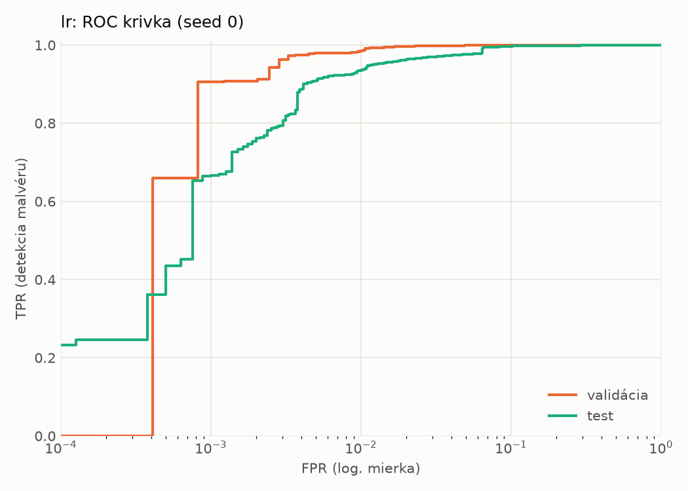
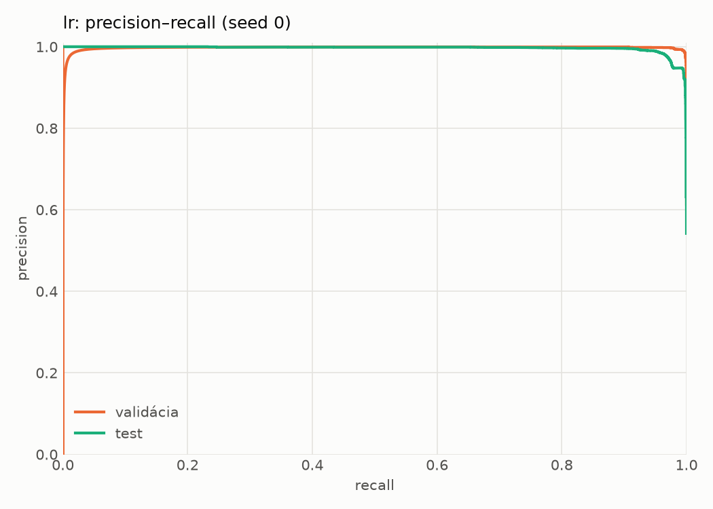
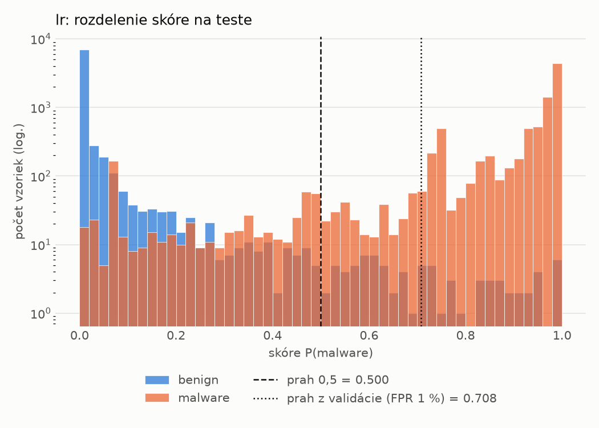
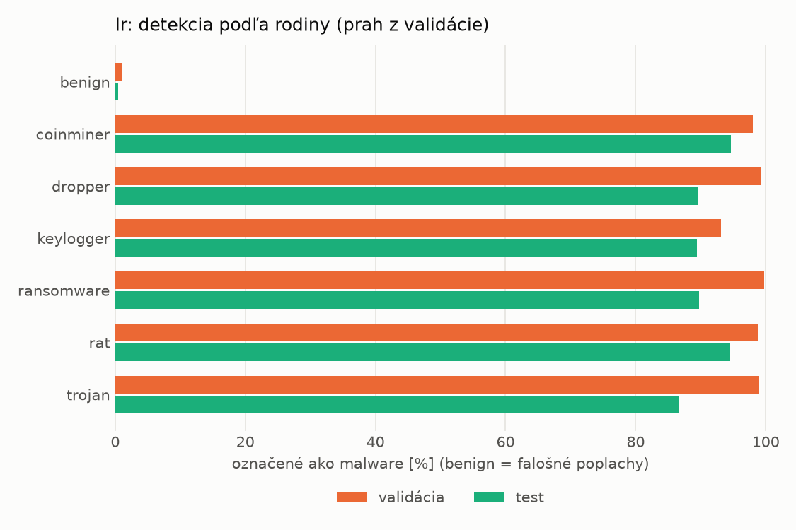
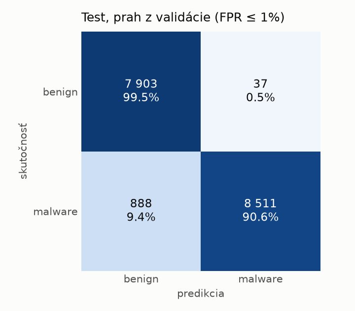
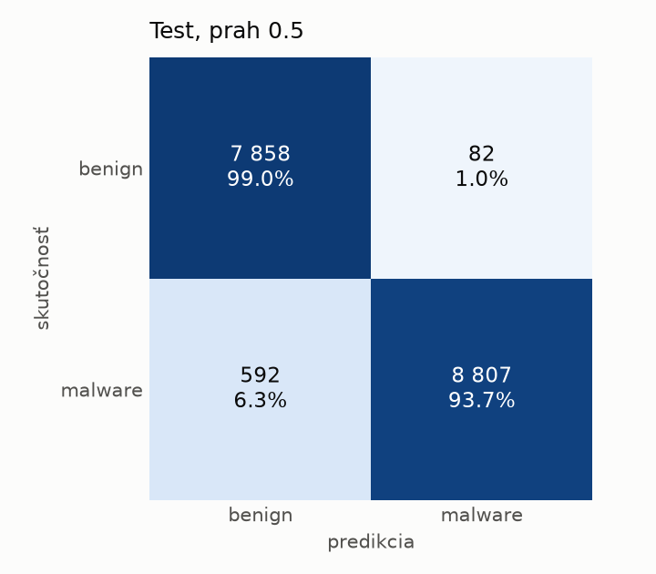

# hybrid/lr – beh `20261103-215845`

> Automaticky generované (`src/training/run_tabular.py`). Konfigurácia: `config.yaml`, protokol: `protocol.yaml`.

- **Model:** `logreg` – logistická regresia s L2 regularizáciou (vstup signed log1p + štandardizácia)
- **Ladenie:** bez ladenia – hyperparametre prevzaté z `runs_final/hybrid/lr/20261102-044357`
- **Finálne modely:** seedy [0, 1, 2]; hodnoty sú priemer ± smerodajná odchýlka cez seedy
- **Najlepšie hyperparametre:** `{"max_iter": 2000, "C": 0.0028355883180749405}`

## Detekčná kvalita (bez prahu)
| metrika | train (podvzorka) | validácia | test |
|---|---|---|---|
| ROC-AUC | 0.9995 ± 0.0000 | 0.9990 ± 0.0000 | 0.9958 ± 0.0000 |
| PR-AUC | 0.9997 ± 0.0000 | 0.9976 ± 0.0000 | 0.9963 ± 0.0000 |
| TPR pri FPR 1 % | 0.9943 ± 0.0000 | 0.9848 ± 0.0000 | 0.9347 ± 0.0000 |
| TPR pri FPR 0,1 % | 0.9235 ± 0.0000 | 0.9054 ± 0.0000 | 0.6652 ± 0.0000 |
| log loss | 0.0297 ± 0.0000 | 0.0337 ± 0.0000 | 0.1157 ± 0.0000 |
| Brier skóre | 0.0069 ± 0.0000 | 0.0079 ± 0.0000 | 0.0315 ± 0.0000 |

Rozdiel ROC-AUC train − validácia: **0.0006** (veľký rozdiel = preučenie).

## Pri prahu z validácie (FPR ≤ 1% na validácii)
| metrika | train (podvzorka) | validácia | test |
|---|---|---|---|
| accuracy | 0.9881 ± 0.0000 | 0.9869 ± 0.0000 | 0.9467 ± 0.0000 |
| balanced accuracy | 0.9893 ± 0.0000 | 0.9875 ± 0.0000 | 0.9504 ± 0.0000 |
| precision | 0.9967 ± 0.0000 | 0.9938 ± 0.0000 | 0.9957 ± 0.0000 |
| recall (TPR) | 0.9838 ± 0.0000 | 0.9848 ± 0.0000 | 0.9055 ± 0.0000 |
| FPR | 0.0051 ± 0.0000 | 0.0098 ± 0.0000 | 0.0047 ± 0.0000 |
| F1 | 0.9902 ± 0.0000 | 0.9893 ± 0.0000 | 0.9485 ± 0.0000 |
| MCC | 0.9752 ± 0.0000 | 0.9724 ± 0.0000 | 0.8978 ± 0.0000 |

## Pri pevnom prahu 0.5
| metrika | train (podvzorka) | validácia | test |
|---|---|---|---|
| accuracy | 0.9927 ± 0.0000 | 0.9905 ± 0.0000 | 0.9611 ± 0.0000 |
| balanced accuracy | 0.9922 ± 0.0000 | 0.9896 ± 0.0000 | 0.9633 ± 0.0000 |
| precision | 0.9936 ± 0.0000 | 0.9910 ± 0.0000 | 0.9908 ± 0.0000 |
| recall (TPR) | 0.9944 ± 0.0000 | 0.9936 ± 0.0000 | 0.9370 ± 0.0000 |
| FPR | 0.0100 ± 0.0000 | 0.0143 ± 0.0000 | 0.0103 ± 0.0000 |
| F1 | 0.9940 ± 0.0000 | 0.9923 ± 0.0000 | 0.9631 ± 0.0000 |
| MCC | 0.9846 ± 0.0000 | 0.9800 ± 0.0000 | 0.9237 ± 0.0000 |

## Výpočtové nároky (seed 0, testovacia množina)
| meranie | hodnota |
|---|---|
| tréning finálneho modelu | 4.4 s (priemer cez seedy) |
| ladenie spolu | 0 s |
| počet parametrov / uzlov | 4 316 |
| veľkosť modelu na disku | 0.13 MB |
| transformácia vstupu – latencia (1 vlákno) | 0.036 ms |
| transformácia vstupu – priepustnosť | 22 934 vzoriek/s |
| CPU latencia modelu (batch 1, 1 vlákno) | 0.008 ms (p95 0.008) |
| CPU priepustnosť (24 vlákien) | 155 039 vzoriek/s |

## Grafy
| | |
|---|---|
|  |  |
|  |  |
|  |  |
|  |  |

## Súbory
`metrics.json` (všetky metriky po seedoch vrátane rodín), `timing.json`, `hpo_trials.csv`,
`predictions/<časť>_seed<N>.parquet` (sha256, family, label, score), `model/seed_<N>/`, `log.txt`.
