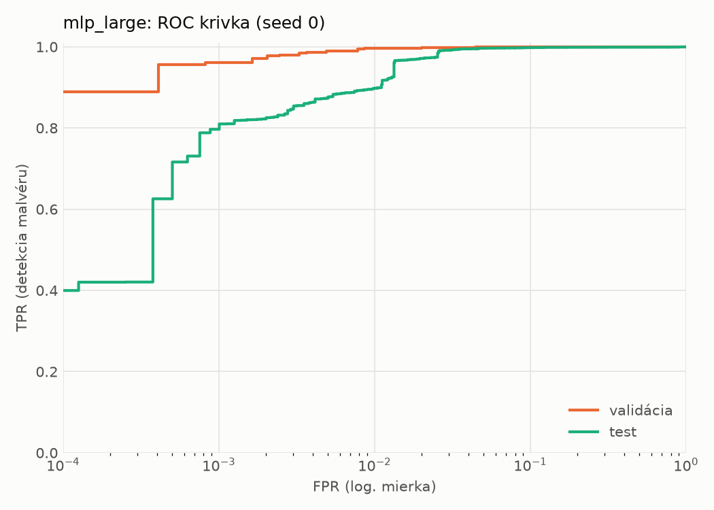
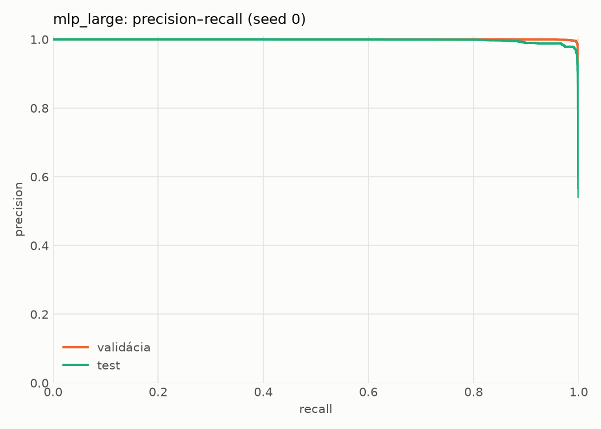
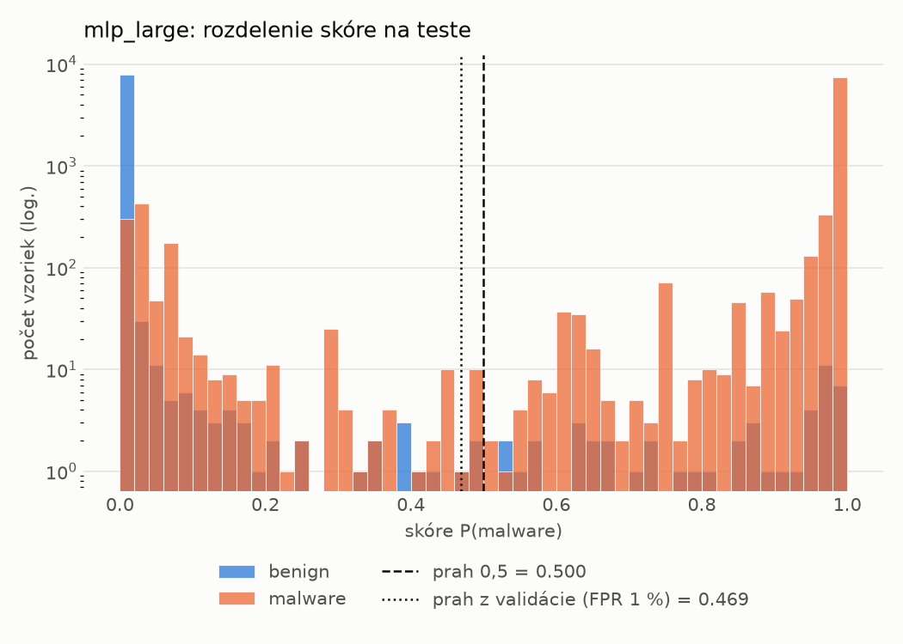
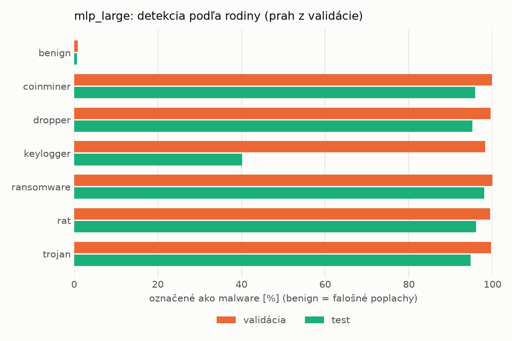
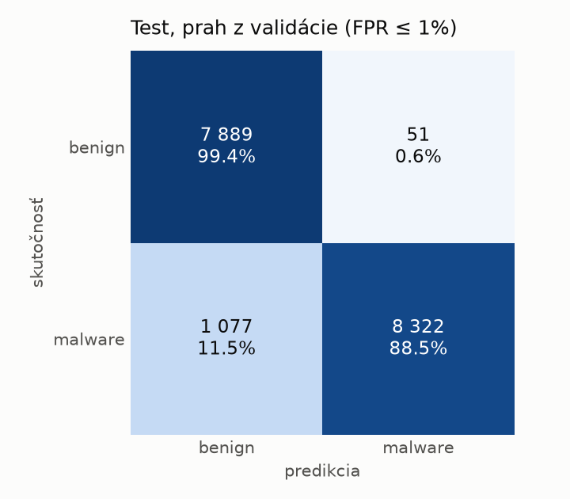
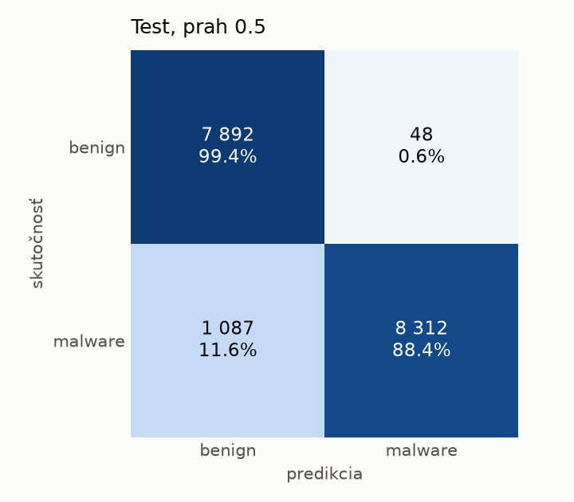
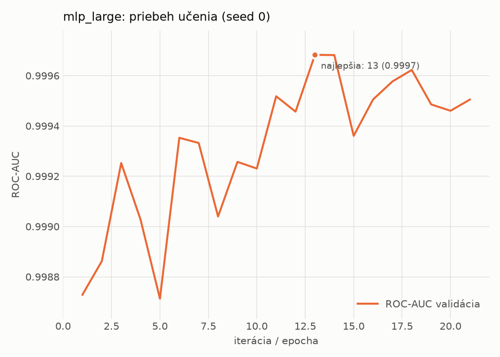

# hybrid/mlp_large – beh `20261103-220646`

> Automaticky generované (`src/training/run_tabular.py`). Konfigurácia: `config.yaml`, protokol: `protocol.yaml`.

- **Model:** `mlp` – veľká neurónová sieť (3–5 skrytých vrstiev, 512–2048 neurónov), kandidát na učiteľa
- **Ladenie:** bez ladenia – hyperparametre prevzaté z `runs_final/hybrid/mlp_large/20261102-064138`
- **Finálne modely:** seedy [0, 1, 2]; hodnoty sú priemer ± smerodajná odchýlka cez seedy
- **Najlepšie hyperparametre:** `{"max_epochs": 100, "patience": 8, "hidden_layers": 4, "hidden_width": 512, "width_decay": 0.5, "dropout": 0.1951820260605614, "lr": 0.000176468680848935, "weight_decay": 1.209699321025492e-05, "batch_size": 512}`

## Detekčná kvalita (bez prahu)
| metrika | train (podvzorka) | validácia | test |
|---|---|---|---|
| ROC-AUC | 0.9999 ± 0.0001 | 0.9997 ± 0.0000 | 0.9964 ± 0.0002 |
| PR-AUC | 0.9999 ± 0.0001 | 0.9998 ± 0.0000 | 0.9972 ± 0.0001 |
| TPR pri FPR 1 % | 0.9980 ± 0.0014 | 0.9960 ± 0.0001 | 0.9355 ± 0.0329 |
| TPR pri FPR 0,1 % | 0.9763 ± 0.0171 | 0.9492 ± 0.0122 | 0.7502 ± 0.0407 |
| log loss | 0.0236 ± 0.0164 | 0.0334 ± 0.0106 | 0.1884 ± 0.0442 |
| Brier skóre | 0.0039 ± 0.0016 | 0.0061 ± 0.0005 | 0.0475 ± 0.0123 |

Rozdiel ROC-AUC train − validácia: **0.0002** (veľký rozdiel = preučenie).

## Pri prahu z validácie (FPR ≤ 1% na validácii)
| metrika | train (podvzorka) | validácia | test |
|---|---|---|---|
| accuracy | 0.9956 ± 0.0013 | 0.9938 ± 0.0001 | 0.9475 ± 0.0156 |
| balanced accuracy | 0.9951 ± 0.0013 | 0.9931 ± 0.0001 | 0.9511 ± 0.0144 |
| precision | 0.9953 ± 0.0009 | 0.9939 ± 0.0001 | 0.9938 ± 0.0004 |
| recall (TPR) | 0.9975 ± 0.0011 | 0.9960 ± 0.0001 | 0.9088 ± 0.0287 |
| FPR | 0.0074 ± 0.0015 | 0.0097 ± 0.0002 | 0.0067 ± 0.0003 |
| F1 | 0.9964 ± 0.0010 | 0.9949 ± 0.0001 | 0.9493 ± 0.0157 |
| MCC | 0.9908 ± 0.0026 | 0.9869 ± 0.0002 | 0.8993 ± 0.0286 |

## Pri pevnom prahu 0.5
| metrika | train (podvzorka) | validácia | test |
|---|---|---|---|
| accuracy | 0.9956 ± 0.0012 | 0.9936 ± 0.0002 | 0.9431 ± 0.0126 |
| balanced accuracy | 0.9951 ± 0.0012 | 0.9931 ± 0.0002 | 0.9470 ± 0.0116 |
| precision | 0.9956 ± 0.0010 | 0.9942 ± 0.0001 | 0.9943 ± 0.0002 |
| recall (TPR) | 0.9972 ± 0.0010 | 0.9953 ± 0.0004 | 0.9001 ± 0.0231 |
| FPR | 0.0069 ± 0.0016 | 0.0091 ± 0.0002 | 0.0061 ± 0.0001 |
| F1 | 0.9964 ± 0.0010 | 0.9948 ± 0.0002 | 0.9448 ± 0.0128 |
| MCC | 0.9907 ± 0.0025 | 0.9864 ± 0.0005 | 0.8912 ± 0.0229 |

## Výpočtové nároky (seed 0, testovacia množina)
| meranie | hodnota |
|---|---|
| tréning finálneho modelu | 6.2 s (priemer cez seedy) |
| ladenie spolu | 0 s |
| počet parametrov / uzlov | 2 384 257 |
| veľkosť modelu na disku | 9.66 MB |
| transformácia vstupu – latencia (1 vlákno) | 0.063 ms |
| transformácia vstupu – priepustnosť | 21 320 vzoriek/s |
| CPU latencia modelu (batch 1, 1 vlákno) | 0.288 ms (p95 0.363) |
| CPU priepustnosť (24 vlákien) | 37 861 vzoriek/s |
| GPU latencia (batch 1) | 0.537 ms (p95 1.052) |
| GPU priepustnosť | 35 541 vzoriek/s |
| GPU špičková pamäť | 2551 MB |

## Grafy
| | |
|---|---|
|  |  |
|  |  |
|  |  |
|  |  |

## Súbory
`metrics.json` (všetky metriky po seedoch vrátane rodín), `timing.json`, `hpo_trials.csv`,
`predictions/<časť>_seed<N>.parquet` (sha256, family, label, score), `model/seed_<N>/`, `log.txt`.
