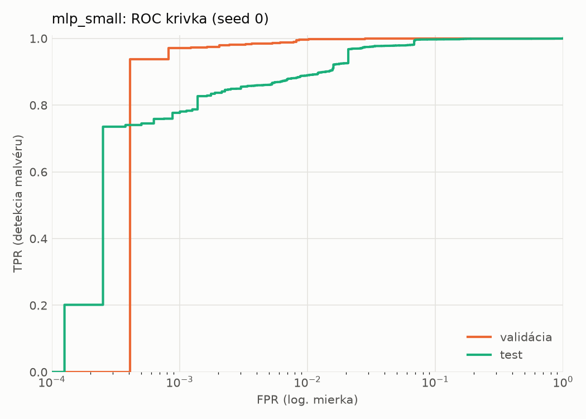
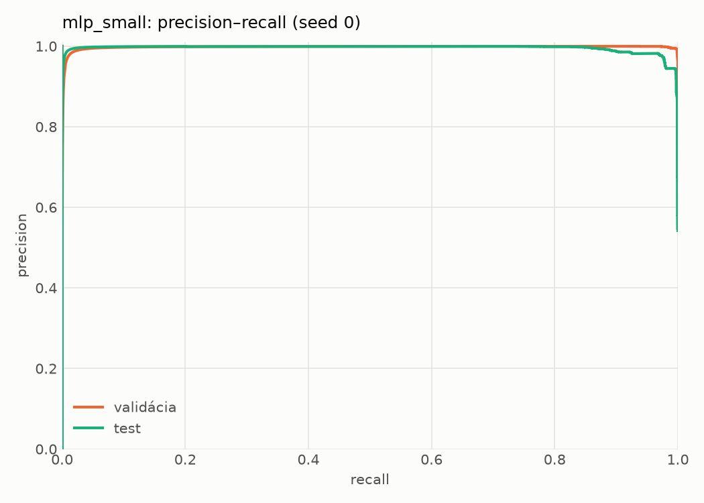
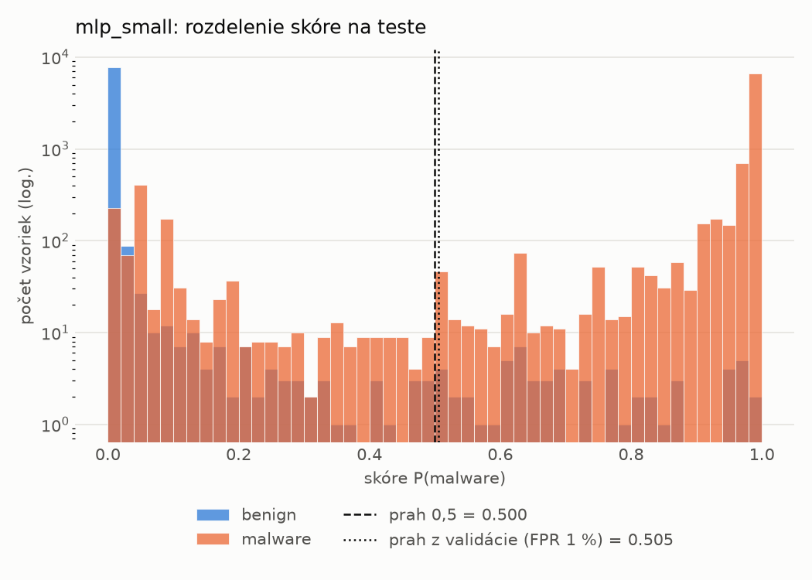
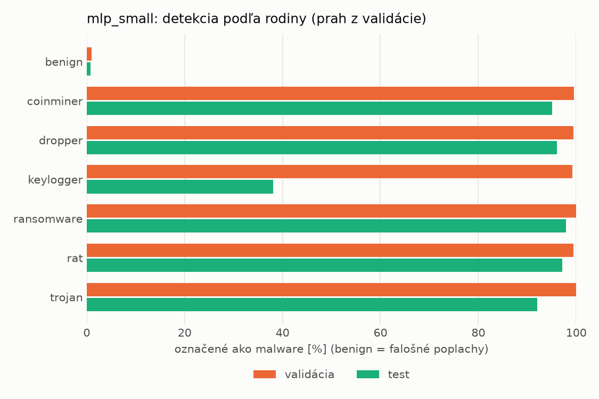
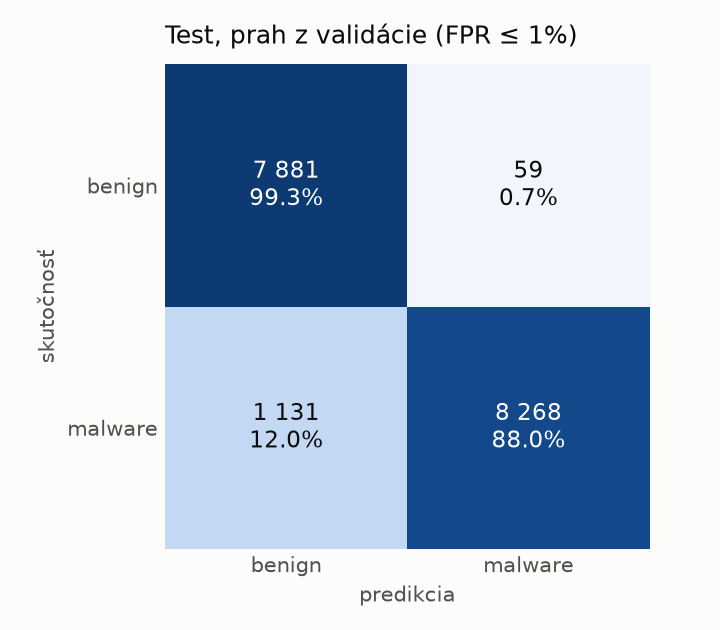
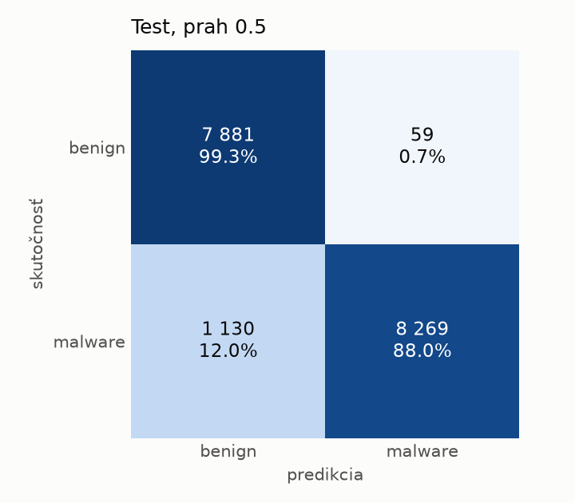
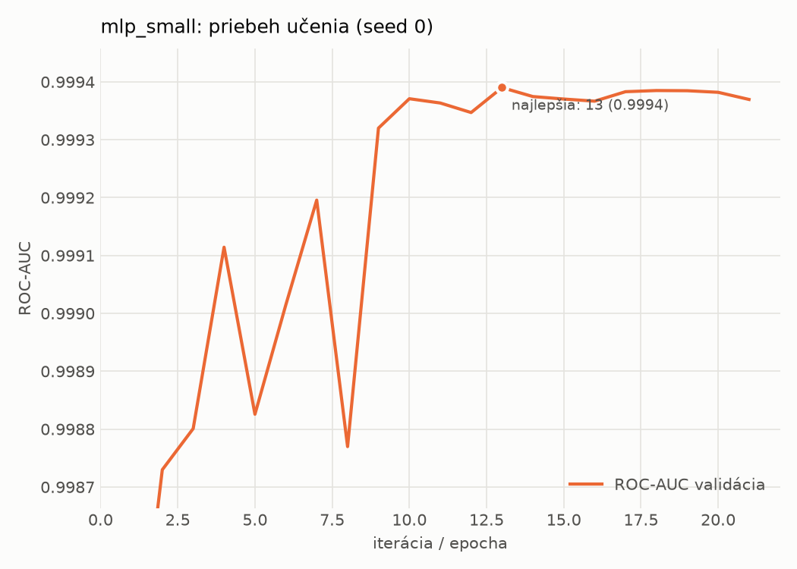

# hybrid/mlp_small – beh `20261103-220603`

> Automaticky generované (`src/training/run_tabular.py`). Konfigurácia: `config.yaml`, protokol: `protocol.yaml`.

- **Model:** `mlp` – malá neurónová sieť (1–2 skryté vrstvy), kandidát na ľahkého študenta
- **Ladenie:** bez ladenia – hyperparametre prevzaté z `runs_final/hybrid/mlp_small/20261102-063854`
- **Finálne modely:** seedy [0, 1, 2]; hodnoty sú priemer ± smerodajná odchýlka cez seedy
- **Najlepšie hyperparametre:** `{"width_decay": 0.5, "max_epochs": 100, "patience": 8, "hidden_layers": 2, "hidden_width": 32, "dropout": 0.16874195706419903, "lr": 0.0006143857735366936, "weight_decay": 0.007079811471617702, "batch_size": 512}`

## Detekčná kvalita (bez prahu)
| metrika | train (podvzorka) | validácia | test |
|---|---|---|---|
| ROC-AUC | 0.9999 ± 0.0001 | 0.9995 ± 0.0001 | 0.9956 ± 0.0008 |
| PR-AUC | 0.9999 ± 0.0000 | 0.9991 ± 0.0011 | 0.9952 ± 0.0023 |
| TPR pri FPR 1 % | 0.9984 ± 0.0007 | 0.9961 ± 0.0009 | 0.9118 ± 0.0268 |
| TPR pri FPR 0,1 % | 0.9832 ± 0.0065 | 0.9245 ± 0.0540 | 0.7216 ± 0.0952 |
| log loss | 0.0200 ± 0.0072 | 0.0259 ± 0.0054 | 0.1772 ± 0.0418 |
| Brier skóre | 0.0038 ± 0.0009 | 0.0053 ± 0.0005 | 0.0500 ± 0.0090 |

Rozdiel ROC-AUC train − validácia: **0.0004** (veľký rozdiel = preučenie).

## Pri prahu z validácie (FPR ≤ 1% na validácii)
| metrika | train (podvzorka) | validácia | test |
|---|---|---|---|
| accuracy | 0.9953 ± 0.0009 | 0.9940 ± 0.0007 | 0.9264 ± 0.0044 |
| balanced accuracy | 0.9950 ± 0.0010 | 0.9934 ± 0.0006 | 0.9315 ± 0.0041 |
| precision | 0.9957 ± 0.0010 | 0.9941 ± 0.0004 | 0.9930 ± 0.0001 |
| recall (TPR) | 0.9967 ± 0.0008 | 0.9961 ± 0.0009 | 0.8703 ± 0.0084 |
| FPR | 0.0068 ± 0.0015 | 0.0094 ± 0.0007 | 0.0072 ± 0.0002 |
| F1 | 0.9962 ± 0.0007 | 0.9951 ± 0.0006 | 0.9276 ± 0.0047 |
| MCC | 0.9902 ± 0.0019 | 0.9873 ± 0.0015 | 0.8611 ± 0.0078 |

## Pri pevnom prahu 0.5
| metrika | train (podvzorka) | validácia | test |
|---|---|---|---|
| accuracy | 0.9953 ± 0.0013 | 0.9937 ± 0.0006 | 0.9326 ± 0.0056 |
| balanced accuracy | 0.9948 ± 0.0013 | 0.9929 ± 0.0007 | 0.9372 ± 0.0051 |
| precision | 0.9952 ± 0.0011 | 0.9932 ± 0.0006 | 0.9923 ± 0.0005 |
| recall (TPR) | 0.9972 ± 0.0011 | 0.9966 ± 0.0004 | 0.8825 ± 0.0106 |
| FPR | 0.0075 ± 0.0017 | 0.0108 ± 0.0010 | 0.0081 ± 0.0006 |
| F1 | 0.9962 ± 0.0010 | 0.9949 ± 0.0005 | 0.9342 ± 0.0058 |
| MCC | 0.9902 ± 0.0026 | 0.9868 ± 0.0013 | 0.8719 ± 0.0099 |

## Výpočtové nároky (seed 0, testovacia množina)
| meranie | hodnota |
|---|---|
| tréning finálneho modelu | 8.0 s (priemer cez seedy) |
| ladenie spolu | 0 s |
| počet parametrov / uzlov | 138 753 |
| veľkosť modelu na disku | 0.67 MB |
| transformácia vstupu – latencia (1 vlákno) | 0.039 ms |
| transformácia vstupu – priepustnosť | 23 061 vzoriek/s |
| CPU latencia modelu (batch 1, 1 vlákno) | 0.102 ms (p95 0.113) |
| CPU priepustnosť (24 vlákien) | 46 812 vzoriek/s |
| GPU latencia (batch 1) | 0.414 ms (p95 0.460) |
| GPU priepustnosť | 30 837 vzoriek/s |
| GPU špičková pamäť | 1411 MB |

## Grafy
| | |
|---|---|
|  |  |
|  |  |
|  |  |
|  |  |

## Súbory
`metrics.json` (všetky metriky po seedoch vrátane rodín), `timing.json`, `hpo_trials.csv`,
`predictions/<časť>_seed<N>.parquet` (sha256, family, label, score), `model/seed_<N>/`, `log.txt`.
