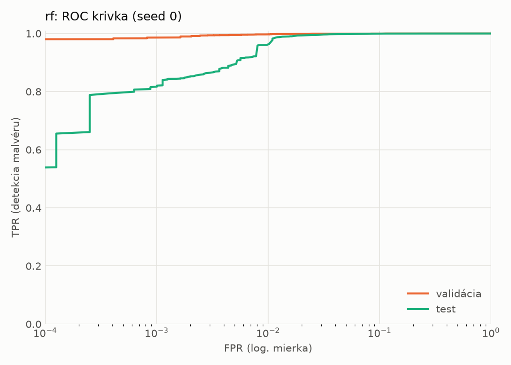
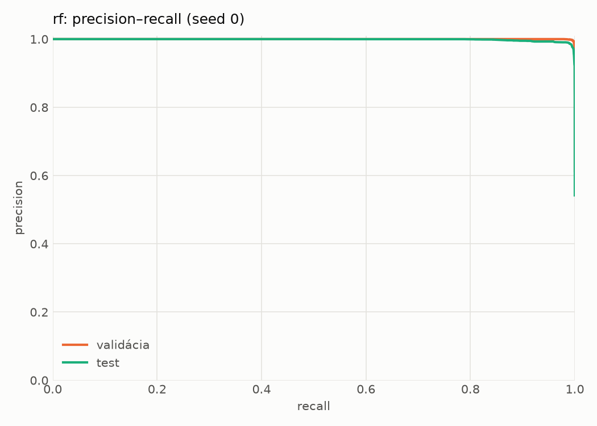
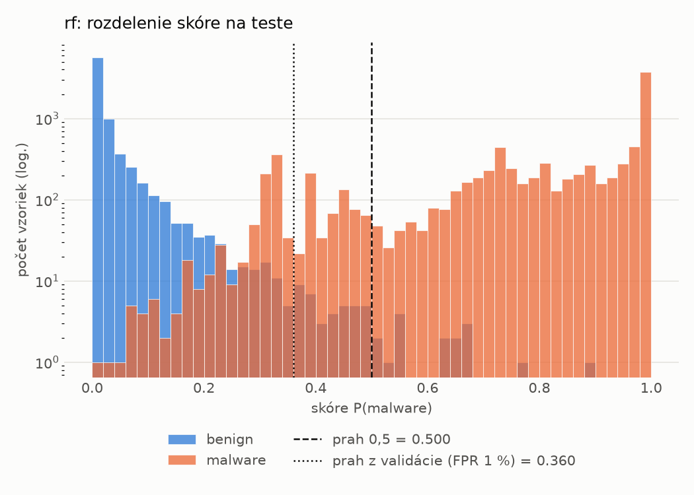
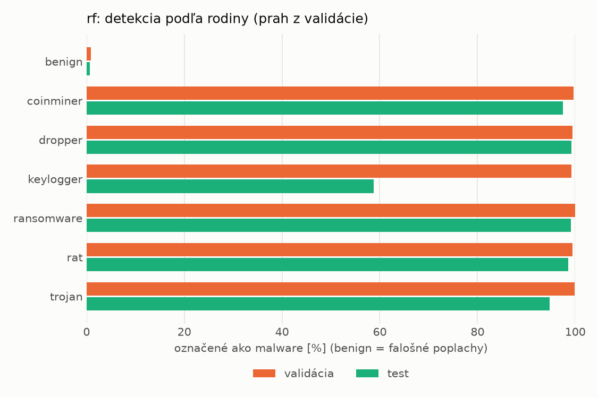
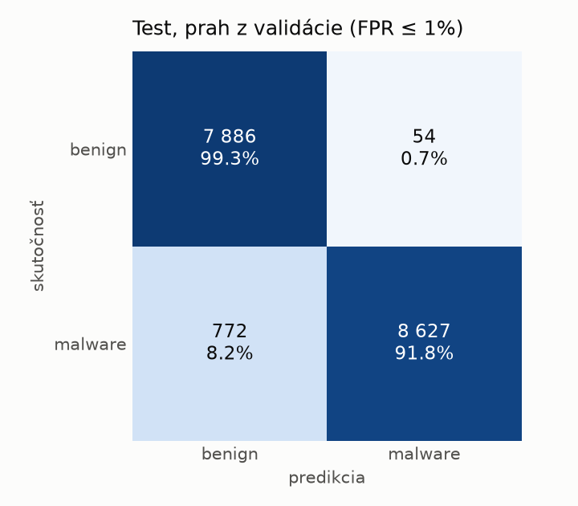
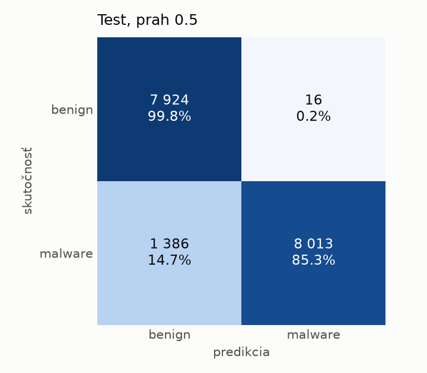

# hybrid/rf – beh `20261103-215918`

> Automaticky generované (`src/training/run_tabular.py`). Konfigurácia: `config.yaml`, protokol: `protocol.yaml`.

- **Model:** `random_forest` – Random Forest (pôvodné hodnoty príznakov)
- **Ladenie:** bez ladenia – hyperparametre prevzaté z `runs_final/hybrid/rf/20261102-044751`
- **Finálne modely:** seedy [0, 1, 2]; hodnoty sú priemer ± smerodajná odchýlka cez seedy
- **Najlepšie hyperparametre:** `{"n_estimators": 250, "max_depth": null, "min_samples_leaf": 1, "max_features": 0.05}`

## Detekčná kvalita (bez prahu)
| metrika | train (podvzorka) | validácia | test |
|---|---|---|---|
| ROC-AUC | 1.0000 ± 0.0000 | 0.9998 ± 0.0000 | 0.9985 ± 0.0001 |
| PR-AUC | 1.0000 ± 0.0000 | 0.9999 ± 0.0000 | 0.9987 ± 0.0001 |
| TPR pri FPR 1 % | 1.0000 ± 0.0000 | 0.9971 ± 0.0003 | 0.9693 ± 0.0121 |
| TPR pri FPR 0,1 % | 1.0000 ± 0.0000 | 0.9860 ± 0.0001 | 0.8147 ± 0.0006 |
| log loss | 0.0071 ± 0.0000 | 0.0210 ± 0.0002 | 0.1542 ± 0.0037 |
| Brier skóre | 0.0009 ± 0.0000 | 0.0047 ± 0.0001 | 0.0475 ± 0.0016 |

Rozdiel ROC-AUC train − validácia: **0.0002** (veľký rozdiel = preučenie).

## Pri prahu z validácie (FPR ≤ 1% na validácii)
| metrika | train (podvzorka) | validácia | test |
|---|---|---|---|
| accuracy | 1.0000 ± 0.0000 | 0.9945 ± 0.0002 | 0.9604 ± 0.0132 |
| balanced accuracy | 1.0000 ± 0.0000 | 0.9937 ± 0.0001 | 0.9628 ± 0.0121 |
| precision | 1.0000 ± 0.0000 | 0.9939 ± 0.0001 | 0.9928 ± 0.0009 |
| recall (TPR) | 1.0000 ± 0.0000 | 0.9971 ± 0.0003 | 0.9337 ± 0.0248 |
| FPR | 0.0000 ± 0.0000 | 0.0097 ± 0.0002 | 0.0081 ± 0.0011 |
| F1 | 1.0000 ± 0.0000 | 0.9955 ± 0.0001 | 0.9622 ± 0.0130 |
| MCC | 1.0000 ± 0.0000 | 0.9883 ± 0.0003 | 0.9228 ± 0.0249 |

## Pri pevnom prahu 0.5
| metrika | train (podvzorka) | validácia | test |
|---|---|---|---|
| accuracy | 1.0000 ± 0.0000 | 0.9951 ± 0.0002 | 0.9226 ± 0.0036 |
| balanced accuracy | 1.0000 ± 0.0000 | 0.9953 ± 0.0002 | 0.9284 ± 0.0033 |
| precision | 1.0000 ± 0.0000 | 0.9976 ± 0.0004 | 0.9977 ± 0.0002 |
| recall (TPR) | 1.0000 ± 0.0000 | 0.9944 ± 0.0001 | 0.8592 ± 0.0069 |
| FPR | 0.0000 ± 0.0000 | 0.0038 ± 0.0006 | 0.0023 ± 0.0003 |
| F1 | 1.0000 ± 0.0000 | 0.9960 ± 0.0001 | 0.9233 ± 0.0039 |
| MCC | 1.0000 ± 0.0000 | 0.9897 ± 0.0003 | 0.8557 ± 0.0062 |

## Výpočtové nároky (seed 0, testovacia množina)
| meranie | hodnota |
|---|---|
| tréning finálneho modelu | 113.1 s (priemer cez seedy) |
| ladenie spolu | 0 s |
| počet parametrov / uzlov | 268 400 |
| veľkosť modelu na disku | 21.80 MB |
| CPU latencia modelu (batch 1, 1 vlákno) | 7.237 ms (p95 8.140) |
| CPU priepustnosť (24 vlákien) | 89 633 vzoriek/s |

## Grafy
| | |
|---|---|
|  |  |
|  |  |
|  |  |
|  |  |

## Súbory
`metrics.json` (všetky metriky po seedoch vrátane rodín), `timing.json`, `hpo_trials.csv`,
`predictions/<časť>_seed<N>.parquet` (sha256, family, label, score), `model/seed_<N>/`, `log.txt`.
