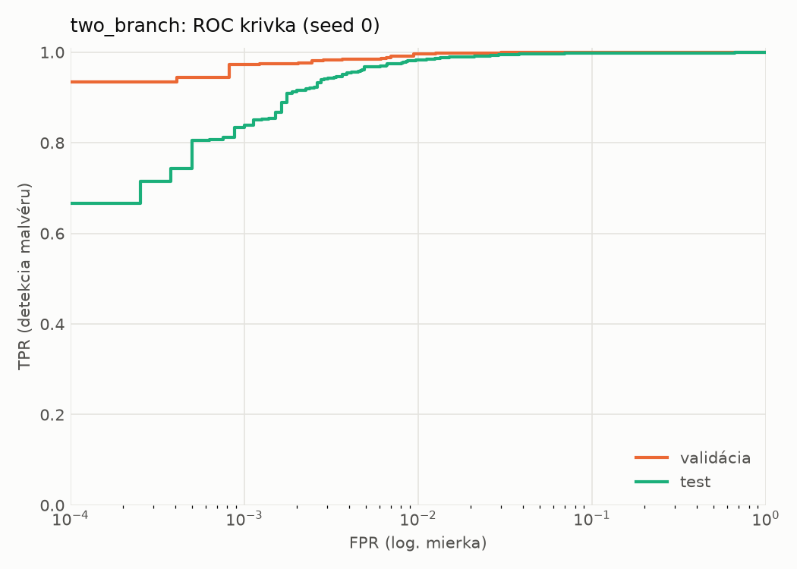
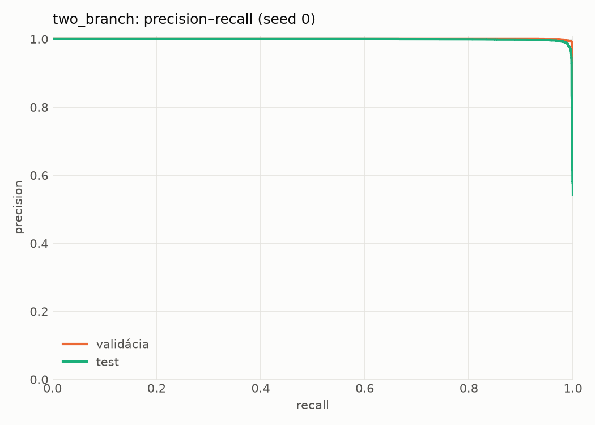
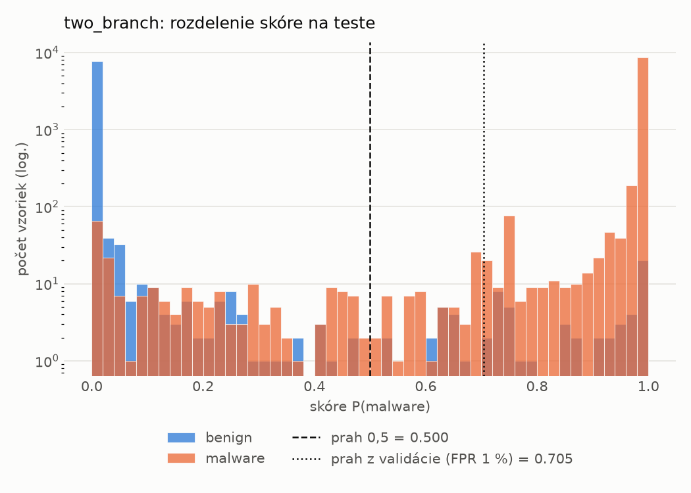
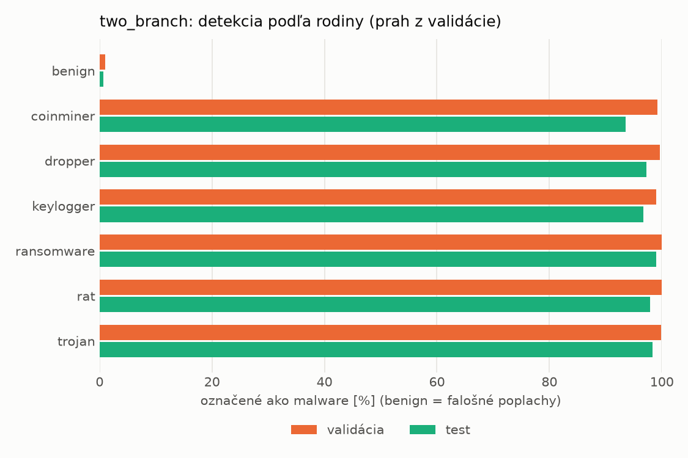
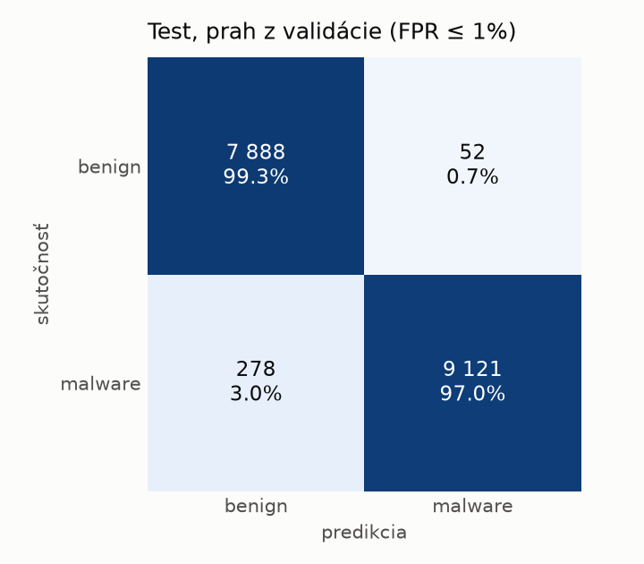
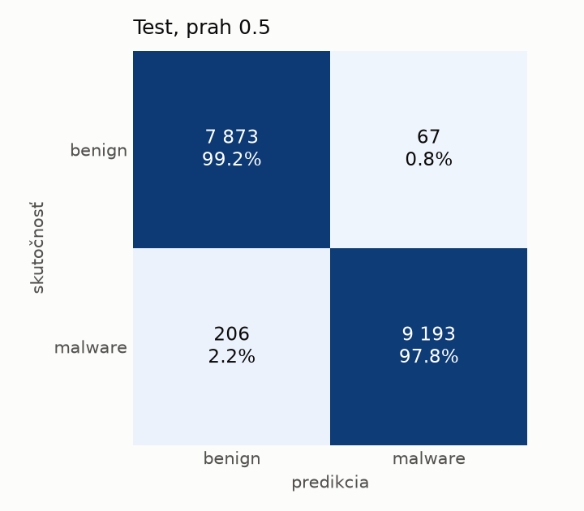
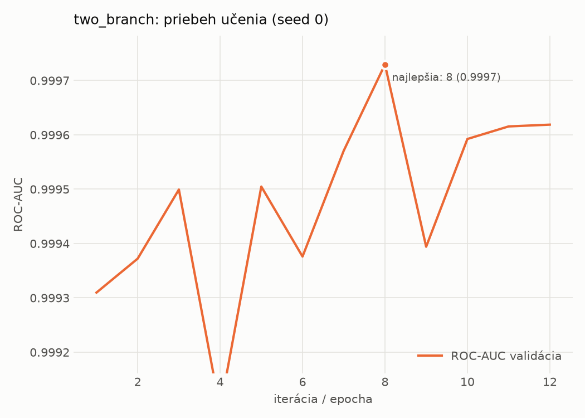

# hybrid_seq/two_branch – beh `20261103-220724`

> Automaticky generované (`src/training/run_tabular.py`). Konfigurácia: `config.yaml`, protokol: `protocol.yaml`.

- **Model:** `two_branch` – statická MLP vetva + sekvenčná CNN vetva nad API volaniami, spojené v spoločnej hlave
- **Ladenie:** bez ladenia – hyperparametre prevzaté z `runs_final/hybrid/two_branch/20261102-170657`
- **Finálne modely:** seedy [0, 1, 2]; hodnoty sú priemer ± smerodajná odchýlka cez seedy
- **Najlepšie hyperparametre:** `{"n_static": 2381, "width_decay": 0.5, "max_epochs": 30, "patience": 4, "static_layers": 3, "static_width": 256, "emb_dim": 64, "channels": 256, "kernels": "2-4-8", "hidden": 512, "dropout": 0.32477392485404594, "lr": 0.0006728393356648638, "weight_decay": 0.0003230215070317658, "batch_size": 256}`

## Detekčná kvalita (bez prahu)
| metrika | train (podvzorka) | validácia | test |
|---|---|---|---|
| ROC-AUC | 0.9998 ± 0.0001 | 0.9996 ± 0.0002 | 0.9979 ± 0.0003 |
| PR-AUC | 0.9999 ± 0.0000 | 0.9997 ± 0.0001 | 0.9985 ± 0.0003 |
| TPR pri FPR 1 % | 0.9981 ± 0.0008 | 0.9958 ± 0.0007 | 0.9788 ± 0.0043 |
| TPR pri FPR 0,1 % | 0.9793 ± 0.0021 | 0.9006 ± 0.0640 | 0.8540 ± 0.0352 |
| log loss | 0.0148 ± 0.0021 | 0.0251 ± 0.0005 | 0.0673 ± 0.0086 |
| Brier skóre | 0.0040 ± 0.0006 | 0.0058 ± 0.0002 | 0.0163 ± 0.0030 |

Rozdiel ROC-AUC train − validácia: **0.0003** (veľký rozdiel = preučenie).

## Pri prahu z validácie (FPR ≤ 1% na validácii)
| metrika | train (podvzorka) | validácia | test |
|---|---|---|---|
| accuracy | 0.9953 ± 0.0006 | 0.9939 ± 0.0003 | 0.9769 ± 0.0037 |
| balanced accuracy | 0.9950 ± 0.0005 | 0.9933 ± 0.0003 | 0.9782 ± 0.0034 |
| precision | 0.9961 ± 0.0004 | 0.9943 ± 0.0005 | 0.9949 ± 0.0009 |
| recall (TPR) | 0.9962 ± 0.0010 | 0.9958 ± 0.0007 | 0.9624 ± 0.0076 |
| FPR | 0.0062 ± 0.0007 | 0.0091 ± 0.0009 | 0.0059 ± 0.0011 |
| F1 | 0.9962 ± 0.0005 | 0.9950 ± 0.0003 | 0.9783 ± 0.0036 |
| MCC | 0.9901 ± 0.0013 | 0.9871 ± 0.0007 | 0.9543 ± 0.0072 |

## Pri pevnom prahu 0.5
| metrika | train (podvzorka) | validácia | test |
|---|---|---|---|
| accuracy | 0.9949 ± 0.0008 | 0.9928 ± 0.0008 | 0.9792 ± 0.0044 |
| balanced accuracy | 0.9944 ± 0.0008 | 0.9919 ± 0.0008 | 0.9802 ± 0.0040 |
| precision | 0.9949 ± 0.0009 | 0.9924 ± 0.0008 | 0.9935 ± 0.0007 |
| recall (TPR) | 0.9967 ± 0.0010 | 0.9959 ± 0.0009 | 0.9680 ± 0.0087 |
| FPR | 0.0080 ± 0.0014 | 0.0121 ± 0.0013 | 0.0075 ± 0.0008 |
| F1 | 0.9958 ± 0.0006 | 0.9941 ± 0.0006 | 0.9806 ± 0.0042 |
| MCC | 0.9893 ± 0.0016 | 0.9848 ± 0.0017 | 0.9586 ± 0.0085 |

## Výpočtové nároky (seed 0, testovacia množina)
| meranie | hodnota |
|---|---|
| tréning finálneho modelu | 349.9 s (priemer cez seedy) |
| ladenie spolu | 0 s |
| počet parametrov / uzlov | 1 754 690 |
| veľkosť modelu na disku | 7.09 MB |
| CPU latencia modelu (batch 1, 1 vlákno) | 5.334 ms (p95 5.689) |
| CPU priepustnosť (24 vlákien) | 635 vzoriek/s |
| GPU latencia (batch 1) | 1.236 ms (p95 3.203) |
| GPU priepustnosť | 4 381 vzoriek/s |
| GPU špičková pamäť | 3659 MB |

## Grafy
| | |
|---|---|
|  |  |
|  |  |
|  |  |
|  |  |

## Súbory
`metrics.json` (všetky metriky po seedoch vrátane rodín), `timing.json`, `hpo_trials.csv`,
`predictions/<časť>_seed<N>.parquet` (sha256, family, label, score), `model/seed_<N>/`, `log.txt`.
