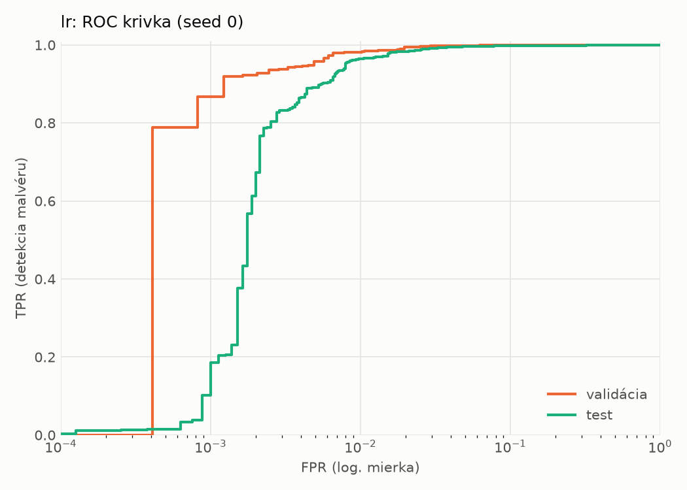
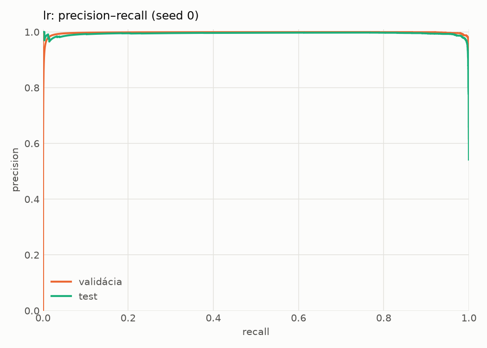
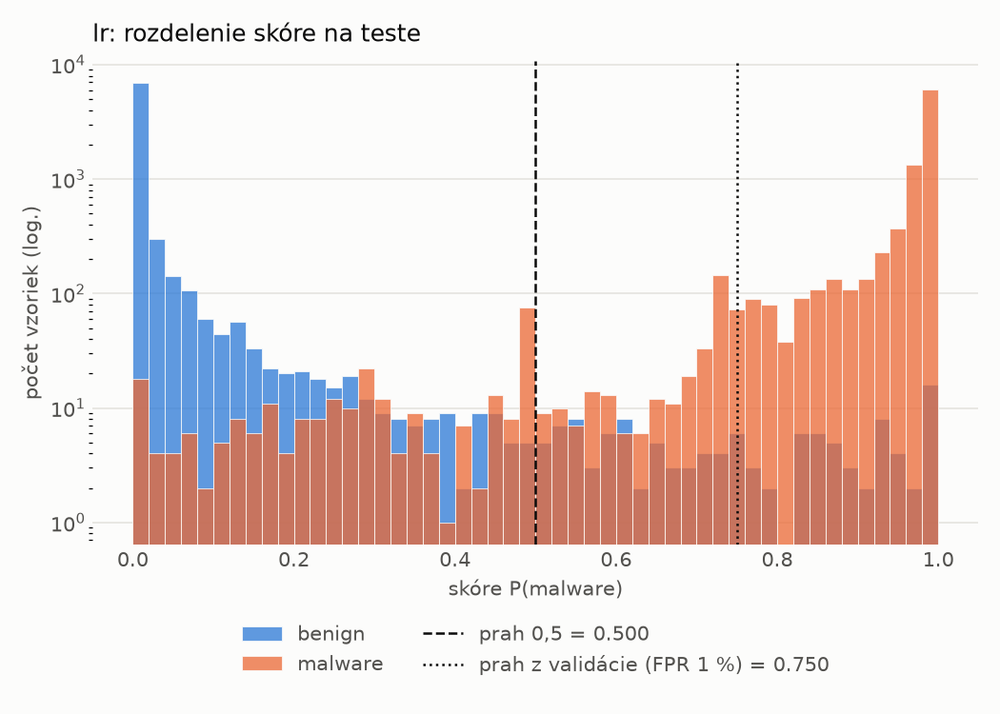
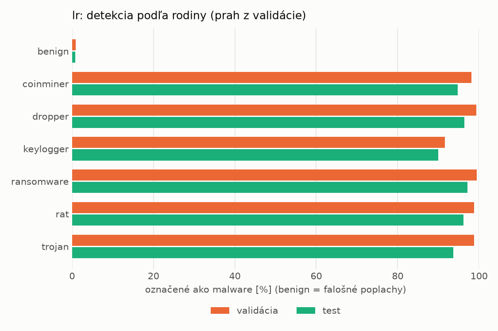
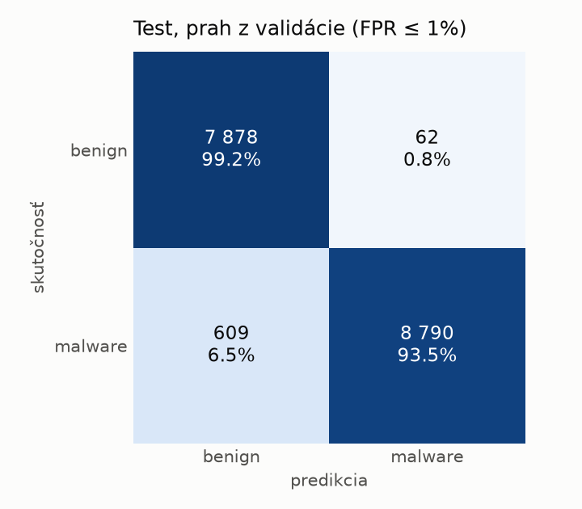
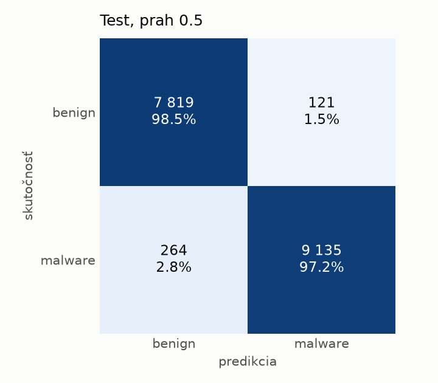

# static/lr – beh `20261103-211132`

> Automaticky generované (`src/training/run_tabular.py`). Konfigurácia: `config.yaml`, protokol: `protocol.yaml`.

- **Model:** `logreg` – logistická regresia s L2 regularizáciou (vstup signed log1p + štandardizácia)
- **Ladenie:** bez ladenia – hyperparametre prevzaté z `runs_final/static/lr/20261101-213555`
- **Finálne modely:** seedy [0, 1, 2]; hodnoty sú priemer ± smerodajná odchýlka cez seedy
- **Najlepšie hyperparametre:** `{"max_iter": 2000, "C": 0.00515917154582608}`

## Detekčná kvalita (bez prahu)
| metrika | train (podvzorka) | validácia | test |
|---|---|---|---|
| ROC-AUC | 0.9994 ± 0.0000 | 0.9987 ± 0.0000 | 0.9963 ± 0.0000 |
| PR-AUC | 0.9996 ± 0.0000 | 0.9976 ± 0.0000 | 0.9941 ± 0.0000 |
| TPR pri FPR 1 % | 0.9872 ± 0.0000 | 0.9819 ± 0.0000 | 0.9639 ± 0.0000 |
| TPR pri FPR 0,1 % | 0.9229 ± 0.0000 | 0.8669 ± 0.0000 | 0.1021 ± 0.0000 |
| log loss | 0.0349 ± 0.0000 | 0.0414 ± 0.0000 | 0.0692 ± 0.0000 |
| Brier skóre | 0.0082 ± 0.0000 | 0.0097 ± 0.0000 | 0.0163 ± 0.0000 |

Rozdiel ROC-AUC train − validácia: **0.0006** (veľký rozdiel = preučenie).

## Pri prahu z validácie (FPR ≤ 1% na validácii)
| metrika | train (podvzorka) | validácia | test |
|---|---|---|---|
| accuracy | 0.9855 ± 0.0000 | 0.9854 ± 0.0000 | 0.9613 ± 0.0000 |
| balanced accuracy | 0.9872 ± 0.0000 | 0.9865 ± 0.0000 | 0.9637 ± 0.0000 |
| precision | 0.9967 ± 0.0000 | 0.9943 ± 0.0000 | 0.9930 ± 0.0000 |
| recall (TPR) | 0.9795 ± 0.0000 | 0.9819 ± 0.0000 | 0.9352 ± 0.0000 |
| FPR | 0.0051 ± 0.0000 | 0.0090 ± 0.0000 | 0.0078 ± 0.0000 |
| F1 | 0.9880 ± 0.0000 | 0.9881 ± 0.0000 | 0.9632 ± 0.0000 |
| MCC | 0.9699 ± 0.0000 | 0.9695 ± 0.0000 | 0.9243 ± 0.0000 |

## Pri pevnom prahu 0.5
| metrika | train (podvzorka) | validácia | test |
|---|---|---|---|
| accuracy | 0.9881 ± 0.0000 | 0.9867 ± 0.0000 | 0.9778 ± 0.0000 |
| balanced accuracy | 0.9880 ± 0.0000 | 0.9857 ± 0.0000 | 0.9783 ± 0.0000 |
| precision | 0.9919 ± 0.0000 | 0.9882 ± 0.0000 | 0.9869 ± 0.0000 |
| recall (TPR) | 0.9885 ± 0.0000 | 0.9902 ± 0.0000 | 0.9719 ± 0.0000 |
| FPR | 0.0126 ± 0.0000 | 0.0188 ± 0.0000 | 0.0152 ± 0.0000 |
| F1 | 0.9902 ± 0.0000 | 0.9892 ± 0.0000 | 0.9794 ± 0.0000 |
| MCC | 0.9750 ± 0.0000 | 0.9720 ± 0.0000 | 0.9555 ± 0.0000 |

## Výpočtové nároky (seed 0, testovacia množina)
| meranie | hodnota |
|---|---|
| tréning finálneho modelu | 1.8 s (priemer cez seedy) |
| ladenie spolu | 0 s |
| počet parametrov / uzlov | 2 316 |
| veľkosť modelu na disku | 0.07 MB |
| transformácia vstupu – latencia (1 vlákno) | 0.022 ms |
| transformácia vstupu – priepustnosť | 44 074 vzoriek/s |
| CPU latencia modelu (batch 1, 1 vlákno) | 0.006 ms (p95 0.006) |
| CPU priepustnosť (24 vlákien) | 289 986 vzoriek/s |

## Grafy
| | |
|---|---|
|  |  |
|  |  |
|  |  |
|  |  |

## Súbory
`metrics.json` (všetky metriky po seedoch vrátane rodín), `timing.json`, `hpo_trials.csv`,
`predictions/<časť>_seed<N>.parquet` (sha256, family, label, score), `model/seed_<N>/`, `log.txt`.
