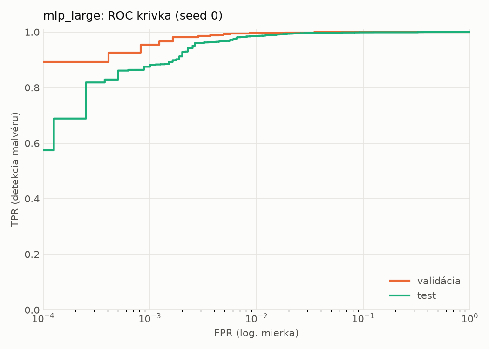
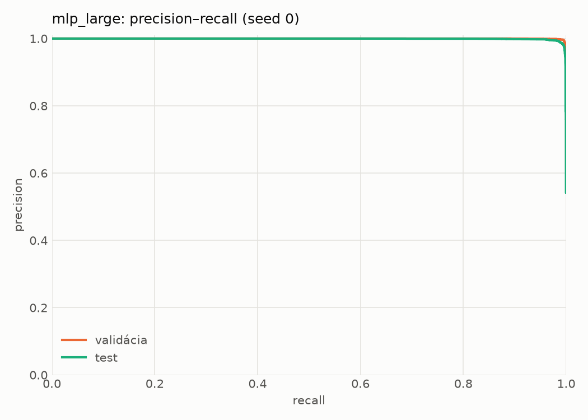
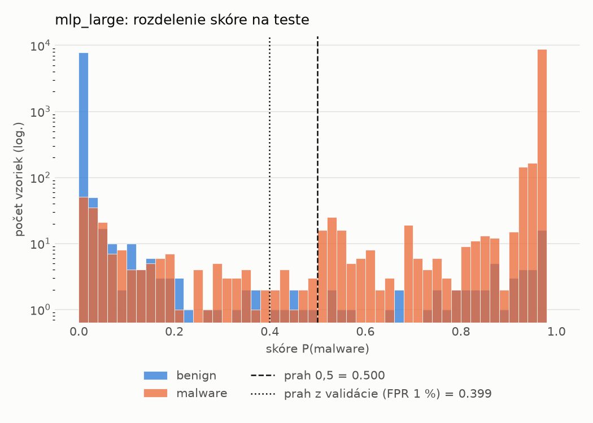
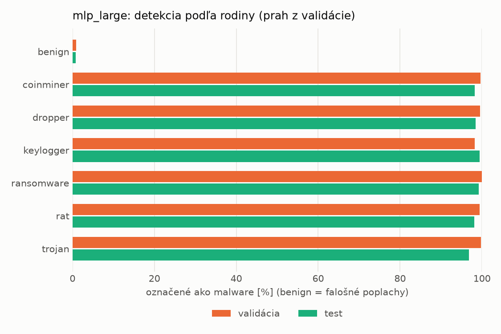
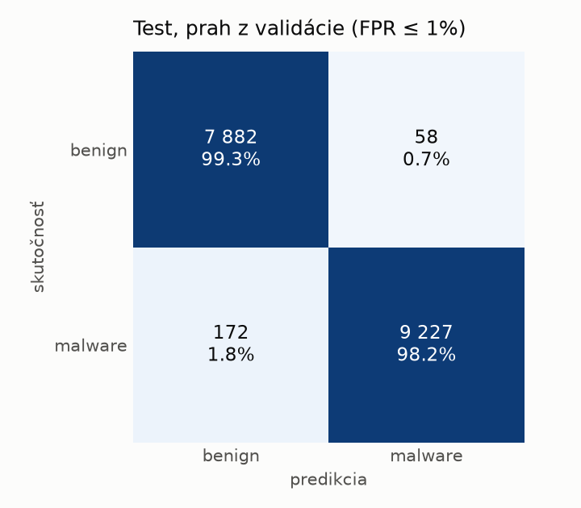
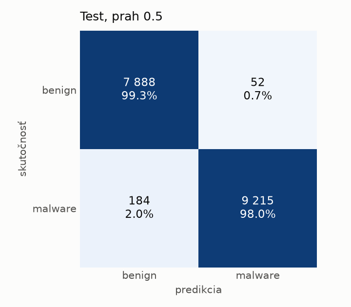
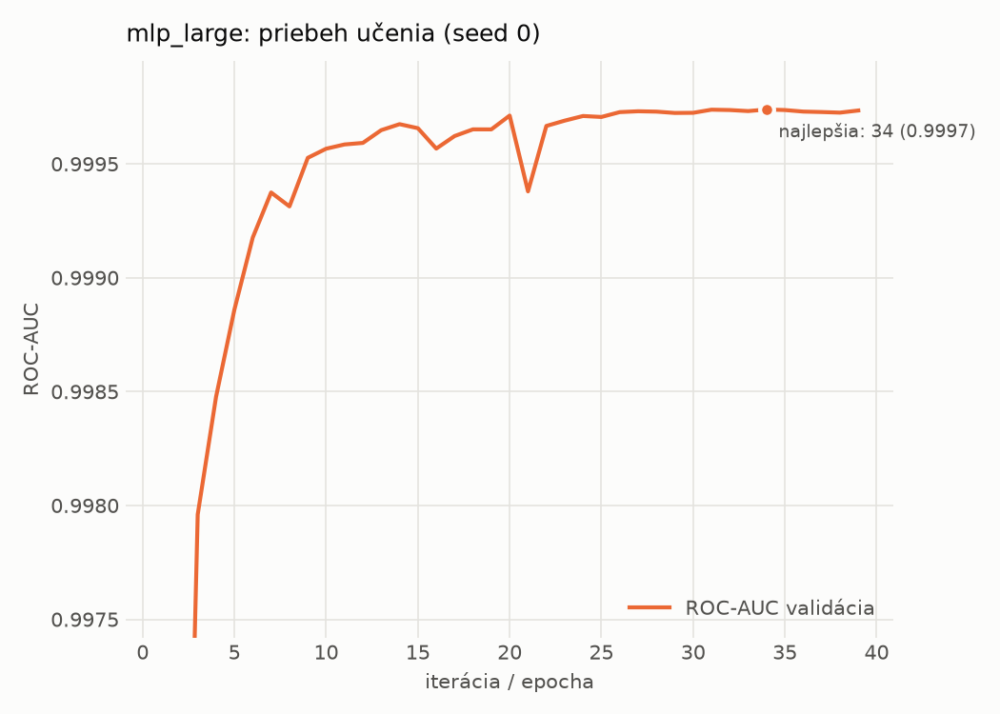

# static/mlp_large – beh `20261103-212659`

> Automaticky generované (`src/training/run_tabular.py`). Konfigurácia: `config.yaml`, protokol: `protocol.yaml`.

- **Model:** `mlp` – veľká neurónová sieť (3–5 skrytých vrstiev, 512–2048 neurónov), kandidát na učiteľa
- **Ladenie:** bez ladenia – hyperparametre prevzaté z `runs_final/static/mlp_large/20261101-235239`
- **Finálne modely:** seedy [0, 1, 2]; hodnoty sú priemer ± smerodajná odchýlka cez seedy
- **Najlepšie hyperparametre:** `{"max_epochs": 100, "patience": 8, "hidden_layers": 5, "hidden_width": 512, "width_decay": 0.5, "dropout": 0.4556986332296347, "lr": 0.00015070674125138616, "weight_decay": 0.0036646034219705954, "batch_size": 1024}`

## Detekčná kvalita (bez prahu)
| metrika | train (podvzorka) | validácia | test |
|---|---|---|---|
| ROC-AUC | 0.9998 ± 0.0000 | 0.9998 ± 0.0000 | 0.9985 ± 0.0002 |
| PR-AUC | 0.9999 ± 0.0000 | 0.9998 ± 0.0000 | 0.9989 ± 0.0001 |
| TPR pri FPR 1 % | 0.9984 ± 0.0003 | 0.9958 ± 0.0004 | 0.9839 ± 0.0034 |
| TPR pri FPR 0,1 % | 0.9873 ± 0.0022 | 0.9643 ± 0.0101 | 0.8628 ± 0.0256 |
| log loss | 0.0364 ± 0.0055 | 0.0444 ± 0.0047 | 0.0709 ± 0.0062 |
| Brier skóre | 0.0040 ± 0.0005 | 0.0063 ± 0.0003 | 0.0145 ± 0.0016 |

Rozdiel ROC-AUC train − validácia: **0.0001** (veľký rozdiel = preučenie).

## Pri prahu z validácie (FPR ≤ 1% na validácii)
| metrika | train (podvzorka) | validácia | test |
|---|---|---|---|
| accuracy | 0.9961 ± 0.0004 | 0.9939 ± 0.0001 | 0.9823 ± 0.0049 |
| balanced accuracy | 0.9958 ± 0.0003 | 0.9934 ± 0.0002 | 0.9832 ± 0.0044 |
| precision | 0.9965 ± 0.0002 | 0.9943 ± 0.0004 | 0.9942 ± 0.0004 |
| recall (TPR) | 0.9972 ± 0.0008 | 0.9958 ± 0.0004 | 0.9730 ± 0.0094 |
| FPR | 0.0055 ± 0.0004 | 0.0090 ± 0.0007 | 0.0067 ± 0.0006 |
| F1 | 0.9968 ± 0.0003 | 0.9951 ± 0.0001 | 0.9835 ± 0.0046 |
| MCC | 0.9919 ± 0.0008 | 0.9872 ± 0.0002 | 0.9647 ± 0.0095 |

## Pri pevnom prahu 0.5
| metrika | train (podvzorka) | validácia | test |
|---|---|---|---|
| accuracy | 0.9960 ± 0.0005 | 0.9937 ± 0.0002 | 0.9833 ± 0.0032 |
| balanced accuracy | 0.9956 ± 0.0004 | 0.9931 ± 0.0002 | 0.9841 ± 0.0029 |
| precision | 0.9962 ± 0.0003 | 0.9941 ± 0.0005 | 0.9942 ± 0.0003 |
| recall (TPR) | 0.9973 ± 0.0006 | 0.9956 ± 0.0004 | 0.9749 ± 0.0059 |
| FPR | 0.0060 ± 0.0005 | 0.0094 ± 0.0008 | 0.0067 ± 0.0004 |
| F1 | 0.9967 ± 0.0004 | 0.9948 ± 0.0001 | 0.9845 ± 0.0030 |
| MCC | 0.9916 ± 0.0010 | 0.9866 ± 0.0003 | 0.9667 ± 0.0062 |

## Výpočtové nároky (seed 0, testovacia množina)
| meranie | hodnota |
|---|---|
| tréning finálneho modelu | 5.4 s (priemer cez seedy) |
| ladenie spolu | 0 s |
| počet parametrov / uzlov | 1 362 369 |
| veľkosť modelu na disku | 5.53 MB |
| transformácia vstupu – latencia (1 vlákno) | 0.041 ms |
| transformácia vstupu – priepustnosť | 38 190 vzoriek/s |
| CPU latencia modelu (batch 1, 1 vlákno) | 0.305 ms (p95 0.324) |
| CPU priepustnosť (24 vlákien) | 76 945 vzoriek/s |
| GPU latencia (batch 1) | 0.609 ms (p95 1.371) |
| GPU priepustnosť | 87 700 vzoriek/s |
| GPU špičková pamäť | 1394 MB |

## Grafy
| | |
|---|---|
|  |  |
|  |  |
|  |  |
|  |  |

## Súbory
`metrics.json` (všetky metriky po seedoch vrátane rodín), `timing.json`, `hpo_trials.csv`,
`predictions/<časť>_seed<N>.parquet` (sha256, family, label, score), `model/seed_<N>/`, `log.txt`.
