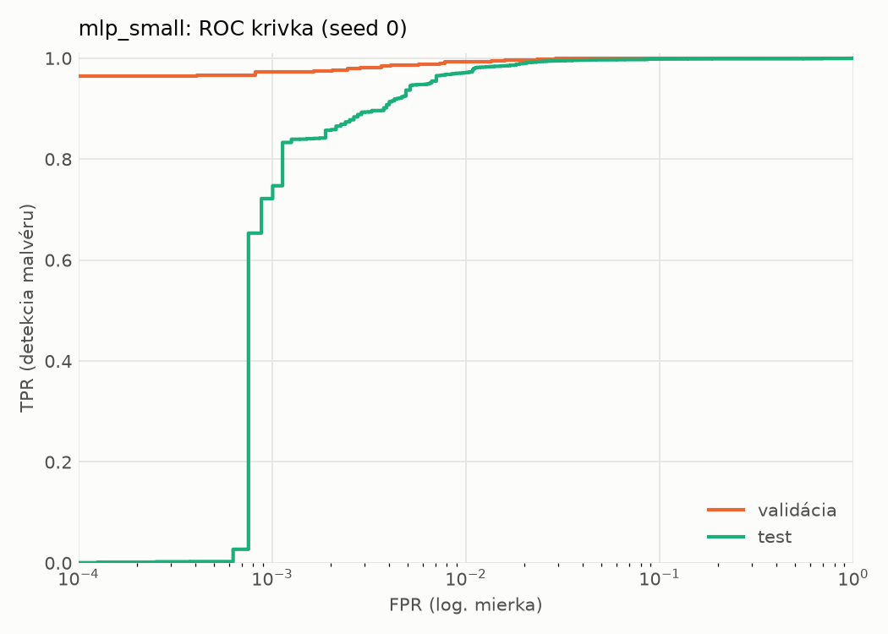
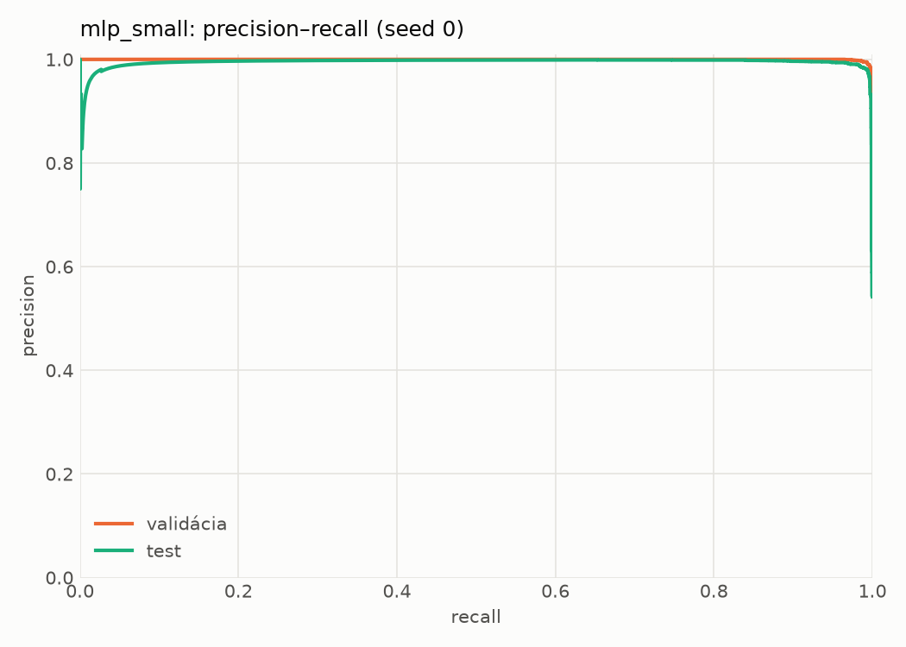
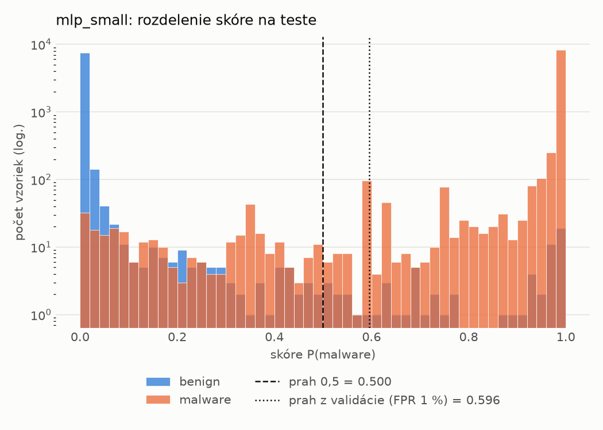
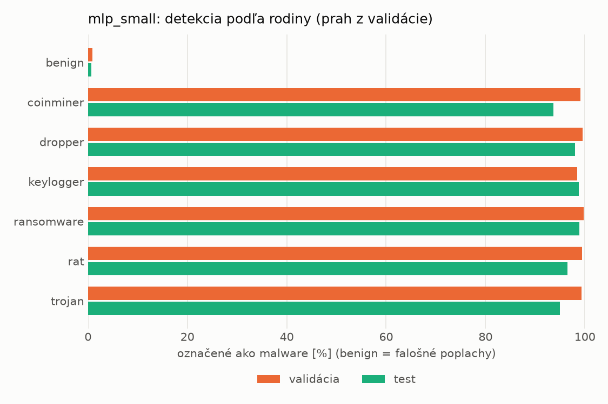
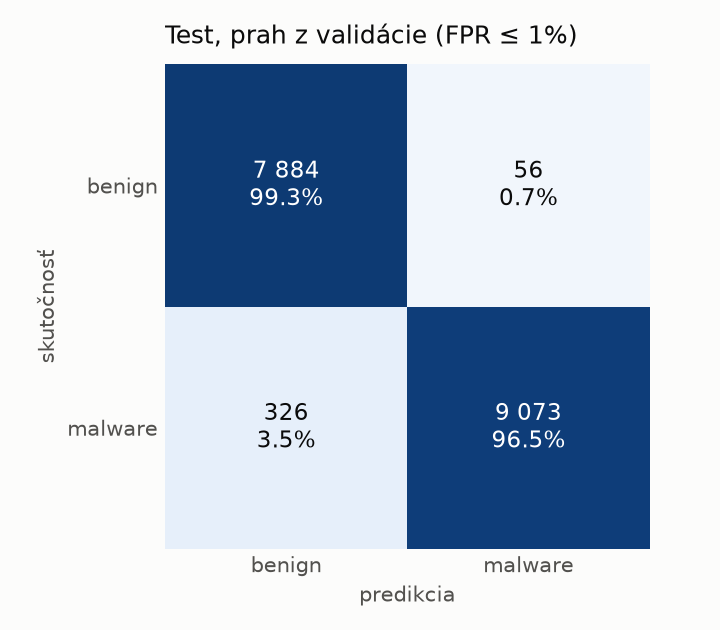
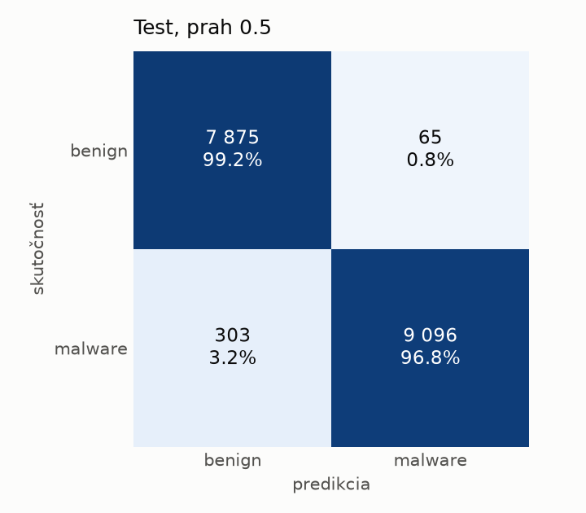
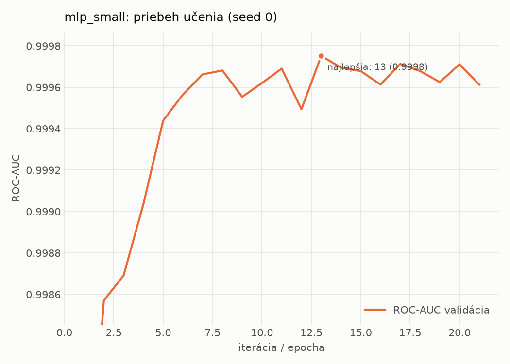

# static/mlp_small – beh `20261103-212634`

> Automaticky generované (`src/training/run_tabular.py`). Konfigurácia: `config.yaml`, protokol: `protocol.yaml`.

- **Model:** `mlp` – malá neurónová sieť (1–2 skryté vrstvy), kandidát na ľahkého študenta
- **Ladenie:** bez ladenia – hyperparametre prevzaté z `runs_final/static/mlp_small/20261101-235005`
- **Finálne modely:** seedy [0, 1, 2]; hodnoty sú priemer ± smerodajná odchýlka cez seedy
- **Najlepšie hyperparametre:** `{"width_decay": 0.5, "max_epochs": 100, "patience": 8, "hidden_layers": 2, "hidden_width": 32, "dropout": 0.15212112147976886, "lr": 0.0005958389350068958, "weight_decay": 5.34293726127978e-05, "batch_size": 512}`

## Detekčná kvalita (bez prahu)
| metrika | train (podvzorka) | validácia | test |
|---|---|---|---|
| ROC-AUC | 0.9999 ± 0.0000 | 0.9996 ± 0.0002 | 0.9973 ± 0.0001 |
| PR-AUC | 0.9999 ± 0.0000 | 0.9995 ± 0.0006 | 0.9950 ± 0.0003 |
| TPR pri FPR 1 % | 0.9984 ± 0.0000 | 0.9942 ± 0.0008 | 0.9743 ± 0.0029 |
| TPR pri FPR 0,1 % | 0.9878 ± 0.0004 | 0.9616 ± 0.0181 | 0.7561 ± 0.0331 |
| log loss | 0.0156 ± 0.0011 | 0.0255 ± 0.0017 | 0.0605 ± 0.0085 |
| Brier skóre | 0.0035 ± 0.0001 | 0.0063 ± 0.0004 | 0.0153 ± 0.0025 |

Rozdiel ROC-AUC train − validácia: **0.0003** (veľký rozdiel = preučenie).

## Pri prahu z validácie (FPR ≤ 1% na validácii)
| metrika | train (podvzorka) | validácia | test |
|---|---|---|---|
| accuracy | 0.9957 ± 0.0002 | 0.9929 ± 0.0008 | 0.9789 ± 0.0024 |
| balanced accuracy | 0.9957 ± 0.0003 | 0.9925 ± 0.0008 | 0.9800 ± 0.0022 |
| precision | 0.9973 ± 0.0005 | 0.9942 ± 0.0005 | 0.9940 ± 0.0002 |
| recall (TPR) | 0.9956 ± 0.0001 | 0.9942 ± 0.0008 | 0.9669 ± 0.0046 |
| FPR | 0.0043 ± 0.0007 | 0.0091 ± 0.0009 | 0.0069 ± 0.0002 |
| F1 | 0.9964 ± 0.0002 | 0.9942 ± 0.0007 | 0.9803 ± 0.0023 |
| MCC | 0.9909 ± 0.0005 | 0.9850 ± 0.0017 | 0.9580 ± 0.0047 |

## Pri pevnom prahu 0.5
| metrika | train (podvzorka) | validácia | test |
|---|---|---|---|
| accuracy | 0.9952 ± 0.0002 | 0.9920 ± 0.0008 | 0.9805 ± 0.0022 |
| balanced accuracy | 0.9947 ± 0.0002 | 0.9912 ± 0.0008 | 0.9814 ± 0.0020 |
| precision | 0.9952 ± 0.0008 | 0.9923 ± 0.0004 | 0.9922 ± 0.0006 |
| recall (TPR) | 0.9971 ± 0.0010 | 0.9947 ± 0.0010 | 0.9718 ± 0.0046 |
| FPR | 0.0076 ± 0.0013 | 0.0123 ± 0.0007 | 0.0091 ± 0.0008 |
| F1 | 0.9961 ± 0.0001 | 0.9935 ± 0.0007 | 0.9819 ± 0.0021 |
| MCC | 0.9900 ± 0.0003 | 0.9831 ± 0.0017 | 0.9611 ± 0.0043 |

## Výpočtové nároky (seed 0, testovacia množina)
| meranie | hodnota |
|---|---|
| tréning finálneho modelu | 5.1 s (priemer cez seedy) |
| ladenie spolu | 0 s |
| počet parametrov / uzlov | 74 753 |
| veľkosť modelu na disku | 0.36 MB |
| transformácia vstupu – latencia (1 vlákno) | 0.024 ms |
| transformácia vstupu – priepustnosť | 40 350 vzoriek/s |
| CPU latencia modelu (batch 1, 1 vlákno) | 0.097 ms (p95 0.109) |
| CPU priepustnosť (24 vlákien) | 109 629 vzoriek/s |
| GPU latencia (batch 1) | 0.383 ms (p95 0.425) |
| GPU priepustnosť | 79 953 vzoriek/s |
| GPU špičková pamäť | 767 MB |

## Grafy
| | |
|---|---|
|  |  |
|  |  |
|  |  |
|  |  |

## Súbory
`metrics.json` (všetky metriky po seedoch vrátane rodín), `timing.json`, `hpo_trials.csv`,
`predictions/<časť>_seed<N>.parquet` (sha256, family, label, score), `model/seed_<N>/`, `log.txt`.
