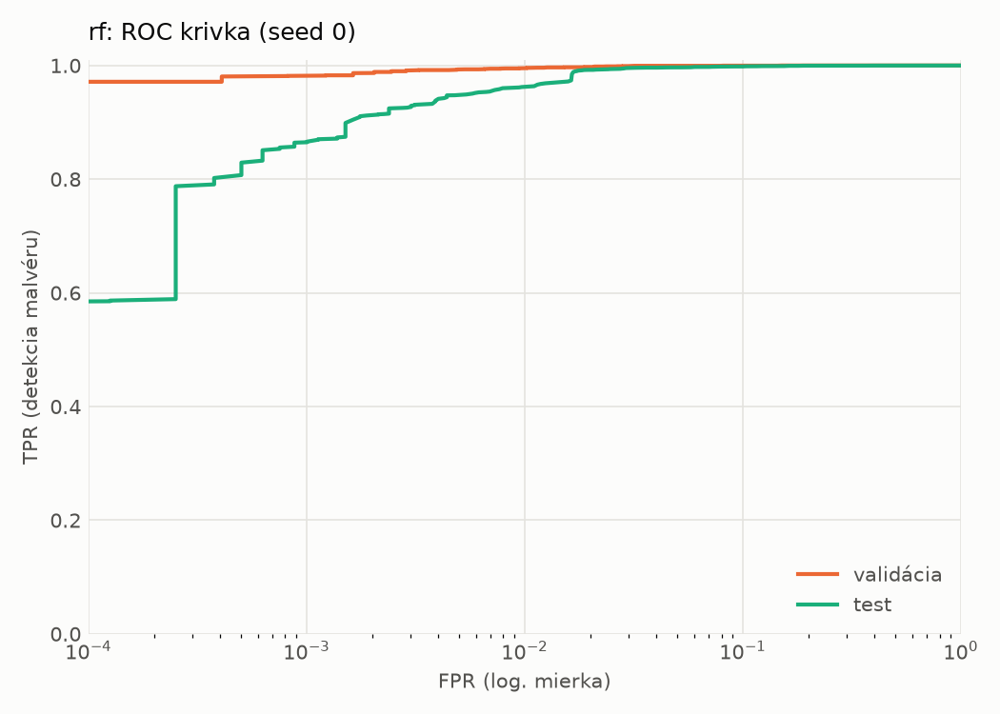
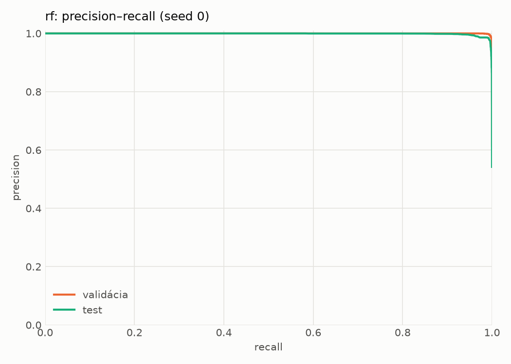
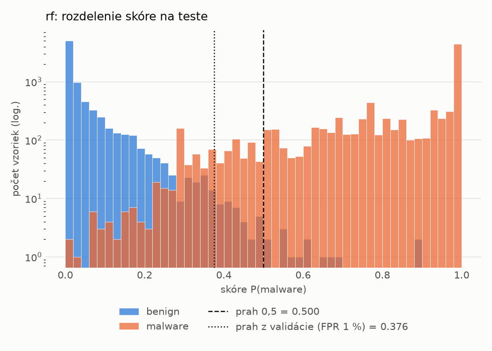
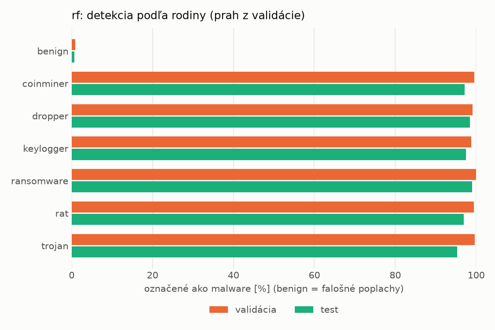
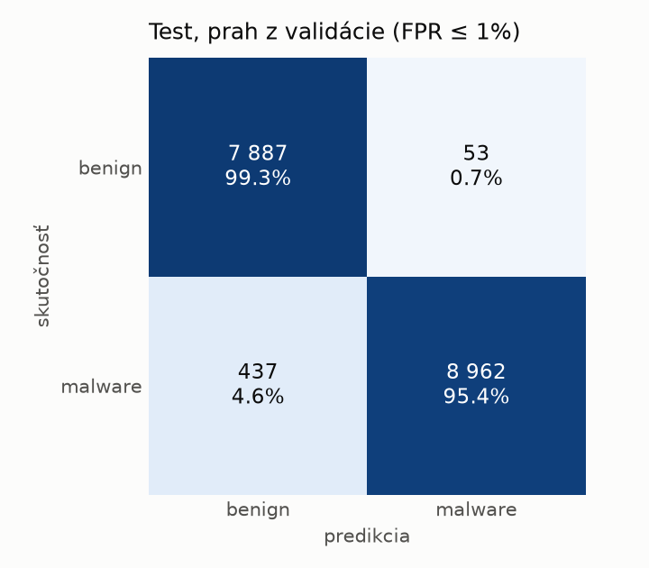
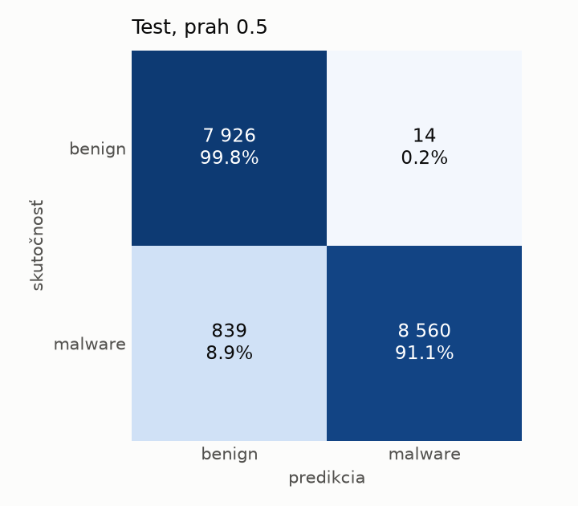

# static/rf – beh `20261103-211145`

> Automaticky generované (`src/training/run_tabular.py`). Konfigurácia: `config.yaml`, protokol: `protocol.yaml`.

- **Model:** `random_forest` – Random Forest (pôvodné hodnoty príznakov)
- **Ladenie:** bez ladenia – hyperparametre prevzaté z `runs_final/static/rf/20261101-213728`
- **Finálne modely:** seedy [0, 1, 2]; hodnoty sú priemer ± smerodajná odchýlka cez seedy
- **Najlepšie hyperparametre:** `{"n_estimators": 250, "max_depth": null, "min_samples_leaf": 1, "max_features": "sqrt"}`

## Detekčná kvalita (bez prahu)
| metrika | train (podvzorka) | validácia | test |
|---|---|---|---|
| ROC-AUC | 1.0000 ± 0.0000 | 0.9998 ± 0.0000 | 0.9985 ± 0.0002 |
| PR-AUC | 1.0000 ± 0.0000 | 0.9999 ± 0.0000 | 0.9988 ± 0.0002 |
| TPR pri FPR 1 % | 1.0000 ± 0.0000 | 0.9952 ± 0.0001 | 0.9646 ± 0.0032 |
| TPR pri FPR 0,1 % | 1.0000 ± 0.0000 | 0.9818 ± 0.0017 | 0.8665 ± 0.0031 |
| log loss | 0.0090 ± 0.0001 | 0.0274 ± 0.0005 | 0.1339 ± 0.0036 |
| Brier skóre | 0.0010 ± 0.0000 | 0.0062 ± 0.0001 | 0.0387 ± 0.0013 |

Rozdiel ROC-AUC train − validácia: **0.0002** (veľký rozdiel = preučenie).

## Pri prahu z validácie (FPR ≤ 1% na validácii)
| metrika | train (podvzorka) | validácia | test |
|---|---|---|---|
| accuracy | 1.0000 ± 0.0000 | 0.9934 ± 0.0001 | 0.9721 ± 0.0020 |
| balanced accuracy | 1.0000 ± 0.0000 | 0.9929 ± 0.0001 | 0.9738 ± 0.0018 |
| precision | 1.0000 ± 0.0000 | 0.9941 ± 0.0003 | 0.9943 ± 0.0002 |
| recall (TPR) | 1.0000 ± 0.0000 | 0.9952 ± 0.0001 | 0.9540 ± 0.0037 |
| FPR | 0.0000 ± 0.0000 | 0.0094 ± 0.0004 | 0.0065 ± 0.0003 |
| F1 | 1.0000 ± 0.0000 | 0.9946 ± 0.0001 | 0.9737 ± 0.0019 |
| MCC | 1.0000 ± 0.0000 | 0.9861 ± 0.0002 | 0.9449 ± 0.0037 |

## Pri pevnom prahu 0.5
| metrika | train (podvzorka) | validácia | test |
|---|---|---|---|
| accuracy | 1.0000 ± 0.0000 | 0.9940 ± 0.0005 | 0.9508 ± 0.0028 |
| balanced accuracy | 1.0000 ± 0.0000 | 0.9943 ± 0.0005 | 0.9545 ± 0.0026 |
| precision | 1.0000 ± 0.0000 | 0.9973 ± 0.0002 | 0.9984 ± 0.0001 |
| recall (TPR) | 1.0000 ± 0.0000 | 0.9929 ± 0.0007 | 0.9107 ± 0.0052 |
| FPR | 0.0000 ± 0.0000 | 0.0042 ± 0.0002 | 0.0017 ± 0.0001 |
| F1 | 1.0000 ± 0.0000 | 0.9951 ± 0.0004 | 0.9525 ± 0.0029 |
| MCC | 1.0000 ± 0.0000 | 0.9874 ± 0.0011 | 0.9058 ± 0.0051 |

## Výpočtové nároky (seed 0, testovacia množina)
| meranie | hodnota |
|---|---|
| tréning finálneho modelu | 19.9 s (priemer cez seedy) |
| ladenie spolu | 0 s |
| počet parametrov / uzlov | 368 800 |
| veľkosť modelu na disku | 29.83 MB |
| CPU latencia modelu (batch 1, 1 vlákno) | 7.363 ms (p95 8.569) |
| CPU priepustnosť (24 vlákien) | 139 743 vzoriek/s |

## Grafy
| | |
|---|---|
|  |  |
|  |  |
|  |  |
|  |  |

## Súbory
`metrics.json` (všetky metriky po seedoch vrátane rodín), `timing.json`, `hpo_trials.csv`,
`predictions/<časť>_seed<N>.parquet` (sha256, family, label, score), `model/seed_<N>/`, `log.txt`.
