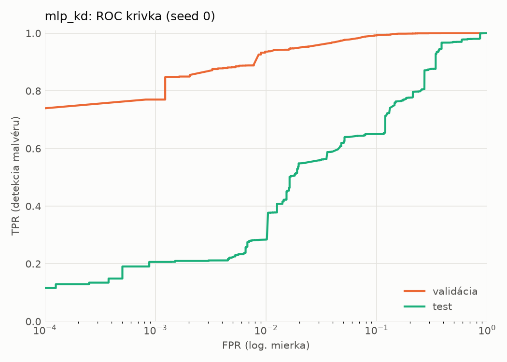
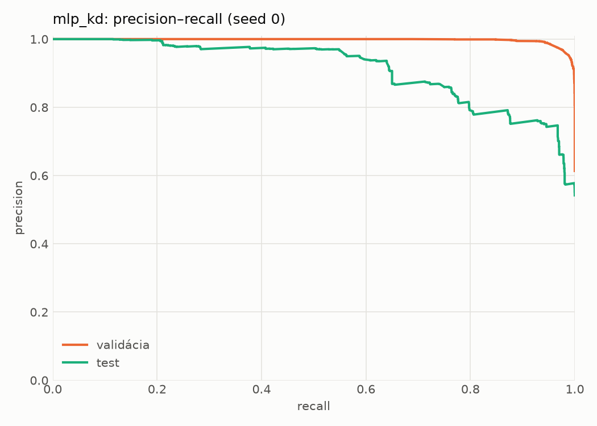
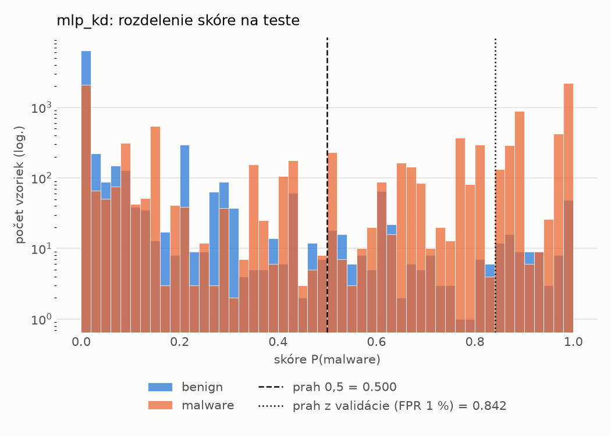
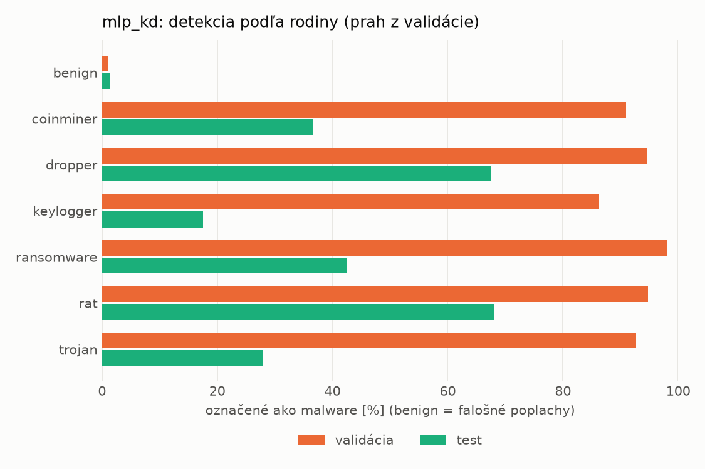
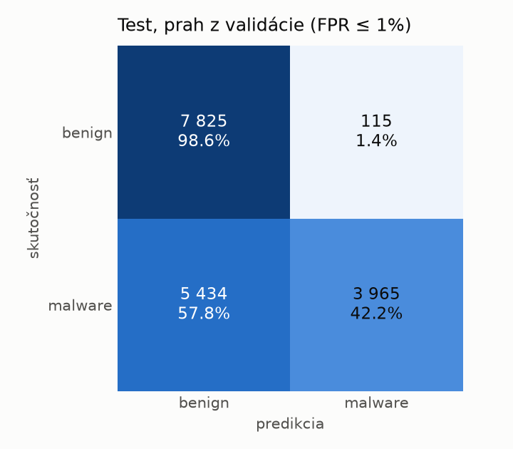
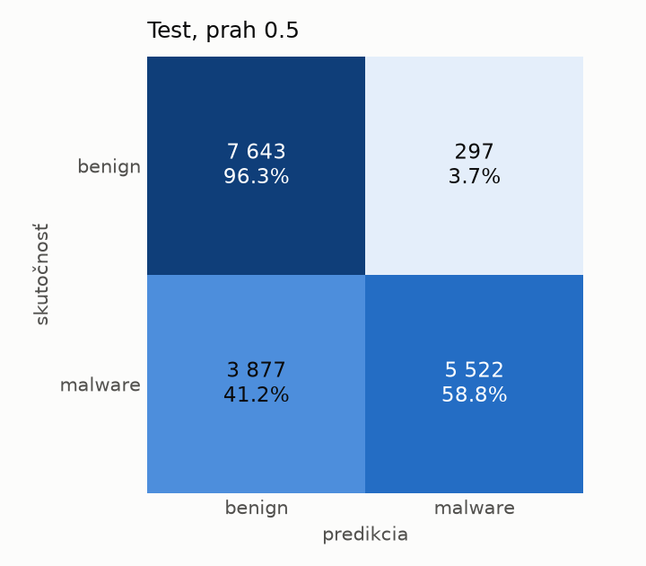
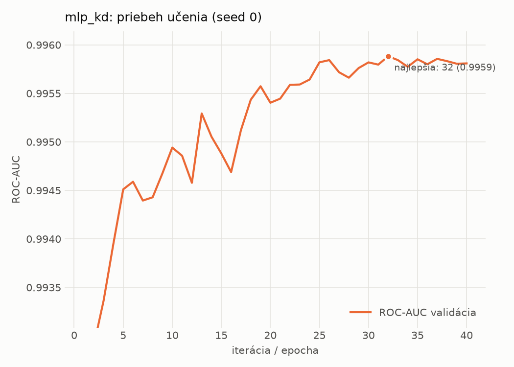

# dynamic/mlp_kd – beh `20261103-232431`

> Automaticky generované (`src/training/run_tabular.py`). Konfigurácia: `config.yaml`, protokol: `protocol.yaml`.

- **Model:** `mlp` – študent – malé MLP učené destiláciou z hybridného učiteľa
- **Ladenie:** bez ladenia – hyperparametre prevzaté z `runs_final/students_dynamic/mlp_kd/20261102-212132`
- **Finálne modely:** seedy [0, 1, 2]; hodnoty sú priemer ± smerodajná odchýlka cez seedy
- **Najlepšie hyperparametre:** `{"hidden_layers": 1, "max_epochs": 100, "patience": 8, "hidden_width": 32, "dropout": 0.14978534481914754, "lr": 0.0015794492400712224, "weight_decay": 1.2553588001973222e-06, "batch_size": 512, "kd_alpha": 0.7118939371172979, "kd_temperature": 1.298431487079528}`

## Detekčná kvalita (bez prahu)
| metrika | train (podvzorka) | validácia | test |
|---|---|---|---|
| ROC-AUC | 0.9963 ± 0.0001 | 0.9958 ± 0.0000 | 0.8844 ± 0.0127 |
| PR-AUC | 0.9975 ± 0.0001 | 0.9973 ± 0.0000 | 0.9096 ± 0.0050 |
| TPR pri FPR 1 % | 0.9249 ± 0.0023 | 0.9324 ± 0.0036 | 0.3718 ± 0.0764 |
| TPR pri FPR 0,1 % | 0.8432 ± 0.0005 | 0.7982 ± 0.0377 | 0.2058 ± 0.0095 |
| log loss | 0.0782 ± 0.0006 | 0.0838 ± 0.0006 | 1.0606 ± 0.0806 |
| Brier skóre | 0.0243 ± 0.0003 | 0.0247 ± 0.0001 | 0.2170 ± 0.0059 |

Rozdiel ROC-AUC train − validácia: **0.0004** (veľký rozdiel = preučenie).

## Pri prahu z validácie (FPR ≤ 1% na validácii)
| metrika | train (podvzorka) | validácia | test |
|---|---|---|---|
| accuracy | 0.9489 ± 0.0012 | 0.9547 ± 0.0021 | 0.6921 ± 0.0107 |
| balanced accuracy | 0.9568 ± 0.0008 | 0.9613 ± 0.0017 | 0.7149 ± 0.0099 |
| precision | 0.9949 ± 0.0008 | 0.9935 ± 0.0001 | 0.9743 ± 0.0022 |
| recall (TPR) | 0.9210 ± 0.0027 | 0.9324 ± 0.0036 | 0.4436 ± 0.0193 |
| FPR | 0.0074 ± 0.0012 | 0.0097 ± 0.0002 | 0.0138 ± 0.0006 |
| F1 | 0.9565 ± 0.0011 | 0.9620 ± 0.0019 | 0.6095 ± 0.0188 |
| MCC | 0.8987 ± 0.0021 | 0.9091 ± 0.0040 | 0.4967 ± 0.0160 |

## Pri pevnom prahu 0.5
| metrika | train (podvzorka) | validácia | test |
|---|---|---|---|
| accuracy | 0.9651 ± 0.0017 | 0.9648 ± 0.0004 | 0.7352 ± 0.0212 |
| balanced accuracy | 0.9650 ± 0.0020 | 0.9644 ± 0.0007 | 0.7530 ± 0.0194 |
| precision | 0.9772 ± 0.0022 | 0.9763 ± 0.0014 | 0.9479 ± 0.0011 |
| recall (TPR) | 0.9654 ± 0.0008 | 0.9661 ± 0.0010 | 0.5413 ± 0.0408 |
| FPR | 0.0353 ± 0.0034 | 0.0373 ± 0.0023 | 0.0352 ± 0.0021 |
| F1 | 0.9712 ± 0.0013 | 0.9712 ± 0.0003 | 0.6885 ± 0.0329 |
| MCC | 0.9270 ± 0.0035 | 0.9261 ± 0.0008 | 0.5455 ± 0.0306 |

## Výpočtové nároky (seed 0, testovacia množina)
| meranie | hodnota |
|---|---|
| tréning finálneho modelu | 8.6 s (priemer cez seedy) |
| ladenie spolu | 0 s |
| počet parametrov / uzlov | 64 129 |
| veľkosť modelu na disku | 0.31 MB |
| transformácia vstupu – latencia (1 vlákno) | 0.018 ms |
| transformácia vstupu – priepustnosť | 47 090 vzoriek/s |
| CPU latencia modelu (batch 1, 1 vlákno) | 0.068 ms (p95 0.103) |
| CPU priepustnosť (24 vlákien) | 96 279 vzoriek/s |
| GPU latencia (batch 1) | 0.455 ms (p95 0.482) |
| GPU priepustnosť | 105 405 vzoriek/s |
| GPU špičková pamäť | 664 MB |

## Grafy
| | |
|---|---|
|  |  |
|  |  |
|  |  |
|  |  |

## Súbory
`metrics.json` (všetky metriky po seedoch vrátane rodín), `timing.json`, `hpo_trials.csv`,
`predictions/<časť>_seed<N>.parquet` (sha256, family, label, score), `model/seed_<N>/`, `log.txt`.
