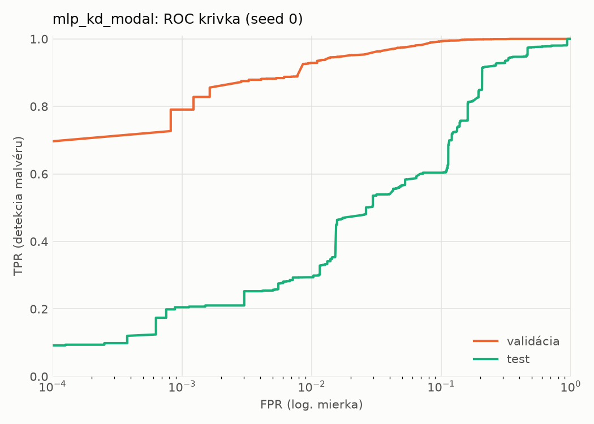
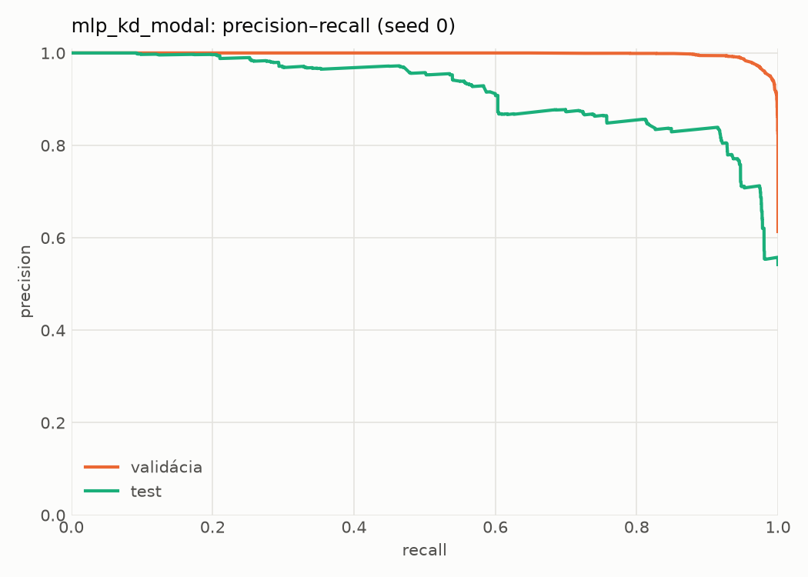
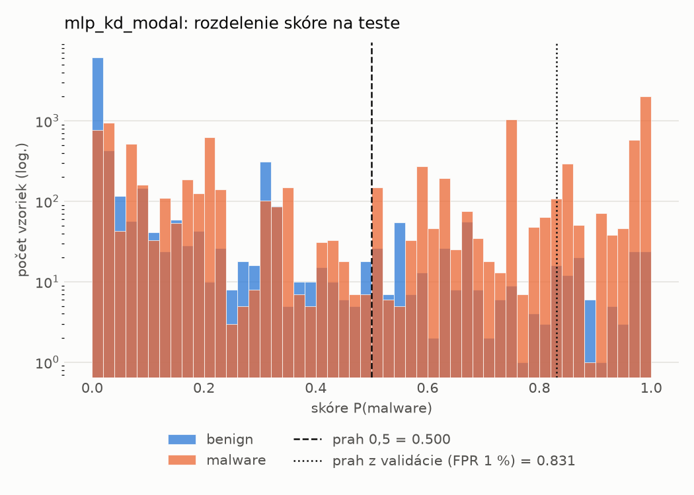
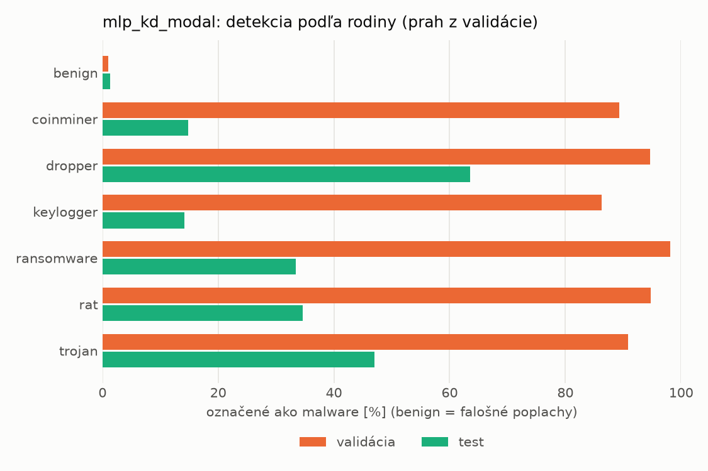
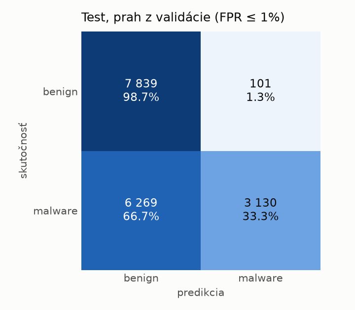
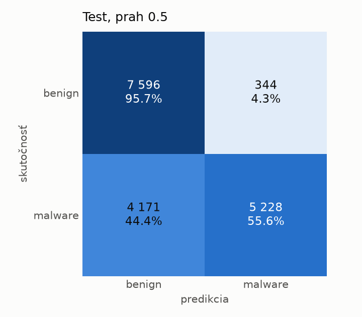
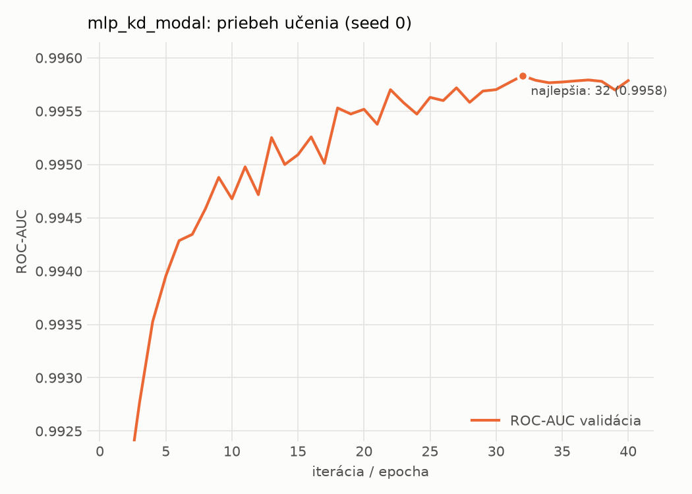

# dynamic/mlp_kd_modal – beh `20261103-232528`

> Automaticky generované (`src/training/run_tabular.py`). Konfigurácia: `config.yaml`, protokol: `protocol.yaml`.

- **Model:** `mlp` – študent – malé MLP učené destiláciou z učiteľa rovnakej modality (variant A)
- **Ladenie:** bez ladenia – hyperparametre prevzaté z `runs_final/students_dynamic/mlp_kd_modal/20261102-212954`
- **Finálne modely:** seedy [0, 1, 2]; hodnoty sú priemer ± smerodajná odchýlka cez seedy
- **Najlepšie hyperparametre:** `{"hidden_layers": 1, "max_epochs": 100, "patience": 8, "hidden_width": 32, "dropout": 0.14040860994340293, "lr": 0.00037778352941027736, "weight_decay": 1.149514965975221e-06, "batch_size": 512, "kd_alpha": 0.8818461482523741, "kd_temperature": 1.583698009756735}`

## Detekčná kvalita (bez prahu)
| metrika | train (podvzorka) | validácia | test |
|---|---|---|---|
| ROC-AUC | 0.9963 ± 0.0000 | 0.9958 ± 0.0001 | 0.8830 ± 0.0150 |
| PR-AUC | 0.9975 ± 0.0000 | 0.9972 ± 0.0001 | 0.9032 ± 0.0119 |
| TPR pri FPR 1 % | 0.9245 ± 0.0016 | 0.9275 ± 0.0015 | 0.3448 ± 0.0686 |
| TPR pri FPR 0,1 % | 0.8453 ± 0.0029 | 0.7888 ± 0.0494 | 0.1924 ± 0.0111 |
| log loss | 0.0778 ± 0.0006 | 0.0822 ± 0.0006 | 0.8580 ± 0.0288 |
| Brier skóre | 0.0243 ± 0.0002 | 0.0247 ± 0.0002 | 0.2199 ± 0.0037 |

Rozdiel ROC-AUC train − validácia: **0.0005** (veľký rozdiel = preučenie).

## Pri prahu z validácie (FPR ≤ 1% na validácii)
| metrika | train (podvzorka) | validácia | test |
|---|---|---|---|
| accuracy | 0.9465 ± 0.0005 | 0.9517 ± 0.0009 | 0.6580 ± 0.0345 |
| balanced accuracy | 0.9552 ± 0.0003 | 0.9588 ± 0.0007 | 0.6835 ± 0.0319 |
| precision | 0.9960 ± 0.0004 | 0.9934 ± 0.0000 | 0.9713 ± 0.0046 |
| recall (TPR) | 0.9161 ± 0.0010 | 0.9275 ± 0.0015 | 0.3801 ± 0.0636 |
| FPR | 0.0058 ± 0.0005 | 0.0098 ± 0.0000 | 0.0131 ± 0.0005 |
| F1 | 0.9544 ± 0.0004 | 0.9593 ± 0.0008 | 0.5445 ± 0.0651 |
| MCC | 0.8946 ± 0.0008 | 0.9033 ± 0.0017 | 0.4471 ± 0.0509 |

## Pri pevnom prahu 0.5
| metrika | train (podvzorka) | validácia | test |
|---|---|---|---|
| accuracy | 0.9652 ± 0.0004 | 0.9649 ± 0.0005 | 0.7256 ± 0.0126 |
| balanced accuracy | 0.9654 ± 0.0002 | 0.9649 ± 0.0003 | 0.7429 ± 0.0125 |
| precision | 0.9781 ± 0.0004 | 0.9776 ± 0.0012 | 0.9255 ± 0.0203 |
| recall (TPR) | 0.9646 ± 0.0012 | 0.9649 ± 0.0018 | 0.5372 ± 0.0171 |
| FPR | 0.0338 ± 0.0007 | 0.0351 ± 0.0019 | 0.0513 ± 0.0148 |
| F1 | 0.9713 ± 0.0004 | 0.9712 ± 0.0004 | 0.6797 ± 0.0162 |
| MCC | 0.9273 ± 0.0008 | 0.9264 ± 0.0009 | 0.5214 ± 0.0259 |

## Výpočtové nároky (seed 0, testovacia množina)
| meranie | hodnota |
|---|---|
| tréning finálneho modelu | 9.1 s (priemer cez seedy) |
| ladenie spolu | 0 s |
| počet parametrov / uzlov | 64 129 |
| veľkosť modelu na disku | 0.31 MB |
| transformácia vstupu – latencia (1 vlákno) | 0.034 ms |
| transformácia vstupu – priepustnosť | 47 412 vzoriek/s |
| CPU latencia modelu (batch 1, 1 vlákno) | 0.068 ms (p95 0.078) |
| CPU priepustnosť (24 vlákien) | 138 346 vzoriek/s |
| GPU latencia (batch 1) | 0.334 ms (p95 0.367) |
| GPU priepustnosť | 100 442 vzoriek/s |
| GPU špičková pamäť | 664 MB |

## Grafy
| | |
|---|---|
|  |  |
|  |  |
|  |  |
|  |  |

## Súbory
`metrics.json` (všetky metriky po seedoch vrátane rodín), `timing.json`, `hpo_trials.csv`,
`predictions/<časť>_seed<N>.parquet` (sha256, family, label, score), `model/seed_<N>/`, `log.txt`.
