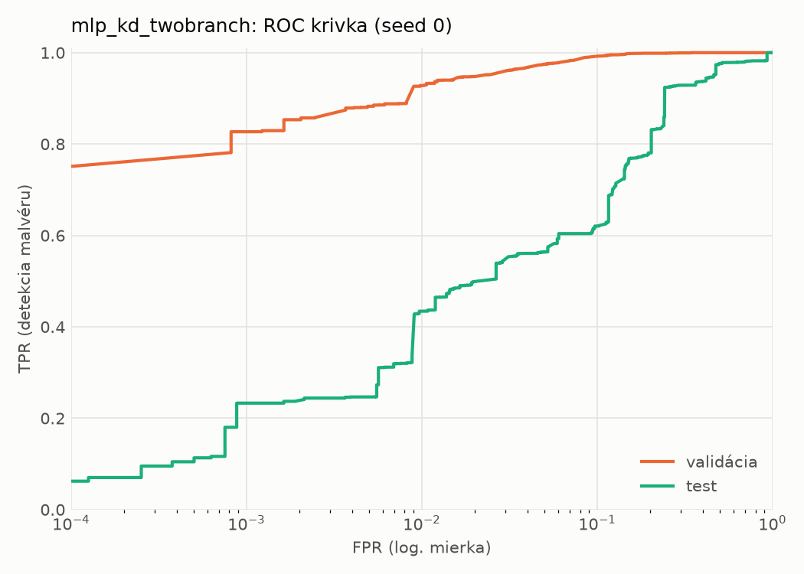
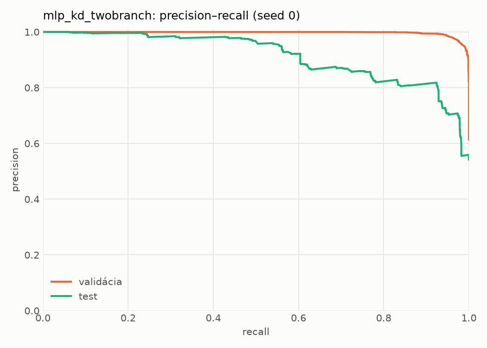
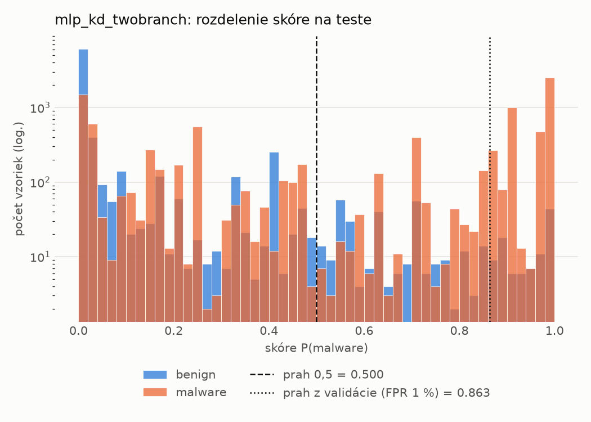
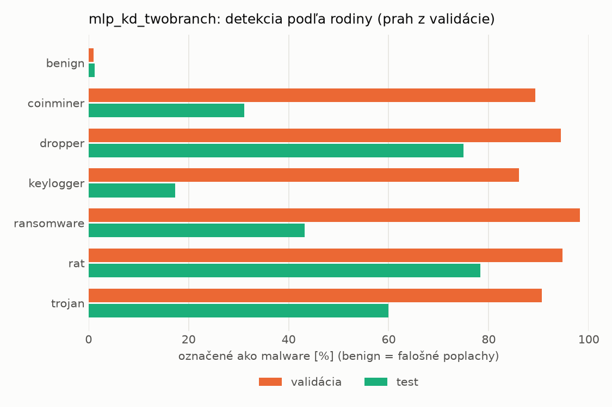
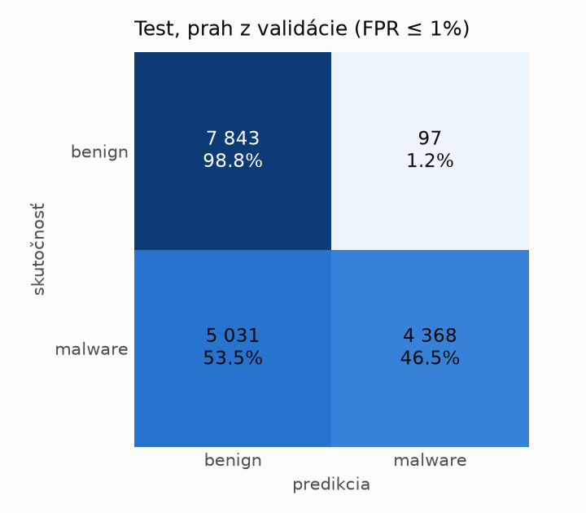
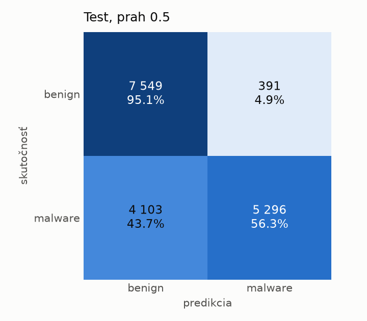
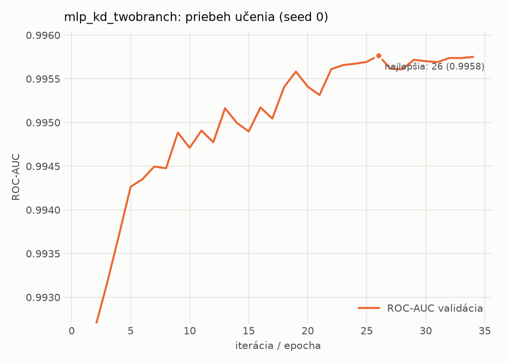

# dynamic/mlp_kd_twobranch – beh `20261103-232603`

> Automaticky generované (`src/training/run_tabular.py`). Konfigurácia: `config.yaml`, protokol: `protocol.yaml`.

- **Model:** `mlp` – študent – malé MLP učené destiláciou z dvojvetvovej siete (V2)
- **Ladenie:** bez ladenia – hyperparametre prevzaté z `runs_v2/full/students_dynamic/mlp_kd_twobranch/20261103-210509`
- **Finálne modely:** seedy [0, 1, 2]; hodnoty sú priemer ± smerodajná odchýlka cez seedy
- **Najlepšie hyperparametre:** `{"hidden_layers": 1, "max_epochs": 100, "patience": 8, "hidden_width": 32, "dropout": 0.20072105080128874, "lr": 0.0007693195243892695, "weight_decay": 5.480532660403751e-05, "batch_size": 512, "kd_alpha": 0.8408369066096718, "kd_temperature": 1.578549465607724}`

## Detekčná kvalita (bez prahu)
| metrika | train (podvzorka) | validácia | test |
|---|---|---|---|
| ROC-AUC | 0.9963 ± 0.0002 | 0.9958 ± 0.0000 | 0.8780 ± 0.0158 |
| PR-AUC | 0.9976 ± 0.0001 | 0.9973 ± 0.0000 | 0.9059 ± 0.0081 |
| TPR pri FPR 1 % | 0.9266 ± 0.0023 | 0.9310 ± 0.0028 | 0.3986 ± 0.0555 |
| TPR pri FPR 0,1 % | 0.8482 ± 0.0022 | 0.8287 ± 0.0037 | 0.2254 ± 0.0088 |
| log loss | 0.0771 ± 0.0019 | 0.0839 ± 0.0000 | 1.0243 ± 0.1563 |
| Brier skóre | 0.0240 ± 0.0006 | 0.0246 ± 0.0003 | 0.2133 ± 0.0067 |

Rozdiel ROC-AUC train − validácia: **0.0005** (veľký rozdiel = preučenie).

## Pri prahu z validácie (FPR ≤ 1% na validácii)
| metrika | train (podvzorka) | validácia | test |
|---|---|---|---|
| accuracy | 0.9485 ± 0.0016 | 0.9539 ± 0.0018 | 0.7015 ± 0.0024 |
| balanced accuracy | 0.9567 ± 0.0013 | 0.9606 ± 0.0015 | 0.7236 ± 0.0023 |
| precision | 0.9957 ± 0.0003 | 0.9935 ± 0.0002 | 0.9763 ± 0.0019 |
| recall (TPR) | 0.9196 ± 0.0027 | 0.9310 ± 0.0028 | 0.4605 ± 0.0037 |
| FPR | 0.0062 ± 0.0005 | 0.0097 ± 0.0002 | 0.0132 ± 0.0010 |
| F1 | 0.9561 ± 0.0014 | 0.9612 ± 0.0016 | 0.6258 ± 0.0038 |
| MCC | 0.8982 ± 0.0029 | 0.9075 ± 0.0035 | 0.5108 ± 0.0041 |

## Pri pevnom prahu 0.5
| metrika | train (podvzorka) | validácia | test |
|---|---|---|---|
| accuracy | 0.9653 ± 0.0016 | 0.9650 ± 0.0006 | 0.7419 ± 0.0009 |
| balanced accuracy | 0.9657 ± 0.0014 | 0.9651 ± 0.0006 | 0.7586 ± 0.0013 |
| precision | 0.9788 ± 0.0009 | 0.9780 ± 0.0010 | 0.9396 ± 0.0072 |
| recall (TPR) | 0.9640 ± 0.0024 | 0.9647 ± 0.0012 | 0.5598 ± 0.0032 |
| FPR | 0.0327 ± 0.0014 | 0.0344 ± 0.0016 | 0.0427 ± 0.0057 |
| F1 | 0.9714 ± 0.0013 | 0.9713 ± 0.0005 | 0.7016 ± 0.0005 |
| MCC | 0.9275 ± 0.0032 | 0.9267 ± 0.0012 | 0.5510 ± 0.0046 |

## Výpočtové nároky (seed 0, testovacia množina)
| meranie | hodnota |
|---|---|
| tréning finálneho modelu | 9.3 s (priemer cez seedy) |
| ladenie spolu | 0 s |
| počet parametrov / uzlov | 64 129 |
| veľkosť modelu na disku | 0.31 MB |
| transformácia vstupu – latencia (1 vlákno) | 0.034 ms |
| transformácia vstupu – priepustnosť | 47 812 vzoriek/s |
| CPU latencia modelu (batch 1, 1 vlákno) | 0.068 ms (p95 0.077) |
| CPU priepustnosť (24 vlákien) | 141 299 vzoriek/s |
| GPU latencia (batch 1) | 0.322 ms (p95 0.366) |
| GPU priepustnosť | 94 926 vzoriek/s |
| GPU špičková pamäť | 1170 MB |

## Grafy
| | |
|---|---|
|  |  |
|  |  |
|  |  |
|  |  |

## Súbory
`metrics.json` (všetky metriky po seedoch vrátane rodín), `timing.json`, `hpo_trials.csv`,
`predictions/<časť>_seed<N>.parquet` (sha256, family, label, score), `model/seed_<N>/`, `log.txt`.
