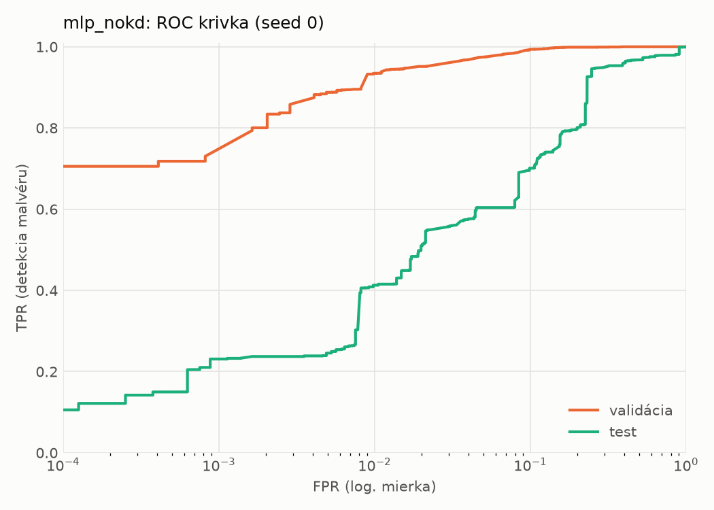
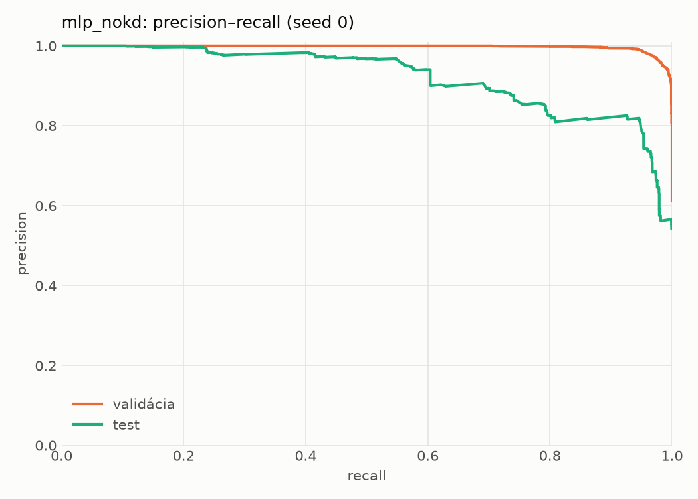
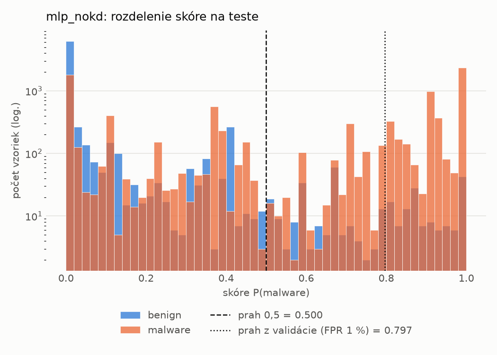
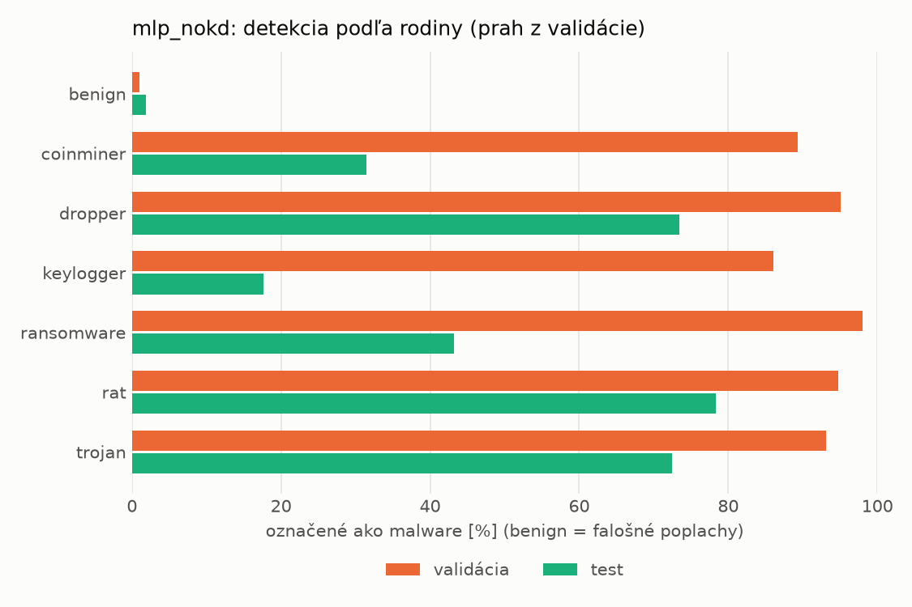
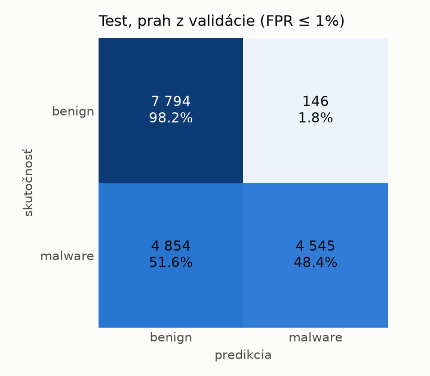
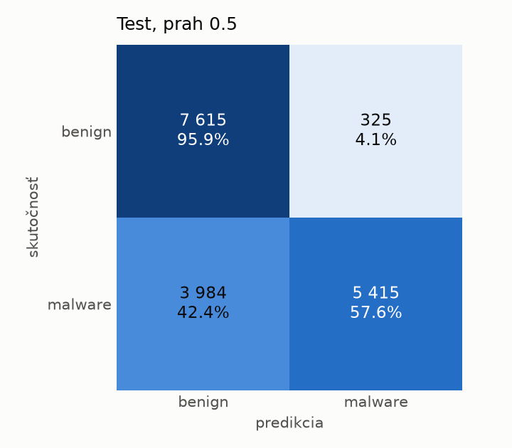
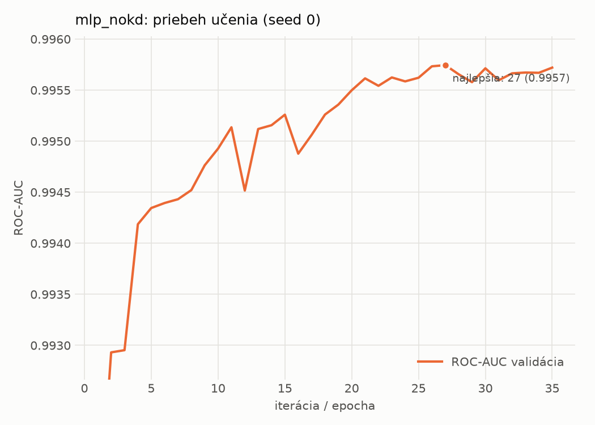

# dynamic/mlp_nokd – beh `20261103-232505`

> Automaticky generované (`src/training/run_tabular.py`). Konfigurácia: `config.yaml`, protokol: `protocol.yaml`.

- **Model:** `mlp` – kontrola – rovnaké malé MLP bez destilácie (iba skutočné označenia)
- **Ladenie:** bez ladenia – hyperparametre prevzaté z `runs_final/students_dynamic/mlp_nokd/20261102-212647`
- **Finálne modely:** seedy [0, 1, 2]; hodnoty sú priemer ± smerodajná odchýlka cez seedy
- **Najlepšie hyperparametre:** `{"hidden_layers": 1, "max_epochs": 100, "patience": 8, "hidden_width": 32, "dropout": 0.27854460554056926, "lr": 0.002048574130711367, "weight_decay": 5.911733622585913e-06, "batch_size": 512}`

## Detekčná kvalita (bez prahu)
| metrika | train (podvzorka) | validácia | test |
|---|---|---|---|
| ROC-AUC | 0.9961 ± 0.0002 | 0.9957 ± 0.0001 | 0.9063 ± 0.0061 |
| PR-AUC | 0.9974 ± 0.0001 | 0.9972 ± 0.0000 | 0.9250 ± 0.0047 |
| TPR pri FPR 1 % | 0.9234 ± 0.0033 | 0.9299 ± 0.0041 | 0.4282 ± 0.0134 |
| TPR pri FPR 0,1 % | 0.8484 ± 0.0012 | 0.7491 ± 0.0421 | 0.2383 ± 0.0143 |
| log loss | 0.0792 ± 0.0020 | 0.0851 ± 0.0002 | 0.8381 ± 0.0617 |
| Brier skóre | 0.0249 ± 0.0007 | 0.0248 ± 0.0004 | 0.1959 ± 0.0038 |

Rozdiel ROC-AUC train − validácia: **0.0004** (veľký rozdiel = preučenie).

## Pri prahu z validácie (FPR ≤ 1% na validácii)
| metrika | train (podvzorka) | validácia | test |
|---|---|---|---|
| accuracy | 0.9467 ± 0.0028 | 0.9532 ± 0.0025 | 0.7064 ± 0.0045 |
| balanced accuracy | 0.9549 ± 0.0022 | 0.9600 ± 0.0021 | 0.7280 ± 0.0040 |
| precision | 0.9946 ± 0.0007 | 0.9934 ± 0.0000 | 0.9733 ± 0.0038 |
| recall (TPR) | 0.9177 ± 0.0049 | 0.9299 ± 0.0041 | 0.4714 ± 0.0106 |
| FPR | 0.0079 ± 0.0010 | 0.0098 ± 0.0000 | 0.0154 ± 0.0026 |
| F1 | 0.9546 ± 0.0025 | 0.9606 ± 0.0022 | 0.6351 ± 0.0088 |
| MCC | 0.8945 ± 0.0050 | 0.9061 ± 0.0048 | 0.5164 ± 0.0047 |

## Pri pevnom prahu 0.5
| metrika | train (podvzorka) | validácia | test |
|---|---|---|---|
| accuracy | 0.9646 ± 0.0012 | 0.9647 ± 0.0007 | 0.7452 ± 0.0113 |
| balanced accuracy | 0.9638 ± 0.0017 | 0.9639 ± 0.0012 | 0.7620 ± 0.0106 |
| precision | 0.9743 ± 0.0025 | 0.9748 ± 0.0025 | 0.9446 ± 0.0070 |
| recall (TPR) | 0.9676 ± 0.0010 | 0.9674 ± 0.0017 | 0.5630 ± 0.0187 |
| FPR | 0.0401 ± 0.0040 | 0.0397 ± 0.0040 | 0.0390 ± 0.0044 |
| F1 | 0.9709 ± 0.0009 | 0.9711 ± 0.0005 | 0.7054 ± 0.0161 |
| MCC | 0.9257 ± 0.0026 | 0.9257 ± 0.0015 | 0.5582 ± 0.0188 |

## Výpočtové nároky (seed 0, testovacia množina)
| meranie | hodnota |
|---|---|
| tréning finálneho modelu | 5.0 s (priemer cez seedy) |
| ladenie spolu | 0 s |
| počet parametrov / uzlov | 64 129 |
| veľkosť modelu na disku | 0.31 MB |
| transformácia vstupu – latencia (1 vlákno) | 0.034 ms |
| transformácia vstupu – priepustnosť | 45 805 vzoriek/s |
| CPU latencia modelu (batch 1, 1 vlákno) | 0.068 ms (p95 0.077) |
| CPU priepustnosť (24 vlákien) | 97 367 vzoriek/s |
| GPU latencia (batch 1) | 0.458 ms (p95 0.484) |
| GPU priepustnosť | 106 771 vzoriek/s |
| GPU špičková pamäť | 1170 MB |

## Grafy
| | |
|---|---|
|  |  |
|  |  |
|  |  |
|  |  |

## Súbory
`metrics.json` (všetky metriky po seedoch vrátane rodín), `timing.json`, `hpo_trials.csv`,
`predictions/<časť>_seed<N>.parquet` (sha256, family, label, score), `model/seed_<N>/`, `log.txt`.
