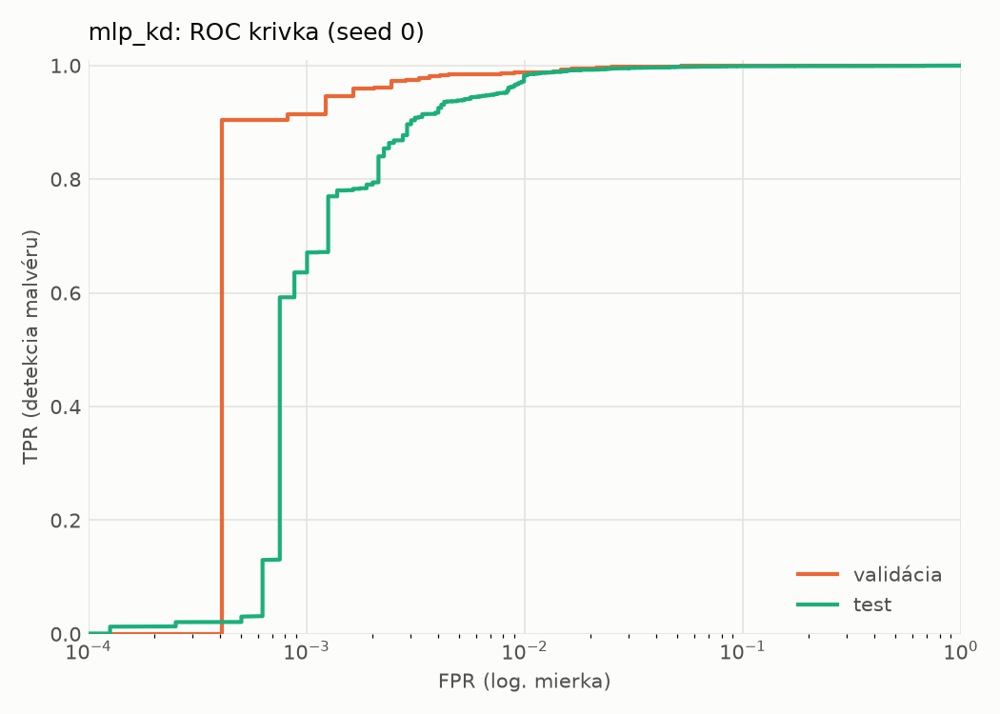
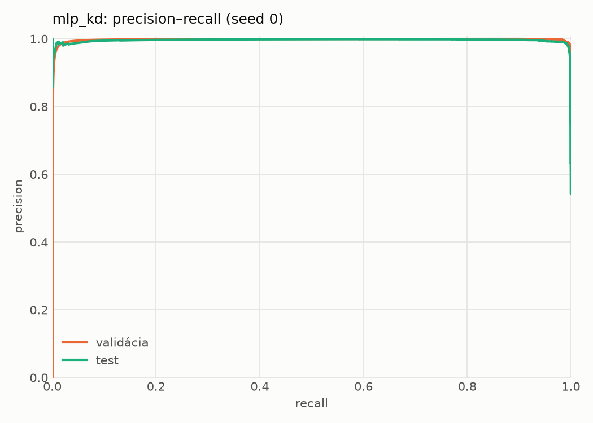
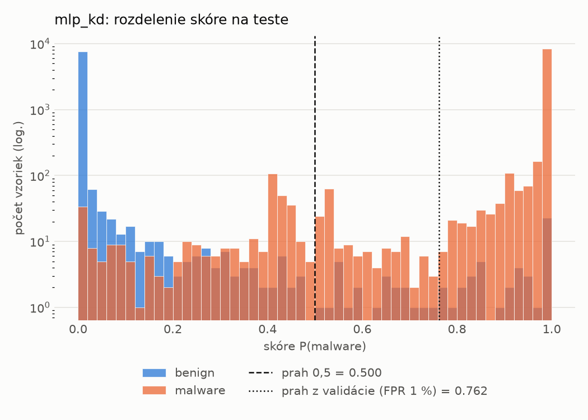
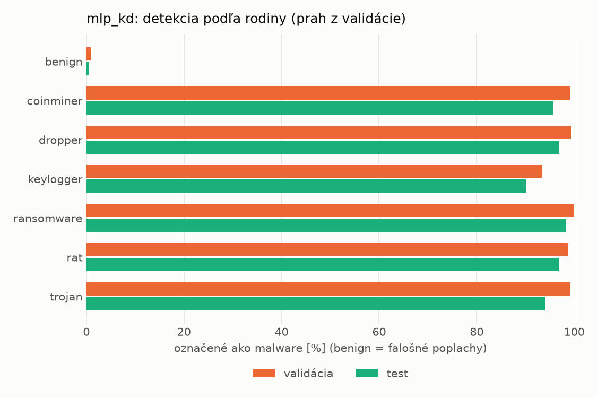
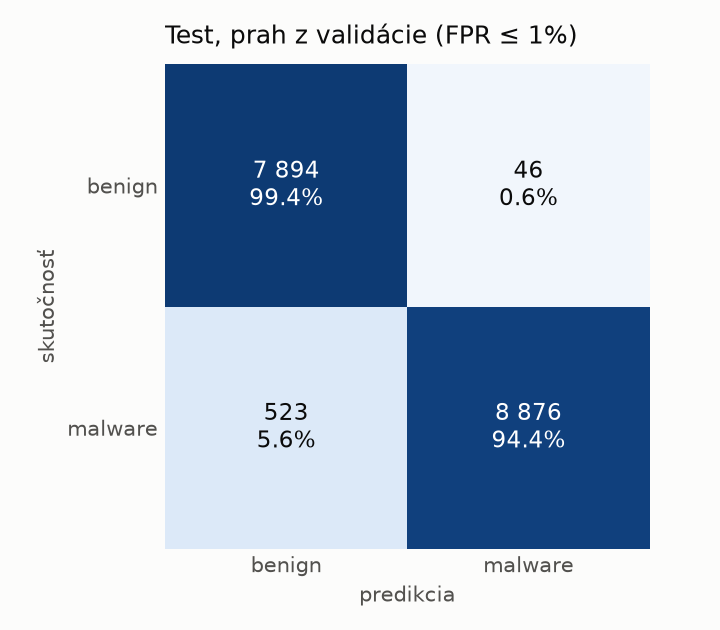
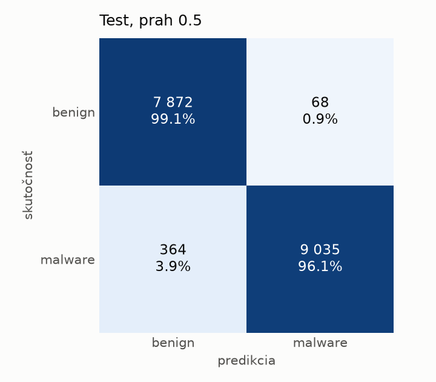
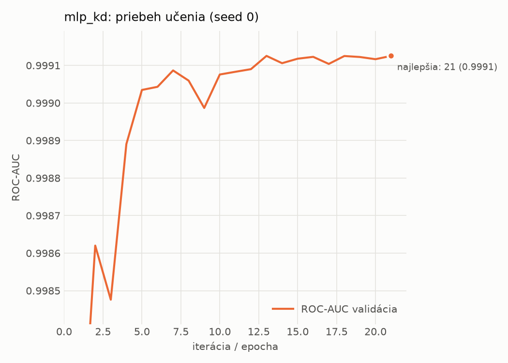

# static/mlp_kd – beh `20261103-232226`

> Automaticky generované (`src/training/run_tabular.py`). Konfigurácia: `config.yaml`, protokol: `protocol.yaml`.

- **Model:** `mlp` – študent – malé MLP učené destiláciou z hybridného učiteľa
- **Ladenie:** bez ladenia – hyperparametre prevzaté z `runs_final/students_static/mlp_kd/20261102-211333`
- **Finálne modely:** seedy [0, 1, 2]; hodnoty sú priemer ± smerodajná odchýlka cez seedy
- **Najlepšie hyperparametre:** `{"hidden_layers": 1, "max_epochs": 100, "patience": 8, "hidden_width": 32, "dropout": 0.0997633477545663, "lr": 0.0015427581570995174, "weight_decay": 0.00017559733451057006, "batch_size": 256, "kd_alpha": 0.604033962068706, "kd_temperature": 6.472658522077935}`

## Detekčná kvalita (bez prahu)
| metrika | train (podvzorka) | validácia | test |
|---|---|---|---|
| ROC-AUC | 0.9997 ± 0.0000 | 0.9992 ± 0.0000 | 0.9976 ± 0.0003 |
| PR-AUC | 0.9998 ± 0.0000 | 0.9983 ± 0.0008 | 0.9965 ± 0.0009 |
| TPR pri FPR 1 % | 0.9944 ± 0.0005 | 0.9881 ± 0.0005 | 0.9714 ± 0.0095 |
| TPR pri FPR 0,1 % | 0.9755 ± 0.0018 | 0.9340 ± 0.0175 | 0.6517 ± 0.0342 |
| log loss | 0.0195 ± 0.0011 | 0.0316 ± 0.0009 | 0.0660 ± 0.0041 |
| Brier skóre | 0.0055 ± 0.0004 | 0.0080 ± 0.0002 | 0.0175 ± 0.0017 |

Rozdiel ROC-AUC train − validácia: **0.0006** (veľký rozdiel = preučenie).

## Pri prahu z validácie (FPR ≤ 1% na validácii)
| metrika | train (podvzorka) | validácia | test |
|---|---|---|---|
| accuracy | 0.9895 ± 0.0006 | 0.9890 ± 0.0002 | 0.9666 ± 0.0018 |
| balanced accuracy | 0.9908 ± 0.0006 | 0.9892 ± 0.0002 | 0.9687 ± 0.0016 |
| precision | 0.9977 ± 0.0002 | 0.9939 ± 0.0001 | 0.9950 ± 0.0002 |
| recall (TPR) | 0.9851 ± 0.0009 | 0.9881 ± 0.0005 | 0.9431 ± 0.0032 |
| FPR | 0.0035 ± 0.0003 | 0.0097 ± 0.0002 | 0.0056 ± 0.0003 |
| F1 | 0.9914 ± 0.0005 | 0.9910 ± 0.0002 | 0.9684 ± 0.0017 |
| MCC | 0.9782 ± 0.0013 | 0.9768 ± 0.0005 | 0.9345 ± 0.0034 |

## Pri pevnom prahu 0.5
| metrika | train (podvzorka) | validácia | test |
|---|---|---|---|
| accuracy | 0.9929 ± 0.0008 | 0.9900 ± 0.0006 | 0.9756 ± 0.0008 |
| balanced accuracy | 0.9927 ± 0.0006 | 0.9890 ± 0.0007 | 0.9769 ± 0.0008 |
| precision | 0.9950 ± 0.0001 | 0.9903 ± 0.0008 | 0.9927 ± 0.0009 |
| recall (TPR) | 0.9933 ± 0.0013 | 0.9934 ± 0.0005 | 0.9621 ± 0.0009 |
| FPR | 0.0078 ± 0.0001 | 0.0154 ± 0.0013 | 0.0084 ± 0.0010 |
| F1 | 0.9942 ± 0.0006 | 0.9918 ± 0.0005 | 0.9772 ± 0.0008 |
| MCC | 0.9850 ± 0.0016 | 0.9789 ± 0.0013 | 0.9516 ± 0.0017 |

## Výpočtové nároky (seed 0, testovacia množina)
| meranie | hodnota |
|---|---|
| tréning finálneho modelu | 11.1 s (priemer cez seedy) |
| ladenie spolu | 0 s |
| počet parametrov / uzlov | 74 209 |
| veľkosť modelu na disku | 0.36 MB |
| transformácia vstupu – latencia (1 vlákno) | 0.041 ms |
| transformácia vstupu – priepustnosť | 40 824 vzoriek/s |
| CPU latencia modelu (batch 1, 1 vlákno) | 0.068 ms (p95 0.078) |
| CPU priepustnosť (24 vlákien) | 109 841 vzoriek/s |
| GPU latencia (batch 1) | 0.447 ms (p95 0.488) |
| GPU priepustnosť | 59 648 vzoriek/s |
| GPU špičková pamäť | 767 MB |

## Grafy
| | |
|---|---|
|  |  |
|  |  |
|  |  |
|  |  |

## Súbory
`metrics.json` (všetky metriky po seedoch vrátane rodín), `timing.json`, `hpo_trials.csv`,
`predictions/<časť>_seed<N>.parquet` (sha256, family, label, score), `model/seed_<N>/`, `log.txt`.
