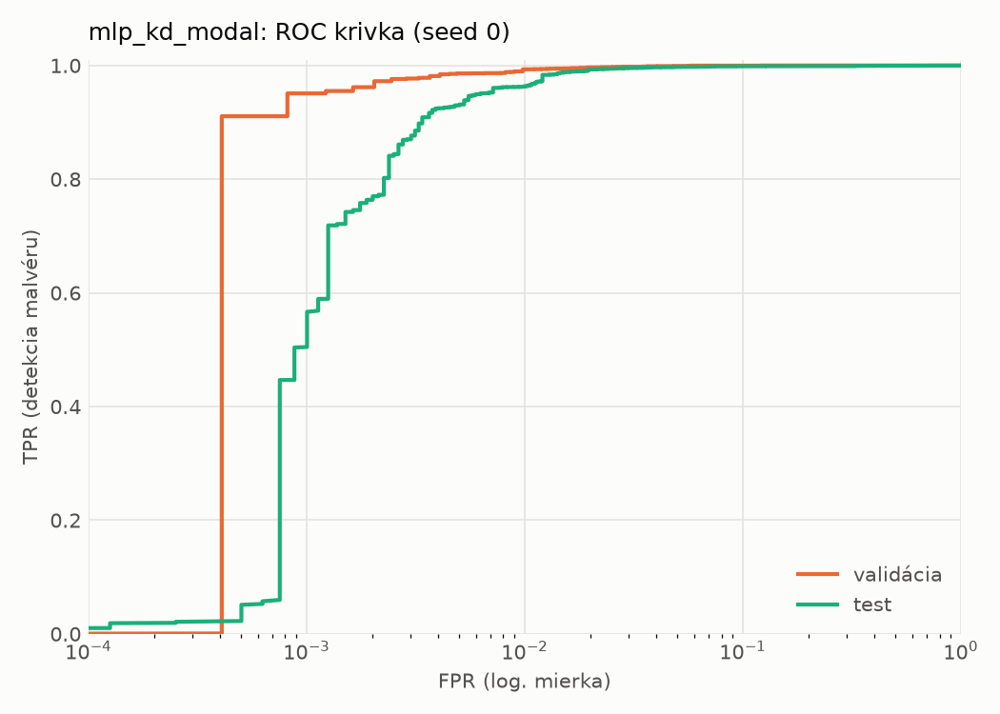
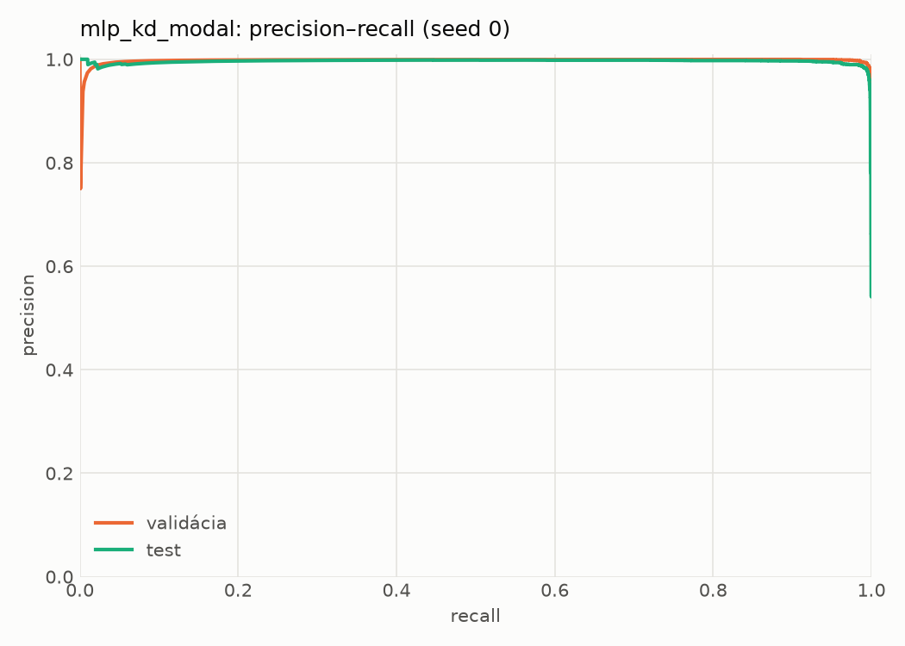
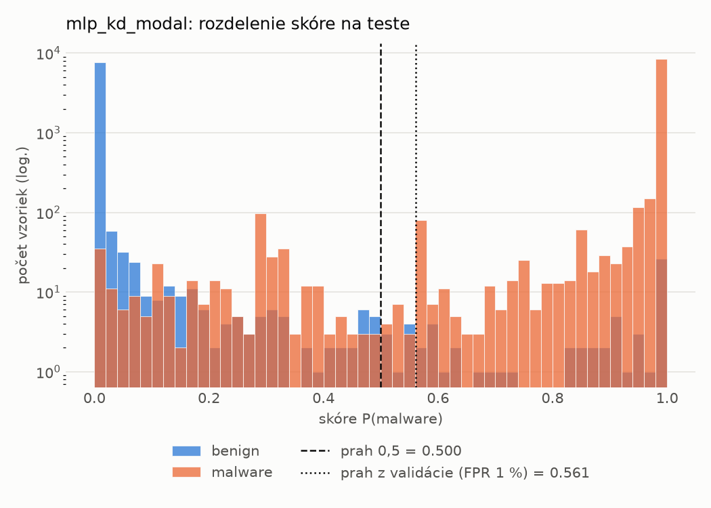
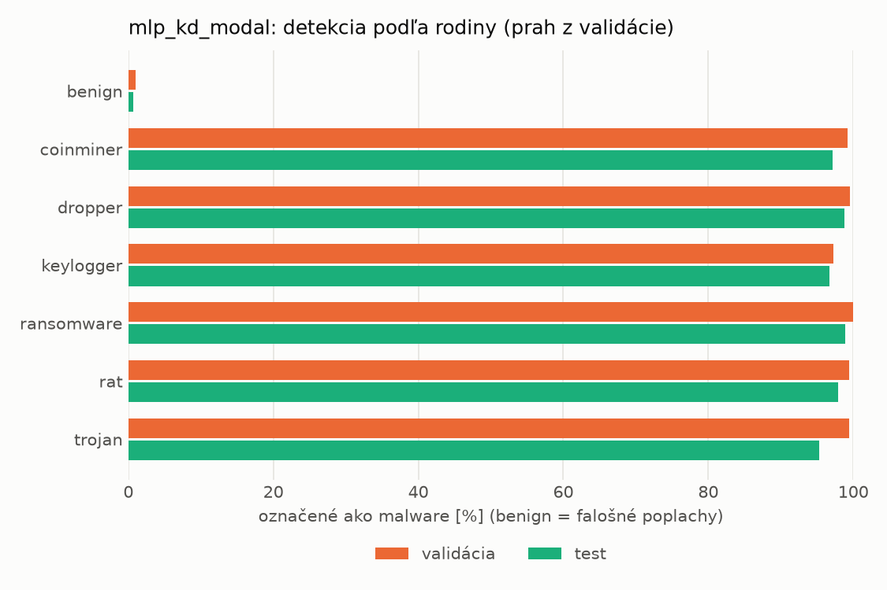
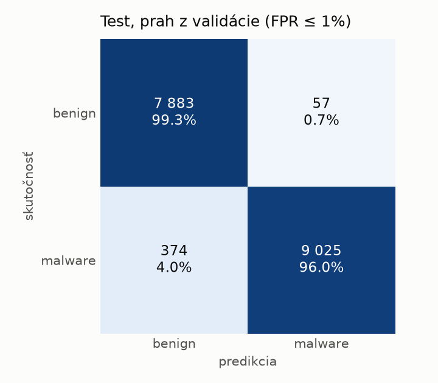
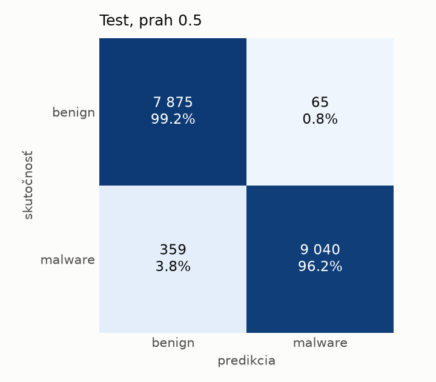
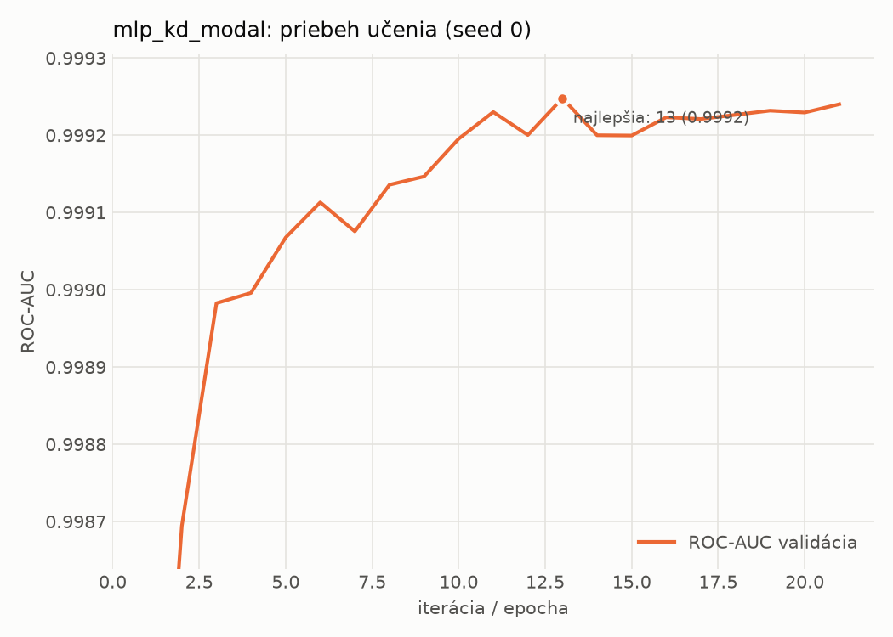

# static/mlp_kd_modal – beh `20261103-232325`

> Automaticky generované (`src/training/run_tabular.py`). Konfigurácia: `config.yaml`, protokol: `protocol.yaml`.

- **Model:** `mlp` – študent – malé MLP učené destiláciou z učiteľa rovnakej modality (variant A)
- **Ladenie:** bez ladenia – hyperparametre prevzaté z `runs_final/students_static/mlp_kd_modal/20261102-211832`
- **Finálne modely:** seedy [0, 1, 2]; hodnoty sú priemer ± smerodajná odchýlka cez seedy
- **Najlepšie hyperparametre:** `{"hidden_layers": 1, "max_epochs": 100, "patience": 8, "hidden_width": 32, "dropout": 0.15602040635334324, "lr": 0.00105640764164036, "weight_decay": 3.5856126103453987e-06, "batch_size": 256, "kd_alpha": 0.815861880342119, "kd_temperature": 5.185299851677596}`

## Detekčná kvalita (bez prahu)
| metrika | train (podvzorka) | validácia | test |
|---|---|---|---|
| ROC-AUC | 0.9998 ± 0.0000 | 0.9992 ± 0.0000 | 0.9976 ± 0.0002 |
| PR-AUC | 0.9999 ± 0.0000 | 0.9983 ± 0.0001 | 0.9958 ± 0.0005 |
| TPR pri FPR 1 % | 0.9974 ± 0.0008 | 0.9903 ± 0.0027 | 0.9708 ± 0.0093 |
| TPR pri FPR 0,1 % | 0.9787 ± 0.0010 | 0.9513 ± 0.0004 | 0.6539 ± 0.1299 |
| log loss | 0.0161 ± 0.0007 | 0.0291 ± 0.0009 | 0.0650 ± 0.0060 |
| Brier skóre | 0.0044 ± 0.0002 | 0.0072 ± 0.0002 | 0.0162 ± 0.0019 |

Rozdiel ROC-AUC train − validácia: **0.0006** (veľký rozdiel = preučenie).

## Pri prahu z validácie (FPR ≤ 1% na validácii)
| metrika | train (podvzorka) | validácia | test |
|---|---|---|---|
| accuracy | 0.9922 ± 0.0013 | 0.9904 ± 0.0015 | 0.9717 ± 0.0037 |
| balanced accuracy | 0.9930 ± 0.0011 | 0.9904 ± 0.0011 | 0.9734 ± 0.0034 |
| precision | 0.9979 ± 0.0002 | 0.9940 ± 0.0002 | 0.9945 ± 0.0006 |
| recall (TPR) | 0.9894 ± 0.0024 | 0.9903 ± 0.0027 | 0.9531 ± 0.0073 |
| FPR | 0.0033 ± 0.0003 | 0.0094 ± 0.0004 | 0.0063 ± 0.0008 |
| F1 | 0.9936 ± 0.0011 | 0.9922 ± 0.0012 | 0.9733 ± 0.0036 |
| MCC | 0.9837 ± 0.0028 | 0.9798 ± 0.0031 | 0.9442 ± 0.0070 |

## Pri pevnom prahu 0.5
| metrika | train (podvzorka) | validácia | test |
|---|---|---|---|
| accuracy | 0.9945 ± 0.0003 | 0.9911 ± 0.0001 | 0.9788 ± 0.0047 |
| balanced accuracy | 0.9944 ± 0.0004 | 0.9901 ± 0.0001 | 0.9798 ± 0.0043 |
| precision | 0.9962 ± 0.0005 | 0.9912 ± 0.0001 | 0.9928 ± 0.0006 |
| recall (TPR) | 0.9948 ± 0.0002 | 0.9943 ± 0.0003 | 0.9679 ± 0.0092 |
| FPR | 0.0059 ± 0.0008 | 0.0141 ± 0.0002 | 0.0084 ± 0.0008 |
| F1 | 0.9955 ± 0.0002 | 0.9927 ± 0.0001 | 0.9801 ± 0.0045 |
| MCC | 0.9884 ± 0.0006 | 0.9812 ± 0.0002 | 0.9577 ± 0.0091 |

## Výpočtové nároky (seed 0, testovacia množina)
| meranie | hodnota |
|---|---|
| tréning finálneho modelu | 10.3 s (priemer cez seedy) |
| ladenie spolu | 0 s |
| počet parametrov / uzlov | 74 209 |
| veľkosť modelu na disku | 0.36 MB |
| transformácia vstupu – latencia (1 vlákno) | 0.042 ms |
| transformácia vstupu – priepustnosť | 38 230 vzoriek/s |
| CPU latencia modelu (batch 1, 1 vlákno) | 0.068 ms (p95 0.076) |
| CPU priepustnosť (24 vlákien) | 109 043 vzoriek/s |
| GPU latencia (batch 1) | 0.294 ms (p95 0.328) |
| GPU priepustnosť | 61 396 vzoriek/s |
| GPU špičková pamäť | 1878 MB |

## Grafy
| | |
|---|---|
|  |  |
|  |  |
|  |  |
|  |  |

## Súbory
`metrics.json` (všetky metriky po seedoch vrátane rodín), `timing.json`, `hpo_trials.csv`,
`predictions/<časť>_seed<N>.parquet` (sha256, family, label, score), `model/seed_<N>/`, `log.txt`.
