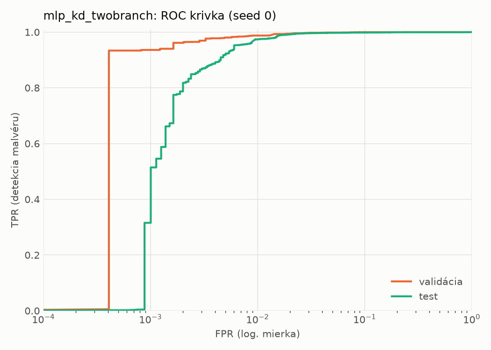
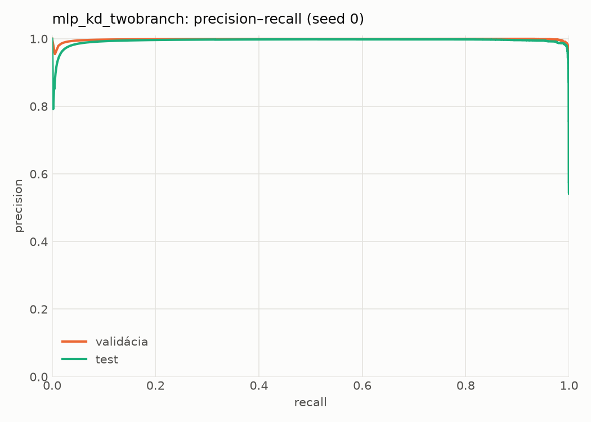
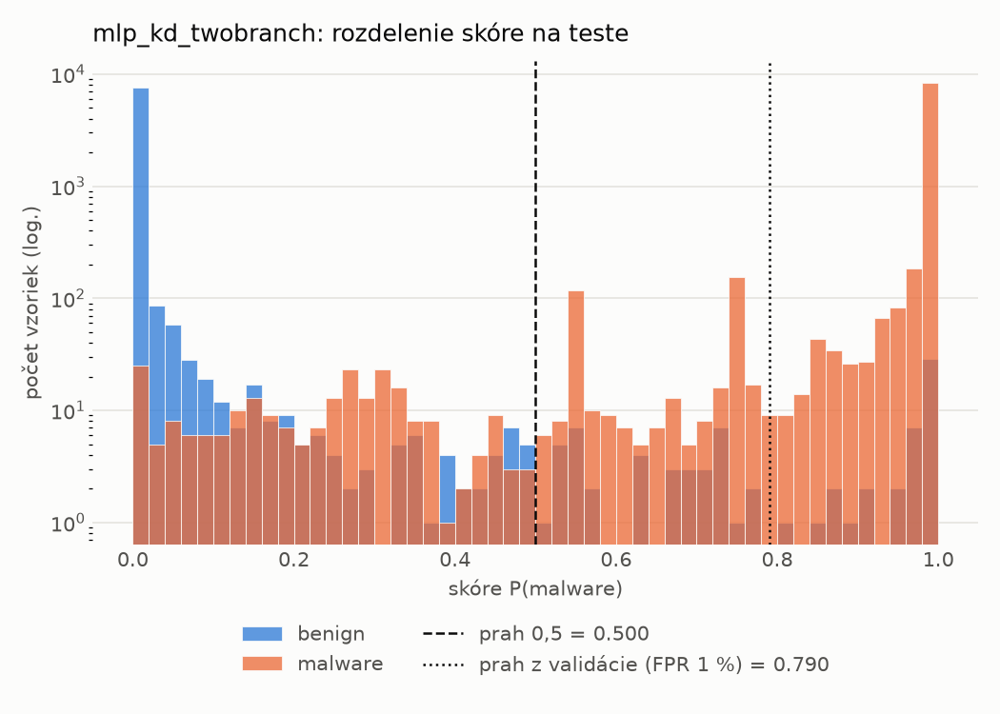
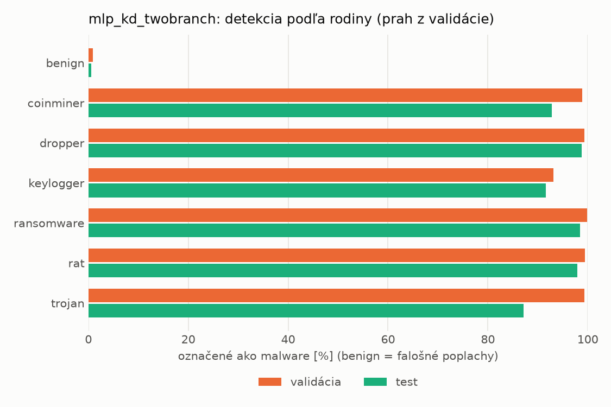
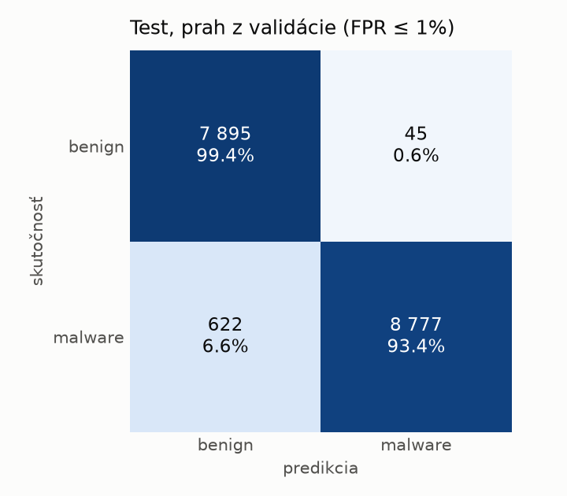
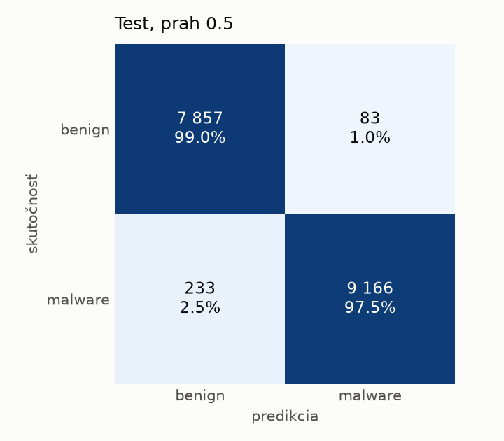
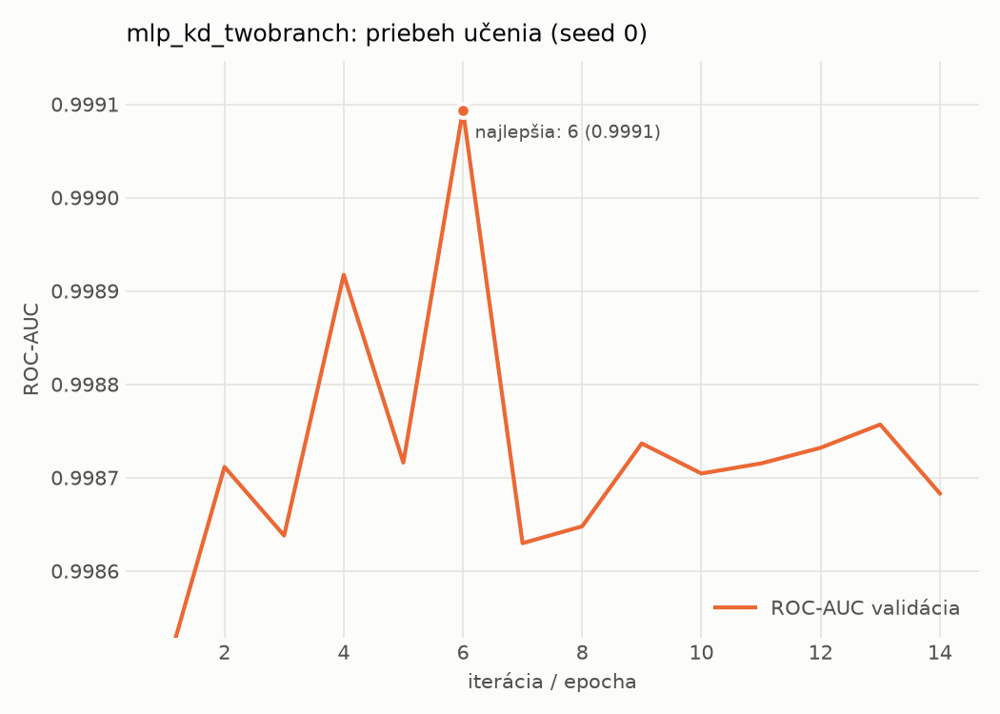

# static/mlp_kd_twobranch – beh `20261103-232405`

> Automaticky generované (`src/training/run_tabular.py`). Konfigurácia: `config.yaml`, protokol: `protocol.yaml`.

- **Model:** `mlp` – študent – malé MLP učené destiláciou z dvojvetvovej siete (V2)
- **Ladenie:** bez ladenia – hyperparametre prevzaté z `runs_v2/full/students_static/mlp_kd_twobranch/20261103-210128`
- **Finálne modely:** seedy [0, 1, 2]; hodnoty sú priemer ± smerodajná odchýlka cez seedy
- **Najlepšie hyperparametre:** `{"hidden_layers": 1, "max_epochs": 100, "patience": 8, "hidden_width": 32, "dropout": 0.11907530604839062, "lr": 0.0013122016832935236, "weight_decay": 1.6321051677063922e-05, "batch_size": 256, "kd_alpha": 0.8749635763069835, "kd_temperature": 3.9893325789148495}`

## Detekčná kvalita (bez prahu)
| metrika | train (podvzorka) | validácia | test |
|---|---|---|---|
| ROC-AUC | 0.9997 ± 0.0002 | 0.9990 ± 0.0003 | 0.9971 ± 0.0003 |
| PR-AUC | 0.9998 ± 0.0001 | 0.9982 ± 0.0004 | 0.9947 ± 0.0007 |
| TPR pri FPR 1 % | 0.9916 ± 0.0050 | 0.9882 ± 0.0051 | 0.9722 ± 0.0046 |
| TPR pri FPR 0,1 % | 0.9661 ± 0.0165 | 0.9168 ± 0.0185 | 0.3507 ± 0.1520 |
| log loss | 0.0217 ± 0.0056 | 0.0326 ± 0.0038 | 0.0672 ± 0.0034 |
| Brier skóre | 0.0061 ± 0.0014 | 0.0081 ± 0.0009 | 0.0157 ± 0.0007 |

Rozdiel ROC-AUC train − validácia: **0.0007** (veľký rozdiel = preučenie).

## Pri prahu z validácie (FPR ≤ 1% na validácii)
| metrika | train (podvzorka) | validácia | test |
|---|---|---|---|
| accuracy | 0.9898 ± 0.0038 | 0.9891 ± 0.0031 | 0.9680 ± 0.0115 |
| balanced accuracy | 0.9908 ± 0.0029 | 0.9893 ± 0.0025 | 0.9699 ± 0.0105 |
| precision | 0.9970 ± 0.0011 | 0.9939 ± 0.0003 | 0.9937 ± 0.0012 |
| recall (TPR) | 0.9862 ± 0.0068 | 0.9882 ± 0.0051 | 0.9470 ± 0.0223 |
| FPR | 0.0046 ± 0.0017 | 0.0096 ± 0.0005 | 0.0071 ± 0.0015 |
| F1 | 0.9916 ± 0.0031 | 0.9911 ± 0.0025 | 0.9697 ± 0.0111 |
| MCC | 0.9788 ± 0.0077 | 0.9771 ± 0.0064 | 0.9372 ± 0.0219 |

## Pri pevnom prahu 0.5
| metrika | train (podvzorka) | validácia | test |
|---|---|---|---|
| accuracy | 0.9919 ± 0.0015 | 0.9902 ± 0.0011 | 0.9820 ± 0.0002 |
| balanced accuracy | 0.9914 ± 0.0016 | 0.9893 ± 0.0013 | 0.9825 ± 0.0002 |
| precision | 0.9930 ± 0.0013 | 0.9908 ± 0.0015 | 0.9904 ± 0.0012 |
| recall (TPR) | 0.9938 ± 0.0011 | 0.9933 ± 0.0003 | 0.9762 ± 0.0013 |
| FPR | 0.0110 ± 0.0020 | 0.0146 ± 0.0024 | 0.0112 ± 0.0015 |
| F1 | 0.9934 ± 0.0012 | 0.9921 ± 0.0009 | 0.9833 ± 0.0002 |
| MCC | 0.9830 ± 0.0031 | 0.9794 ± 0.0022 | 0.9639 ± 0.0005 |

## Výpočtové nároky (seed 0, testovacia množina)
| meranie | hodnota |
|---|---|
| tréning finálneho modelu | 4.7 s (priemer cez seedy) |
| ladenie spolu | 0 s |
| počet parametrov / uzlov | 74 209 |
| veľkosť modelu na disku | 0.36 MB |
| transformácia vstupu – latencia (1 vlákno) | 0.028 ms |
| transformácia vstupu – priepustnosť | 47 252 vzoriek/s |
| CPU latencia modelu (batch 1, 1 vlákno) | 0.068 ms (p95 0.077) |
| CPU priepustnosť (24 vlákien) | 109 945 vzoriek/s |
| GPU latencia (batch 1) | 0.282 ms (p95 0.320) |
| GPU priepustnosť | 80 871 vzoriek/s |
| GPU špičková pamäť | 767 MB |

## Grafy
| | |
|---|---|
|  |  |
|  |  |
|  |  |
|  |  |

## Súbory
`metrics.json` (všetky metriky po seedoch vrátane rodín), `timing.json`, `hpo_trials.csv`,
`predictions/<časť>_seed<N>.parquet` (sha256, family, label, score), `model/seed_<N>/`, `log.txt`.
