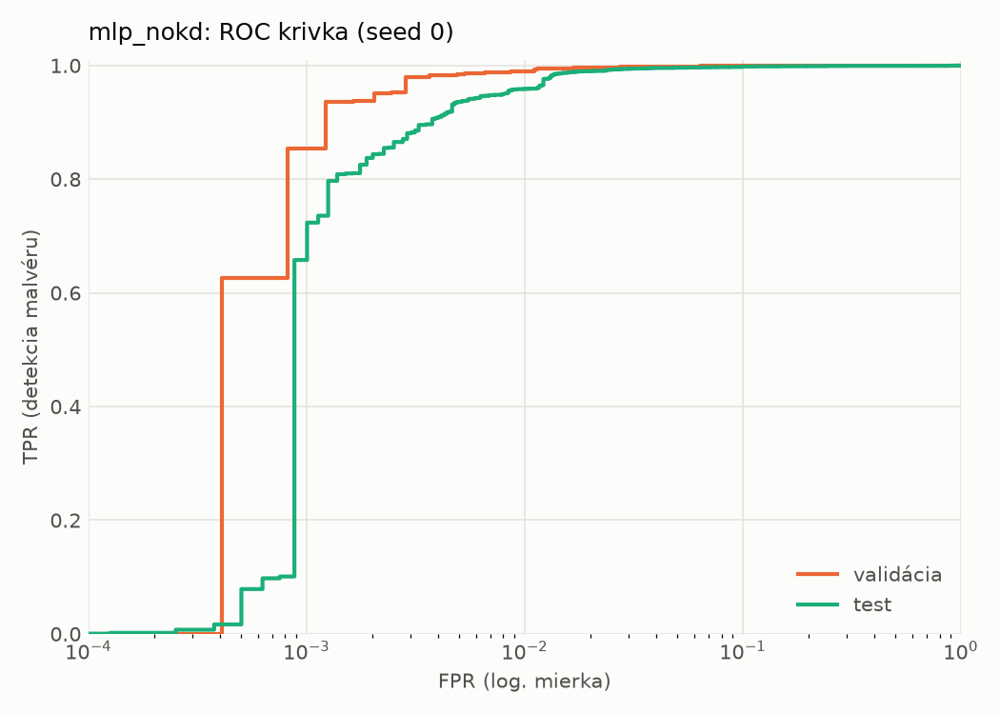
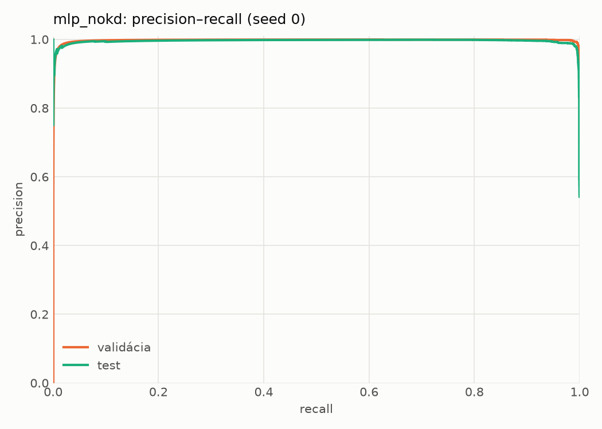
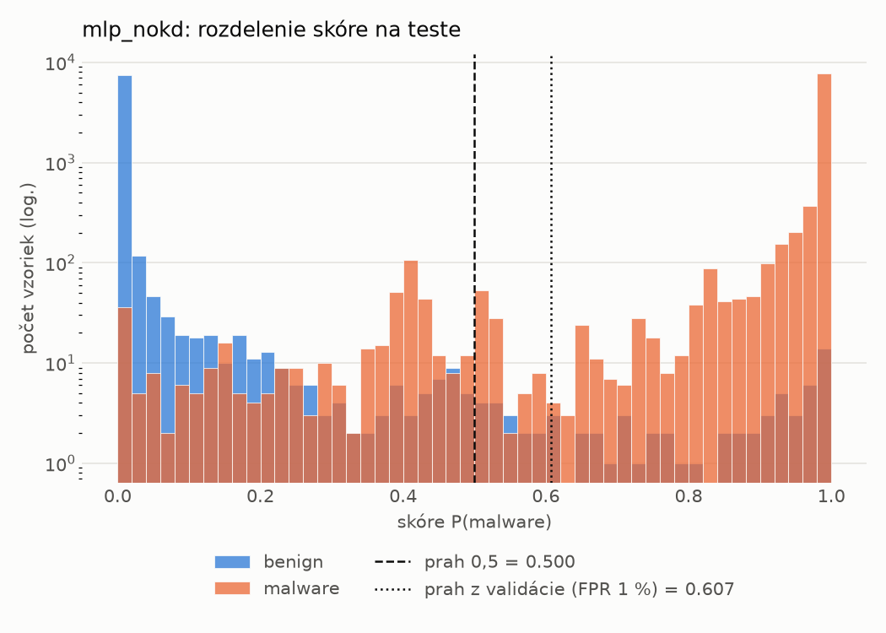
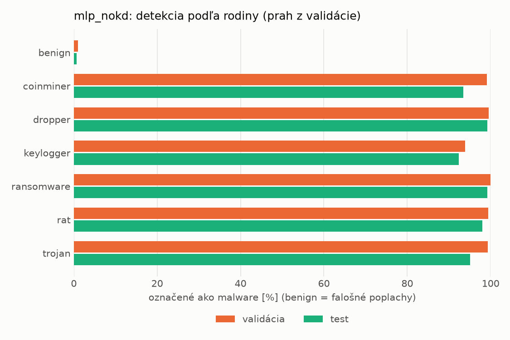
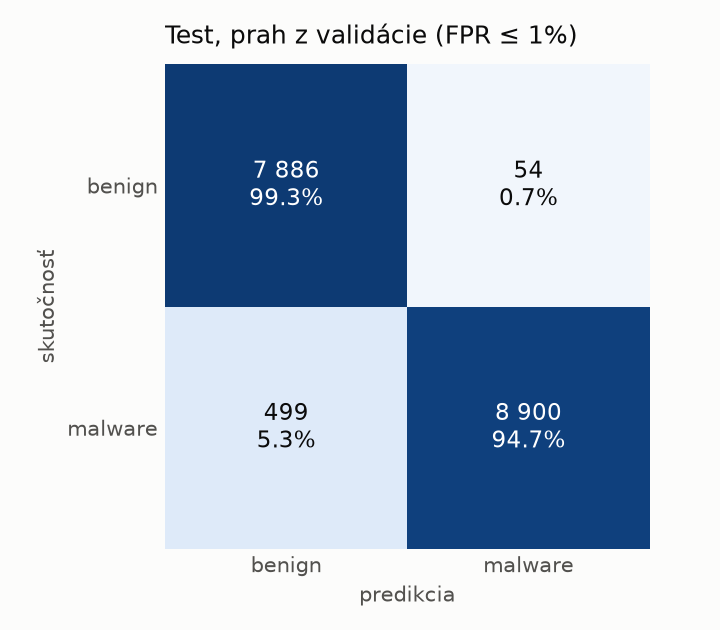
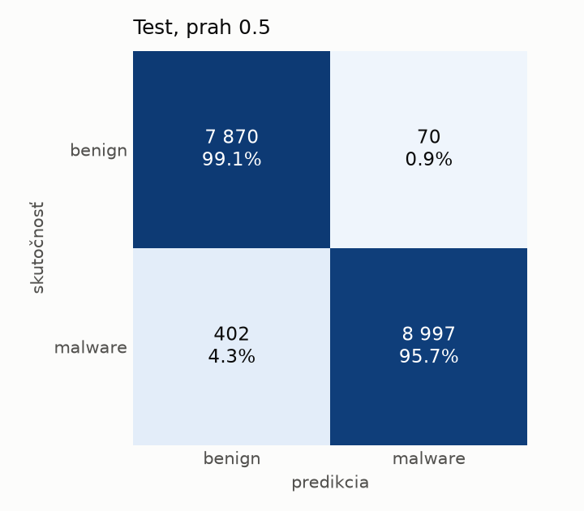
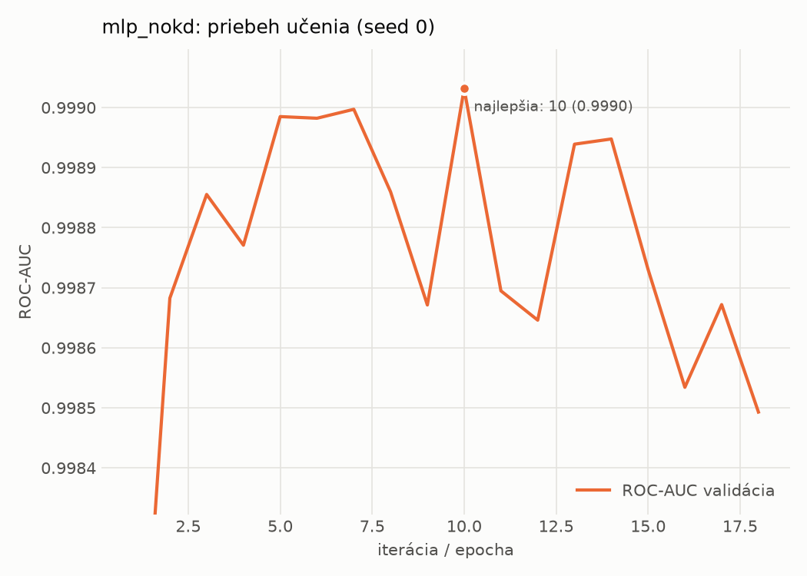

# static/mlp_nokd – beh `20261103-232309`

> Automaticky generované (`src/training/run_tabular.py`). Konfigurácia: `config.yaml`, protokol: `protocol.yaml`.

- **Model:** `mlp` – kontrola – rovnaké malé MLP bez destilácie (iba skutočné označenia)
- **Ladenie:** bez ladenia – hyperparametre prevzaté z `runs_final/students_static/mlp_nokd/20261102-211710`
- **Finálne modely:** seedy [0, 1, 2]; hodnoty sú priemer ± smerodajná odchýlka cez seedy
- **Najlepšie hyperparametre:** `{"hidden_layers": 1, "max_epochs": 100, "patience": 8, "hidden_width": 32, "dropout": 0.137657909519708, "lr": 0.0007042503153050794, "weight_decay": 1.207246112223234e-05, "batch_size": 512}`

## Detekčná kvalita (bez prahu)
| metrika | train (podvzorka) | validácia | test |
|---|---|---|---|
| ROC-AUC | 0.9997 ± 0.0001 | 0.9988 ± 0.0002 | 0.9969 ± 0.0006 |
| PR-AUC | 0.9998 ± 0.0001 | 0.9975 ± 0.0001 | 0.9945 ± 0.0014 |
| TPR pri FPR 1 % | 0.9953 ± 0.0024 | 0.9879 ± 0.0014 | 0.9561 ± 0.0071 |
| TPR pri FPR 0,1 % | 0.9765 ± 0.0020 | 0.8996 ± 0.0410 | 0.4749 ± 0.3722 |
| log loss | 0.0264 ± 0.0088 | 0.0363 ± 0.0064 | 0.0720 ± 0.0061 |
| Brier skóre | 0.0056 ± 0.0013 | 0.0078 ± 0.0006 | 0.0182 ± 0.0010 |

Rozdiel ROC-AUC train − validácia: **0.0009** (veľký rozdiel = preučenie).

## Pri prahu z validácie (FPR ≤ 1% na validácii)
| metrika | train (podvzorka) | validácia | test |
|---|---|---|---|
| accuracy | 0.9902 ± 0.0019 | 0.9889 ± 0.0007 | 0.9653 ± 0.0025 |
| balanced accuracy | 0.9914 ± 0.0016 | 0.9892 ± 0.0005 | 0.9674 ± 0.0023 |
| precision | 0.9979 ± 0.0003 | 0.9940 ± 0.0004 | 0.9936 ± 0.0004 |
| recall (TPR) | 0.9860 ± 0.0028 | 0.9879 ± 0.0014 | 0.9419 ± 0.0043 |
| FPR | 0.0033 ± 0.0004 | 0.0094 ± 0.0007 | 0.0071 ± 0.0004 |
| F1 | 0.9919 ± 0.0015 | 0.9909 ± 0.0006 | 0.9671 ± 0.0024 |
| MCC | 0.9795 ± 0.0038 | 0.9767 ± 0.0014 | 0.9319 ± 0.0047 |

## Pri pevnom prahu 0.5
| metrika | train (podvzorka) | validácia | test |
|---|---|---|---|
| accuracy | 0.9936 ± 0.0019 | 0.9910 ± 0.0010 | 0.9720 ± 0.0028 |
| balanced accuracy | 0.9933 ± 0.0021 | 0.9902 ± 0.0011 | 0.9734 ± 0.0026 |
| precision | 0.9951 ± 0.0020 | 0.9917 ± 0.0010 | 0.9909 ± 0.0012 |
| recall (TPR) | 0.9944 ± 0.0012 | 0.9936 ± 0.0010 | 0.9572 ± 0.0051 |
| FPR | 0.0077 ± 0.0032 | 0.0132 ± 0.0017 | 0.0104 ± 0.0014 |
| F1 | 0.9947 ± 0.0015 | 0.9927 ± 0.0008 | 0.9737 ± 0.0027 |
| MCC | 0.9865 ± 0.0039 | 0.9810 ± 0.0021 | 0.9445 ± 0.0055 |

## Výpočtové nároky (seed 0, testovacia množina)
| meranie | hodnota |
|---|---|
| tréning finálneho modelu | 2.3 s (priemer cez seedy) |
| ladenie spolu | 0 s |
| počet parametrov / uzlov | 74 209 |
| veľkosť modelu na disku | 0.36 MB |
| transformácia vstupu – latencia (1 vlákno) | 0.042 ms |
| transformácia vstupu – priepustnosť | 38 750 vzoriek/s |
| CPU latencia modelu (batch 1, 1 vlákno) | 0.069 ms (p95 0.079) |
| CPU priepustnosť (24 vlákien) | 110 273 vzoriek/s |
| GPU latencia (batch 1) | 0.269 ms (p95 0.313) |
| GPU priepustnosť | 80 903 vzoriek/s |
| GPU špičková pamäť | 1352 MB |

## Grafy
| | |
|---|---|
|  |  |
|  |  |
|  |  |
|  |  |

## Súbory
`metrics.json` (všetky metriky po seedoch vrátane rodín), `timing.json`, `hpo_trials.csv`,
`predictions/<časť>_seed<N>.parquet` (sha256, family, label, score), `model/seed_<N>/`, `log.txt`.
