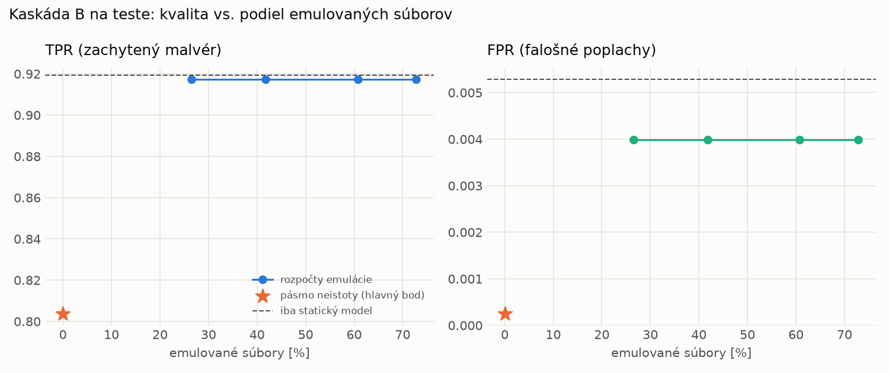

# Kaskáda B `b_baselines` – beh `20261104-012506`

> Generované `src/cascade/evaluate_b.py` (2026-11-04T01:25:06+01:00). Seedy: [0, 1, 2]; hodnoty = priemer ± sm. odchýlka.
> Všetky prahy a pásmo neistoty sú z validácie; test sa na nič nenastavuje. Postup: `docs/09_plan_v2.md`.

| rola | beh |
|---|---|
| static | `runs_v2/lofo/coinminer/static/lightgbm/20261103-232852` |
| dynamic | `runs_v2/lofo/coinminer/dynamic/lightgbm/20261103-234518` |
| hybrid | `runs_v2/lofo/coinminer/hybrid/lightgbm/20261104-001521` |

Druhý stupeň: **dynamic**. Pásmo neistoty statického modelu: FPR ≤ 0.1% nad `hi`,
najviac 1% malvéru validácie pod `lo` (seed 0: lo = 0.9784, hi = 0.9784, seed 1: lo = 0.9680, hi = 0.9680, seed 2: lo = 0.9660, hi = 0.9660).

## Test
| prístup | accuracy | balanced_accuracy | precision | recall_tpr | fpr | f1 | mcc |
|---|---|---|---|---|---|---|---|
| kaskáda B | 0.8935 ± 0.0109 | 0.9018 ± 0.0101 | 0.9997 ± 0.0000 | 0.8038 ± 0.0201 | 0.0003 ± 0.0000 | 0.8910 ± 0.0123 | 0.8075 ± 0.0180 |
| statický | 0.9538 ± 0.0001 | 0.9570 ± 0.0001 | 0.9952 ± 0.0004 | 0.9193 ± 0.0005 | 0.0053 ± 0.0005 | 0.9557 ± 0.0002 | 0.9108 ± 0.0002 |
| dynamický | 0.7744 ± 0.0007 | 0.7908 ± 0.0007 | 0.9804 ± 0.0006 | 0.5958 ± 0.0010 | 0.0141 ± 0.0005 | 0.7412 ± 0.0009 | 0.6166 ± 0.0013 |
| hybrid (každá vzorka) | 0.9528 ± 0.0018 | 0.9560 ± 0.0016 | 0.9950 ± 0.0011 | 0.9175 ± 0.0043 | 0.0055 ± 0.0013 | 0.9547 ± 0.0018 | 0.9088 ± 0.0031 |

- **emulované súbory: 0.00%** (ostatné rozhodne iba statický model); na hybrid ide 0.00% súborov
- chyby pri istom rozhodnutí statického modelu (seed 0): 1976
- validácia: emulované 0.00%, na hybrid 0.00%

## Validácia
| prístup | accuracy | balanced_accuracy | precision | recall_tpr | fpr | f1 | mcc |
|---|---|---|---|---|---|---|---|
| kaskáda B | 0.9937 ± 0.0002 | 0.9949 ± 0.0001 | 0.9995 ± 0.0000 | 0.9907 ± 0.0003 | 0.0008 ± 0.0000 | 0.9951 ± 0.0001 | 0.9866 ± 0.0004 |
| statický | 0.9955 ± 0.0005 | 0.9946 ± 0.0006 | 0.9952 ± 0.0007 | 0.9977 ± 0.0000 | 0.0085 ± 0.0013 | 0.9965 ± 0.0004 | 0.9902 ± 0.0010 |
| dynamický | 0.9731 ± 0.0001 | 0.9773 ± 0.0002 | 0.9954 ± 0.0001 | 0.9624 ± 0.0001 | 0.0079 ± 0.0002 | 0.9786 ± 0.0001 | 0.9434 ± 0.0003 |
| hybrid (každá vzorka) | 0.9949 ± 0.0004 | 0.9940 ± 0.0004 | 0.9947 ± 0.0004 | 0.9974 ± 0.0004 | 0.0094 ± 0.0007 | 0.9960 ± 0.0003 | 0.9890 ± 0.0008 |

## Januárové vzorky vynechanej rodiny (iba malvér → TPR)
| prístup | TPR |
|---|---|
| kaskáda B | 0.3912 ± 0.0158 |
| statický | 0.8650 ± 0.0061 |
| dynamický | 0.2556 ± 0.0013 |
| hybrid (každá vzorka) | 0.8711 ± 0.0072 |

Podiel emulovaných: 0.00%

## Krivka rozpočtu emulácie (test, priemer cez seedy)
| budget_val | emulation_rate | hybrid_rate | recall_tpr | fpr | f1 |
|---|---|---|---|---|---|
| 0.1000 | 0.2652 | 0.0504 | 0.9174 | 0.0040 | 0.9553 |
| 0.2000 | 0.4176 | 0.0769 | 0.9174 | 0.0040 | 0.9553 |
| 0.3000 | 0.6078 | 0.0955 | 0.9174 | 0.0040 | 0.9553 |
| 0.4000 | 0.7278 | 0.1090 | 0.9174 | 0.0040 | 0.9553 |

## Výpočtové nároky
Emulácia (Speakeasy) sa nedá zmerať (dataset neobsahuje PE súbory). **Predpoklad** 60 s na súbor
(limit z `speakeasy-config.json`): kaskáda B ≈ 0.0 s na súbor v priemere, dynamický/hybridný model
a kaskáda A 60 s (emulujú každý súbor).

_Chýba benchmark niektorého komponentu (v zero-day behoch sa nemeria)._

