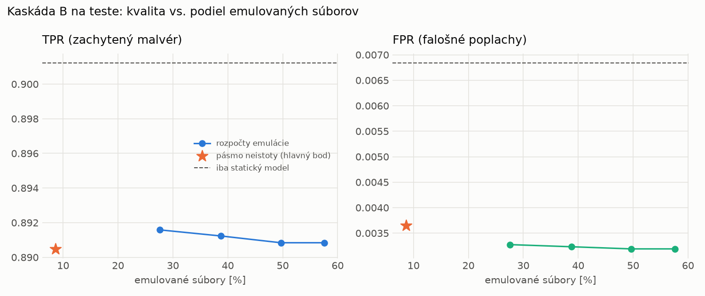

# Kaskáda B `b_heavy` – beh `20261104-012504`

> Generované `src/cascade/evaluate_b.py` (2026-11-04T01:25:04+01:00). Seedy: [0, 1, 2]; hodnoty = priemer ± sm. odchýlka.
> Všetky prahy a pásmo neistoty sú z validácie; test sa na nič nenastavuje. Postup: `docs/09_plan_v2.md`.

| rola | beh |
|---|---|
| static | `runs_v2/lofo/coinminer/students_static/mlp_kd/20261104-012050` |
| dynamic | `runs_v2/lofo/coinminer/students_dynamic/mlp_kd/20261104-012249` |
| hybrid | `runs_v2/lofo/coinminer/hybrid/two_branch/20261104-001725` |

Druhý stupeň: **dynamic**. Pásmo neistoty statického modelu: FPR ≤ 0.1% nad `hi`,
najviac 1% malvéru validácie pod `lo` (seed 0: lo = 0.6290, hi = 0.9979, seed 1: lo = 0.6102, hi = 0.9924, seed 2: lo = 0.6720, hi = 0.9951).

## Test
| prístup | accuracy | balanced_accuracy | precision | recall_tpr | fpr | f1 | mcc |
|---|---|---|---|---|---|---|---|
| kaskáda B | 0.9390 ± 0.0027 | 0.9434 ± 0.0024 | 0.9965 ± 0.0006 | 0.8905 ± 0.0055 | 0.0037 ± 0.0007 | 0.9405 ± 0.0028 | 0.8841 ± 0.0046 |
| statický | 0.9433 ± 0.0022 | 0.9472 ± 0.0021 | 0.9936 ± 0.0003 | 0.9012 ± 0.0039 | 0.0068 ± 0.0003 | 0.9452 ± 0.0023 | 0.8913 ± 0.0041 |
| dynamický | 0.7299 ± 0.0053 | 0.7499 ± 0.0047 | 0.9802 ± 0.0037 | 0.5121 ± 0.0120 | 0.0123 ± 0.0027 | 0.6727 ± 0.0095 | 0.5527 ± 0.0058 |
| hybrid (každá vzorka) | 0.9409 ± 0.0057 | 0.9450 ± 0.0053 | 0.9942 ± 0.0005 | 0.8962 ± 0.0104 | 0.0062 ± 0.0005 | 0.9427 ± 0.0059 | 0.8872 ± 0.0103 |

- **emulované súbory: 8.64%** (ostatné rozhodne iba statický model); na hybrid ide 6.67% súborov
- chyby pri istom rozhodnutí statického modelu (seed 0): 903
- validácia: emulované 1.98%, na hybrid 1.10%

## Validácia
| prístup | accuracy | balanced_accuracy | precision | recall_tpr | fpr | f1 | mcc |
|---|---|---|---|---|---|---|---|
| kaskáda B | 0.9915 ± 0.0010 | 0.9922 ± 0.0010 | 0.9970 ± 0.0005 | 0.9897 ± 0.0011 | 0.0053 ± 0.0008 | 0.9933 ± 0.0008 | 0.9816 ± 0.0022 |
| statický | 0.9905 ± 0.0015 | 0.9905 ± 0.0011 | 0.9946 ± 0.0003 | 0.9905 ± 0.0024 | 0.0096 ± 0.0005 | 0.9926 ± 0.0012 | 0.9795 ± 0.0031 |
| dynamický | 0.9671 ± 0.0001 | 0.9721 ± 0.0001 | 0.9942 ± 0.0000 | 0.9540 ± 0.0002 | 0.0098 ± 0.0000 | 0.9737 ± 0.0001 | 0.9311 ± 0.0003 |
| hybrid (každá vzorka) | 0.9940 ± 0.0016 | 0.9934 ± 0.0014 | 0.9950 ± 0.0003 | 0.9957 ± 0.0023 | 0.0089 ± 0.0005 | 0.9953 ± 0.0013 | 0.9871 ± 0.0035 |

## Januárové vzorky vynechanej rodiny (iba malvér → TPR)
| prístup | TPR |
|---|---|
| kaskáda B | 0.7236 ± 0.0675 |
| statický | 0.7763 ± 0.0490 |
| dynamický | 0.1549 ± 0.0020 |
| hybrid (každá vzorka) | 0.7766 ± 0.0510 |

Podiel emulovaných: 31.13%

## Krivka rozpočtu emulácie (test, priemer cez seedy)
| budget_val | emulation_rate | hybrid_rate | recall_tpr | fpr | f1 |
|---|---|---|---|---|---|
| 0.1000 | 0.2757 | 0.1158 | 0.8916 | 0.0033 | 0.9413 |
| 0.2000 | 0.3877 | 0.1421 | 0.8912 | 0.0032 | 0.9411 |
| 0.3000 | 0.4966 | 0.1703 | 0.8908 | 0.0032 | 0.9409 |
| 0.4000 | 0.5760 | 0.2147 | 0.8908 | 0.0032 | 0.9409 |

## Výpočtové nároky
Emulácia (Speakeasy) sa nedá zmerať (dataset neobsahuje PE súbory). **Predpoklad** 60 s na súbor
(limit z `speakeasy-config.json`): kaskáda B ≈ 5.2 s na súbor v priemere, dynamický/hybridný model
a kaskáda A 60 s (emulujú každý súbor).

_Chýba benchmark niektorého komponentu (v zero-day behoch sa nemeria)._

