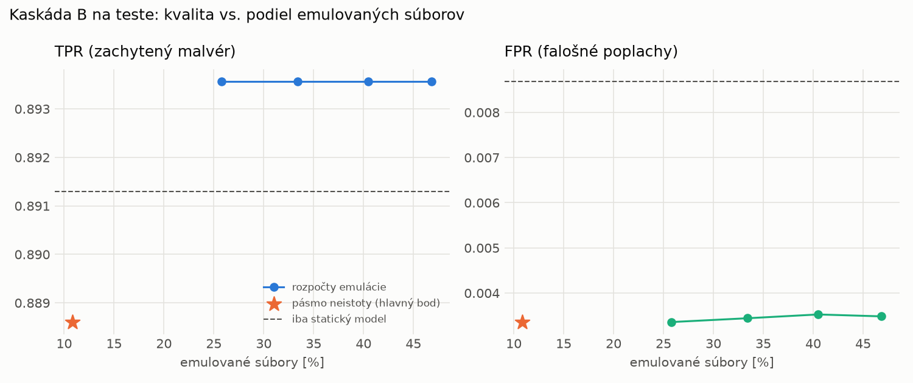

# Kaskáda B `b_nokd` – beh `20261104-012507`

> Generované `src/cascade/evaluate_b.py` (2026-11-04T01:25:08+01:00). Seedy: [0, 1, 2]; hodnoty = priemer ± sm. odchýlka.
> Všetky prahy a pásmo neistoty sú z validácie; test sa na nič nenastavuje. Postup: `docs/09_plan_v2.md`.

| rola | beh |
|---|---|
| static | `runs_v2/lofo/coinminer/students_static/mlp_nokd/20261104-012129` |
| dynamic | `runs_v2/lofo/coinminer/students_dynamic/mlp_nokd/20261104-012323` |
| hybrid | `runs_v2/lofo/coinminer/hybrid/lightgbm/20261104-001521` |

Druhý stupeň: **dynamic**. Pásmo neistoty statického modelu: FPR ≤ 0.1% nad `hi`,
najviac 1% malvéru validácie pod `lo` (seed 0: lo = 0.5689, hi = 0.9585, seed 1: lo = 0.4983, hi = 0.9509, seed 2: lo = 0.4972, hi = 0.9480).

## Test
| prístup | accuracy | balanced_accuracy | precision | recall_tpr | fpr | f1 | mcc |
|---|---|---|---|---|---|---|---|
| kaskáda B | 0.9381 ± 0.0036 | 0.9426 ± 0.0033 | 0.9968 ± 0.0004 | 0.8886 ± 0.0064 | 0.0034 ± 0.0004 | 0.9396 ± 0.0037 | 0.8826 ± 0.0064 |
| statický | 0.9371 ± 0.0065 | 0.9413 ± 0.0061 | 0.9918 ± 0.0011 | 0.8913 ± 0.0112 | 0.0087 ± 0.0011 | 0.9389 ± 0.0067 | 0.8798 ± 0.0119 |
| dynamický | 0.7449 ± 0.0125 | 0.7639 ± 0.0114 | 0.9837 ± 0.0031 | 0.5384 ± 0.0238 | 0.0106 ± 0.0022 | 0.6957 ± 0.0198 | 0.5758 ± 0.0176 |
| hybrid (každá vzorka) | 0.9528 ± 0.0018 | 0.9560 ± 0.0016 | 0.9950 ± 0.0011 | 0.9175 ± 0.0043 | 0.0055 ± 0.0013 | 0.9547 ± 0.0018 | 0.9088 ± 0.0031 |

- **emulované súbory: 10.85%** (ostatné rozhodne iba statický model); na hybrid ide 6.84% súborov
- chyby pri istom rozhodnutí statického modelu (seed 0): 969
- validácia: emulované 2.84%, na hybrid 1.02%

## Validácia
| prístup | accuracy | balanced_accuracy | precision | recall_tpr | fpr | f1 | mcc |
|---|---|---|---|---|---|---|---|
| kaskáda B | 0.9894 ± 0.0022 | 0.9905 ± 0.0019 | 0.9970 ± 0.0005 | 0.9864 ± 0.0030 | 0.0053 ± 0.0008 | 0.9916 ± 0.0017 | 0.9771 ± 0.0047 |
| statický | 0.9883 ± 0.0036 | 0.9888 ± 0.0029 | 0.9946 ± 0.0003 | 0.9871 ± 0.0054 | 0.0094 ± 0.0004 | 0.9908 ± 0.0029 | 0.9749 ± 0.0077 |
| dynamický | 0.9664 ± 0.0007 | 0.9716 ± 0.0005 | 0.9942 ± 0.0000 | 0.9530 ± 0.0011 | 0.0098 ± 0.0000 | 0.9732 ± 0.0006 | 0.9298 ± 0.0014 |
| hybrid (každá vzorka) | 0.9949 ± 0.0004 | 0.9940 ± 0.0004 | 0.9947 ± 0.0004 | 0.9974 ± 0.0004 | 0.0094 ± 0.0007 | 0.9960 ± 0.0003 | 0.9890 ± 0.0008 |

## Januárové vzorky vynechanej rodiny (iba malvér → TPR)
| prístup | TPR |
|---|---|
| kaskáda B | 0.5727 ± 0.0189 |
| statický | 0.5717 ± 0.0217 |
| dynamický | 0.2342 ± 0.0011 |
| hybrid (každá vzorka) | 0.8711 ± 0.0072 |

Podiel emulovaných: 15.84%

## Krivka rozpočtu emulácie (test, priemer cez seedy)
| budget_val | emulation_rate | hybrid_rate | recall_tpr | fpr | f1 |
|---|---|---|---|---|---|
| 0.1000 | 0.2580 | 0.1041 | 0.8936 | 0.0034 | 0.9424 |
| 0.2000 | 0.3339 | 0.1309 | 0.8936 | 0.0034 | 0.9423 |
| 0.3000 | 0.4049 | 0.1586 | 0.8936 | 0.0035 | 0.9423 |
| 0.4000 | 0.4683 | 0.1812 | 0.8936 | 0.0035 | 0.9423 |

## Výpočtové nároky
Emulácia (Speakeasy) sa nedá zmerať (dataset neobsahuje PE súbory). **Predpoklad** 60 s na súbor
(limit z `speakeasy-config.json`): kaskáda B ≈ 6.5 s na súbor v priemere, dynamický/hybridný model
a kaskáda A 60 s (emulujú každý súbor).

_Chýba benchmark niektorého komponentu (v zero-day behoch sa nemeria)._

