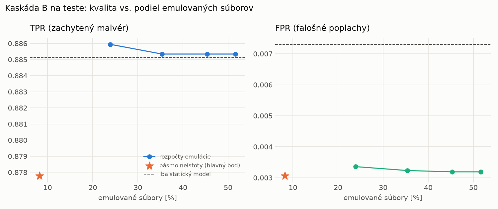

# Kaskáda B `b_twobranch` – beh `20261104-012509`

> Generované `src/cascade/evaluate_b.py` (2026-11-04T01:25:10+01:00). Seedy: [0, 1, 2]; hodnoty = priemer ± sm. odchýlka.
> Všetky prahy a pásmo neistoty sú z validácie; test sa na nič nenastavuje. Postup: `docs/09_plan_v2.md`.

| rola | beh |
|---|---|
| static | `runs_v2/lofo/coinminer/students_static/mlp_kd_twobranch/20261104-012222` |
| dynamic | `runs_v2/lofo/coinminer/students_dynamic/mlp_kd_twobranch/20261104-012418` |
| hybrid | `runs_v2/lofo/coinminer/hybrid/lightgbm/20261104-001521` |

Druhý stupeň: **dynamic**. Pásmo neistoty statického modelu: FPR ≤ 0.1% nad `hi`,
najviac 1% malvéru validácie pod `lo` (seed 0: lo = 0.5904, hi = 0.9916, seed 1: lo = 0.5329, hi = 0.9783, seed 2: lo = 0.7590, hi = 0.9827).

## Test
| prístup | accuracy | balanced_accuracy | precision | recall_tpr | fpr | f1 | mcc |
|---|---|---|---|---|---|---|---|
| kaskáda B | 0.9323 ± 0.0084 | 0.9374 ± 0.0078 | 0.9971 ± 0.0005 | 0.8778 ± 0.0153 | 0.0031 ± 0.0005 | 0.9336 ± 0.0088 | 0.8726 ± 0.0149 |
| statický | 0.9344 ± 0.0113 | 0.9389 ± 0.0105 | 0.9931 ± 0.0007 | 0.8851 ± 0.0207 | 0.0073 ± 0.0007 | 0.9359 ± 0.0118 | 0.8753 ± 0.0201 |
| dynamický | 0.7085 ± 0.0271 | 0.7303 ± 0.0250 | 0.9799 ± 0.0021 | 0.4719 ± 0.0506 | 0.0114 ± 0.0013 | 0.6360 ± 0.0470 | 0.5224 ± 0.0388 |
| hybrid (každá vzorka) | 0.9528 ± 0.0018 | 0.9560 ± 0.0016 | 0.9950 ± 0.0011 | 0.9175 ± 0.0043 | 0.0055 ± 0.0013 | 0.9547 ± 0.0018 | 0.9088 ± 0.0031 |

- **emulované súbory: 8.22%** (ostatné rozhodne iba statický model); na hybrid ide 6.04% súborov
- chyby pri istom rozhodnutí statického modelu (seed 0): 1085
- validácia: emulované 2.30%, na hybrid 1.02%

## Validácia
| prístup | accuracy | balanced_accuracy | precision | recall_tpr | fpr | f1 | mcc |
|---|---|---|---|---|---|---|---|
| kaskáda B | 0.9909 ± 0.0022 | 0.9919 ± 0.0020 | 0.9975 ± 0.0008 | 0.9882 ± 0.0030 | 0.0044 ± 0.0013 | 0.9928 ± 0.0018 | 0.9804 ± 0.0048 |
| statický | 0.9898 ± 0.0019 | 0.9901 ± 0.0013 | 0.9950 ± 0.0006 | 0.9891 ± 0.0036 | 0.0089 ± 0.0010 | 0.9920 ± 0.0015 | 0.9780 ± 0.0041 |
| dynamický | 0.9643 ± 0.0035 | 0.9699 ± 0.0027 | 0.9942 ± 0.0000 | 0.9497 ± 0.0054 | 0.0098 ± 0.0000 | 0.9714 ± 0.0029 | 0.9257 ± 0.0069 |
| hybrid (každá vzorka) | 0.9949 ± 0.0004 | 0.9940 ± 0.0004 | 0.9947 ± 0.0004 | 0.9974 ± 0.0004 | 0.0094 ± 0.0007 | 0.9960 ± 0.0003 | 0.9890 ± 0.0008 |

## Januárové vzorky vynechanej rodiny (iba malvér → TPR)
| prístup | TPR |
|---|---|
| kaskáda B | 0.6211 ± 0.0825 |
| statický | 0.6551 ± 0.1302 |
| dynamický | 0.1503 ± 0.0121 |
| hybrid (každá vzorka) | 0.8711 ± 0.0072 |

Podiel emulovaných: 14.14%

## Krivka rozpočtu emulácie (test, priemer cez seedy)
| budget_val | emulation_rate | hybrid_rate | recall_tpr | fpr | f1 |
|---|---|---|---|---|---|
| 0.1000 | 0.2389 | 0.1051 | 0.8859 | 0.0034 | 0.9380 |
| 0.2000 | 0.3536 | 0.1560 | 0.8853 | 0.0032 | 0.9377 |
| 0.3000 | 0.4534 | 0.2020 | 0.8853 | 0.0032 | 0.9378 |
| 0.4000 | 0.5164 | 0.2176 | 0.8853 | 0.0032 | 0.9378 |

## Výpočtové nároky
Emulácia (Speakeasy) sa nedá zmerať (dataset neobsahuje PE súbory). **Predpoklad** 60 s na súbor
(limit z `speakeasy-config.json`): kaskáda B ≈ 4.9 s na súbor v priemere, dynamický/hybridný model
a kaskáda A 60 s (emulujú každý súbor).

_Chýba benchmark niektorého komponentu (v zero-day behoch sa nemeria)._

