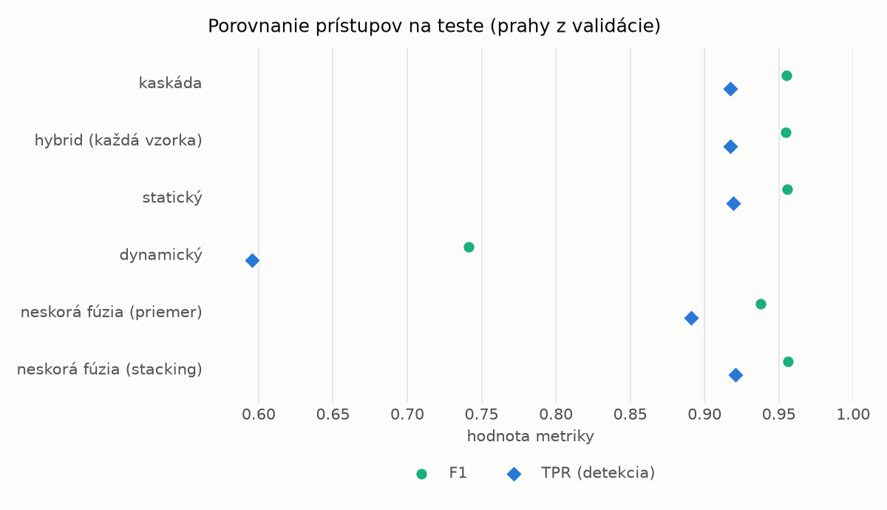
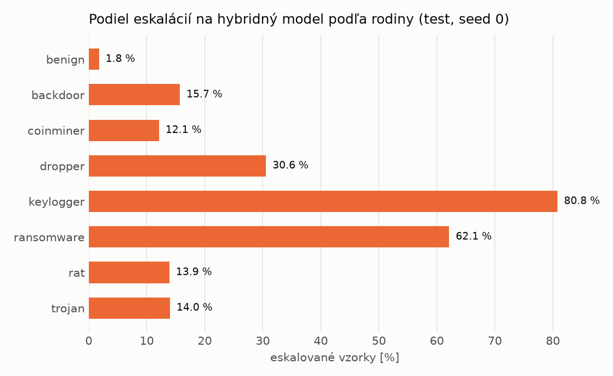

# Kaskáda `baselines` – beh `20261104-012456`

> Generované `src/cascade/evaluate.py` (2026-11-04T01:24:56+01:00). Seedy: [0, 1, 2]; hodnoty = priemer ± sm. odchýlka.
> Všetky prahy sú určené na validácii (FPR ≤ 1 %); test sa na nič nenastavuje.

| rola | beh |
|---|---|
| static | `runs_v2/lofo/coinminer/static/lightgbm/20261103-232852` |
| dynamic | `runs_v2/lofo/coinminer/dynamic/lightgbm/20261103-234518` |
| hybrid | `runs_v2/lofo/coinminer/hybrid/lightgbm/20261104-001521` |

## Test
| prístup | accuracy | balanced_accuracy | precision | recall_tpr | fpr | f1 | mcc |
|---|---|---|---|---|---|---|---|
| kaskáda | 0.9534 ± 0.0007 | 0.9567 ± 0.0006 | 0.9963 ± 0.0005 | 0.9174 ± 0.0018 | 0.0040 ± 0.0006 | 0.9553 ± 0.0007 | 0.9102 ± 0.0012 |
| hybrid (každá vzorka) | 0.9528 ± 0.0018 | 0.9560 ± 0.0016 | 0.9950 ± 0.0011 | 0.9175 ± 0.0043 | 0.0055 ± 0.0013 | 0.9547 ± 0.0018 | 0.9088 ± 0.0031 |
| statický | 0.9538 ± 0.0001 | 0.9570 ± 0.0001 | 0.9952 ± 0.0004 | 0.9193 ± 0.0005 | 0.0053 ± 0.0005 | 0.9557 ± 0.0002 | 0.9108 ± 0.0002 |
| dynamický | 0.7744 ± 0.0007 | 0.7908 ± 0.0007 | 0.9804 ± 0.0006 | 0.5958 ± 0.0010 | 0.0141 ± 0.0005 | 0.7412 ± 0.0009 | 0.6166 ± 0.0013 |
| neskorá fúzia (priemer) | 0.9359 ± 0.0014 | 0.9401 ± 0.0014 | 0.9898 ± 0.0059 | 0.8910 ± 0.0058 | 0.0109 ± 0.0064 | 0.9378 ± 0.0014 | 0.8773 ± 0.0029 |
| neskorá fúzia (stacking) | 0.9542 ± 0.0001 | 0.9573 ± 0.0002 | 0.9945 ± 0.0012 | 0.9207 ± 0.0011 | 0.0060 ± 0.0013 | 0.9562 ± 0.0001 | 0.9114 ± 0.0003 |

## Validácia
| prístup | accuracy | balanced_accuracy | precision | recall_tpr | fpr | f1 | mcc |
|---|---|---|---|---|---|---|---|
| kaskáda | 0.9955 ± 0.0005 | 0.9948 ± 0.0006 | 0.9957 ± 0.0006 | 0.9973 ± 0.0003 | 0.0076 ± 0.0010 | 0.9965 ± 0.0004 | 0.9903 ± 0.0011 |
| hybrid (každá vzorka) | 0.9949 ± 0.0004 | 0.9940 ± 0.0004 | 0.9947 ± 0.0004 | 0.9974 ± 0.0004 | 0.0094 ± 0.0007 | 0.9960 ± 0.0003 | 0.9890 ± 0.0008 |
| statický | 0.9955 ± 0.0005 | 0.9946 ± 0.0006 | 0.9952 ± 0.0007 | 0.9977 ± 0.0000 | 0.0085 ± 0.0013 | 0.9965 ± 0.0004 | 0.9902 ± 0.0010 |
| dynamický | 0.9731 ± 0.0001 | 0.9773 ± 0.0002 | 0.9954 ± 0.0001 | 0.9624 ± 0.0001 | 0.0079 ± 0.0002 | 0.9786 ± 0.0001 | 0.9434 ± 0.0003 |
| neskorá fúzia (priemer) | 0.9948 ± 0.0003 | 0.9941 ± 0.0005 | 0.9953 ± 0.0007 | 0.9965 ± 0.0002 | 0.0083 ± 0.0012 | 0.9959 ± 0.0002 | 0.9887 ± 0.0007 |
| neskorá fúzia (stacking) | 0.9957 ± 0.0001 | 0.9948 ± 0.0003 | 0.9953 ± 0.0003 | 0.9980 ± 0.0001 | 0.0083 ± 0.0006 | 0.9967 ± 0.0001 | 0.9907 ± 0.0003 |

## Správanie kaskády (test, seed 0)
- podiel eskalácií na hybrid: **18.60%** (3225 vzoriek)
- chyby pri zhode študentov (kaskáda ich nemôže opraviť): **738**
  (5.229% zo zhôd; FP 5, FN 733)
- úspešnosť na eskalovaných vzorkách: hybrid 0.9739534883720931, statický 0.9813953488372092,
  dynamický 0.018604651162790697  → prínos hybridu pri nezhode

## Výpočtové nároky (odhad z benchmarkov komponentov)
_Chýba benchmark niektorého komponentu (`python -m src.evaluation.benchmark`)._

