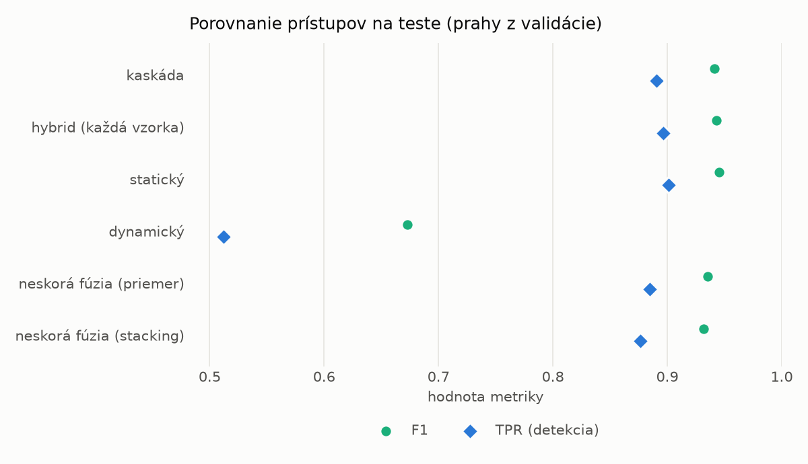
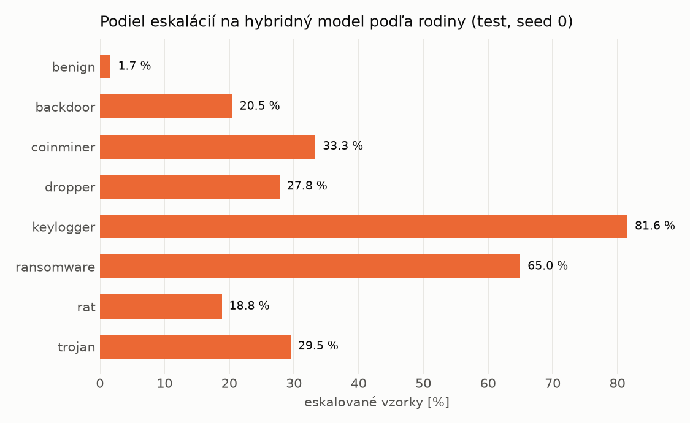

# Kaskáda `heavy` – beh `20261104-012454`

> Generované `src/cascade/evaluate.py` (2026-11-04T01:24:54+01:00). Seedy: [0, 1, 2]; hodnoty = priemer ± sm. odchýlka.
> Všetky prahy sú určené na validácii (FPR ≤ 1 %); test sa na nič nenastavuje.

| rola | beh |
|---|---|
| static | `runs_v2/lofo/coinminer/students_static/mlp_kd/20261104-012050` |
| dynamic | `runs_v2/lofo/coinminer/students_dynamic/mlp_kd/20261104-012249` |
| hybrid | `runs_v2/lofo/coinminer/hybrid/two_branch/20261104-001725` |

## Test
| prístup | accuracy | balanced_accuracy | precision | recall_tpr | fpr | f1 | mcc |
|---|---|---|---|---|---|---|---|
| kaskáda | 0.9393 ± 0.0028 | 0.9438 ± 0.0025 | 0.9972 ± 0.0005 | 0.8906 ± 0.0056 | 0.0030 ± 0.0006 | 0.9409 ± 0.0029 | 0.8849 ± 0.0049 |
| hybrid (každá vzorka) | 0.9409 ± 0.0057 | 0.9450 ± 0.0053 | 0.9942 ± 0.0005 | 0.8962 ± 0.0104 | 0.0062 ± 0.0005 | 0.9427 ± 0.0059 | 0.8872 ± 0.0103 |
| statický | 0.9433 ± 0.0022 | 0.9472 ± 0.0021 | 0.9936 ± 0.0003 | 0.9012 ± 0.0039 | 0.0068 ± 0.0003 | 0.9452 ± 0.0023 | 0.8913 ± 0.0041 |
| dynamický | 0.7299 ± 0.0053 | 0.7499 ± 0.0047 | 0.9802 ± 0.0037 | 0.5121 ± 0.0120 | 0.0123 ± 0.0027 | 0.6727 ± 0.0095 | 0.5527 ± 0.0058 |
| neskorá fúzia (priemer) | 0.9335 ± 0.0035 | 0.9380 ± 0.0034 | 0.9918 ± 0.0019 | 0.8847 ± 0.0054 | 0.0086 ± 0.0020 | 0.9352 ± 0.0036 | 0.8734 ± 0.0066 |
| neskorá fúzia (stacking) | 0.9302 ± 0.0050 | 0.9352 ± 0.0046 | 0.9939 ± 0.0004 | 0.8767 ± 0.0093 | 0.0064 ± 0.0004 | 0.9316 ± 0.0053 | 0.8681 ± 0.0089 |

## Validácia
| prístup | accuracy | balanced_accuracy | precision | recall_tpr | fpr | f1 | mcc |
|---|---|---|---|---|---|---|---|
| kaskáda | 0.9918 ± 0.0009 | 0.9922 ± 0.0008 | 0.9965 ± 0.0002 | 0.9906 ± 0.0012 | 0.0061 ± 0.0004 | 0.9936 ± 0.0007 | 0.9822 ± 0.0019 |
| hybrid (každá vzorka) | 0.9940 ± 0.0016 | 0.9934 ± 0.0014 | 0.9950 ± 0.0003 | 0.9957 ± 0.0023 | 0.0089 ± 0.0005 | 0.9953 ± 0.0013 | 0.9871 ± 0.0035 |
| statický | 0.9905 ± 0.0015 | 0.9905 ± 0.0011 | 0.9946 ± 0.0003 | 0.9905 ± 0.0024 | 0.0096 ± 0.0005 | 0.9926 ± 0.0012 | 0.9795 ± 0.0031 |
| dynamický | 0.9671 ± 0.0001 | 0.9721 ± 0.0001 | 0.9942 ± 0.0000 | 0.9540 ± 0.0002 | 0.0098 ± 0.0000 | 0.9737 ± 0.0001 | 0.9311 ± 0.0003 |
| neskorá fúzia (priemer) | 0.9931 ± 0.0004 | 0.9924 ± 0.0003 | 0.9945 ± 0.0000 | 0.9947 ± 0.0007 | 0.0098 ± 0.0000 | 0.9946 ± 0.0003 | 0.9849 ± 0.0010 |
| neskorá fúzia (stacking) | 0.9936 ± 0.0003 | 0.9930 ± 0.0003 | 0.9948 ± 0.0003 | 0.9953 ± 0.0005 | 0.0093 ± 0.0006 | 0.9950 ± 0.0002 | 0.9862 ± 0.0006 |

## Správanie kaskády (test, seed 0)
- podiel eskalácií na hybrid: **22.82%** (3957 vzoriek)
- chyby pri zhode študentov (kaskáda ich nemôže opraviť): **859**
  (6.419% zo zhôd; FP 2, FN 857)
- úspešnosť na eskalovaných vzorkách: hybrid 0.9373262572656053, statický 0.9800353803386403,
  dynamický 0.019964619661359616  → prínos hybridu pri nezhode

## Výpočtové nároky (odhad z benchmarkov komponentov)
_Chýba benchmark niektorého komponentu (`python -m src.evaluation.benchmark`)._

