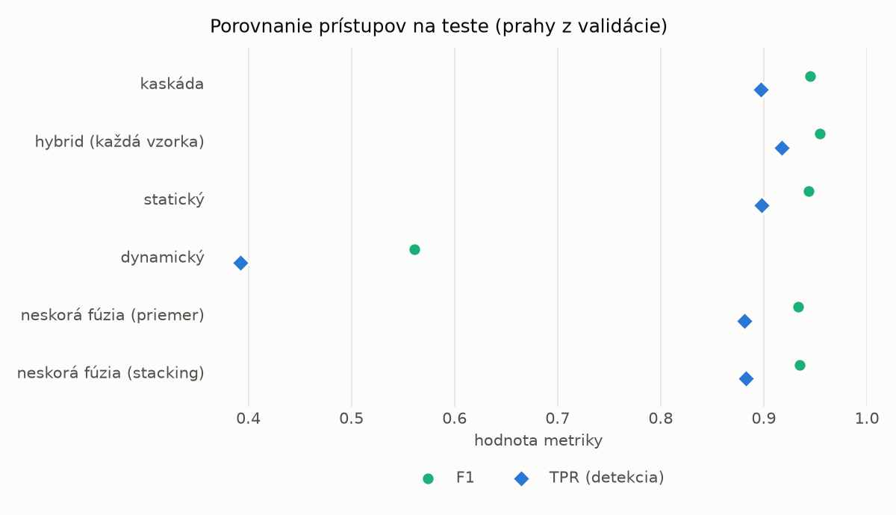
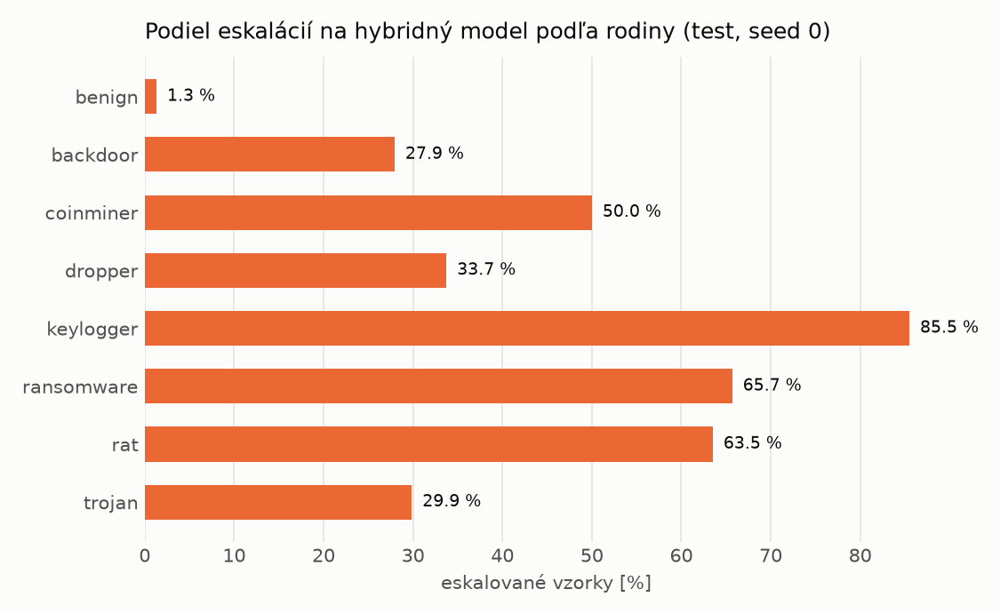

# Kaskáda `modal` – beh `20261104-012451`

> Generované `src/cascade/evaluate.py` (2026-11-04T01:24:52+01:00). Seedy: [0, 1, 2]; hodnoty = priemer ± sm. odchýlka.
> Všetky prahy sú určené na validácii (FPR ≤ 1 %); test sa na nič nenastavuje.

| rola | beh |
|---|---|
| static | `runs_v2/lofo/coinminer/students_static/mlp_kd_modal/20261104-012144` |
| dynamic | `runs_v2/lofo/coinminer/students_dynamic/mlp_kd_modal/20261104-012344` |
| hybrid | `runs_v2/lofo/coinminer/hybrid/lightgbm/20261104-001521` |

## Test
| prístup | accuracy | balanced_accuracy | precision | recall_tpr | fpr | f1 | mcc |
|---|---|---|---|---|---|---|---|
| kaskáda | 0.9432 ± 0.0073 | 0.9474 ± 0.0067 | 0.9977 ± 0.0006 | 0.8972 ± 0.0136 | 0.0024 ± 0.0006 | 0.9447 ± 0.0075 | 0.8919 ± 0.0129 |
| hybrid (každá vzorka) | 0.9528 ± 0.0018 | 0.9560 ± 0.0016 | 0.9950 ± 0.0011 | 0.9175 ± 0.0043 | 0.0055 ± 0.0013 | 0.9547 ± 0.0018 | 0.9088 ± 0.0031 |
| statický | 0.9417 ± 0.0074 | 0.9457 ± 0.0069 | 0.9939 ± 0.0004 | 0.8979 ± 0.0136 | 0.0065 ± 0.0004 | 0.9435 ± 0.0076 | 0.8885 ± 0.0134 |
| dynamický | 0.6676 ± 0.0075 | 0.6929 ± 0.0069 | 0.9853 ± 0.0013 | 0.3927 ± 0.0143 | 0.0069 ± 0.0008 | 0.5614 ± 0.0145 | 0.4670 ± 0.0104 |
| neskorá fúzia (priemer) | 0.9322 ± 0.0019 | 0.9368 ± 0.0018 | 0.9925 ± 0.0010 | 0.8815 ± 0.0030 | 0.0079 ± 0.0010 | 0.9337 ± 0.0019 | 0.8711 ± 0.0035 |
| neskorá fúzia (stacking) | 0.9330 ± 0.0013 | 0.9376 ± 0.0012 | 0.9926 ± 0.0007 | 0.8830 ± 0.0017 | 0.0078 ± 0.0007 | 0.9346 ± 0.0013 | 0.8727 ± 0.0024 |

## Validácia
| prístup | accuracy | balanced_accuracy | precision | recall_tpr | fpr | f1 | mcc |
|---|---|---|---|---|---|---|---|
| kaskáda | 0.9930 ± 0.0012 | 0.9934 ± 0.0010 | 0.9971 ± 0.0003 | 0.9919 ± 0.0018 | 0.0052 ± 0.0005 | 0.9945 ± 0.0010 | 0.9848 ± 0.0027 |
| hybrid (každá vzorka) | 0.9949 ± 0.0004 | 0.9940 ± 0.0004 | 0.9947 ± 0.0004 | 0.9974 ± 0.0004 | 0.0094 ± 0.0007 | 0.9960 ± 0.0003 | 0.9890 ± 0.0008 |
| statický | 0.9910 ± 0.0011 | 0.9909 ± 0.0009 | 0.9947 ± 0.0004 | 0.9912 ± 0.0018 | 0.0094 ± 0.0007 | 0.9929 ± 0.0009 | 0.9805 ± 0.0024 |
| dynamický | 0.9642 ± 0.0029 | 0.9699 ± 0.0022 | 0.9943 ± 0.0001 | 0.9494 ± 0.0046 | 0.0097 ± 0.0002 | 0.9713 ± 0.0024 | 0.9254 ± 0.0056 |
| neskorá fúzia (priemer) | 0.9934 ± 0.0001 | 0.9928 ± 0.0001 | 0.9946 ± 0.0003 | 0.9951 ± 0.0004 | 0.0096 ± 0.0005 | 0.9948 ± 0.0001 | 0.9857 ± 0.0002 |
| neskorá fúzia (stacking) | 0.9939 ± 0.0000 | 0.9932 ± 0.0001 | 0.9946 ± 0.0001 | 0.9959 ± 0.0001 | 0.0096 ± 0.0002 | 0.9953 ± 0.0000 | 0.9869 ± 0.0000 |

## Správanie kaskády (test, seed 0)
- podiel eskalácií na hybrid: **28.78%** (4991 vzoriek)
- chyby pri zhode študentov (kaskáda ich nemôže opraviť): **844**
  (6.835% zo zhôd; FP 2, FN 842)
- úspešnosť na eskalovaných vzorkách: hybrid 0.9891805249449008, statický 0.9861751152073732,
  dynamický 0.013824884792626729  → prínos hybridu pri nezhode

## Výpočtové nároky (odhad z benchmarkov komponentov)
_Chýba benchmark niektorého komponentu (`python -m src.evaluation.benchmark`)._

