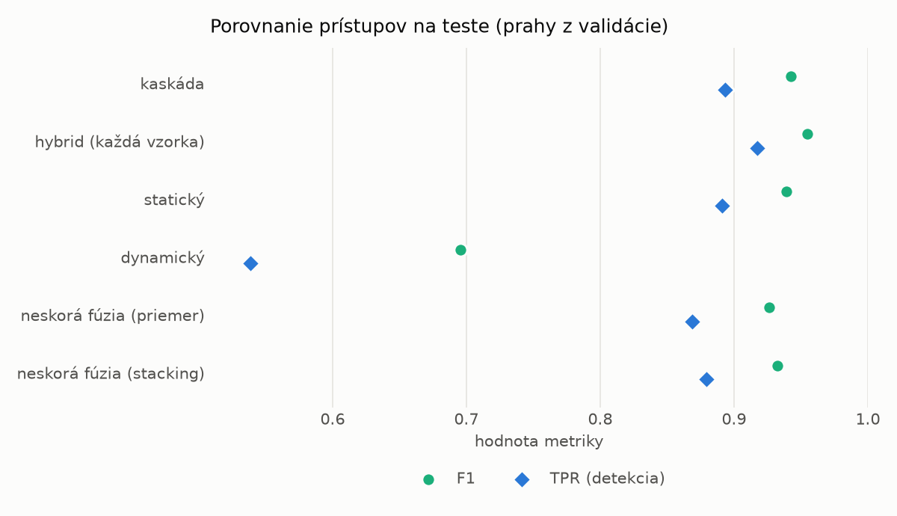
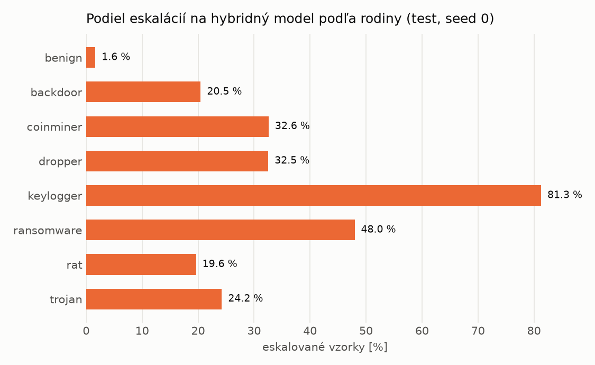

# Kaskáda `nokd` – beh `20261104-012449`

> Generované `src/cascade/evaluate.py` (2026-11-04T01:24:50+01:00). Seedy: [0, 1, 2]; hodnoty = priemer ± sm. odchýlka.
> Všetky prahy sú určené na validácii (FPR ≤ 1 %); test sa na nič nenastavuje.

| rola | beh |
|---|---|
| static | `runs_v2/lofo/coinminer/students_static/mlp_nokd/20261104-012129` |
| dynamic | `runs_v2/lofo/coinminer/students_dynamic/mlp_nokd/20261104-012323` |
| hybrid | `runs_v2/lofo/coinminer/hybrid/lightgbm/20261104-001521` |

## Test
| prístup | accuracy | balanced_accuracy | precision | recall_tpr | fpr | f1 | mcc |
|---|---|---|---|---|---|---|---|
| kaskáda | 0.9410 ± 0.0048 | 0.9454 ± 0.0045 | 0.9973 ± 0.0006 | 0.8936 ± 0.0084 | 0.0029 ± 0.0006 | 0.9426 ± 0.0049 | 0.8879 ± 0.0088 |
| hybrid (každá vzorka) | 0.9528 ± 0.0018 | 0.9560 ± 0.0016 | 0.9950 ± 0.0011 | 0.9175 ± 0.0043 | 0.0055 ± 0.0013 | 0.9547 ± 0.0018 | 0.9088 ± 0.0031 |
| statický | 0.9371 ± 0.0065 | 0.9413 ± 0.0061 | 0.9918 ± 0.0011 | 0.8913 ± 0.0112 | 0.0087 ± 0.0011 | 0.9389 ± 0.0067 | 0.8798 ± 0.0119 |
| dynamický | 0.7449 ± 0.0125 | 0.7639 ± 0.0114 | 0.9837 ± 0.0031 | 0.5384 ± 0.0238 | 0.0106 ± 0.0022 | 0.6957 ± 0.0198 | 0.5758 ± 0.0176 |
| neskorá fúzia (priemer) | 0.9251 ± 0.0032 | 0.9302 ± 0.0031 | 0.9918 ± 0.0016 | 0.8689 ± 0.0051 | 0.0085 ± 0.0016 | 0.9263 ± 0.0033 | 0.8585 ± 0.0059 |
| neskorá fúzia (stacking) | 0.9308 ± 0.0058 | 0.9355 ± 0.0054 | 0.9920 ± 0.0010 | 0.8794 ± 0.0100 | 0.0084 ± 0.0010 | 0.9323 ± 0.0060 | 0.8686 ± 0.0105 |

## Validácia
| prístup | accuracy | balanced_accuracy | precision | recall_tpr | fpr | f1 | mcc |
|---|---|---|---|---|---|---|---|
| kaskáda | 0.9912 ± 0.0032 | 0.9919 ± 0.0025 | 0.9969 ± 0.0004 | 0.9893 ± 0.0049 | 0.0055 ± 0.0006 | 0.9931 ± 0.0025 | 0.9810 ± 0.0067 |
| hybrid (každá vzorka) | 0.9949 ± 0.0004 | 0.9940 ± 0.0004 | 0.9947 ± 0.0004 | 0.9974 ± 0.0004 | 0.0094 ± 0.0007 | 0.9960 ± 0.0003 | 0.9890 ± 0.0008 |
| statický | 0.9883 ± 0.0036 | 0.9888 ± 0.0029 | 0.9946 ± 0.0003 | 0.9871 ± 0.0054 | 0.0094 ± 0.0004 | 0.9908 ± 0.0029 | 0.9749 ± 0.0077 |
| dynamický | 0.9664 ± 0.0007 | 0.9716 ± 0.0005 | 0.9942 ± 0.0000 | 0.9530 ± 0.0011 | 0.0098 ± 0.0000 | 0.9732 ± 0.0006 | 0.9298 ± 0.0014 |
| neskorá fúzia (priemer) | 0.9916 ± 0.0018 | 0.9914 ± 0.0015 | 0.9947 ± 0.0002 | 0.9922 ± 0.0025 | 0.0094 ± 0.0004 | 0.9934 ± 0.0014 | 0.9819 ± 0.0038 |
| neskorá fúzia (stacking) | 0.9928 ± 0.0015 | 0.9923 ± 0.0011 | 0.9946 ± 0.0001 | 0.9941 ± 0.0024 | 0.0096 ± 0.0002 | 0.9944 ± 0.0012 | 0.9844 ± 0.0032 |

## Správanie kaskády (test, seed 0)
- podiel eskalácií na hybrid: **20.42%** (3541 vzoriek)
- chyby pri zhode študentov (kaskáda ich nemôže opraviť): **819**
  (5.936% zo zhôd; FP 4, FN 815)
- úspešnosť na eskalovaných vzorkách: hybrid 0.9697825473030217, statický 0.9587687094041232,
  dynamický 0.04123129059587687  → prínos hybridu pri nezhode

## Výpočtové nároky (odhad z benchmarkov komponentov)
_Chýba benchmark niektorého komponentu (`python -m src.evaluation.benchmark`)._

