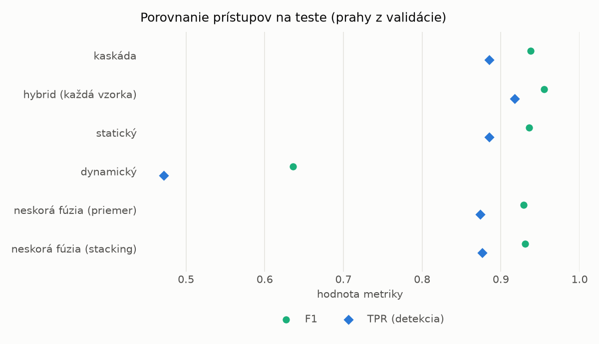
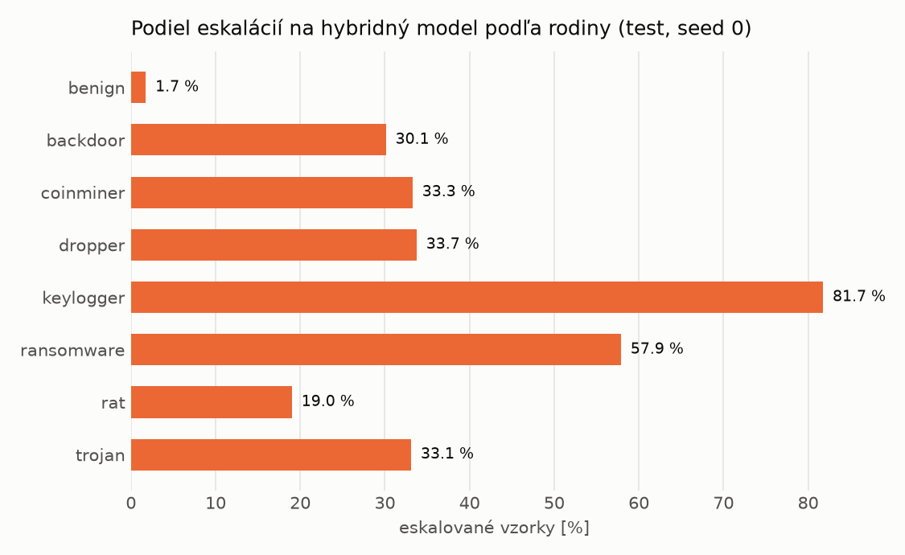

# Kaskáda `twobranch` – beh `20261104-012458`

> Generované `src/cascade/evaluate.py` (2026-11-04T01:24:58+01:00). Seedy: [0, 1, 2]; hodnoty = priemer ± sm. odchýlka.
> Všetky prahy sú určené na validácii (FPR ≤ 1 %); test sa na nič nenastavuje.

| rola | beh |
|---|---|
| static | `runs_v2/lofo/coinminer/students_static/mlp_kd_twobranch/20261104-012222` |
| dynamic | `runs_v2/lofo/coinminer/students_dynamic/mlp_kd_twobranch/20261104-012418` |
| hybrid | `runs_v2/lofo/coinminer/hybrid/lightgbm/20261104-001521` |

## Test
| prístup | accuracy | balanced_accuracy | precision | recall_tpr | fpr | f1 | mcc |
|---|---|---|---|---|---|---|---|
| kaskáda | 0.9367 ± 0.0108 | 0.9414 ± 0.0100 | 0.9976 ± 0.0005 | 0.8853 ± 0.0200 | 0.0026 ± 0.0005 | 0.9380 ± 0.0113 | 0.8804 ± 0.0191 |
| hybrid (každá vzorka) | 0.9528 ± 0.0018 | 0.9560 ± 0.0016 | 0.9950 ± 0.0011 | 0.9175 ± 0.0043 | 0.0055 ± 0.0013 | 0.9547 ± 0.0018 | 0.9088 ± 0.0031 |
| statický | 0.9344 ± 0.0113 | 0.9389 ± 0.0105 | 0.9931 ± 0.0007 | 0.8851 ± 0.0207 | 0.0073 ± 0.0007 | 0.9359 ± 0.0118 | 0.8753 ± 0.0201 |
| dynamický | 0.7085 ± 0.0271 | 0.7303 ± 0.0250 | 0.9799 ± 0.0021 | 0.4719 ± 0.0506 | 0.0114 ± 0.0013 | 0.6360 ± 0.0470 | 0.5224 ± 0.0388 |
| neskorá fúzia (priemer) | 0.9275 ± 0.0059 | 0.9325 ± 0.0055 | 0.9917 ± 0.0012 | 0.8736 ± 0.0107 | 0.0087 ± 0.0012 | 0.9289 ± 0.0062 | 0.8628 ± 0.0106 |
| neskorá fúzia (stacking) | 0.9293 ± 0.0081 | 0.9341 ± 0.0074 | 0.9921 ± 0.0005 | 0.8765 ± 0.0150 | 0.0083 ± 0.0005 | 0.9307 ± 0.0084 | 0.8660 ± 0.0143 |

## Validácia
| prístup | accuracy | balanced_accuracy | precision | recall_tpr | fpr | f1 | mcc |
|---|---|---|---|---|---|---|---|
| kaskáda | 0.9921 ± 0.0023 | 0.9927 ± 0.0018 | 0.9970 ± 0.0005 | 0.9907 ± 0.0037 | 0.0053 ± 0.0008 | 0.9938 ± 0.0018 | 0.9830 ± 0.0049 |
| hybrid (každá vzorka) | 0.9949 ± 0.0004 | 0.9940 ± 0.0004 | 0.9947 ± 0.0004 | 0.9974 ± 0.0004 | 0.0094 ± 0.0007 | 0.9960 ± 0.0003 | 0.9890 ± 0.0008 |
| statický | 0.9898 ± 0.0019 | 0.9901 ± 0.0013 | 0.9950 ± 0.0006 | 0.9891 ± 0.0036 | 0.0089 ± 0.0010 | 0.9920 ± 0.0015 | 0.9780 ± 0.0041 |
| dynamický | 0.9643 ± 0.0035 | 0.9699 ± 0.0027 | 0.9942 ± 0.0000 | 0.9497 ± 0.0054 | 0.0098 ± 0.0000 | 0.9714 ± 0.0029 | 0.9257 ± 0.0069 |
| neskorá fúzia (priemer) | 0.9925 ± 0.0015 | 0.9921 ± 0.0013 | 0.9947 ± 0.0004 | 0.9935 ± 0.0020 | 0.0094 ± 0.0007 | 0.9941 ± 0.0012 | 0.9837 ± 0.0032 |
| neskorá fúzia (stacking) | 0.9929 ± 0.0018 | 0.9923 ± 0.0014 | 0.9945 ± 0.0001 | 0.9943 ± 0.0027 | 0.0097 ± 0.0002 | 0.9944 ± 0.0014 | 0.9845 ± 0.0038 |

## Správanie kaskády (test, seed 0)
- podiel eskalácií na hybrid: **23.38%** (4054 vzoriek)
- chyby pri zhode študentov (kaskáda ich nemôže opraviť): **960**
  (7.226% zo zhôd; FP 4, FN 956)
- úspešnosť na eskalovaných vzorkách: hybrid 0.9829797730636408, statický 0.9728663048840651,
  dynamický 0.02713369511593488  → prínos hybridu pri nezhode

## Výpočtové nároky (odhad z benchmarkov komponentov)
_Chýba benchmark niektorého komponentu (`python -m src.evaluation.benchmark`)._

