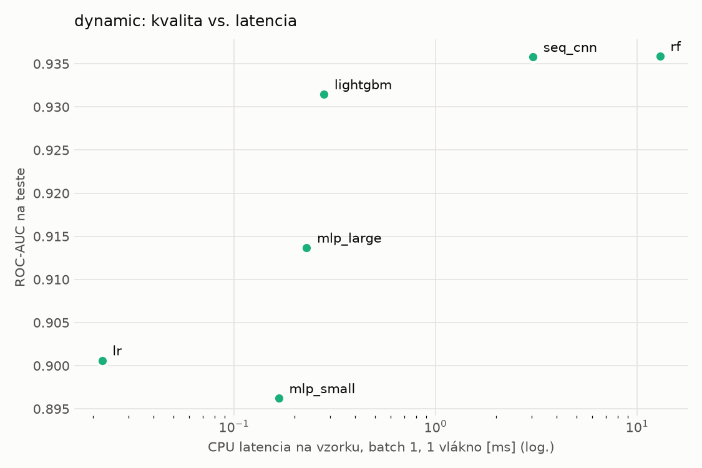
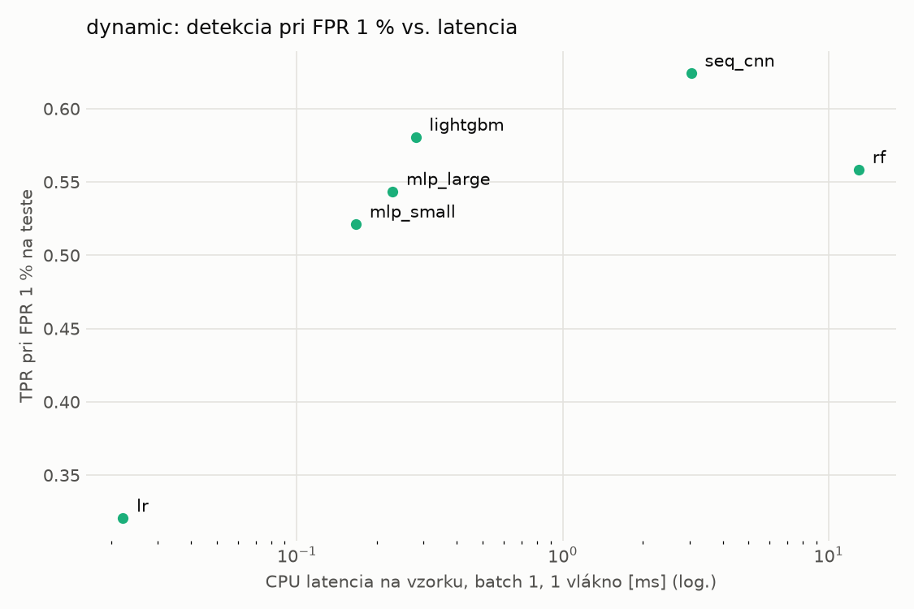
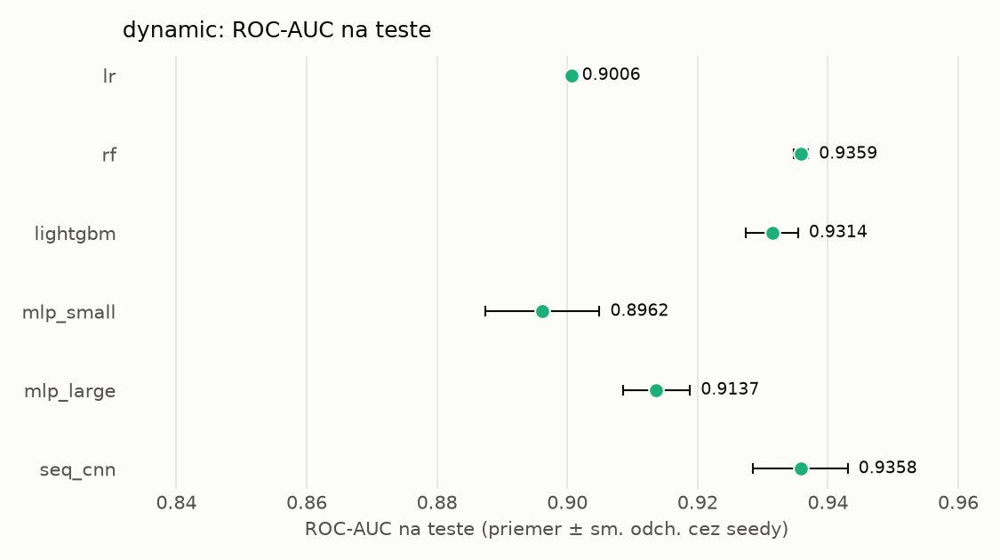
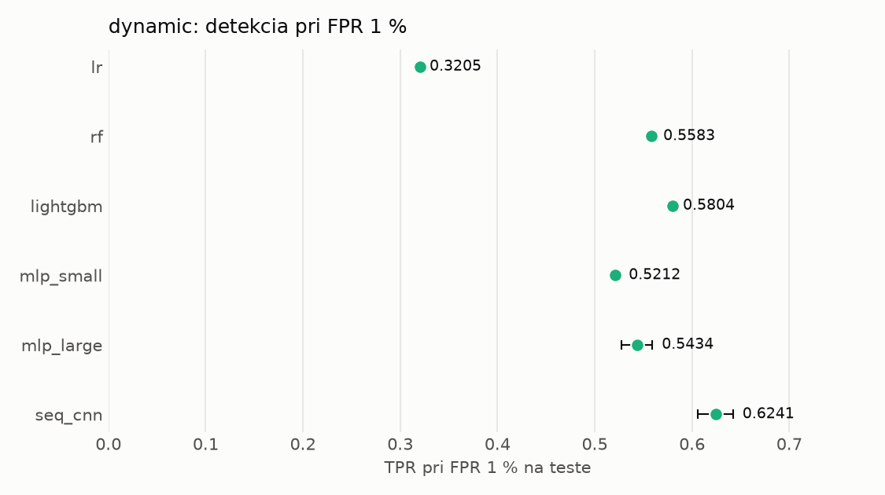

# Porovnanie modelov – dynamic

> Generované `src/evaluation/compare.py` (2026-11-04T00:08:52+01:00); použitý je posledný beh každého modelu.
> Metriky sú priemer cez seedy. \* = pri prahu určenom na validácii (FPR ≤ 1 %).
> CPU ms/vz. = medián latencie jednej vzorky na 1 vlákne vrátane transformácie vstupu (meranie hneď po tréningu,
> orientačné). Oficiálne merania spotreby sú v časti „Spotreba zdrojov pri inferencii“.

## Detekčná kvalita a orientačné časy
| model | ROC-AUC val | ROC-AUC test | TPR@FPR 1 % test | TPR@FPR 0,1 % test | F1 test* | FPR test* | gap train−val | CPU ms/vz. | CPU vz./s | GPU ms/vz. | parametre | MB | tréning s | ladenie min |
|---|---|---|---|---|---|---|---|---|---|---|---|---|---|---|
| [lr](../../dynamic/lr/20261103-234308/README.md) | 0.9954 | 0.9006 ± 0.0000 | 0.3205 | 0.2257 | 0.6540 | 0.0199 | 0.0010 | 0.022 | 340 111 | – | 2 001 | 0.06 | 5.1 | 0.0 |
| [rf](../../dynamic/rf/20261103-234330/README.md) | 0.9975 | 0.9359 ± 0.0011 | 0.5583 | 0.3334 | 0.7166 | 0.0101 | 0.0012 | 13.002 | 87 593 | – | 889 982 | 71.62 | 32.3 | 0.0 |
| [lightgbm](../../dynamic/lightgbm/20261103-234518/README.md) | 0.9976 | 0.9314 ± 0.0040 | 0.5804 | 0.4800 | 0.7412 | 0.0141 | 0.0010 | 0.280 | 46 222 | – | 784 550 | 44.77 | 26.8 | 0.0 |
| [mlp_small](../../dynamic/mlp_small/20261103-234702/README.md) | 0.9967 | 0.8962 ± 0.0087 | 0.5212 | 0.3603 | 0.6708 | 0.0079 | 0.0009 | 0.167 | 120 222 | 0.408 | 546 049 | 2.24 | 4.1 | 0.0 |
| [mlp_large](../../dynamic/mlp_large/20261103-234722/README.md) | 0.9966 | 0.9137 ± 0.0052 | 0.5434 | 0.4272 | 0.6884 | 0.0100 | 0.0008 | 0.229 | 102 747 | 0.531 | 1 190 657 | 4.83 | 13.3 | 0.0 |
| [seq_cnn](../../dynamic/seq_cnn/20261103-234810/README.md) | 0.9975 | 0.9358 ± 0.0073 | 0.6241 | 0.3457 | 0.7614 | 0.0099 | 0.0007 | 3.044 | 1 195 | 0.775 | 209 409 | 0.84 | 376.2 | 0.0 |

## Nízka prevalencia malvéru (test, prah z validácie)
| model | TPR | FPR | precision @ 1 % | falošné na 1 skutočný poplach @ 1 % | precision @ 0.1 % | falošné na 1 skutočný poplach @ 0.1 % |
|---|---|---|---|---|---|---|
| lr | 0.4941 | 0.0199 | 0.201 | 3.99 | 0.024 | 40.23 |
| rf | 0.5632 | 0.0101 | 0.361 | 1.77 | 0.053 | 17.87 |
| lightgbm | 0.5958 | 0.0141 | 0.299 | 2.34 | 0.041 | 23.65 |
| mlp_small | 0.5081 | 0.0079 | 0.394 | 1.54 | 0.061 | 15.52 |
| mlp_large | 0.5295 | 0.0100 | 0.349 | 1.87 | 0.050 | 18.85 |
| seq_cnn | 0.6200 | 0.0099 | 0.386 | 1.59 | 0.059 | 16.03 |

Prepočet: TPR a FPR nezávisia od podielu malvéru, preto sa dajú preniesť na nízku prevalenciu (v reálnej prevádzke je malvéru ~1 % alebo menej; v teste 54 %). „Falošné na 1 skutočný poplach“ = koľko neškodných súborov je označených na každý zachytený malvér.

## Spotreba zdrojov pri inferencii (benchmark, testovacia množina)
_Benchmark zatiaľ nebol spustený (`python -m src.evaluation.benchmark --approach dynamic`)._

## Grafy

