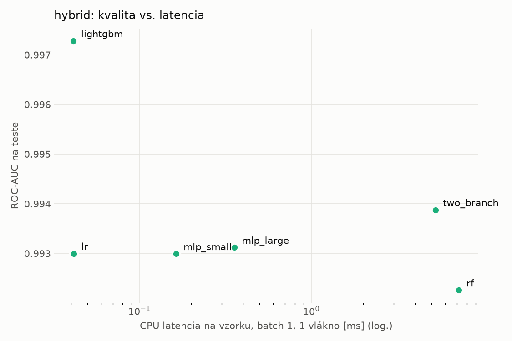
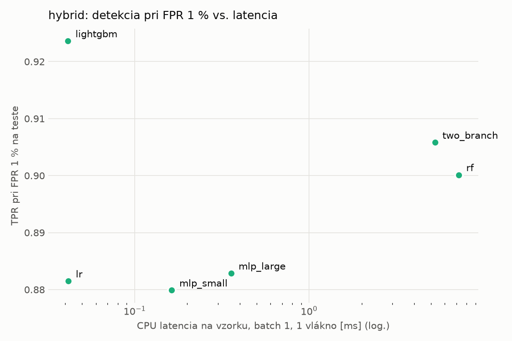
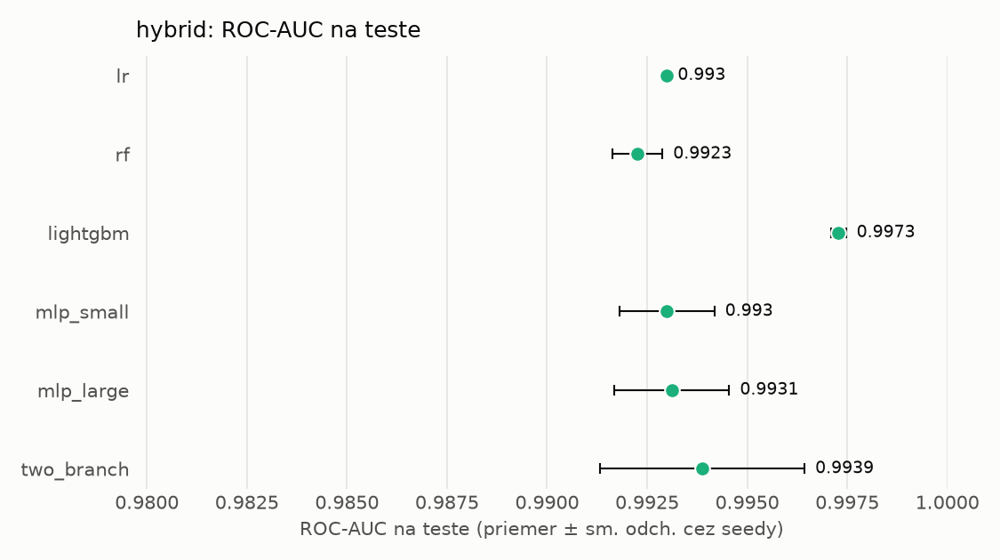
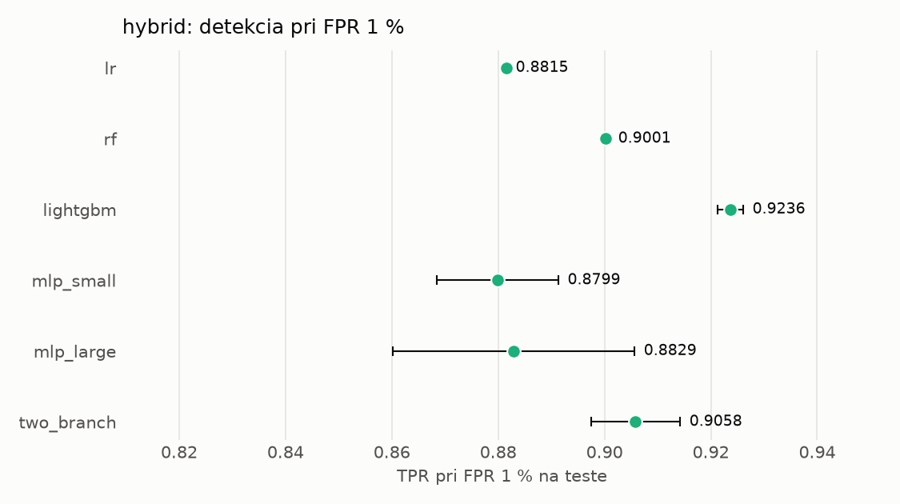

# Porovnanie modelov – hybrid

> Generované `src/evaluation/compare.py` (2026-11-04T00:38:19+01:00); použitý je posledný beh každého modelu.
> Metriky sú priemer cez seedy. \* = pri prahu určenom na validácii (FPR ≤ 1 %).
> CPU ms/vz. = medián latencie jednej vzorky na 1 vlákne vrátane transformácie vstupu (meranie hneď po tréningu,
> orientačné). Oficiálne merania spotreby sú v časti „Spotreba zdrojov pri inferencii“.

## Detekčná kvalita a orientačné časy
| model | ROC-AUC val | ROC-AUC test | TPR@FPR 1 % test | TPR@FPR 0,1 % test | F1 test* | FPR test* | gap train−val | CPU ms/vz. | CPU vz./s | GPU ms/vz. | parametre | MB | tréning s | ladenie min |
|---|---|---|---|---|---|---|---|---|---|---|---|---|---|---|
| [lr](../../hybrid/lr/20261104-000855/README.md) | 0.9990 | 0.9930 ± 0.0000 | 0.8815 | 0.6058 | 0.9242 | 0.0081 | 0.0008 | 0.042 | 159 833 | – | 4 320 | 0.13 | 4.9 | 0.0 |
| [rf](../../hybrid/rf/20261104-000926/README.md) | 0.9998 | 0.9923 ± 0.0006 | 0.9001 | 0.7678 | 0.9426 | 0.0089 | 0.0002 | 7.200 | 110 832 | – | 248 438 | 20.22 | 115.8 | 0.0 |
| [lightgbm](../../hybrid/lightgbm/20261104-001521/README.md) | 0.9998 | 0.9973 ± 0.0002 | 0.9236 | 0.8736 | 0.9547 | 0.0055 | 0.0002 | 0.041 | 285 976 | – | 28 924 | 1.62 | 17.1 | 0.0 |
| [mlp_small](../../hybrid/mlp_small/20261104-001617/README.md) | 0.9994 | 0.9930 ± 0.0012 | 0.8799 | 0.6388 | 0.9089 | 0.0068 | 0.0004 | 0.163 | 46 335 | 0.424 | 138 881 | 0.67 | 5.2 | 0.0 |
| [mlp_large](../../hybrid/mlp_large/20261104-001651/README.md) | 0.9995 | 0.9931 ± 0.0014 | 0.8829 | 0.7285 | 0.9204 | 0.0055 | 0.0004 | 0.357 | 37 447 | 0.538 | 2 386 305 | 9.67 | 4.9 | 0.0 |
| [two_branch](../../hybrid/two_branch/20261104-001725/README.md) | 0.9995 | 0.9939 ± 0.0026 | 0.9058 | 0.7186 | 0.9427 | 0.0062 | 0.0003 | 5.260 | 659 | 1.232 | 1 756 994 | 7.10 | 348.1 | 0.0 |

## Nízka prevalencia malvéru (test, prah z validácie)
| model | TPR | FPR | precision @ 1 % | falošné na 1 skutočný poplach @ 1 % | precision @ 0.1 % | falošné na 1 skutočný poplach @ 0.1 % |
|---|---|---|---|---|---|---|
| lr | 0.8650 | 0.0081 | 0.520 | 0.92 | 0.097 | 9.31 |
| rf | 0.8981 | 0.0089 | 0.506 | 0.98 | 0.092 | 9.85 |
| lightgbm | 0.9175 | 0.0055 | 0.628 | 0.59 | 0.143 | 5.99 |
| mlp_small | 0.8384 | 0.0068 | 0.556 | 0.80 | 0.110 | 8.05 |
| mlp_large | 0.8571 | 0.0055 | 0.610 | 0.64 | 0.134 | 6.46 |
| two_branch | 0.8962 | 0.0062 | 0.595 | 0.68 | 0.127 | 6.88 |

Prepočet: TPR a FPR nezávisia od podielu malvéru, preto sa dajú preniesť na nízku prevalenciu (v reálnej prevádzke je malvéru ~1 % alebo menej; v teste 54 %). „Falošné na 1 skutočný poplach“ = koľko neškodných súborov je označených na každý zachytený malvér.

## Spotreba zdrojov pri inferencii (benchmark, testovacia množina)
_Benchmark zatiaľ nebol spustený (`python -m src.evaluation.benchmark --approach hybrid`)._

## Grafy

