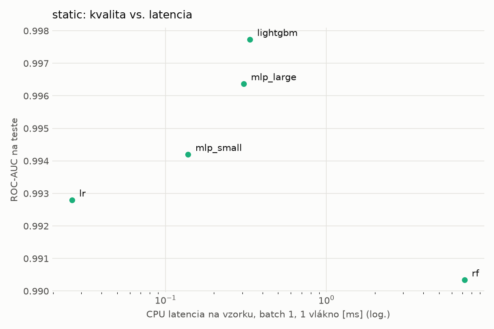
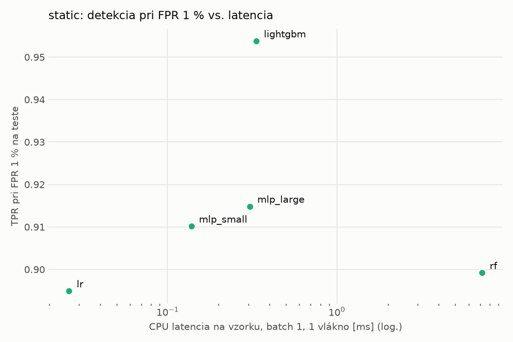
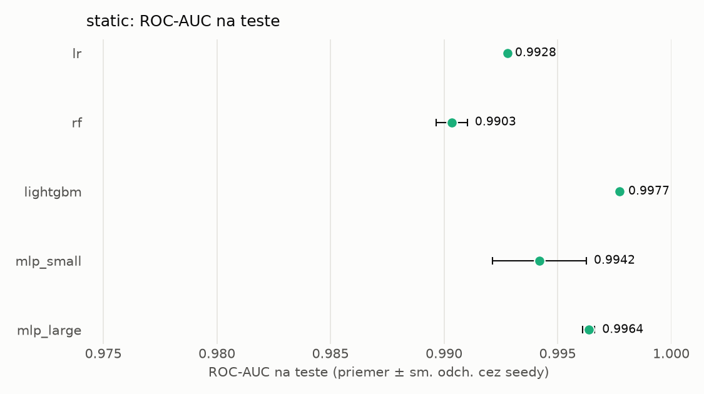
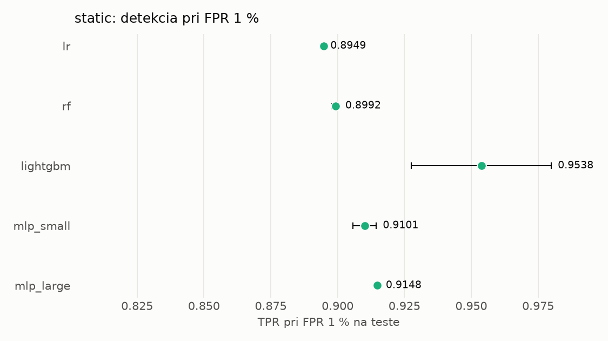

# Porovnanie modelov – static

> Generované `src/evaluation/compare.py` (2026-11-03T23:43:05+01:00); použitý je posledný beh každého modelu.
> Metriky sú priemer cez seedy. \* = pri prahu určenom na validácii (FPR ≤ 1 %).
> CPU ms/vz. = medián latencie jednej vzorky na 1 vlákne vrátane transformácie vstupu (meranie hneď po tréningu,
> orientačné). Oficiálne merania spotreby sú v časti „Spotreba zdrojov pri inferencii“.

## Detekčná kvalita a orientačné časy
| model | ROC-AUC val | ROC-AUC test | TPR@FPR 1 % test | TPR@FPR 0,1 % test | F1 test* | FPR test* | gap train−val | CPU ms/vz. | CPU vz./s | GPU ms/vz. | parametre | MB | tréning s | ladenie min |
|---|---|---|---|---|---|---|---|---|---|---|---|---|---|---|
| [lr](../../static/lr/20261103-232724/README.md) | 0.9986 | 0.9928 ± 0.0000 | 0.8949 | 0.2524 | 0.9362 | 0.0083 | 0.0010 | 0.026 | 286 236 | – | 2 320 | 0.07 | 1.8 | 0.0 |
| [rf](../../static/rf/20261103-232738/README.md) | 0.9998 | 0.9903 ± 0.0007 | 0.8992 | 0.8250 | 0.9401 | 0.0084 | 0.0002 | 7.206 | 137 944 | – | 347 980 | 28.18 | 22.3 | 0.0 |
| [lightgbm](../../static/lightgbm/20261103-232852/README.md) | 0.9998 | 0.9977 ± 0.0001 | 0.9538 | 0.8756 | 0.9557 | 0.0053 | 0.0002 | 0.334 | 33 518 | – | 552 588 | 32.46 | 262.5 | 0.0 |
| [mlp_small](../../static/mlp_small/20261103-234218/README.md) | 0.9991 | 0.9942 ± 0.0021 | 0.9101 | 0.5781 | 0.9427 | 0.0071 | 0.0008 | 0.138 | 61 656 | 0.372 | 74 881 | 0.36 | 4.4 | 0.0 |
| [mlp_large](../../static/mlp_large/20261103-234240/README.md) | 0.9997 | 0.9964 ± 0.0003 | 0.9148 | 0.8127 | 0.9494 | 0.0077 | 0.0002 | 0.306 | 52 054 | 0.732 | 1 364 417 | 5.53 | 5.0 | 0.0 |

## Nízka prevalencia malvéru (test, prah z validácie)
| model | TPR | FPR | precision @ 1 % | falošné na 1 skutočný poplach @ 1 % | precision @ 0.1 % | falošné na 1 skutočný poplach @ 0.1 % |
|---|---|---|---|---|---|---|
| lr | 0.8862 | 0.0083 | 0.519 | 0.93 | 0.096 | 9.37 |
| rf | 0.8933 | 0.0084 | 0.517 | 0.94 | 0.096 | 9.44 |
| lightgbm | 0.9193 | 0.0053 | 0.637 | 0.57 | 0.148 | 5.75 |
| mlp_small | 0.8970 | 0.0071 | 0.561 | 0.78 | 0.112 | 7.90 |
| mlp_large | 0.9095 | 0.0077 | 0.545 | 0.84 | 0.106 | 8.44 |

Prepočet: TPR a FPR nezávisia od podielu malvéru, preto sa dajú preniesť na nízku prevalenciu (v reálnej prevádzke je malvéru ~1 % alebo menej; v teste 54 %). „Falošné na 1 skutočný poplach“ = koľko neškodných súborov je označených na každý zachytený malvér.

## Spotreba zdrojov pri inferencii (benchmark, testovacia množina)
_Benchmark zatiaľ nebol spustený (`python -m src.evaluation.benchmark --approach static`)._

## Grafy

