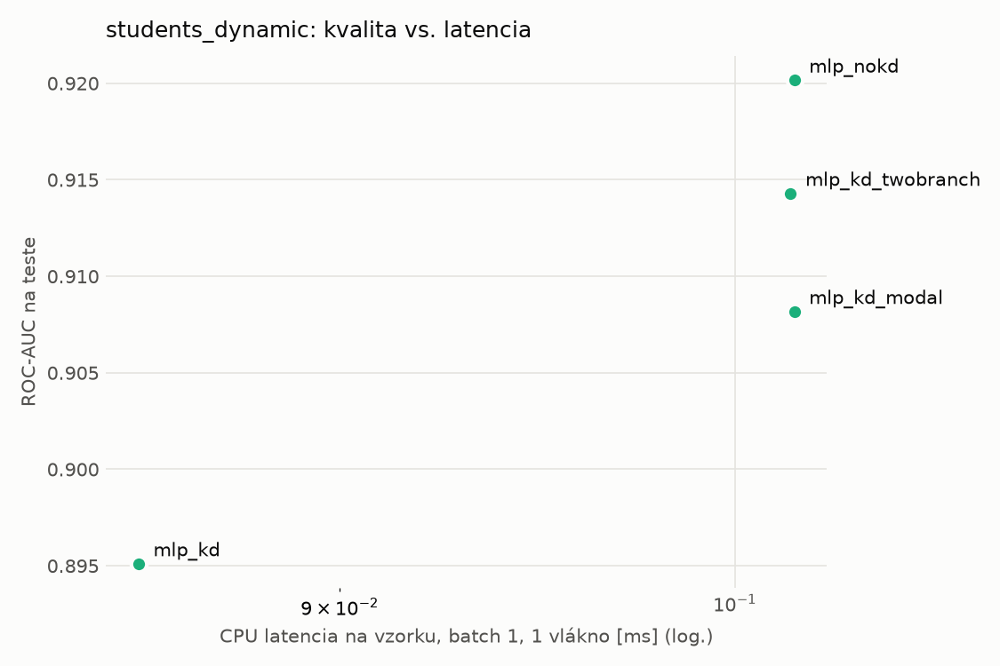
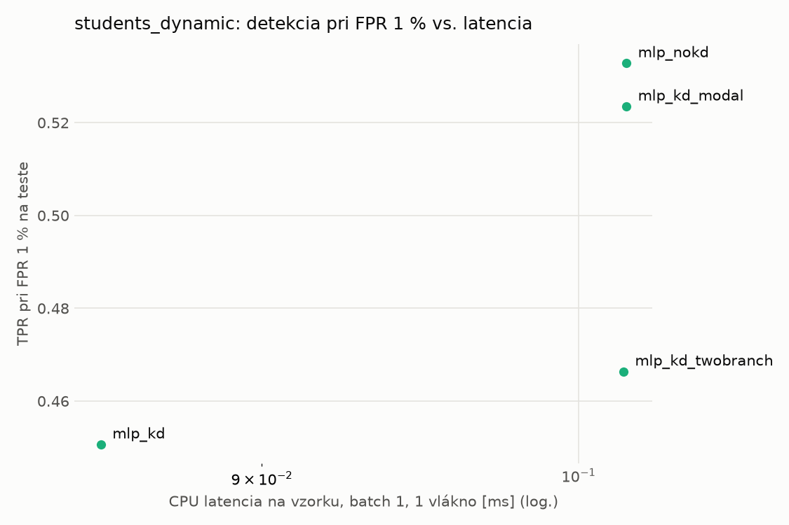
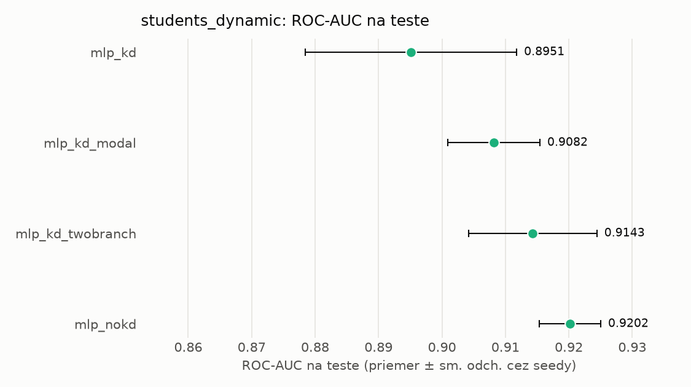
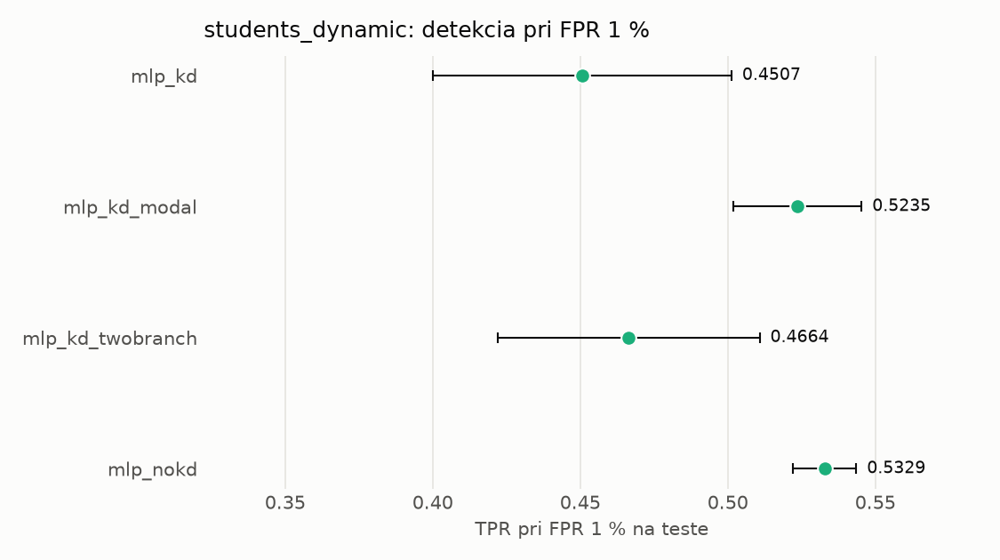

# Porovnanie modelov – students_dynamic

> Generované `src/evaluation/compare.py` (2026-11-04T01:24:44+01:00); použitý je posledný beh každého modelu.
> Metriky sú priemer cez seedy. \* = pri prahu určenom na validácii (FPR ≤ 1 %).
> CPU ms/vz. = medián latencie jednej vzorky na 1 vlákne vrátane transformácie vstupu (meranie hneď po tréningu,
> orientačné). Oficiálne merania spotreby sú v časti „Spotreba zdrojov pri inferencii“.

## Detekčná kvalita a orientačné časy
| model | ROC-AUC val | ROC-AUC test | TPR@FPR 1 % test | TPR@FPR 0,1 % test | F1 test* | FPR test* | gap train−val | CPU ms/vz. | CPU vz./s | GPU ms/vz. | parametre | MB | tréning s | ladenie min |
|---|---|---|---|---|---|---|---|---|---|---|---|---|---|---|
| [mlp_kd](../../students_dynamic/mlp_kd/20261104-012249/README.md) | 0.9966 | 0.8951 ± 0.0167 | 0.4507 | 0.3290 | 0.6727 | 0.0123 | 0.0007 | 0.085 | 139 201 | 0.283 | 64 129 | 0.31 | 8.4 | 0.0 |
| [mlp_kd_modal](../../students_dynamic/mlp_kd_modal/20261104-012344/README.md) | 0.9964 | 0.9082 ± 0.0073 | 0.5235 | 0.2656 | 0.5614 | 0.0069 | 0.0009 | 0.102 | 140 054 | 0.286 | 64 129 | 0.31 | 8.8 | 0.0 |
| [mlp_kd_twobranch](../../students_dynamic/mlp_kd_twobranch/20261104-012418/README.md) | 0.9965 | 0.9143 ± 0.0101 | 0.4664 | 0.3073 | 0.6360 | 0.0114 | 0.0007 | 0.102 | 95 626 | 0.455 | 64 129 | 0.31 | 6.0 | 0.0 |
| [mlp_nokd](../../students_dynamic/mlp_nokd/20261104-012323/README.md) | 0.9964 | 0.9202 ± 0.0049 | 0.5329 | 0.3266 | 0.6957 | 0.0106 | 0.0009 | 0.102 | 96 931 | 0.451 | 64 129 | 0.31 | 4.5 | 0.0 |

## Nízka prevalencia malvéru (test, prah z validácie)
| model | TPR | FPR | precision @ 1 % | falošné na 1 skutočný poplach @ 1 % | precision @ 0.1 % | falošné na 1 skutočný poplach @ 0.1 % |
|---|---|---|---|---|---|---|
| mlp_kd | 0.5121 | 0.0123 | 0.296 | 2.38 | 0.040 | 24.00 |
| mlp_kd_modal | 0.3927 | 0.0069 | 0.364 | 1.75 | 0.054 | 17.62 |
| mlp_kd_twobranch | 0.4719 | 0.0114 | 0.295 | 2.40 | 0.040 | 24.17 |
| mlp_nokd | 0.5384 | 0.0106 | 0.340 | 1.95 | 0.048 | 19.63 |

Prepočet: TPR a FPR nezávisia od podielu malvéru, preto sa dajú preniesť na nízku prevalenciu (v reálnej prevádzke je malvéru ~1 % alebo menej; v teste 54 %). „Falošné na 1 skutočný poplach“ = koľko neškodných súborov je označených na každý zachytený malvér.

## Spotreba zdrojov pri inferencii (benchmark, testovacia množina)
_Benchmark zatiaľ nebol spustený (`python -m src.evaluation.benchmark --approach students_dynamic`)._

## Grafy

