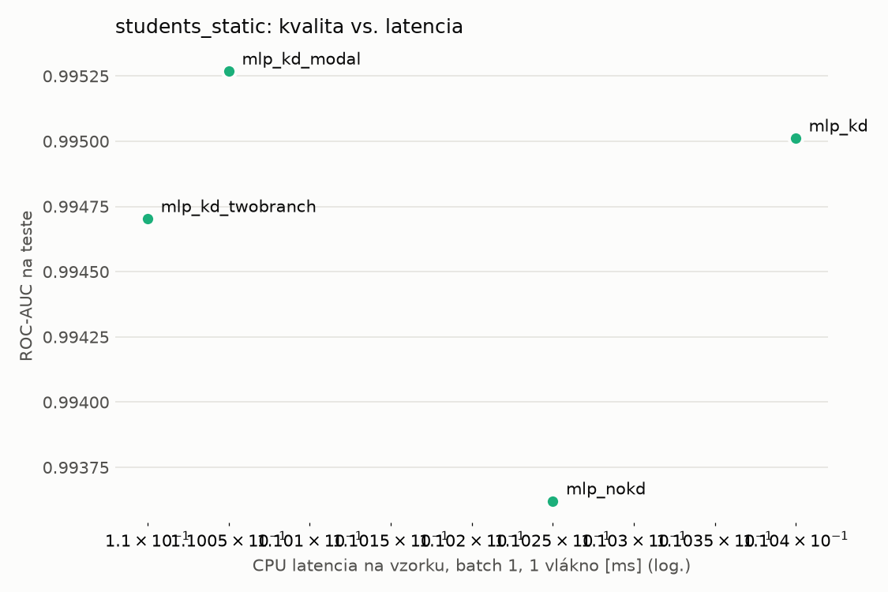
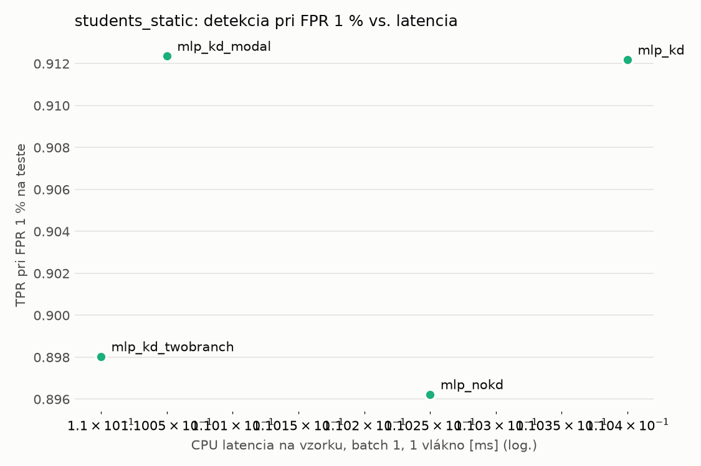
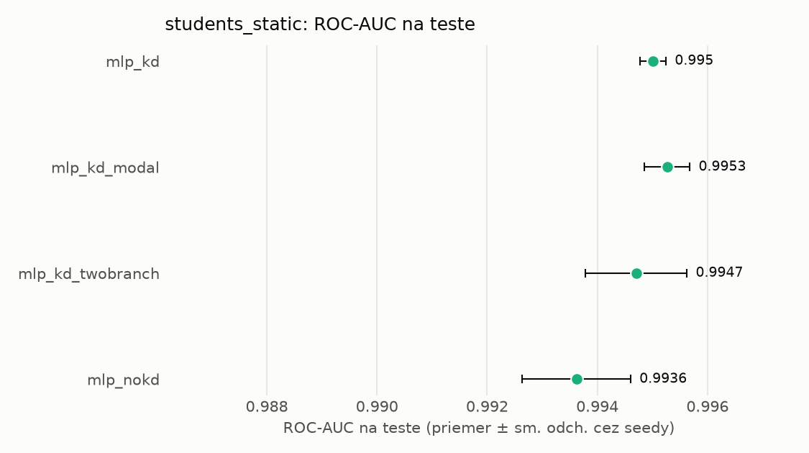
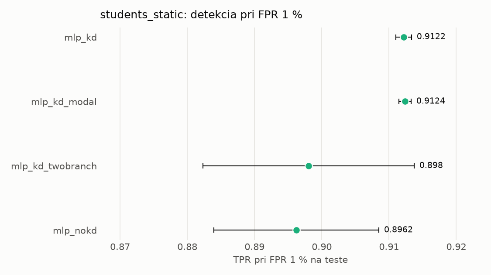

# Porovnanie modelov – students_static

> Generované `src/evaluation/compare.py` (2026-11-04T01:22:46+01:00); použitý je posledný beh každého modelu.
> Metriky sú priemer cez seedy. \* = pri prahu určenom na validácii (FPR ≤ 1 %).
> CPU ms/vz. = medián latencie jednej vzorky na 1 vlákne vrátane transformácie vstupu (meranie hneď po tréningu,
> orientačné). Oficiálne merania spotreby sú v časti „Spotreba zdrojov pri inferencii“.

## Detekčná kvalita a orientačné časy
| model | ROC-AUC val | ROC-AUC test | TPR@FPR 1 % test | TPR@FPR 0,1 % test | F1 test* | FPR test* | gap train−val | CPU ms/vz. | CPU vz./s | GPU ms/vz. | parametre | MB | tréning s | ladenie min |
|---|---|---|---|---|---|---|---|---|---|---|---|---|---|---|
| [mlp_kd](../../students_static/mlp_kd/20261104-012050/README.md) | 0.9993 | 0.9950 ± 0.0002 | 0.9122 | 0.6571 | 0.9452 | 0.0068 | 0.0005 | 0.110 | 109 260 | 0.279 | 74 337 | 0.36 | 9.4 | 0.0 |
| [mlp_kd_modal](../../students_static/mlp_kd_modal/20261104-012144/README.md) | 0.9991 | 0.9953 ± 0.0004 | 0.9124 | 0.6139 | 0.9435 | 0.0065 | 0.0008 | 0.110 | 109 391 | 0.272 | 74 337 | 0.36 | 9.6 | 0.0 |
| [mlp_kd_twobranch](../../students_static/mlp_kd_twobranch/20261104-012222/README.md) | 0.9991 | 0.9947 ± 0.0009 | 0.8980 | 0.6107 | 0.9359 | 0.0073 | 0.0008 | 0.110 | 109 711 | 0.270 | 74 337 | 0.36 | 5.1 | 0.0 |
| [mlp_nokd](../../students_static/mlp_nokd/20261104-012129/README.md) | 0.9989 | 0.9936 ± 0.0010 | 0.8962 | 0.5504 | 0.9389 | 0.0087 | 0.0008 | 0.110 | 60 917 | 0.263 | 74 337 | 0.36 | 2.1 | 0.0 |

## Nízka prevalencia malvéru (test, prah z validácie)
| model | TPR | FPR | precision @ 1 % | falošné na 1 skutočný poplach @ 1 % | precision @ 0.1 % | falošné na 1 skutočný poplach @ 0.1 % |
|---|---|---|---|---|---|---|
| mlp_kd | 0.9012 | 0.0068 | 0.571 | 0.75 | 0.116 | 7.59 |
| mlp_kd_modal | 0.8979 | 0.0065 | 0.582 | 0.72 | 0.121 | 7.24 |
| mlp_kd_twobranch | 0.8851 | 0.0073 | 0.550 | 0.82 | 0.108 | 8.24 |
| mlp_nokd | 0.8913 | 0.0087 | 0.509 | 0.97 | 0.093 | 9.74 |

Prepočet: TPR a FPR nezávisia od podielu malvéru, preto sa dajú preniesť na nízku prevalenciu (v reálnej prevádzke je malvéru ~1 % alebo menej; v teste 54 %). „Falošné na 1 skutočný poplach“ = koľko neškodných súborov je označených na každý zachytený malvér.

## Spotreba zdrojov pri inferencii (benchmark, testovacia množina)
_Benchmark zatiaľ nebol spustený (`python -m src.evaluation.benchmark --approach students_static`)._

## Grafy

